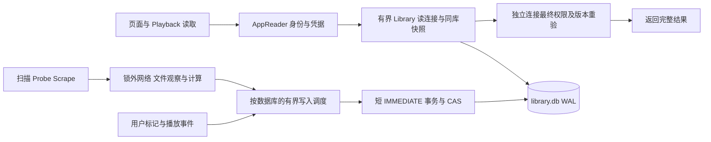

# 存储重构复审：共享锁、工作量与修复方案

日期：2026-10-28。代码基线 `feat/storage-redesign@7e3bd653081c49220325e88b37997960966f5daa`，比较 `main/origin/main@756444f76bef53f5fabed6d0ef53e9f280e005e9`。审查期间分支从 `f569c3c7` 更新到本基线；下文已重新核对新增修复，不将旧缺陷原样延续。用户要求只 review、提出方案并整理文档，本轮不实施 Rust、Web、DDL 或正式测试修改。

**结论：暂不建议合并。共享 Store 互斥锁把不必要的读写串行化，锁内的重复归约又放大等待；两者均需处理。** 五文件生命周期划分和 Media/Library/Playback 同库事务可以保留。当前没有指数增长或永久死锁的证据，已确认存在二次与三次方工作量。

## 修复状态（2026-10-29，`feat/storage-redesign`）

| 项 | 状态 | 提交 | 验证 / 前后对比 |
|---|---|---|---|
| L1 / T1 / T2（读） | 已修复（主路径） | `0aa8426d` `f7f2cd44` `1c0cfdef` `3876d72c` | 读写分离：请求读走只读 `StoreReaders`（`open_reader`），写走 `store_mutate`（5s）。详情/文件/`probe-status` 不再取写锁（`1c0cfdef`，持写锁+BEGIN IMMEDIATE 时 <500ms）。Scrape 按 64 文件批量写入，目录级 ledger 读取移出写锁（`3876d72c`）。**残留**：prepare/validate 等仍可能碰写者。 |
| 删库孤儿 Media | 已修复 | `e9dfa7ef` `95410373` `b4deb257` | 库删除每批调用与单文件删除相同的 `purge_orphan_media_in_tx`，无其他库引用的 Media 连同 aliases / metadata_sources / episodes / probe_jobs 一并清除；`ec9fdc1e`（保留 Media 身份/播放记录）已被 `95410373` 回退，ADR-0012 与回归断言见 `b4deb257`。 |
| 删库取消 | 已修复 | `ffa96c36` | 删除 Library 时取消该库全部工作并立即删除，不再等待工作停下（替代 `b2505a8f` 的等待/自动重试）。 |
| 读池容量 / T4 续 | 已修复 | `29fbceae` | 读池 checkout 改为异步可取消，`STORE_READERS` 4→8，避免批量 Scrape 期间读接口 503。 |
| 库搜索 | 已修复 | `70bee254` | `/search/library-items`：SQL 搜 `search_text`+`library_protocol_people.name_key`，默认 limit 50（最大 100），`next_cursor` 键集续页；返回卡片而非每个文件。前缀不再 6.6MB；演员名可命中。 |
| L1 / T1 / T2（架构余量） | **未完全** | — | 按库写连接调度、prepare/validate 全改专用读连接仍属后续。 |
| L2 | 已修复 | `8b9999c6` | Probe 发布改为增量归约（仅受影响文件）；首选源子查询限定本 Media。N 次 Probe（debug，无 ANALYZE）：N=100 575.7→60.0 ms，N=400 30,782→196.7 ms，增长 53.5×→3.3×。`store` 全部测试通过。 |
| L3 | 已修复 | `8da4cd06` | 已播放断言按主键定位（集/季/整片 UNION ALL）。Series IsPlayed 计数+分页 VM steps：E=250 2,015,920→34,919，E=1000 32,062,420→138,419，增长 15.9×→3.96×。 |
| L4 | 已修复 | `d660ea8f` | Movie 不读覆盖；TV 用 `file_coverage_in_library(lib, Some(media), AllRecorded)`。单元测试 `scrape_coverage_tests`。 |
| L5 / T5(Web) | 部分修复 | `c20a1947` | 单在途轮询（上一轮结束再调度）、卸载/切换中止请求、过期结果丢弃（`single-flight-poll` 测试）。**未做**：首屏分页 + 按 Season 懒加载 + 轻量 Probe 状态读取（需新后端合同）。 |
| L6 / T6 | 已修复 | `40831811` | 只接受 `tmdb:movie|tv:<id>`、`douban:<id>`，其余 400 `title_ref.invalid`，删除裸名称搜索回退；reidentify 在租约前解析。 |
| L7 | **未修复** | — | 卡片就绪状态/`has_poster` 合同需同时改扫描流程、DTO 与 Web，本轮未做。 |
| T3 | 已覆盖 | L2/L3 | 工作量回归测试见 `crates/store/tests/storage_lock_work.rs`。 |
| T4 | 已修复 | `3f9b4b80` | `LibraryReadGate`：异步有界等候（每连接 4 个等候位）、共用绝对 deadline、取消即出队、worker 结束才归还 permit。测试：池满时第二个读等待后 200；队列满才 503 并恢复。 |
| Web 同源 /api | 已修复 | `f29f5a10` | Web 改为同源 `/api`（Vite dev 代理），移除 `VITE_API_BASE_URL`；CORS max-age，启动超时自动重试。 |
| 图片缓存等待 | 已修复 | `ccfeff52` `b17f955a` | 快速缓存填充有界等待、上游 URI 编码规范化；任务 SSE 共享单流、图片响应缓存与懒加载，缓解浏览器连接耗尽。 |
| Probe 远程读 | 现行约束 | `eb9ede38` | STRM 远程读串行：`REMOTE_READ_LIMIT = 1`、冷却 500ms、`probe.concurrency` 默认 1（回退 `98cd82e6` 的并发 4）。 |

### 本轮只记不改（2026-10-29）

- **前端超时（任务流 + 封面代理）**：e2e 复现页面 11–20s / 请求超时卡片，根因是前端 HTTP/1.1 连接被长请求占满。已由 `b17f955a`（共享 SSE、图片缓存/懒加载）、`ccfeff52`、`f29f5a10`（同源 /api）处理，待 e2e 复核。
- **读池 busy**：已由 `29fbceae`（8 个 reader、异步可取消等候）缓解；若 e2e 再现 503 需另测。

## 现场证据与版本边界

已读取用户引用的[测试会话](thread://01a182c8-d27f-78c3-81c0-2561363b7476?hostId=local)，包括更新后的结论：

- `f569c3c7` 的实际扫描中，TV Media 详情约 1.4–2.6 秒，一次达到 7.2 秒；部分 Library 请求接近 12 秒。列表 5 并发、20 次中 8 次 503，采样 CPU 集中于 SQLite 单元重建。491 个 STRM 分散于多个 Media，不能等同于一个 Media 有 491 个文件。
- 测试会话核对 `7e3bd653` 后未启动新一轮完整扫描：详情已 offload，但共享锁、重建算法及先登记文件后抓图的顺序未根治。旧现场耗时不能冒充新版复测结果。
- 本轮仅使用离线 fake、临时 SQLite 和公开 Store/Router seam。最新 Probe 与协议筛选的 bundled SQLite 3.50.2 复现见[持久测量记录](../benchmarks/2026-10-28-storage-lock-work.md)。没有访问用户实例、真实 Metadata source、Downloader、Browser、NAS 或 STRM。

## L1 · P1：共享锁仍把读取排在扫描后面

[ApiState](../../crates/api/src/management/state.rs#L24) 为四个 Store 数据库共享一个 `Arc<Mutex<Store>>`。[详情](../../crates/api/src/http/library.rs#L306)、[图片](../../crates/api/src/http/library_artwork/images.rs#L107)、[Library 统计](../../crates/api/src/library_statistics.rs#L40) 经 `store_read` 等待同一把锁。offload 改变了等待线程，读取仍需等待扫描/Probe 的独占临界区；[store_wait](../../crates/api/src/http/store_wait.rs) 的五秒等待预算不是读写隔离。

已使用 reader 的 items/facets/gallery/item-index/协议查询也未完全隔离：[visibility、prepare 和 validate](../../crates/api/src/library_read_work.rs#L240) 都回到共享 Store。reader 有空闲且 WAL 允许读取已提交快照时，请求仍可能卡在应用锁之前或返回前。认证已有独立 [AppReader](../../crates/store/src/app_reader.rs)，但 prepare/validate 再次使用 Store 读取身份与 Library roster。

此外，[生产 reader 数量为 2](../../crates/api/src/management/state.rs#L284)，[池满立即 Busy](../../crates/store/src/library_read/pool.rs#L103)，[HTTP lease 阶段](../../crates/api/src/library_read_work.rs#L177) 没有等待空闲连接的队列。保护容量是合理的；普通页面并发请求也直接失败，不能作为用户可用性的验收结果。仅增加池容量会保留全局锁瓶颈。

当前 Router 离线实测：独立线程持 Store 锁 600ms，detail/libraries/episodes/items 仍需约 610–620ms，而 50ms 定时器约 52ms 唤醒，确认执行器已解除阻塞、请求仍排队。单独在 prepare 或 validate 前制造争用，各产生约 605ms 锁等待；后者的实际选页 SQL 仅约 0.21ms。两个 lease 均占用时，facets 约 0.99ms 即返回 503，归还后 200。该夹具隔离的是应用锁，不是一个真实扫描事务，完整源码与结果见[测量记录](../benchmarks/2026-10-28-storage-lock-work.md)。

**来源：** main 已有全局 Store 锁；本次重构新增了独立读池，但准备/校验和许多实际消费者保留该串行点。不是所有现存锁问题都由本次新引入。

**方案：** 见下文 T1/T2。读路径完整使用专用连接，写路径按数据库拥有连接、短事务和有界调度。保持事务、权限和生命周期屏障，不能仅把 Mutex 换成 RwLock：当前 rusqlite 连接不能被多个读线程并发使用，也不能让读 guard 与写事务共享同一连接。

## L2 · P1：单文件 Probe 完整归约，累计出现三次方增长

[publish_probe_result](../../crates/store/src/library_write/probe.rs#L92) 每次更新一个文件都调用完整 `reduce_library_media`。[rebuild_units](../../crates/store/src/library_write/reduce/card.rs#L243) 对每个单元再相关查询本 Media 文件以选择首选源。缺少统计时，查询计划可先扫描该 Media 的全部文件，再查覆盖，单次约 O(U×F)；每个文件都 Probe 时约 O(F²×U)，一文件一集时为 O(N³)。[实际发布](../../crates/api/src/probe_manager/tracks.rs#L129) 全程持有 Store 锁。

最新 release、公开 Store 方法、同一个 TV Media、一文件一集、无网络/NFO/Playback 的结果：

| 文件/单元 N | 单次 Probe，无统计 | N 次 Probe，无统计 | N 次 Probe，ANALYZE 后 |
|---:|---:|---:|---:|
| 100 | 3.639 ms | 201.309 ms | 61.681 ms |
| 200 | 7.267 ms | 1,431.473 ms | 176.822 ms |
| 400 | 28.426 ms | 11,484.707 ms | 576.588 ms |

初次空库的 optimize 不保证新数据已有统计。ANALYZE 改善计划，但每文件全量归约仍重复处理同一批覆盖，不构成根治。上述累计值是 N 次发布之和，不是一把锁连续持有 11.5 秒，也不能直接套用到现场全部文件。

**方案：** 在全量 SQL 中显式收窄 `u2.library_id/media_id`，使现有覆盖索引可按单元定位文件，或采用真正集合式选源；再让 Probe 使用文件前后事实更新受影响摘要，覆盖不变时不重建整份 `library_units`。优先复用并核验现有 `reduce_incremental`，保持 query projection capture/settle、用户摘要、HDR 已观察空值和版本 CAS。仅冷详情变化不应触发整卡片归约。全量 reducer 留给完整修复和必要重建。

## L3 · P1：协议 IsPlayed 筛选仍是二次增长

上轮 H3 修复的是 [series_scalar](../../crates/store/src/library_query/series_scalar.rs) 展示统计；[protocol/predicates.rs](../../crates/store/src/library_query/protocol/predicates.rs#L249) 的有效 played 谓词仍对每个单元扫描同 User/Media 的断言，再用 OR 匹配 whole/season/episode 并排序。Series 的 `IsPlayed=true` 需检查全部已拥有分集，count 和 page 各自执行该谓词；固定只返回一个 Series 也会变慢。

最新 release 公开 `protocol_item_page_with_stats`，全新未 ANALYZE 数据库，一个文件覆盖 E 集、每集都有 played 断言：

| E | 完整查询 VM steps | sort operations | 本机耗时 |
|---:|---:|---:|---:|
| 250 | 2,015,920 | 502 | 7.53 ms |
| 500 | 8,031,420 | 1,002 | 28.29 ms |
| 1,000 | 32,062,420 | 2,002 | 101.65 ms |
| 2,000 | 128,124,420 | 4,002 | 415.45 ms |

E 翻倍、VM 约四倍。读池只能隔离连接，不能降低该 CPU 工作量；长查询也会更久占用两个 reader 的其中一个。

**方案：** 共享有效断言的 SQL 规则生成，whole/season/episode 分别按完整主键 seek，最多合并三条候选再决议。保证最新时间、同时间集/季/whole 优先级、显式 false、跨库覆盖和空覆盖语义不变。不能直接用全 Media played 摘要代替 Folder/Library 子集结果。补 Series 和 Episode 的 IsPlayed/Filters、已看/未看及统计前后的完整 count+page 工作量门。

## L4 · P2：冷扫描逐 Media 反复水合整个 Library

无有效本地 NFO、开启 Scrape 时，[metadata_reread](../../crates/api/src/http/library_scan/runner/metadata.rs#L78) 在每个 Media 的循环中持 Store 锁调用 `coverages_in_library`。该 helper 明确传 [media=None](../../crates/api/src/http/library/assets.rs#L26)，读整个 Library 的文件和覆盖；[下游](../../crates/api/src/http/library_scan.rs#L344) 只消费当前 TV Media 的覆盖，Movie 不使用这份全集。

M 个 Media、F 个文件的此阶段至少水合 O(M×F) 行；M 与 F 同阶时是二次增长。此项为源码范围推导，未把它写成完整冷扫描耗时测量。

**方案：** Movie 跳过该全集读取；TV 使用现有 `file_coverage_in_library(library, Some(resolved.id), scope)`，随后按必要范围处理。保留身份收敛后的重新读取和发布校验。验收固定一个待 Scrape Media，扩大其他 Media/文件时，不增加该 Media 的解码行和持锁 SQL 工作量。

## L5 · P2：Web 每轮收齐全部文件，慢轮询会叠加

[getLibraryItemDetail](../../web/lib/api/libraries.ts#L1331) await 全部文件页后才返回详情，[组件](../../web/components/library-item-detail-view.tsx#L326) 在 Probe 未终态时每五秒重跑全部详情及 Library 列表。没有上一轮完成约束和请求取消。真实 adapter 的离线请求计数：50/1,000/10,000 文件分别为 1/20/200 个串行 HTTP 请求后才 resolve；这不是生产延迟测量。

**方案：** 首详情立即返回首屏与续页游标；按展开的 Season/文件范围加载，不能先全量加载再客户端过滤。Probe 使用轻量状态读取，完成后局部更新；下一轮在上一轮结束后调度，切页/卸载取消并忽略过期结果。后台任务状态与文件列表分页分别建合同。当前后端页内覆盖读取已修，不能继续报告原全 Media coverage 读取缺陷。

## L6 · P2：无兼容要求仍有旧引用输入

[parse_title_ref](../../crates/api/src/http/title_ref.rs#L45) 接受旧 `tmdb:<id>` 并默认 movie，同时接受三段 Douban；无效引用退化成裸名称搜索。当前 Web 生成 `tmdb:movie|tv:<id>`、`douban:<id>`，[详情测试](../../web/test/discover-reference.test.mjs) 已明确拒绝旧三段 Douban。该后端分支继承 main，最新修改只是移动执行线程。

**方案：** 统一严格引用解析，拒绝旧形状/空 ID/无效 kind/未知来源，不猜 movie、不把坏引用转成网络搜索。确有裸名称搜索的消费者以显式输入表达，并同批切换 preview/create/reidentify/CLI；旧输入 400、零持久写，fake Catalog 证明不发请求。删除肯定旧输入的回归，不新增别名或转发层。Metadata source 合法缺字段回退与 Jellyfin 协议映射继续按各自业务合同判断。

## L7 · P2：文件发布与正常卡片展示缺少就绪边界

[walk](../../crates/api/src/http/library_scan/runner/walk.rs) 先发布扫描事实，再识别和获取图片；[卡片](../../crates/api/src/http/library.rs) 仍用 `poster_ref.or(preferred_file_id)` 构造未确认存在的图片地址。缺图 GET 可能即时下载。现场无图、图片超时及 invalid URI 属于已观察问题，但本轮没有重新定位每个 URL 的失败原因。

**方案：** 保留文件事实立即登记，以支持恢复/删除/后台处理；为卡片展示定义独立的 metadata/artwork 就绪状态，处理中的条目进入可见的管理入口。基本信息与海报成功后进入正常展示，失败/无图源给出可重试的明确状态，不能永久隐藏文件或让海报失败阻止正常 Playback。Web 消费真实 `has_poster`/就绪字段，避免靠一个必然可能 404 的地址代表就绪。状态是当前业务合同，不做旧 DTO 兼容；图片读取仍留 public。

## 技术方案与必要互斥的边界

串行的合理目的有两个：连接不能被多个线程同时使用；相关事实和摘要必须一起提交。当前一把锁覆盖四个连接和所有业务的范围超过了这两个目的。SQLite WAL 支持独立连接读取已提交快照，同一数据库文件仍只有一个写事务能执行。SQLite WAL 的写锁不是行锁；按 Media/文件收窄业务范围，是减少事务工作量与占用时间，不会让同一数据库文件的两个写事务同时执行。换成更多写连接、每文件一把锁或 RwLock 都不会自动改变这一事实。

目标结构（提案，尚未实现）：

### T1：完整读路径解除对全局 Store 的依赖

- 将借用 `Connection` 的查询核心复用于 Library roster、详情/文件页、图片路径、统计、分集、Playback 和协议实际消费者。业务 SQL 只有一份，不增加长期物化缓存或旧数据回读。
- 身份用 AppReader；Library ACL/config/lifecycle/roster 在 reader 的一致快照读取。结束数据读取事务、释放旧快照后，返回前通过新开的独立短读重新核验原 token/角色及最新 Library 指纹和选中文件版本，不能用原 WAL 快照验证“最新”。scope 改变最多重试一次，原绝对 deadline 不重置。匿名 public artwork 保持匿名合同，不强制加入 token 校验。
- 跨 app/library 没有原子事务；保留明确的授权发布检查点和竞态测试，不能删掉最终校验来提速，也不能把两次独立读称为跨库原子授权点。若要求更强的跨文件线性化，另设计权限发布短门闩/epoch，同时覆盖 token 撤销、角色/enable、ACL/config/lifecycle、删除/换源相关提交和响应发布。固定锁序，不能持门闩等 writer/网络；普通扫描/Probe 不纳入该门闩，也不能把租约跨 await 持有。
- 读连接只读，关闭、文件身份变化、layout 改变和取消时按现有安全规则排空。单个 reader 仍独占自己的连接；正常读不经过 writer 队列。

### T2：写连接按数据库文件拥有，事务范围以不变量决定

- 使用按 SQLite 数据库文件的有界写入调度，连接由该执行器拥有；所有 Library 共用的 `library.db` 仍只有一个 writer，不是每个 Library 各开 writer。`Store` 可以保留为门面，移除生产读请求对 `Arc<Mutex<Store>>` 的依赖；不用它重新串行独立的 app/library/subscribe/cache 工作。
- 同一次文件事实、coverage、unit/card/terms/count 变更留在 library 的同一事务，Playback 原始事实和当前用户摘要同样原子提交。不能为了缩锁把它们拆成可观察的半成功。
- 网络、stat、音频计算、图片/NFO 生成和大对象准备在事务外，实际执行时和提交内重验文件版本、源、归属、User/Media 冻结、Library 生命周期和实例写门禁，不沿用排队前的写准入结论。跨库持久操作按现有阶段推进，任何库的事务不等待另一库锁或网络。
- 后台批次限制输入数量也限制实际工作量，批间释放写入执行权；用户 Playback/mark 与后台批次公平调度，防止任一方向饥饿。一次 operation 的身份/冻结合同不因分批削弱。
- 用户断开不会把已提交写入伪装为未执行。尚未执行的排队动作可取消，已经执行的事务返回已知结果或明确未知状态；permit/连接跟随真实 worker 结束释放。

### T3–T6：算法、负载、合同与验收顺序

| 任务 | 内容 | 依赖与验收 |
|---|---|---|
| T3 | L2/L3/L4 的归约、played 谓词与范围收窄 | 可先独立修；无统计/有统计均测。完整重建近线性或 N log N；固定一个不变覆盖文件的 Probe 不遍历全部其他集；逐文件总成本不得再出现每翻倍约八倍。 |
| T4 | reader 有界异步等候、取消、读写各自容量与阶段指标 | 配合 T1/T2；连接数不靠溢出突破，队列有长度上限，等候在 blocking worker、通用 http_work permit 和 Store 锁之外。共用绝对 deadline，取消移除排队项，真实 worker 结束才归还 lease/permit。5 个正常并发读可等空闲连接，确实饱和/到期才 503。 |
| T5 | L5 首屏分页/单在途轮询，L7 展示就绪 | 首屏 HTTP 数量不随总文件增长；定时器慢一轮不生成重叠请求；失败条目可管理和恢复。 |
| T6 | L6 严格引用与全链路验收 | 全部生产者/消费者同批切换，旧输入拒绝；新类型与错误不加兼容。 |

先加入能失败的公开行为和工作量回归，再实现 T1–T6。算法与连接隔离各自验收，最终运行相同 fixture 的混合扫描/Probe/Playback/页面负载，才能重新判断合并；不能只凭 timer 恢复、查询数少或单项绿灯关闭 L1。

## 数据库与接口规模判断

当前唯一 DDL 为 76 表/750 字段；library 为 53 表/596 字段/83 个命名索引。表数不构成必须拆库或换数据库的证据。五文件按生命周期划分、文件显式归属、冷详情、原始用户事实和派生摘要的区分有用途。优先修连接和算法，不牺牲权威库 FULL 耐久性，不机械删索引/合表。

| 接口/阶段 | 当前工作量与结论 |
|---|---|
| 单库普通页、kind 收窄、无筛选/单分类 count | 当前索引、成员和边际计数有价值；固定电影数据扩大无关 TV 的旧测量不能作为本版所有请求的证明。 |
| 多条件精确 facets、跨库去重、多键排序、协议深 StartIndex | 可随命中/跳过数量线性或 N log N 增长；需要完整 VM/耗时曲线。Jellyfin offset 是协议要求，不按旧自有 API 兼容删除。 |
| IsPlayed 的稠密单 Media | L3 已证实二次增长，必须修。 |
| Library roster 统计 | `library_stats.rs` 每次 COUNT/SUM items/files，随本库规模线性增长；迁移独立 reader 后再测是否值得事务维护精确计数，避免叠加缓存。 |
| item-index | 需要遍历排序集合生成各桶游标，不是固定一页的常量成本。其长读不应阻挡 writer。 |
| 单文件 Probe 与冷扫描 | L2/L4 已确认重复处理范围；输入窗口≤100 不等于 CPU、SQL 或持锁时间有界。 |
| Web 详情 | 已读文件总量线性，且有串行 HTTP 与轮询重叠放大，见 L5。 |

完整验收矩阵固定请求页及字段，分别扩大 Media 数、同 Media 集数/版本、其他 User 的状态、终态 operation 历史和无关 Library；保留精确结果 oracle。记录 SQL VM/sort/解码字节、锁/队列等待、事务时间、HTTP p50/p95/max、503 比例、CPU/RSS/WAL及后台吞吐。初建空库、统计前后、冷热 OS 缓存分开报告。100k Media/1M 文件/1M Playback、NAS/设备仍需单独容量验收。

关键结构回归：外部线程持写连接事务 600ms 时，详情/列表/现有图片可在提交前返回一致的已提交快照；App 配置读取也能完成。并发撤销 token/ACL、冻结/删除/换源时，结果必须经过原有权限与引用重验。测试持锁方由独立线程释放，避免用被阻塞的 runtime timer 解锁。健康检查可用和 timer 正常只是执行器证据，不能代替上述读写并发证据。

## 已关闭的旧发现与本轮验证

`7e3bd653` 已 offload 详情等 Store 调用，重复文件观察已离锁且不再逐文件重读覆盖，文件页 coverage 已按页 seek，Series scalar 已按三坐标 seek，图片发现已移锁外，旧 Filter kind/旧根合并路由已删除，删除/模型身份屏障与唯一 DDL 校验已有修复。保留[上轮修复记录](2026-10-28-storage-remediation-verification.md)的固定范围结果，不重复列为待办。L3 是筛选谓词的另一条 SQL，不能用 scalar 通过证明它通过。

本轮 `7e3bd653` 的 `cargo test --workspace --no-fail-fast` 退出 0，输出汇总 **3314 passed / 0 failed / 24 ignored**（494 个 suite 结果，含子进程与 doc-tests）。Web 定向 `node --test test/library-operations.test.mjs test/library-file-pagination.test.mjs test/discover-reference.test.mjs` **45 passed / 0 failed**。完整日志分别在 `/tmp/crawler-media-review-7e3bd653-workspace.log`、`/tmp/storage-review-web-targeted-7e3bd653.log`；关键新探针的源码/结果已随文档持久保存，不依赖临时目录取回。

现有自动化绿灯不覆盖本轮新增的 L1–L7 缺口。历史 `f569c3c7` 构建在分支外部更新期间出现两条依赖源码位置的审计失败，不能计为 `7e3bd653` 的失败或通过。当前无 Rust/TS/DDL 修改，未重复 Web 全量构建，不运行真实服务或新一轮全量 STRM 测试。提交前检查所有变更均为 Markdown、本地链接存在且 `git diff --check` 通过。

## 文档整理

- 本页集中当前发现、技术方案、关闭项和未测边界；旧审查及修复记录标明固定版本，不再指向已经完成的 H1–H6 为待办。
- 删除 `superpowers/plans/2026-10-28-storage-head-remediation.md`：其 H1–H6 对账与最终门禁已全部保留在上轮修复记录；原文可用 `git show 7e3bd653:docs/superpowers/plans/2026-10-28-storage-head-remediation.md` 读取。本次方案 T1–T6 尚未实施。
- 更新 docs 入口、ADR-0008、数据库/自有 API/主 Spec 的当前导航，纠正旧 library version 8、已修 cursor scope 仍称缺失，以及“执行器修复等于读写隔离”的表述。历史独有测量、失败、恢复和设计证据保留，不按日期删除。
