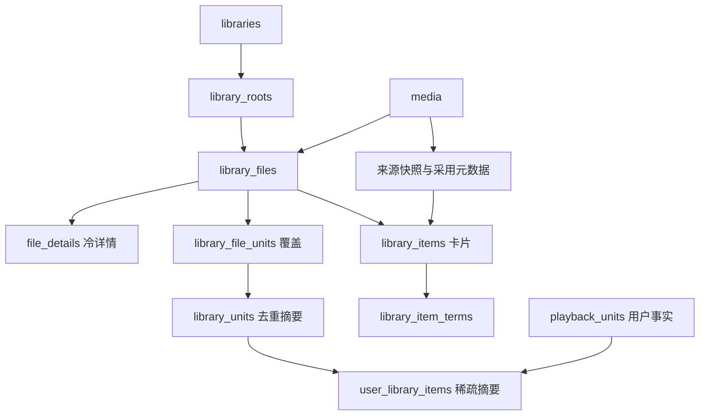

# 当前数据库设计与全量数据字典

本页结构基线按生产DDL；2026-10-22行为复审基线 `1845dab`。**五文件及主要新入口存在，仍有生产接线与不变量缺陷。** 详情见[复审](../audits/2026-10-22-storage-repair-review.md)，不能将旧 `bd6c3c8` 缺口清单当当前事实，也不能以表存在/历史绿测证明交付。

## 1. 权威来源

- Store打开/预检：[open.rs](../../crates/store/src/open.rs)、[layout.rs](../../crates/store/src/schema/layout.rs)；生产DDL：[app.sql](../../crates/store/src/schema/v1/app.sql)、[library.sql](../../crates/store/src/schema/v1/library.sql)、[subscribe.sql](../../crates/store/src/schema/v1/subscribe.sql)。
- cache唯一DDL及校验：[media::response_cache](../../crates/media/src/response_cache/mod.rs)，Store直接复用；已删除的cache.sql不是现行入口。
- Jobs：[store.rs](../../crates/jobs/src/store.rs)、[change_state.rs](../../crates/jobs/src/change_state.rs)、[retention_cursor.rs](../../crates/jobs/src/retention_cursor.rs)。
- 目标：[存储设计](../superpowers/specs/2026-10-18-library-storage-redesign.md)、[开发合同](../superpowers/plans/2026-10-18-library-storage-contracts.md)；唯一当前执行入口：[干净切换与优化](../superpowers/plans/2026-10-22-storage-repair-remediation.md)。
- 固定版本检查/失败证据：[benchmark记录](../benchmarks/2026-10-18-library-storage.md)。历史初始化/测试与本轮源码核对不混写，不访问用户实例。

## 2. 五文件生命周期

| 文件 | 布局身份/版本 | 表数 | 字段数 | 职责 | 可按缓存清空 |
|---|---|---:|---:|---|---|
| [app.db](app.md) | 1129139248 / 1 | 10 | 50 | User/凭证、Site、Downloader、Filter、Naming、设置、搜索快照、实例锁 | 否 |
| [library.db](library.md) | 1129139249 / 1 | 45 | 519 | Media/采用元数据、Library/根、文件/覆盖/摘要、Collection、Playback、持久文件工作 | 否 |
| [subscribe.db](subscribe.md) | 1129139250 / 1 | 4 | 47 | Subscribe策略、覆盖/搜索事实、在途记录 | 否 |
| [cache.db](cache.md) | 1129139251 / 1 | 6 | 30 | 六来源原始响应，不保存本地采用/观看事实 | 是，受控清理 |
| [jobs.db](jobs.md) | 1129139252 / 1（Store启动预检） | 4 | 29 | Job定义/执行/重试、更新计数、保留游标 | 否 |

合计69张业务表、675字段，不计SQLite内部表。当前Store四文件共68个显式命名索引（library51、app2、subscribe3、cache12），32组FK、0触发器；Jobs另9命名索引/6触发器。每文件独立提交，没有跨文件FK或原子提交。library原53减去两个重复索引，历史测量保留原版本数字。

`Store::open_at`只允许app另选路径，其他Store文件仍在data_dir；Jobs由Queue打开。正常启动不自动清库、不导入旧layout；错误/未知布局拒绝。所有连接显式WAL、5000ms busy_timeout、foreign_keys=ON。cache额外检查必需表/索引名称，不能推广为所有分区逐列校验。

## 3. library.db事实与摘要

箭头是业务依赖，不等于全是FK或每次请求都JOIN。`library_files`一个物理文件一行；file_units是一文件多集/同集多版本；units按逻辑单元去重；items每实际有已发布文件的Library/Media一行。size按文件一次计，whole=(-1,-1)，TV S00E00是真实分集。file_details仅冷探测数据，不是第二完整文件投影。

Media与原始Playback事实独立于文件存在；最后文件/Library删除不能级联删身份、进度或Collection成员。用户摘要随卡片删除，重导入从原始事实恢复；完整/增量已维护用户摘要，但已有卡片同批新增同unit两个版本会重复计数（R03），不能笼统写成“增量从未维护”。

## 4. `1845dab`生产边界

| 能力 | 已有实现 | 复审仍发现的缺口 |
|---|---|---|
| 启动/cache | 五文件、拒旧、共享cache DDL | 不等于全消费者离线可用或未来升级器完成 |
| 文件发布 | 复合ownership FK、覆盖、公共及用户摘要；源CAS方法 | 实际重扫未接源CAS；config0通配；批内新unit重复计数；pending recorder错记UUID（R01–R05） |
| Web详情 | 后端文件cursor/EOF与显式选源 | 实际adapter仍读错续页cursor并丢状态/units，101只得100、missing可选（R14） |
| 元数据/NFO | normalized parser、来源快照、override和export记录 | 真实Catalog默认None、详情不消费override；Missing与来源漂移；正常导出CAS/编辑baseline不闭合（R15–R18） |
| Playback | 显式事件统一commit、Web session stream与版本守卫 | Jellyfin流忽略session/device，no-ID跨集、Start旧包、fresh完成、计时单位/交接、played决议与movie00尚有缺陷（R06–R13） |
| 协议查询 | 普通Items等生产SQL选页和页内合成 | PersonIds仍绕Catalog；Unicode/genre ID/多键/scope/locale/availability与played不一致（R12/R23/R24） |
| 根/完整性/身份 | 已有202/status及恢复驱动，不再404 | roots+locale组合漏应用；checker漏units/terms且假有界；merge决议/失败恢复及User删除恢复仍缺陷（R19–R22/R25） |

Web session创建已拒movie坐标，但marks/progress/resume等仍有 `(0,0)`→whole alias（R13）；前端显式文件选择已传播，不声称仍普遍生产movie00。正常Jellyfin认证、TV00不是旧数据兼容。

## 5. 查询、事务与运维限制

- 公共卡片/terms与稀疏用户摘要降低读成本，代价是局部写放大。普通seek有索引；精确count/facets、复杂观看排序、包含搜索与深offset不承诺常量成本。
- 目标是同事务维护全部受影响事实/摘要、IO和大JSON解析在锁外；当前仍有绕写/锁内IO。不能读时stat/NFO/网络或整库重建掩盖漏维护。
- 用户身份/凭证在app，Subscribe在subscribe，Job在jobs。共享进程锁/多连接不是跨文件事务，User删除/身份合并需持久阶段恢复。
- 字段NOT NULL/默认/索引以DDL声明为准，不能从_id后缀推FK。JSON CHECK只验证语法；秒/ms/ns/RFC3339不能混比。
- `request_visible_media`是连接TEMP表，WAL/SHM是活动伴随文件，不是额外业务分区。
- 当前无ledger/file_meta/browse journal持久表，不建兼容表/视图，不双读双写。旧SQL/旧实例文件不会因文档修改自动迁移。
- cache清空只允许连接内受控删除，或停写关闭全部连接后重建；备份不能直接复制活跃文件冒充五文件一致快照。
- 实例切换需单独核实真实app_path/data_dir及停写授权，只处理明确SQLite/WAL/SHM；媒体、字幕、NFO、图片、下载目录、Indexer YAML、编译缓存保留。本轮文档任务不操作实例。
