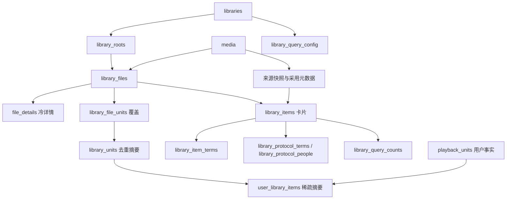

# 当前数据库设计与数据字典

> 本轮修复与验证进度见[修复记录](../audits/2026-10-28-storage-remediation-verification.md)。原[7030c1dd 审查](../audits/2026-10-28-storage-head-review.md)保留当时反例，不作为当前未修清单。

结构核对：2026-10-28，当前分支的唯一生产 DDL。各文件只声明当前定义，初始化空库并重开相同定义；没有历史布局、迁移阶梯或兼容分支。

## 权威来源

- Store打开/预检：[open.rs](../../crates/store/src/open.rs)、[layout.rs](../../crates/store/src/schema/layout.rs)；生产DDL：[app.sql](../../crates/store/src/schema/v1/app.sql)、[library.sql](../../crates/store/src/schema/v1/library.sql)、[subscribe.sql](../../crates/store/src/schema/v1/subscribe.sql)。
- cache唯一DDL及校验：[media::response_cache](../../crates/media/src/response_cache/mod.rs)，Store直接复用。
- Jobs 唯一 DDL：[schema.sql](../../crates/jobs/src/schema.sql)，布局校验/原子初始化：[schema.rs](../../crates/jobs/src/schema.rs)。
- 规范：[存储设计](../superpowers/specs/2026-10-18-library-storage-redesign.md)、[开发合同](../superpowers/plans/2026-10-18-library-storage-contracts.md)。字典描述源码结构，不替代行为验收。

## 五文件生命周期

| 文件 | application_id / user_version | 表数 | 字段数 | 职责 | 可按缓存清空 |
|---|---|---:|---:|---|---|
| [app.db](app.md) | 1129139248 / 1 | 9 | 48 | User/凭证、Site、Downloader、Filter、Naming、设置、搜索快照、实例锁 | 否 |
| [library.db](library.md) | 1129139249 / 1 | 53 | 596 | Media/采用元数据、Library/根、文件/覆盖/摘要、Collection、Playback、持久工作 | 否 |
| [subscribe.db](subscribe.md) | 1129139250 / 1 | 4 | 47 | Subscribe策略、覆盖/搜索事实、在途记录 | 否 |
| [cache.db](cache.md) | 1129139251 / 1 | 6 | 30 | 六来源原始响应 | 是，受控清理 |
| [jobs.db](jobs.md) | 1129139252 / 1（Jobs自有预检） | 4 | 29 | Job定义/执行/重试、更新计数、保留游标 | 否 |

合计76张业务表、750字段，不计SQLite内部表。Store四文件100个显式命名索引（library83、app2、subscribe3、cache12），37组FK、0触发器；Jobs另9命名索引/6触发器。app/library/subscribe/Jobs统计来自生产DDL；cache统计与其生产建表声明对账。没有跨文件FK或原子提交。

`Store::open_at`只允许app另选路径；Jobs由Queue打开。启动只检查和初始化当前定义；无自动清库或数据导入。连接显式WAL、5000ms busy_timeout、foreign_keys=ON；建库路径在切 WAL **之前**设 `auto_vacuum=INCREMENTAL`（文件头属性，只能在建表前改；WAL 库或事务内设置是静默 no-op）；Store四连接与独立Jobs Queue走同一套连接策略：`cache_size=-16384`（每连接16MiB）、`temp_store=MEMORY`、`journal_size_limit=67108864`、`mmap_size=268435456`（每连接地址空间上限，不是常驻内存），打开时`PRAGMA optimize=0x10002`、关闭时`PRAGMA optimize`；`synchronous`按库区分——cache.db用NORMAL（可重建，容忍掉电丢最近提交），app/library/subscribe与Jobs Queue保持FULL（权威库绝不牺牲已提交事务）；实例租约心跳的专用app连接同样是FULL，但busy_timeout拉长到10000ms；library读池连接使用相同的cache/mmap/temp_store且`query_only=ON`。Jobs已有OFF→实际policy→FULL的连接级回归。独立media ResponseCache连接未显式设置synchronous，保留其构建默认。Store 用唯一生产 DDL 生成表、索引、视图的定义清单，比较 sqlite_schema 中的定义（包括表内约束），并拒绝额外对象；运行时诊断/故障注入触发器不纳入这份结构清单。Jobs 由其唯一 DDL 验证对象定义及单例。

## library.db事实与摘要

箭头表示业务依赖，不全是FK。一个物理文件一行；file_units支持一文件多集/同集多版本；units按逻辑单元去重；items按实际Library/Media归属保存。whole=(-1,-1)，TV S00E00合法，未知覆盖为空。Media/原始Playback事实独立于文件；最后文件删除不删身份、进度或Collection成员。

写事务统一IMMEDIATE；文件发布在同一library事务维护覆盖、卡片、terms与摘要。100文件批次按 Media 在同事务批末合并用户摘要、协议 genre/person 成员和边际计数；查询语言投影按单库权威语言维护。rename意图保存版本、源/目标磁盘证据与阶段，跨subscribe引用按持久阶段恢复。

嵌套根迁移使用≤100文件事务和持久游标；NFO按批迁移，源/目标冻结暂停且公平轮转，API driver 在解冻后继续并批间放锁。root_reassignment_state 保留可查询状态、稳定 operation_id、配置版本与错误。Unidentified 登记 path_key/library/root/revision，独立索引 seek 窗口≤100候选，游标前错归属来源会重置相应游标，正确新事实保持向前进度。删除先冻结目标库，indexed snapshot/cleanup 每窗口≤100文件，无关库路径不会触发磁盘观察。

## 运维与性能边界

本轮将指纹模型的 Media/成员校验和发布放入同一 IMMEDIATE 事务；Series 断言使用三个精确坐标 seek；重复文件复用单次 coverage 捕获，多单元候选共享每份 coverage。接口同步 SQL 在 blocking worker 捕获 owned 事实，文件/网络观察释放 Store 后执行。公开定向回归与最终门禁分别记录，不能由局部通过推断所有设备/规模已验收。

待删除路径持久保存规范键和意图 generation；入队前在锁外观察磁盘身份，入队后阻止对应路径被发布/换源/改名。后台按持久身份重验和重试，完成磁盘动作后再清除对应文件事实。重命名附属文件的删除入队失败会保留可恢复阶段。

- 当前无 ledger/file_meta/browse journal 持久表、旧布局导入器或兼容视图。旧 `/directory` 聚合/roots 写、旧 Naming 表和反拆、自有无签发 session Playback、Downloader settings JSON 回读均删除；Web/CLI 使用当前合同。
- kind 先收窄授权 Library，查询使用同库精确成员、边际计数和页内选源；QueryWorkStats 纳入 exact count/辅助 SQL。新模型的实测与未运行范围见[2026-10-25 验收记录](../benchmarks/2026-10-25-large-hit-query-read-model.md)；[2026-10-24 历史测量](../benchmarks/2026-10-24-storage-query-rereview.md)保留原版本。
- Probe/Claim/Watch/fs watcher/根配置的 filesystem 观察使用 owned 快照移出 Store；最终发布校验原归属、配置和源版本。原 NFO 失败退出已修；R6–R8 补齐 mutation 门禁、Playback 同事务身份屏障，以及有界 operation/补图执行，见复审与正式回归。未确认新的 SQLite 永久锁环，不能由已有 offload 推断全部安全。
- cache清空只允许连接内受控删除，或停写关闭全部连接后重建；备份不能直接复制活跃文件冒充跨文件一致快照。`request_visible_media`是TEMP表，WAL/SHM不是额外业务分区。
- 本轮不访问真实实例，不部署、不重建数据库。媒体/字幕/NFO/图片/下载目录保留；NAS、真实Jellyfin客户端、100k Media/1M文件完整规模尚未在本轮运行。
