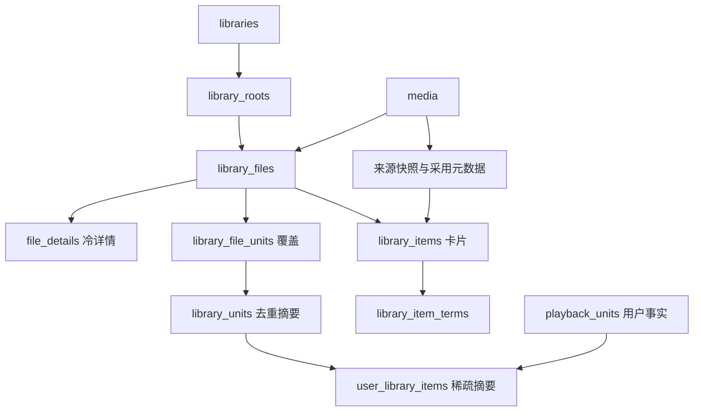

# 当前数据库设计与数据字典

结构核对：2026-10-24，review `cf7fb70`，本轮未修改 DDL。比较本地 `main@86122d7`，远端 `origin/main@14fdbb6`；区别见[当前复审](../audits/2026-10-24-storage-rereview.md)。修复与优化任务见[唯一方案](../superpowers/plans/2026-10-23-storage-review-remediation.md)。

## 权威来源

- Store打开/预检：[open.rs](../../crates/store/src/open.rs)、[layout.rs](../../crates/store/src/schema/layout.rs)；生产DDL：[app.sql](../../crates/store/src/schema/v1/app.sql)、[library.sql](../../crates/store/src/schema/v1/library.sql)、[subscribe.sql](../../crates/store/src/schema/v1/subscribe.sql)。
- cache唯一DDL及校验：[media::response_cache](../../crates/media/src/response_cache/mod.rs)，Store直接复用。
- Jobs：[store.rs](../../crates/jobs/src/store.rs)、[change_state.rs](../../crates/jobs/src/change_state.rs)、[retention_cursor.rs](../../crates/jobs/src/retention_cursor.rs)。
- 规范：[存储设计](../superpowers/specs/2026-10-18-library-storage-redesign.md)、[开发合同](../superpowers/plans/2026-10-18-library-storage-contracts.md)。字典描述源码结构，不替代行为验收。

## 五文件生命周期

| 文件 | application_id / user_version | 表数 | 字段数 | 职责 | 可按缓存清空 |
|---|---|---:|---:|---|---|
| [app.db](app.md) | 1129139248 / 1 | 10 | 50 | User/凭证、Site、Downloader、Filter、Naming、设置、搜索快照、实例锁 | 否 |
| [library.db](library.md) | 1129139249 / 1 | 47 | 553 | Media/采用元数据、Library/根、文件/覆盖/摘要、Collection、Playback、持久工作 | 否 |
| [subscribe.db](subscribe.md) | 1129139250 / 1 | 4 | 47 | Subscribe策略、覆盖/搜索事实、在途记录 | 否 |
| [cache.db](cache.md) | 1129139251 / 1 | 6 | 30 | 六来源原始响应 | 是，受控清理 |
| [jobs.db](jobs.md) | 1129139252 / 1（Store启动预检） | 4 | 29 | Job定义/执行/重试、更新计数、保留游标 | 否 |

合计71张业务表、709字段，不计SQLite内部表。Store四文件74个显式命名索引（library57、app2、subscribe3、cache12），32组FK、0触发器；Jobs另9命名索引/6触发器。app/library/subscribe统计来自Python SQLite 3.54.0执行当前生产DDL的内存核对；cache/Jobs统计与其生产建表声明对账。没有跨文件FK或原子提交。

`Store::open_at`只允许app另选路径；Jobs由Queue打开。正常启动不自动清库、不导入旧layout；错误/未知布局拒绝。连接显式WAL、5000ms busy_timeout、foreign_keys=ON；Store四连接（含cache）与独立Jobs Queue均显式synchronous=FULL；Jobs已有OFF→实际policy→FULL的连接级回归。独立media ResponseCache连接未显式设置synchronous，保留其构建默认。必需表/索引名称检查不等于逐列/约束完整校验。

## library.db事实与摘要

箭头表示业务依赖，不全是FK。一个物理文件一行；file_units支持一文件多集/同集多版本；units按逻辑单元去重；items按实际Library/Media归属保存。whole=(-1,-1)，TV S00E00合法，未知覆盖为空。Media/原始Playback事实独立于文件；最后文件删除不删身份、进度或Collection成员。

写事务统一IMMEDIATE；文件发布在同一library事务维护覆盖、卡片、terms与摘要。100文件批次的当前用户摘要已按Media批末合并；协议索引在写入时维护genre/person及search_text，精确语言谓词仍在候选上执行。rename意图保存版本、源/目标磁盘证据与阶段，跨subscribe引用按持久阶段恢复。

嵌套根迁移使用≤100文件事务/持久游标，NFO按批迁移，源/目标冻结均暂停；发布重验当前最深根，扫描保留观察前的Library/root/config。Unidentified有独立≤100行移动阶段并支持重开，但候选SQL工作量未证明严格有界。每个缺失kind的默认Library/root原子初始化；根操作外层同步 drain、冻结解除缺自动恢复驱动及剩余锁内路径 IO 见当前方案。

## 运维与性能边界

- 当前无 ledger/file_meta/browse journal 持久表，无旧布局导入器或兼容视图。Web Subscribe、成功信封及严格 marks 已切换；但旧 `/directory` 写、无会话 Playback 和 Downloader settings JSON 回退仍存活，不能宣称所有入口无旧版兼容。
- 精确 count、已筛选 facets、任意子串、深 offset、大命中 genre 及全局 kind 查询仍有工作量放大；协议 terms 在文件批次中还会重复重建。当前隔离数据见[本轮测量](../benchmarks/2026-10-24-storage-query-rereview.md)，历史 release 数字见[历史性能报告](../benchmarks/2026-10-23-storage-redesign-report.md)。
- SQL 路径归一化纯计算；Probe、Claim、扫描 NFO/artwork 和 rename 主要磁盘阶段已出 Store 锁。root/Watch 剩余 IO、删除链全实例路径推断及整段 cleanup 持锁仍需修复。未确认新生产锁环；测试 fixture owner/join 与 panic 传播的原反例已修。
- cache清空只允许连接内受控删除，或停写关闭全部连接后重建；备份不能直接复制活跃文件冒充跨文件一致快照。`request_visible_media`是TEMP表，WAL/SHM不是额外业务分区。
- 本轮不访问真实实例，不部署、不重建数据库。媒体/字幕/NFO/图片/下载目录保留；NAS、真实Jellyfin客户端、100k Media/1M文件完整规模尚未在本轮运行。
