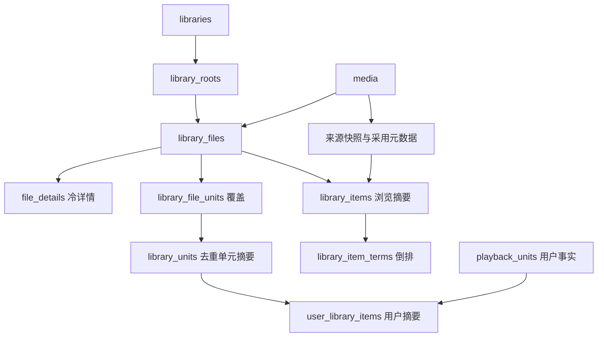

# 当前数据库设计与全量数据字典

基线：`feat/storage-redesign@a3dab1b`（2026-10-19）。本文描述该代码版本的新库布局，不代表全部生产消费者已切换或重构已验收。旧版 `main@2c3a5c7` 六文件字典已被替换；历史正文从 Git 读取，不作为现行操作说明。

## 1. 权威来源与证据边界

- Store 的打开、只读预检及布局初始化：[open.rs](../../crates/store/src/open.rs)、[layout.rs](../../crates/store/src/schema/layout.rs)、[v1 DDL](../../crates/store/src/schema/v1/)。四个 Store 文件各自事务提交，不存在跨文件 FK 或原子提交。
- media 的缓存初始化：[response_cache/mod.rs](../../crates/media/src/response_cache/mod.rs)。它与 Store 共用 `cache.db`，但当前两处建索引语句不同，详见 [cache 字典](cache.md)，不能宣称 DDL 完全统一。
- Job 初始化：[store.rs](../../crates/jobs/src/store.rs)、[change_state.rs](../../crates/jobs/src/change_state.rs)、[retention_cursor.rs](../../crates/jobs/src/retention_cursor.rs)。
- 本轮先将当前生产 DDL 在临时 SQLite 内存连接执行后读取结构，再用已编译的真实 `Store::open` / `Queue::open` 在独立临时目录初始化五文件，核对表/字段/索引/触发器、application_id/user_version；结果与下表一致，`integrity_check=ok`、`foreign_key_check` 无行。不访问生产数据；结构烟测不是完整应用运行验收。字典字段仍以链接的源码为准。
- 设计合同见 [ADR-0008](../adr/0008-sqlite-system-of-record.md) 与 [存储重设计](../superpowers/specs/2026-10-18-library-storage-redesign.md)。缺陷及后续实施顺序见 [修复与优化计划](../superpowers/plans/2026-10-19-storage-cutover-remediation.md)。

## 2. 五个文件

| 文件 | 布局版本 | 表数 | 字段数 | 保存内容 | 能否按缓存清空 |
|---|---|---:|---:|---|---|
| [app.db](app.md) | application_id=1129139248，user_version=1 | 10 | 50 | User/凭证、Site、Downloader、Filter、Naming template、设置、搜索快照、实例锁 | 否 |
| [library.db](library.md) | application_id=1129139249，user_version=1 | 45 | 519 | Media/采用元数据、Library/根、文件/覆盖/摘要、Collection、Playback、专用持久工作 | 否 |
| [subscribe.db](subscribe.md) | application_id=1129139250，user_version=1 | 4 | 47 | Subscribe 策略、槽位事实、搜索状态、待下载记录 | 否 |
| [cache.db](cache.md) | application_id=1129139251，user_version=1 | 6 | 30 | 六来源外部响应；不保存本地 Media/观看事实 | 是，需受控清理 |
| [jobs.db](jobs.md) | 当前初始化不设置布局标识/版本；新库 PRAGMA 默认均为 0 | 4 | 29 | Job 定义、执行、重试、更新流计数、历史清理游标 | 否 |

合计 **69 张业务表、675 个字段**，不计 `sqlite_sequence` 等 SQLite 内部表。Store DDL 有 70 个显式命名索引、32 组 FK、0 个触发器；Jobs 有自己的 9 个命名索引、6 个更新流触发器。cache 的索引数取决于初始化路径，不把它混成一个固定全实例索引总数。

2026-10-19 本轮真实初始化仅运行 Store→Queue，未接着让media打开cache；因此实测cache为12个命名索引，不把它推广为所有初始化顺序都相同。未运行Cargo回归、Web或完整产品链，也未重跑用户checkpoint修复的行为门禁。

默认同名文件在数据目录。`Store::open_at` 仅允许 app 文件另选路径，cache/library/subscribe 仍在数据目录；Jobs 由 Queue 打开。视频、字幕、NFO、图片、Indexer YAML、下载目录不是 SQLite 表内容，不能随切换删除。

## 3. library.db 内的事实与读模型

箭头表达业务依赖，精确 FK 以 [Library 字典](library.md) 为准。`items/units/terms/user_library_items` 是派生读模型，不是外部响应缓存；正常读请求不能通过清空、整库重建或访问网络来弥补未维护的摘要。

- `library_files`：一个物理文件一行，显式持久化 Library/root/Media/kind，`path_key` 全局唯一。presence 为 present/missing/unknown；publication 为 pending/published。
- `library_file_units`：一文件多集、多文件同集的覆盖事实；whole 为 `(-1,-1)`，TV S00E00 为真实分集。
- `library_units`：每 Library/Media/逻辑单元一行；`library_items`：每实际有已发布文件的 Library/Media 一张卡片。字节数按文件而非覆盖行计。
- `file_details` 保存音轨/字幕/章节等冷数据。Media 身份及 Playback 原始事实不依赖文件仍存在。
- `media_metadata_sources` 保存来源快照，`media_metadata/media_seasons/media_episodes` 保存采用结果；Library NFO 输入及人工覆盖另存。表存在不表示来源优先级、人工锁、自产 NFO 反馈已经完整实现。
- 认证凭证留在 app；Playback 逻辑事实、源绑定、会话、历史在 library。删除文件不可通过 FK 级联删除观看事实；删除卡片可删除对应用户摘要，重导入应从原始事实恢复，但当前写路径存在缺陷。

## 4. 当前生产接线与缺口

| 能力 | 当前代码事实 | 仍不可据此声称 |
|---|---|---|
| 新库启动 | Store 拒绝错误/未知布局，创建新四库；旧浏览表已删除 | 允许旧库导入或就地猜测兼容 |
| Web Library 列表 | `http/library.rs` 读取 `library_item_page`，过滤/排序在 SQL | 省略 limit 已改为有界默认页 |
| 文件详情 | Store 文件页有 cursor；HTTP 返回 `next_file_cursor` | 前端已自动串联全部文件页 |
| Jellyfin | 输出逻辑 ItemId；物理多版本折叠为同一逻辑条目；genre/studio/search/person 过滤优先读采用元数据 | Jellyfin 筛选/排序/分页已全部在 SQL 完成 |
| 元数据采用 | 生产 Scrape 仍只接部分展示字段及 NFO；`adopt_metadata` 未接生产 | 完整 work/season/episode 已自动采用 |
| Playback | Web 会话取流与会话绑定；自动续播优先原可用源；换源归零 | 所有历史客户端/第三方路径均已验收 |
| 文件事务 | 文件增删同事务重建受影响用户摘要；多集覆盖与 pending 身份完整 | 所有未来写入口无需再检查不变量 |
| 根/locale/integrity | 新增嵌套根会重归属文件；删除清理 `Unidentified` 与多覆盖快照 | `library_operations` 的 locale/integrity 操作处理器已交付 |

电影旧 `(0,0)` 的复制、回读与兼容测试已删除；`LedgerRow` 仍作为部分写入口的单集适配层存在，新增写路径必须直接使用 `FileCoverage`。TV `(0,0)`、Jellyfin 协议、明确的跨源恢复拒绝、正常来源回退不是旧数据兼容。

## 5. 查询与事务边界

| 场景 | 当前表与实现 | 成本/正确性边界 |
|---|---|---|
| 单库卡片页 | `library_items` + 当前用户稀疏摘要；terms 索引 EXISTS | 普通排序有复合索引；观看排序/复杂筛选/精确 count 可扫描本库窄行 |
| 文件/单元 | files/coverage/units 按 Library/Media/坐标读取 | 分页前按逻辑项去重，物理版本不能冒充多张同 ID 卡片 |
| 文件写入 | `library_write` 的事实与局部归约 | 目标为同事务维护全部受影响摘要；当前仍有绕写与事务内 IO，见修复计划 |
| Subscribe 与 Transfer | subscribe 的策略/下载事实 + library 的文件事实 | 同进程锁不等于跨文件原子提交，须持久幂等恢复 |
| Job 与业务操作 | jobs 的执行记录 + library/subscribe 业务 ID | Job payload 不是 FK；冻结/排空/恢复必须由业务入口实现 |
| User 删除 | app 的身份/凭证 + 其他库用户引用 | 无跨文件 FK；需显式恢复，不能声称一个 SQLite 事务完成 |
| 外部发现/选图 | cache 来源表及外部请求 | 与本地 Library 展示采用事实区分，不禁止外部发现正常联网 |

连接使用 WAL、5000ms busy timeout、`foreign_keys=ON`。FK 仅保护实际声明的同库关系；app/subscribe/jobs 仍有未声明的逻辑引用。多个 Store/Queue/cache 连接不形成跨文件事务。schema 当前按固定布局验证，不等于已实现未来前向升级器。

## 6. 字典阅读、清理与运维

- 字段表中的 `NOT NULL` 来自 SQLite 声明，主键不自动等于 `NOT NULL`；各表完整 CHECK/唯一/FK/索引另列。不得从 `_id` 后缀推断 FK。
- 秒、毫秒、纳秒、RFC3339 仍混用。`played_changed_at_ms` 与 `watch_activity_at` 的语义/单位需由调用者核实；不能把收藏时间当观看或 played 断言时间。
- `request_visible_media` 是 library 连接的 TEMP 表，不是第六个数据库。WAL/SHM 是活动数据库伴随文件，不能随意 unlink。
- 旧 `catalog.db/fanart.db`、`ledger/file_meta`、浏览 journal/代次投影不在新库 schema 中；不创建同名兼容表/视图，不双读双写。旧 SQL 和实例文件不会因文档修改自动迁移或清理。
- 本轮未操作任何用户实例。实际切换必须停所有写者、核实真实文件路径并按授权处理旧 SQLite/WAL/SHM；媒体及 sidecar 保留。受控清 cache 不得删除 adopted metadata、Job 定义、在途状态或观看事实。
- 测试与测量必须引用代码版本：[证据记录](../benchmarks/2026-10-18-library-storage.md)。历史失败在新提交后不是当前失败证明，历史通过也不是当前通过证明。
