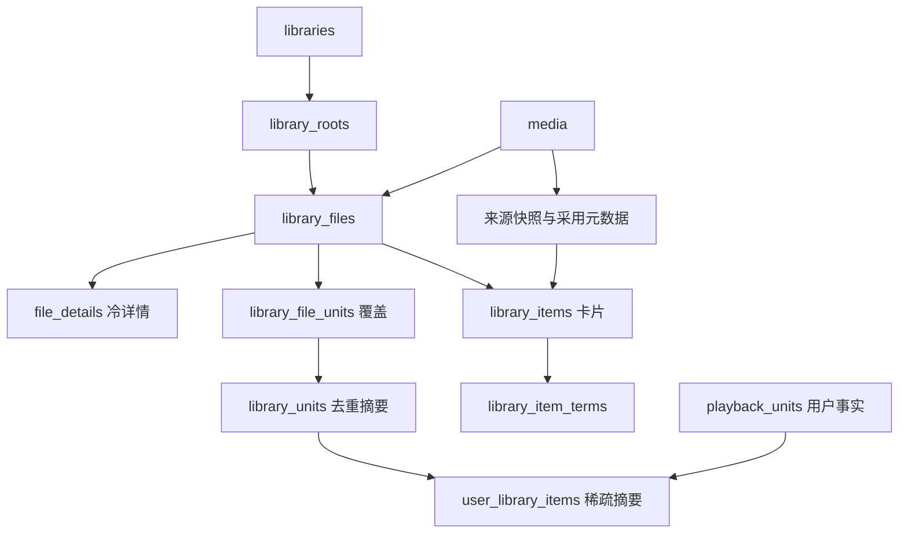

# 当前数据库设计与全量数据字典

源码核对基线：`bd6c3c8`（2026-10-20）。**五文件布局存在，生产干净切换未完成。** 字典描述已声明的结构；规范、实现与运行验收分开，不以表存在或历史测试全绿证明业务合同成立。

## 1. 权威来源

- Store打开/预检：[open.rs](../../crates/store/src/open.rs)、[layout.rs](../../crates/store/src/schema/layout.rs)；生产DDL：[app.sql](../../crates/store/src/schema/v1/app.sql)、[library.sql](../../crates/store/src/schema/v1/library.sql)、[subscribe.sql](../../crates/store/src/schema/v1/subscribe.sql)。
- cache唯一DDL及校验：[media::response_cache](../../crates/media/src/response_cache/mod.rs)，Store直接复用；已删除的cache.sql不是现行入口。
- Jobs：[store.rs](../../crates/jobs/src/store.rs)、[change_state.rs](../../crates/jobs/src/change_state.rs)、[retention_cursor.rs](../../crates/jobs/src/retention_cursor.rs)。
- 目标：[存储设计](../superpowers/specs/2026-10-18-library-storage-redesign.md)、[开发合同](../superpowers/plans/2026-10-18-library-storage-contracts.md)；唯一当前执行入口：[干净切换与优化](../superpowers/plans/2026-10-20-storage-clean-cutover.md)。
- 固定版本检查/失败证据：[benchmark记录](../benchmarks/2026-10-18-library-storage.md)。历史初始化/测试与本轮源码核对不混写，不访问用户实例。

## 2. 五文件生命周期

| 文件 | 布局身份/版本 | 表数 | 字段数 | 职责 | 可按缓存清空 |
|---|---|---:|---:|---|---|
| [app.db](app.md) | 1129139248 / 1 | 10 | 50 | User/凭证、Site、Downloader、Filter、Naming、设置、搜索快照、实例锁 | 否 |
| [library.db](library.md) | 1129139249 / 1 | 45 | 519 | Media/采用元数据、Library/根、文件/覆盖/摘要、Collection、Playback、持久文件工作 | 否 |
| [subscribe.db](subscribe.md) | 1129139250 / 1 | 4 | 47 | Subscribe策略、覆盖/搜索事实、在途记录 | 否 |
| [cache.db](cache.md) | 1129139251 / 1 | 6 | 30 | 六来源原始响应，不保存本地采用/观看事实 | 是，受控清理 |
| [jobs.db](jobs.md) | Queue未设置，默认0 / 0 | 4 | 29 | Job定义/执行/重试、更新计数、保留游标 | 否 |

合计69张业务表、675字段，不计SQLite内部表。Store四文件共70个显式命名索引（含cache12个）、32组FK、0触发器；Jobs另有9命名索引/6触发器。每文件独立提交，没有跨文件FK或原子提交。

`Store::open_at`只允许app另选路径，其他Store文件仍在data_dir；Jobs由Queue打开。正常启动不自动清库、不导入旧layout；错误/未知布局拒绝。所有连接显式WAL、5000ms busy_timeout、foreign_keys=ON。cache额外检查必需表/索引名称，不能推广为所有分区逐列校验。

## 3. library.db事实与摘要

箭头是业务依赖，不等于全是FK或每次请求都JOIN。`library_files`一个物理文件一行；file_units是一文件多集/同集多版本；units按逻辑单元去重；items每实际有已发布文件的Library/Media一行。size按文件一次计，whole=(-1,-1)，TV S00E00是真实分集。file_details仅冷探测数据，不是第二完整文件投影。

Media与原始Playback事实独立于文件存在；最后文件/Library删除不能级联删身份、进度或Collection成员。用户摘要可随卡片删除，重导入从原始事实恢复。当前完整归约已实现，增量路径仍漏维护，不能用目标不变量描述所有生产入口。

## 4. `bd6c3c8`生产边界

| 能力 | 已有实现 | 复审仍发现的缺口 |
|---|---|---|
| 启动/cache | 五文件、拒旧、共享cache DDL | 不等于全消费者离线可用或未来升级器完成 |
| 文件发布 | 复合ownership FK、覆盖与公共摘要 | 已有路径重扫不推进FileVersion；增量用户摘要不更新；部分旧writer仍用LedgerRow |
| Web详情 | 本地采用字段、首50文件+cursor | 续页字段不匹配/50边界异常；冷字段读取丢失；状态/多覆盖DTO不完整 |
| 元数据/NFO | adopt_metadata有部分生产调用、固定来源优先及最后有效值基础 | 原响应经旧DTO有损重建；人工锁/locale/多NFO/已有文件重扫/自产反馈未闭合 |
| Playback | Web签发会话及session stream，源感知resolver | 心跳未严格消费签发版本；合并E02被误拒；Jellyfin原始位置与逻辑ID-as-source仍在 |
| 协议查询 | typed ItemId和部分采用字段过滤 | Jellyfin `Items` 已由 `protocol_item_page` 在 store 侧选页（谓词/折叠/排序/`total`/`LIMIT` 同一短读事务，页内用合成快照）；`PersonIds` 仍是候选级路径、`NextUp` 独立路径，作用域行重读仍计入成本 |
| 根/完整性/身份 | 删除协调器、部分嵌套根重归属、Store合并API | 根替换FK失败；library_operations/checker/merge管理路由与恢复未交付 |

电影 `(0,0)`仍被Web发送并由后端映射whole；禁止将“无旧持久行”写成“无兼容代码”。正常Jellyfin协议认证、TV00、来源stale回退不等于旧数据库兼容。

## 5. 查询、事务与运维限制

- 公共卡片/terms与稀疏用户摘要降低读成本，代价是局部写放大。普通seek有索引；精确count/facets、复杂观看排序、包含搜索与深offset不承诺常量成本。
- 目标是同事务维护全部受影响事实/摘要、IO和大JSON解析在锁外；当前仍有绕写/锁内IO。不能读时stat/NFO/网络或整库重建掩盖漏维护。
- 用户身份/凭证在app，Subscribe在subscribe，Job在jobs。共享进程锁/多连接不是跨文件事务，User删除/身份合并需持久阶段恢复。
- 字段NOT NULL/默认/索引以DDL声明为准，不能从_id后缀推FK。JSON CHECK只验证语法；秒/ms/ns/RFC3339不能混比。
- `request_visible_media`是连接TEMP表，WAL/SHM是活动伴随文件，不是额外业务分区。
- 当前无ledger/file_meta/browse journal持久表，不建兼容表/视图，不双读双写。旧SQL/旧实例文件不会因文档修改自动迁移。
- cache清空只允许连接内受控删除，或停写关闭全部连接后重建；备份不能直接复制活跃文件冒充五文件一致快照。
- 实例切换需单独核实真实app_path/data_dir及停写授权，只处理明确SQLite/WAL/SHM；媒体、字幕、NFO、图片、下载目录、Indexer YAML、编译缓存保留。本轮文档任务不操作实例。
