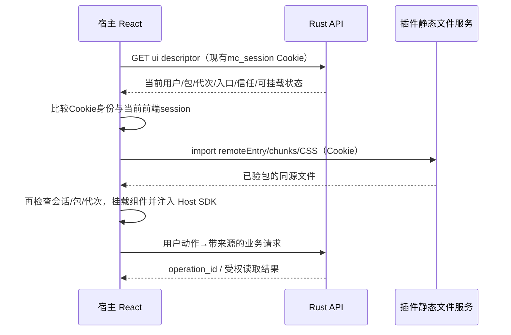

# React 插件 UI、模块联邦与宿主 SDK

状态：Phase 1 已实施并接入（当前分支 `plugin_system_development`）。实际契约与组件落地在 `sdk/plugin-ui/src/contracts.ts`、`sdk/plugin-ui/src/react.tsx`、`sdk/plugin-ui-kit/src/`、`web/components/plugins/`、`web/lib/plugins/`、`web/src/main.tsx` 及 `crates/api/src/{plugins/ui_*.rs,http/plugins/ui.rs}`。本文同时保留安全边界说明，避免把同页面模块联邦误认为前端沙箱。

配套：[系统设计](../superpowers/specs/2026-11-03-plugin-system-design.md)、[作者接口](authoring.md)、[管理 API](ui-and-api.md)、[P6 实施计划](../superpowers/plans/2026-11-03-plugin-system-plan.md#p6作者工具管理界面与-react-插件-ui)。

## 1. 采用的机制与参考证据

宿主与插件都用 React/TypeScript/Vite。插件作为独立工程构建，随 `.cmplugin` 分发完整 JS/CSS/静态资产；宿主运行时通过 Module Federation 加载组件，不重新编译宿主，不要求部署独立前端服务器。简单配置仍可仅提供 JSON Schema；完整业务页不必转换为 widget DSL。WASM 后端与浏览器前端是两个执行环境，前端不能直接 import WIT、Rust 对象或 CDP socket。

当前 `web/package.json` 与 `web/pnpm-lock.yaml` 精确锁定 React/React DOM `19.3.0`（Vite `^7.0.0` 锁定 `7.3.6`）。选择 `@module-federation/vite` 与配套 runtime，按锁定版本精确共享依赖，不同时支持 OriginJS 和 enhanced 两套 remote 格式。

参考的是 MoviePilot 当前 v3 源码，不把它等同于所有已发布版本：

| 证据 | 借鉴的部分 |
|---|---|
| [前端 Vite 配置，55db2ea](https://github.com/jxxghp/MoviePilot-Frontend/blob/55db2eaad425406daa6f2ed90b70cd85c6772349/vite.config.ts) | 使用 OriginJS federation、运行时注册 remote、共享 Vue/Vuetify；我们采用 React 对应实现 |
| [插件前端示例](https://github.com/jxxghp/MoviePilot-Frontend/blob/55db2eaad425406daa6f2ed90b70cd85c6772349/examples/plugin-component/vite.config.js) | 独立编译 Config/Page/Dashboard/AppPage |
| [加载器](https://github.com/jxxghp/MoviePilot-Frontend/blob/55db2eaad425406daa6f2ed90b70cd85c6772349/src/utils/federationLoader.ts) | remote 发现、注册、异步加载及多页面入口 |
| [后端插件路由，26f066d](https://github.com/jxxghp/MoviePilot/blob/26f066df53704a77e1d12480ff43f0a5d3f8f76f/app/api/endpoints/plugin.py) | 插件声明渲染方式，后端托管插件静态文件 |
| [宿主 SDK](https://github.com/jxxghp/MoviePilot-Frontend/blob/55db2eaad425406daa6f2ed90b70cd85c6772349/docs/plugin-frontend-sdk.md) | 复用订阅、搜索、下载、选择器、通知、进度与导航交互 |
| [Module Federation Vite](https://github.com/module-federation/vite) | React remote、共享依赖、运行时加载；准确 API 以 P6.1 锁定版本为准 |

不移植其 Vue 组件、旧接口 fallback、多版本兼容或固定 query token。我们用显式入口映射、精确 SDK 合同及现有后台身份/operation 规则。

## 2. 信任与生命周期边界

同页面 React 联邦组件是**受信任前端代码**。它与宿主共享 DOM、JavaScript 环境和浏览器登录上下文。SDK 包装、CSS Modules、React ErrorBoundary、代码签名均不构成安全沙箱。恶意 JS 仍可能读取浏览器可见的凭据、直接调用当前用户可调用的原生 API、修改 DOM 或向浏览器允许的目的地联网。后端 WASM 的 fuel、Site egress、credential_epoch 与组件 grants 不会自动约束这段 JS。

因此区分两项授权：后端能力 grant 限制 WASM/带插件归属的业务调用；前端信任表示允许该包代码在**当前 Admin 的登录权限范围**运行。不能承诺“给 UI SDK 只开放搜索，所以这段同页面 JS 只能搜索”。不可信包可以使用宿主声明式表单而不加载其 JS；本版不提供 iframe 隔离运行模式，不把模块联邦包装成隔离方案。

前端信任单独记录为 `plugin_ui_trust(plugin_id, package_sha256, bundle_sha256, granted_by_user_id, granted_at, revoked_at, revision)`（`PRIMARY KEY(plugin_id, package_sha256)`），放 `app.db`。第一次打开前显示包来源、完整 digest、所选 SDK 与同页面代码权限说明；Admin 重新鉴权后确认并记录 `granted_by_user_id`。Member 本版不加载插件代码；新包 digest 必须重新确认。拒绝或撤销前端信任不自动禁用后端插件，也不妨碍宿主配置/停用/卸载。

信任确认、重新鉴权、安装升级、权限、审计、原始 state 导出和不可逆文件删除的最终确认均由宿主页面实现，不由 remote 替换。这是正常集成流程的职责划分，不声称恶意同页面代码无法伪造界面。用户应只信任愿意以其当前账号权限执行的前端代码。

所有受支持 SDK 调用携带宿主生成的 plugin/package/generation 上下文，后端重验 User ACL、manifest UI 能力上限、已授予业务能力、对象 scope 与 lifecycle。原生 UI 复用的操作也保留这条来源链。对故意绕开 SDK 的同页面代码只能依赖原生端点自身的 User ACL，不能伪称仍具有插件级隔离。

## 3. 包、入口和版本

```text
org.example.checkin.cmplugin
├── plugin.toml
├── components/maintenance.wasm
├── schemas/config.schema.json
└── ui/
    ├── asset-manifest.json
    └── assets/
        ├── remoteEntry.js
        ├── CheckinPage.<content-hash>.js
        ├── Config.<content-hash>.js
        └── style.<content-hash>.css
```

下面是追加到作者文档 manifest 的 `[ui]` 部分；不是独立完整插件包。没有 `[ui]` 就不加载插件 JS。允许仅 UI 的包：`components=[]` 且没有 Site profile 时，必须有通过校验的 UI；其 `config_schema` 可为空 object schema，`state_schema` 仍必填，后端能力不因缺少 WASM 自动获得。

```toml
[ui]
kind = "federation-react"
contract = "1.0.0"
remote_name = "cm_example_checkin"
entry = "ui/assets/remoteEntry.js"
asset_manifest = "ui/asset-manifest.json"
react = "19.3.0"
react_dom = "19.3.0"
capabilities = ["read:sites", "read:history", "command:site.maintenance"]

[[ui.surfaces]]
id = "config"
kind = "config"
expose = "./Config"
title = "签到配置"

[[ui.surfaces]]
id = "history"
kind = "page"
expose = "./Page"
title = "签到记录"

[[ui.surfaces]]
id = "checkin"
kind = "app"
expose = "./AppPage"
title = "签到"
icon = "calendar-check"

[[ui.surfaces]]
id = "summary"
kind = "dashboard"
expose = "./Dashboard"
title = "签到概况"
```

`contract`同时标识UI manifest、组件props、Host SDK与UI Kit的精确合同版本，与后端WIT api分开。只接受宿主公布的一组精确合同/React版本；不接受范围、不猜旧字段、不在缺导出时自动寻找另一个组件。remote_name必须与构建配置一致、在不同plugin_id之间唯一，禁止覆盖宿主或另一插件的remote。同一插件并排存放的版本可以同名，但同一浏览器文档只加载其中一个版本，切换包须完整重载。每包最多16个surface；id为1–64位小写字母/数字/连字符，包内唯一；config最多一个，其余可多个。title为纯文本≤80字符，icon必须命中宿主图标目录。

每个 surface 必须 default export 一个接受 `PluginSurfaceProps` 的 React 组件。manifest 指定 expose 后，缺失导出就是该包不完整；没有 Config 时宿主使用 schema 表单，这是显式可选能力，不是兼容 fallback。已声明但加载失败的 Config 显示错误，用户可主动切回宿主表单修复；不吞掉错误。

`asset-manifest.json` 是构建器生成的闭集 `{version:1,files:[{path,sha256,size,content_type}]}`，path 相对包根，包含 entry 及其所有构建产物、动态 chunks、CSS、字体/图片；自身由包签名覆盖，不递归列自己的 hash。sha256 为64位小写hex。只收 `.js/.mjs/.css/.woff2/.png/.jpg/.webp`；不收 HTML、源映射、源码、npm脚本、符号链接或绝对路径。上限：1024文件、单文件8MiB、UI合计32MiB。打包时检查完整引用图；相对 import、CSS url 与字体必须在清单内。该检查用于保证完整性，不能证明任意 JS 不会在运行时生成其他网络地址。

宿主解包后复核每项 hash/MIME/大小，使用不可变目录与目录内解析，不运行 npm、不运行插件构建脚本；整个 `.cmplugin` 的 detached 签名覆盖 UI。正式包仅使用宿主分发的入口，不接受 manifest 中的 CDN、任意 URL 或未经验包的 dev server。

## 4. 路由与页面实现

| 入口 | 路由/位置 | 宿主与插件分工 |
|---|---|---|
| Config | `/settings/plugins/:pluginId?tab=config` | 宿主读取 schema/config/revision；remote 编辑非秘密草稿；保存走宿主 CAS，secret 在宿主控件单独编辑 |
| Page | `/settings/plugins/:pluginId?tab=page&view=:surfaceId` | 插件详情中的业务 tab；多个 page 用二级 tab |
| AppPage | `/plugin-apps/:pluginId/:surfaceId` | 侧栏「插件应用」分组进入完整主内容区；宿主保留导航、账号和返回入口 |
| Dashboard | `/dashboard` 与工作台卡片 | 宿主提供卡片布局/标题/移除；remote 负责内容，不能因安装自动在所有用户首页执行 |

设置「系统 / 插件」仍用于管理。AppPage 显式注册在 `web/src/main.tsx` 的 `/plugin-apps/:pluginId/:surfaceId`（与 `/plugins/*` 后端管理 API 区分），并同步更新 `accessiblePathFor`、侧栏模型和 Admin 检查。

Config 可在已安装、已信任、无升级/卸载且 drain 完成的 disabled 状态加载；enabled 时可查看草稿但 `editable=false`，保存提示先停用。其他 surface 仅 enabled 可挂载。未信任、版本不匹配、停用、熔断、权限不足均显示宿主原因和操作入口，不先下载 JS 再隐藏。准备中的新版本可预先授权，但激活前不允许加载其入口。

核心组件职责：`PluginManagerView` 管安装和生命周期；`PluginDetailView` 管固定tab；`PluginSurfaceHost` 管授权、挂载和错误边界；`PluginConfigHost` 管草稿/CAS/secret；`PluginAppPage` 管整页路由；`PluginDashboardSlot` 管卡片；`PluginSchemaForm` 提供无需 JS 的表单。宿主 UI Kit 提供 Button、Field、Select、SitePicker、DownloaderPicker、DataTable、Stat、Progress、Dialog；复杂交互可用插件自己的 React 组件，不受这份列表限制。

## 5. 发现、静态文件鉴权与加载



动态import、CSS和字体请求不能依赖`web/lib/http.ts`自动补Bearer；实际仓库`crates/api/src/http/auth.rs`已经在登录时设置HttpOnly `mc_session`（Path=/、SameSite=Lax），protected routes接受Cookie，退出时撤销token并清Cookie。因此直接复用现有同源认证，不新增资源Cookie/session表或签发接口，不把token拼进URL，不扩展播放专用query-token例外。Cookie属性/HTTPS部署遵循现有认证合同，本任务不另加生产必须HTTPS的前置条件。

UI descriptor的加载前请求由专用adapter使用`credentials: "include"`且不附Authorization，响应包含`subject_user_id`；宿主必须先与当前前端session身份比较。缺Cookie或Cookie与localStorage Bearer属于不同用户时停止import并提示重新登录，不用错配会话身份加载remote。普通管理API仍按现有Bearer优先规则工作；这里的Cookie-only预检用于确保后续浏览器原生资源请求与页面主体一致。

每次资产请求沿现有authenticate/require_admin与ReaderPool，检查当前会话有效、User为Admin、UI信任未撤销、package为当前可展示版本、lifecycle允许UI。没有有效会话直接401，不能返回登录/SPA HTML；读取繁忙仍503，不误当身份失效。退出/账号切换走现有auth/logout及前端scope失效。现有mc_session也可认证业务API，不能称其为只读资源凭证。Cookie不进入operation、审计、URL或插件props；HttpOnly并不隔离同页面JS的带Cookie请求能力。

静态路径为 `/api/v1/plugin-ui-assets/:pluginId/:packageHash/*path`，path对应清单的包相对路径；`packageHash` 为完整hex digest。返回准确MIME、`nosniff` 和 `Cache-Control: private, no-store`，不进入任何共享缓存/Service Worker预缓存；资源准入不依赖缓存命中。插件资产鉴权不是图片鉴权改造：既有 `/posters/*` 等public端点保持原样。

加载器的缓存键为 `(login_epoch,plugin_id,package_hash,surface_id)`，同一请求合并一次在途加载；先完成descriptor/身份核对，再`registerRemotes`/`loadRemote`，配合Suspense、ErrorBoundary。React、React DOM（含jsx-runtime/client子路径）与SDK/UI Kit共享宿主实例；remote不打第二份React fallback，不引用宿主私有`@/`、Store或Router Context。契约不匹配在import前阻止，不靠两份React勉强渲染。

加载步骤分别记录发现/准入/资源/挂载耗时；默认资源加载截止15秒，超时显示阶段和手动重试入口，不延长全站HTTP超时。import本身不保证可取消：路由离开、信任撤销或代次变化时废弃结果并禁止迟到挂载；不要把AbortController写成卸载模块的证据。模块顶层只导出组件，不执行任务；副作用在挂载生命周期内由作者清理。

SDK dispose 取消本surface请求、订阅、定时刷新和注册的导航/弹窗；只取消观察，不自动取消已受理的服务器Job。停止/升级/撤权关闭后端旧代准入，已打开标签页在descriptor检查或权限错误后卸载。已加载remote的文档在包切换、账号/角色切换或前端信任撤销后必须完整重载，避免模块缓存混用；广播与重新聚焦检查覆盖多标签页。后端停用完成不等待离线标签页确认，另显示“已打开页面需刷新”。完整重载也不是修复恶意代码既有副作用的承诺。

## 6. 前端 Host SDK

唯一契约源为待创建的 `sdk/plugin-ui/src/contracts.ts`；发布 `@crawler-media/plugin-ui-sdk` 类型/React辅助函数和 `@crawler-media/plugin-ui-kit`。宿主从同一源实现适配，SDK不携带真实账号、token、配置秘密或宿主内部Store。精确 `contract=1.0.0` 必须匹配，无旧props别名/双SDK主版本；SDK内能力目录对应本实例实际实现并已授予的能力，未实现方法不能显示可用。

```ts
type OperationRef = { operation_id: string; state: string };
type WriteOptions = { expectedRevision: string; idempotencyKey: string };
type InteractionResult =
  | { status: "opened" }
  | { status: "submitted"; operation: OperationRef }
  | { status: "cancelled" };

export interface PluginSurfaceProps {
  host: PluginHostSDK;
  surfaceId: string;
  config?: {
    values: Readonly<Record<string, unknown>>;
    schemaRevision: string;
    revision: string;
    editable: boolean;
    onDraftChange(values: Record<string, unknown>): void;
    save(values: Record<string, unknown>): Promise<void>;
  };
}
```

`PluginHostSDK` 的 public 方法如下，DTO细节复用对应管理/作者合同，实施从契约源生成文档，不另维护手写网络类型。所有方法实例绑定context，调用者不能替换user/plugin/package/generation。非配置surface没有config prop。

| SDK 方法 | 输入与结果 | 后端/宿主映射 |
|---|---|---|
| `context`、`supports(name)` | 只读plugin/package/generation/surface/login_epoch、能力bool | 当前descriptor；不是授权证明 |
| `environment.get/subscribe` | 主题、语言、布局、当前用户摘要；subscribe返回dispose | 现有session/主题，权限变化废弃旧scope |
| `catalogs.list(kind,{cursor,limit})` | `sites/downloaders/libraries/filters` → 有界ID/名称/能力选项 | 下节UI query；不含凭据/连接配置 |
| `query(name,input)` | 下节闭集查询名/DTO → 有界脱敏结果 | `/plugins/:id/ui/query`；只读不调用guest或联网 |
| `objects.resolve(kind,id,revision?)` | 已读UUID/对象版本 → UiHandle及expiry | `handles.resolve`查询；不得把UUID冒充WIT resource handle |
| `search.results(operationId,{cursor,limit})` | 已完成搜索operation → 分页TorrentView+候选UiHandle | `indexer.cached`查询；当前主体/插件与获准Site，原始HTML不释放 |
| `commands.submit(kind,payload,options)` | 已声明command + WriteOptions → OperationRef | 现有`/plugins/:id/commands`；补UI声明上限与代次复查 |
| `tasks.list/run/receipts` | task_id/input/分页；run带WriteOptions → OperationRef | 已有任务管理路由，检查UI声明与task执行权限 |
| `operations.get/watch` | operation_id；watch回调Operation并返回dispose | 已有operation路由；可见时单飞轮询、终态停止 |
| `endpoint.request(endpointId,{method?,query,body,signal})` | manifest 注册的 endpoint 路径（可选显式 method，默认有 body 为 POST、否则 GET）→ JSON/plain text 或 OperationRef | 当前插件 `/plugins/:id/endpoints/*` 路由；拦截 `.`/`..` 跨路径越界，SDK 区分原始响应和管理信封 |
| `media.select/detail` | 选择器`{query?}`→Media或取消；`{media_id}`→opened | 宿主媒体选择/详情；持久内部Media ID |
| `search.open` | `{query?,site_ids?,media_id?}` → opened | 原生搜索页；程序化搜索用`commands.submit("indexer.search",...)` |
| `subscriptions.create/edit` | `{media_id}`或`{subscribe_id}` → InteractionResult | 原生Subscribe弹窗；确认后的请求保留插件来源和grants |
| `downloads.add` | `{torrent_handle}` → InteractionResult | 原生添加弹窗、有效候选、完整Gate，不能提交任意下载URL |
| `downloads.cleanup` | `{owned_task_handles,mode:"task-only"或"files"}` → InteractionResult | 宿主准备/对账/精确文件预览/确认，详见下文；不是普通ui.confirm |
| `libraries.open` | `{library_id}` → opened | 现有Library页；Transfer/Scrape用已声明命令与宿主确认 |
| `files.select/transfer/scrape` | select输入Library+分页选择→文件集合UiHandle或取消；其余输入该handle→InteractionResult | 宿主文件选择、Transfer/Scrape参数与确认；无任意路径输入，P5完成才开放 |
| `browser.availability` | `{site_id,purpose}` → BrowserAvailability | 已有Browser诊断API；CDP操作通过后端任务/Provider |
| `ui.toast/confirm/dialog` | 纯文本提示、确认选项；dialog接受插件React组件并返回close | 宿主统一容器；业务危险操作仍由专用宿主确认流程处理 |
| `navigation.open` | 宿主路由ID+typed参数 → opened | 允许的内部路由、ACL；不接受任意URL或JS |
| `shell.registerAction/registerTabs` | 固定surface内按钮/tab描述与回调 → dispose | 仅AppPage；禁止覆盖宿主账号/管理导航 |

查询闭集：`sites.list/downloaders.list/libraries.list/filters.list` 输入分页，返回选择器DTO；`subscribes.list` 输入分页与可选media_id返回Subscribe摘要；`media.get`输入media_id返回Media公开视图；`downloads.list`输入可选site_id/downloader_id与分页返回脱敏任务；`checkin.receipts`输入site_id与分页返回维护结果；`boost.snapshot`输入可选site_id/downloader_id返回已有brush-state事实。权限复用作者合同 `read:sites/downloads/history/boost/library/subscribes/catalog`；Media账本归`read:library`，catalog选择器归`read:catalog`，filters选项归`read:subscribes`，Downloader选择项归`read:downloads`。结果ID再交业务方法时仍须重验scope。

闭集另含`handles.resolve`和`indexer.cached`。前者输入`{kind,id,expected_revision?}`，kind仅`site/downloader/library/media/subscribe/owned_download`，返回`{handle,revision,expires_at}`；确认对象存在及可见后签发UiHandle。后者输入`{search_operation_id,cursor?,limit?}`，返回已完成搜索的标准TorrentView与候选UiHandle、`next_cursor`；未完成返回`operation-not-ready`，失效返回`stale-handle`，不会发起新搜索。权限为`read:sites`及原搜索结果scope，不凭知道别人的operation_id就可取结果。

UiHandle是服务端不透明能力，绑定subject/plugin/package/generation、对象种类/ID/观察revision、Site credential_epoch（如适用）、来源operation/cause与10分钟到期时间；不向浏览器暴露WIT资源表索引。文件集合由`files.select`的宿主适配使用同一query的`files.selection`变体签发：输入`{library_id,file_ids,expected_revisions}`，最多200项、只读账本、`read:library`及Library准入，不能传绝对路径。命令入口解码、重验并构造内部typed handle；文件/候选/下载任务的最终检查仍在实际执行前完成。catalog选择项ID不自动成为可下载候选。由搜索operation取出的候选续用服务端cause；客户端不能重置递归计数。过期需重新读取/选择，不把旧handle换绑新对象。

`downloads.add`的宿主适配以候选handle构造新的typed下载入口，不能直接把现有`DownloadTargetRequest.download_url`暴露给remote来满足旧弹窗签名。选择Downloader后由后端解析下载引用并执行全部Gate，保留来源/幂等，不增加可绕过准入的URL直投路径。

`downloads.cleanup`的files模式先提交`downloader.prepare-cleanup`并观察operation取得`host_file_plan_handle`，再调用已有`brush-cleanup-preview`的`plan_handle`参数展示同一计划和短期confirmation_token。Admin确认后通过宿主提交`downloader.delete-files`，携带计划、其revision、confirmation_token和稳定幂等key。token绑定主体/plugin/package/generation、计划摘要/文件版本、期限；UI来源delete-files缺token必须拒绝。自动刷流由后台task按已授权自动清理策略执行，仍检查计划/保护/独立敏感grant，不以UI确认token替代后台策略。task-only模式显示保留文件提示，再调用delete-task。普通ui.confirm不能签发此token，预览/未知/受保护结果不会显示删除成功。

`ui.capabilities`只接受上述read/command闭集，以及`task:run:<task_id>`；后者必须指向本包已声明任务、单独授予，scope包含该任务允许的业务对象，不授予其它任务权限。任务自身执行仍检查其component grants；UI信任不代替task grant。任务元数据、当前插件基本配置、UI布局/提示等宿主基础交互不额外授予业务写能力。示例用`site.maintenance`命令；提供`checkin-cycle`任务的包需另声明并授权`task:run:checkin-cycle`。

SDK错误使用稳定code：`permission-denied/host-disposed/contract-mismatch/stale-generation/stale-handle/operation-not-ready/revision-conflict/busy/request-failed/result-unknown`；`request-failed`保留HTTP code和字段错误。写入断网保留原idempotencyKey，不换key自动重发。`opened`仅代表打开交互，`submitted`仅代表后台受理，均不代表签到/下载已成功。只有operation权威终态与业务receipt能够表达成功。宿主能力只是当前实施范围的明确API，不提供任意调用内部React函数的通道。

## 7. HTTP 补充合同

以下路径省略 `/api/v1`。除资产流外沿用管理信封；所有写遵循现有CAS/幂等规则。`ui/query`是只读POST，要求schema/大小/分页预算，不运行插件。UI来源请求携带 `X-Plugin-Package`、`X-Plugin-Generation`，后端验证后重建context，不能信任header自报身份。

| 方法/路径 | 请求 → 响应 | 准入 |
|---|---|---|
| GET `/plugin-ui-contract` | 无 → 精确contract/React/ReactDOM版本、SDK方法/图标目录 | Admin；不下载remote |
| GET `/plugins/:id/ui` | 无 → UiDescriptor | Admin；未信任也可读元数据，不附秘密 |
| GET `/plugin-ui-navigation` | 无 → 当前包已信任且可挂载的page/app/dashboard入口列表 | Admin；内部按 200/页遍历插件并返回完整数组 |
| POST `/plugins/:id/ui-trust/prepare` | `{package_hash}` → 信任说明/摘要/当前trust_revision/短期consent_token | Admin；已验包版本，不执行代码 |
| POST `/plugins/:id/ui-trust/grant` | `{package_hash,consent_token,reauth_token}` → trust状态/revision | Admin+重新鉴权；CAS `(plugin_id, package_sha256)` 的 UiTrust，首次 0 |
| POST `/plugins/:id/ui-trust/revoke` | `{package_hash}` → trust状态/revision | Admin；CAS 同一 `(plugin_id, package_sha256)` UiTrust；撤销前端信任，不冒充停用后端插件 |
| GET/HEAD `/plugin-ui-assets/:id/:hash/*path` | 规范清单路径 → 二进制JS/CSS等 | 现有会话认证+当前Admin+包级前端信任+展示准入；非信封 |
| POST `/plugins/:id/ui/query` | `{name,input}` → 对应有界查询结果 | Admin Bearer+UI能力/grant/object scope；config可查询选项，业务视图仅enabled |

`UiDescriptor={plugin_id,plugin_name,version,generation,lifecycle,source,package_hash,package_sha256,bundle_sha256,subject_user_id,subject_role,ui_mode,remote_name,entry,entry_url,asset_base_url,contract,react,react_dom,ui_trusted,trust:{status,revision,granted_at,granted_by_user_id,revoked_at},capabilities,styles,surfaces}`。每个surface附`mountable/editable`，入口只有通过验包后由宿主构造。generation为当前插件管理代次，disabled配置视图仍固定该值；身份、包、代次或schema revision变化后草稿需要用户重新核对。GET descriptor不调用WASM，也不把信任false当404。

资产允许Config在disabled时加载，与“业务调用必须enabled”分别判断；整包静态文件可能含其它surface代码，资产准入不承诺按chunk隔离业务权限。所有业务操作仍在后端拒绝disabled。读会话和信任不持锁执行文件IO；先快照验证，锁外安全打开文件再流式发送；已发出的字节无法撤回，撤权阻止后续请求。

UI来源的commands/task/endpoint/operation等既有路由需补统一来源校验中间件；原生管理调用仍走原User ACL。操作读取额外要求同plugin、同发起主体或现有明确Admin管理权限；SDK只给本插件操作，不把管理全权限API当UI SDK。生成generation/identity的责任属于宿主，不允许插件自造任务系统主体。

## 8. 作者编写、开发与实际示例

作者使用独立 `ui/` 工程，模板锁定 SDK/React/Vite/federation 依赖与包管理器。`tools/plugin`（`plugin-cli`）已实现：`scaffold [--world <world>] [--api 1.0.0] [--ui react]` 生成 TSX 入口、mock Host SDK 与构建配置；`build` 校验合同并编译 WASM/UI、生成 `ui/asset-manifest.json`；`pack --output <out.cmplugin>` 打确定性 ZIP 包；`sign --key <key_file>` 生成 minisign/Ed25519 签名；`dev <dir> --instance <url> [--token <token>] [--once|--watch]` 面向开发模式实例热打包/上传/重载。服务器不执行构建步骤。

以下构建配置摘录与宿主共享规则对齐，实际生成模板见 `tools/plugin/src/scaffold_templates.rs`：

```ts
federation({
  name: "cm_example_checkin",
  filename: "assets/remoteEntry.js",
  exposes: {
    "./Config": "./src/Config.tsx",
    "./Page": "./src/Page.tsx",
    "./AppPage": "./src/AppPage.tsx",
    "./Dashboard": "./src/Dashboard.tsx",
  },
  shared: {
    react: { singleton: true, import: false, requiredVersion: "19.3.0" },
    "react-dom": { singleton: true, import: false, requiredVersion: "19.3.0" },
    "@crawler-media/plugin-ui-sdk": { singleton: true, import: false },
    "@crawler-media/plugin-ui-kit": { singleton: true, import: false },
  },
});
```

React与SDK版本升级时重新发布精确契约及示例；不会承诺任意旧包继续运行。本地独立预览提供mock数据/主题/权限/错误/operation，无真实Cookie和CDP；联调使用watch-build→开发模式签入新包→宿主完整刷新，未签名包仍受开发模式规则和包级前端UI信任。正式运行不读取localhost remote URL。

第一方也交付同样的独立前端包：

- **签到**：Config配置Site、interval、transport；AppPage展示每Site历史/认证状态/Browser可用性及“运行一轮”；通过已注册task受理，operation关联Job与各Site receipt；Dashboard显示实际成功/失败/Unknown，打开页面不会隐式签到。
- **刷流**：AppPage含容量、预留、上传量图表、任务表、保护原因、运行与暂停新添加；清理按钮走宿主精确文件预览/确认与持久删除command；Config保存仍要求停用/drain；Dashboard与业务页共用权威snapshot，task删除后保留文件继续占用。
- **自定义Site**：插件可提供自己的说明/诊断页；Site的凭据字段、Provider选择、授权和最终保存仍由宿主Site表单管理。
- **搜索策略**：可提供规则编辑和影响统计页；真正过滤/评分/排序在后端Hook执行，用户没打开插件页时也生效。前端排序只影响展示。

CSS使用Modules或插件根节点命名空间，不导入全局reset、不覆盖宿主body/基础组件；共享主题tokens与统一弹窗层。卡片支持窄屏/深浅主题、键盘焦点、空态、加载、局部错误与重试。CSS约定和ErrorBoundary只隔离正常开发中的冲突/可捕获渲染错误，不能中止恶意同步死循环或回收任意全局副作用。

## 9. 验收与运行约束

React 插件 UI 与内置 `builtin.checkin` / `builtin.boost` 前端包均通过真实构建产物加载（含 Vite `@module-federation/vite`、`web/test:plugins` 集成测试、Rust `plugin_ui_assets` / `plugin_ui_commands` 与 E2E suite 覆盖以下合同）：

1. 独立编译两个React插件，部署到Rust资产路径，宿主无需重建即可显示四种surface和多个整页；react hook/context行为正确，无第二份React。
2. 缺chunk、hash不符、无签名、未知expose、契约/React不符、跨包同remote_name、穿越路径都明确失败；未信任/Member在任何路由均不下载入口。
3. 顶层entry、动态chunk、CSS、字体全用现有同源mc_session；localStorage仅有Bearer而无Cookie时import前提示登录，Cookie/Bearer不同用户不混用信任，撤销会话/降权后资产拒绝；资产不进共享缓存。
4. Config在disabled时可加载/保存，业务页与命令仍拒绝；CAS409保留草稿，secret不回填remote；加载Config失败仍可主动打开宿主表单。
5. 双击/断网/202/Unknown/刷新恢复保持同operation；SDK请求保留plugin来源，越权对象、伪造generation、缺grant、废弃scope和迟到选择器都失败。
6. 路由切换清理观察与UI注册；旧import resolve不挂载；停用/升级/退出/降权跨标签页触发失效与完整重载，服务器不等离线标签页。
7. 签到和刷流既有后台验收通过后再验证真实React页面；签名前端存在不等于后台可用。模拟真实任务阶段、HR保护、清理失败和Browser隔离不足，页面准确展示。
8. 真实浏览器检查桌面/窄屏、两种主题、键盘交互、加载失败和宿主错误恢复；只读页面访问不启动业务任务，开发报告如实列出未覆盖项。
