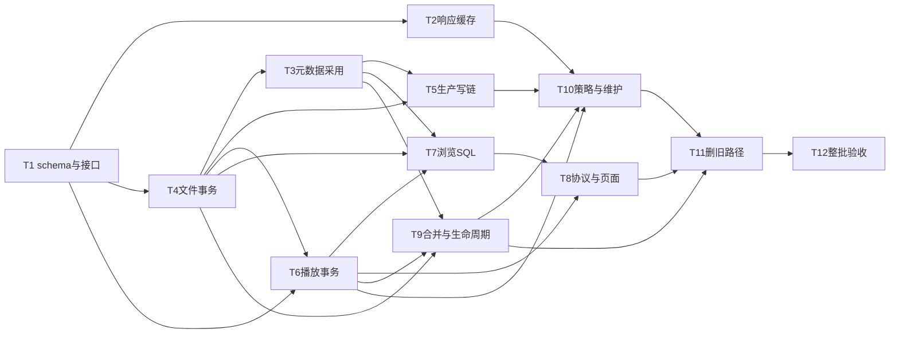

# Media / Library 全新存储开发 Implementation Plan

> **For agentic workers:** REQUIRED SUB-SKILL: Use superpowers:subagent-driven-development (recommended) or superpowers:executing-plans to implement this plan task-by-task. Steps use checkbox (`- [ ]`) syntax for tracking.

**Goal:** 从空数据库启动，将外部响应缓存、本地Media元数据、Library文件事实和浏览/Playback读写完整切换到已审核模型，保留扫描、Transfer、Scrape、Subscribe、权限与Jellyfin功能，并用实测验证大表访问成本。

**Architecture:** media提供六来源cache.db；Store在library.db同事务维护事实/覆盖/卡片/用户摘要，读取优先单表索引，必要多值/观看关联在分页前完成。Media/Library/Collection/Playback由app/subscribe迁入library；不搬旧数据、不建兼容视图、不保留旧投影和journal。控制面app、Subscribe、Jobs独立，跨文件操作显式恢复。

**Tech Stack:** Rust 2024 workspace、rusqlite 0.37 bundled SQLite（T7启用functions特性供纯Unicode/元数据SQL函数）、现有Axum/serde/thiserror/tracing、Vite React 19/TypeScript/pnpm；不新增crate或连接池/消息系统。

**Spec:** [整体设计](../specs/2026-10-18-library-storage-redesign.md)、[来源缓存设计](../specs/2026-10-18-source-separated-cache.md)。详细[开发合同](2026-10-18-library-storage-contracts.md)、[library DDL](2026-10-18-library-storage-schema.sql)、[app/subscribe/cache DDL](2026-10-18-storage-partitions.sql)是本计划不可分的附录，执行者不能只读任务标题。

状态（2026-10-19，`a3dab1b`）：**原计划已部分执行，生产干净切换与整批验收未完成**。五文件布局、新表、部分 Store 写入/查询已实现；本页保留最初T1–T12步骤与未勾选框作为原始验收合同，不追认每步已执行或全部通过。当前字段与分区见[数据库文档](../../database/README.md)，实际检查/烟测见[证据报告](../../benchmarks/2026-10-18-library-storage.md)；后续以[切换修复计划](2026-10-19-storage-cutover-remediation.md)为执行入口，不重写历史或降低原目标。

| 原计划范围 | 当前证据边界 / 剩余阻断 |
|---|---|
| T1/T2：布局与响应缓存 | 生产DDL与五文件分区已建立；表存在不是全部消费者已切换的证明 |
| T3–T5：采用与生产写链 | `adopt_metadata` 尚未接入 API 生产消费者；`LedgerRow` 有损适配与单集 Transfer 仍在，NFO/来源采用问题已有前次烟测证据 |
| T6–T8：观看与协议 | movie `(0,0)` 兼容未删除；`protocol_item_page`、`commit_playback_event` 未接生产消费者；前次实际请求暴露播放404与观看分面漏项 |
| T9/T10：操作与清理 | 前次烟测暴露 self-merge 失败前删除事实、重导入用户摘要缺失、多集文件删除 Protected；不能据局部 Store 测试宣称安全闭合 |
| T11/T12：删旧与最终门 | 旧浏览投影链已移除，但旧模型适配仍在；完整空库产品链及100k Media / 1M文件规模未验收 |

上述运行结果属于 `0a046e0` 的前次审查；当前 `a3dab1b` 已有用户的 checkpoint 失效修复但尚未重跑。前次 workspace 的三项扫描 TOCTOU 失败既不是当前已证实失败，也不是已验证修复/全绿。原计划的设计可执行性审阅只针对文档合同，不能替代生产代码或运行验收。

## Global Constraints

- 允许舍弃全部旧DB数据；只在最后实例切换时停写/确认路径后删明确SQLite及WAL/SHM，不删媒体/字幕/NFO/图片/下载目录/Indexer YAML/编译缓存。正常启动绝不自动清库。
- 最终不建catalog.db/fanart.db；cache六表无浏览revision/journal；本地已采用元数据与观看事实不依赖cache存活。
- 相关事实/coverage/units/items/terms/用户摘要同library.db事务；网络、stat、目录枚举、NFO解析在事务外；100文件仅输入窗口上限，不是时间保证。
- 大表尽量单表；允许terms/观看/权限必要索引关联；禁止全量读取后Rust过滤/排序、先分页后过滤、N+1每卡片水合。offset/Jellyfin StartIndex保留成本声明，cursor新增不破坏既有协议。
- 保留Media UUID、kind隔离、TV S00E00、whole/season/episode、文件版本CAS、freeze/drain/子进程回收、STRM内容版本、探测partial/退避与义务恢复。静态图片公开，视频协议鉴权不放宽。
- 一次干净切换，全部调用方迁完后移除LedgerRow旧单集数据模型、browse_*投影/消费代码/legacy数据迁移；不保留shim/re-export/旧SQL入口。domain只放类型。
- schema/接口/引用变更按合同附录执行；新增API必须落地handler/DTO/权限/状态/恢复，不允许只建表或留TODO。完整DDL的JSON冷字段不是把缺失功能藏进任意payload。
- TDD在公开行为seam；先写失败用例、记录行为RED再GREEN，不把不存在函数的编译错误作为唯一RED。优先迁移已有行为测试，删除只钉源码/文案/转发行为的测试，不重新钉旧表名。每触及crate独立测试，稳定树workspace一次。
- 命令统一环境 `CARGO_TARGET_DIR=/tmp/crawler-media-transfer-flake-target`，保留debug=0/共享target，验证串行。**切换期间GREEN指该任务已迁行为target通过，不指整crate已绿**；各任务仍运行所列独立crate测试并按尚未迁的明确调用方登记失败owner/关闭任务，禁止兼容表/跳过/删除有用测试来制造通过。T11整合门及T12必须所有触及crate独立全绿、稳定树workspace一次；未关闭失败不许发布。删除旧类型导致编译依赖由集成者先迁使目标可运行，不把编译红当行为RED。
- Rust文件<=800行、生产函数<=120行、测试<=120行，lib.rs只模块树/re-export；改到超限文件先按职责拆分。`crates/subscribe/tests/run.rs`若触及必须拆分。
- 关键路径结构化tracing：publish、识别/采用、Transfer、Scrape、操作状态、会话 start/stop、失败/恢复；不记录凭证、完整敏感STRM URL、原始body。Heartbeat debug而非每次info洪泛。
- 任何中间提交只是整批内部检查点，不能切换用户实例或宣称完整交付；必须Task12空库全链路和最终review通过。

## Review Focus

1. **同文件多集、多版本换源与迟到会话**：时间轴/轨道不能串用，逻辑进度不能因文件重建丢失；T1/T6/T8/T12。
2. **NFO权威反馈与locale**：自产V1不能锁死来源V2；Unknown IO不撤销覆盖；work/episode字段和人工清空不串用；T3/T5/T12。
3. **文件改挂/身份合并/冻结恢复**：不得把无关作品进度搬走，冲突/重启不重复计数，source fallback真实且确定；T4/T9。
4. **稀疏User摘要与季级作用域**：未看必须包含无行，S01操作影响有该季覆盖的库而非其他季，不能碰其他User；T6/T7/T8。
5. **大表查询与写放大**：1M无关文件不扩大热页/心跳读取，精确count/复杂排序如实披露；100文件批次不能掩盖长TV锁占用；T7/T10/T12。

---

## 文件责任与调用方切换清单

`Create`路径是本计划指定的新文件；`Modify/Remove`是已核实存在的模块。执行前用LSP references生成symbol清单，文本搜索补充SQL/路径/JSON字段；后者不能取代符号引用查询。每条旧入口必须登记owned task和回归target，不只是搜索结果为0。

|责任|Create / Modify / Remove|任务|
|---|---|---|
|新schema/基础类型|Create domain/src/library_storage.rs；store/src/schema/v1/*.sql、schema/layout.rs；Modify store/src/{lib,open,schema,maps,media,libraries,roots,collections,library_defaults,library_ownership}.rs|T1|
|响应缓存|Create media/src/response_cache/{mod,source,schema.sql,queries}.rs；Modify media/src/{cache,client,douban,tvdb,bangumi,anilist,fanart,lib}.rs；API main/scrape_metadata/catalog_cache/maintenance|T2|
|元数据采用/NFO|Create store/src/metadata/*；library/src/nfo/{read,fields}.rs；api/src/metadata_service.rs；Modify library/src/nfo.rs、api/{catalog,catalog_fanout,catalog_refresh,scrape_metadata,auto_resolve,claim}.rs|T3/T5|
|文件事务与覆盖|Create store/src/library_write/*、store/src/files/{mod,types,read}.rs；Modify原ledger/quality/presence/cleanup/probe义务/scan_seen/file_meta调用方，最后Remove旧ledger模块|T4|
|扫描/传输/探测|Modify api/http/library_scan/runner/*、video.rs、watch_ledger/intake/scrape、worker/transfer、probe_manager/*、chapter_frame_service/worker、fingerprint_job/*、scrape_store、poster_fetch；subscribe/src/{collect,types,collection_destinations}.rs及恢复消费者，RunOutcome/TransferRecorder显式coverage|T5|
|播放事实/会话|Create store/playback/{target,mutate,resume,summary}.rs；Modify store/playback/{units,sessions,session_ids,logs,retention,watch_aggregate,log_scope}.rs、playback.rs、playback_devices.rs；pending_progress.rs仍属于T10的Subscribe下载状态|T6|
|查询热路径|Create store/library_query/*；Modify api/http/library.rs、library/selection/{filters,page,snapshot,metadata,file_stats,projected}.rs、library_statistics、http/library_{scan,gallery,duplicates,chapters,artwork}.rs、http/media.rs|T7|
|Web/Jellyfin/CLI|Modify api/http/playback/*、http/playback_views/*、media_server_provider/*、media-server/src/provider/mod.rs、playback/src/{dto,lib}.rs及tests/jellyfin.rs、playback_read/events、visible_scope、cli；web/lib/api及相关components|T8|
|生命周期/合并|Create store/media_operations/*、api/http/media_operations.rs、api/library_integrity.rs；Modify store/library_deletion/scope/paths、api/library_lifecycle/reconciliation/presence、http/library_config/reidentify/housekeeping/delete|T9|
|Subscribe/维护/认证清理|Modify store/{subscribes,subscribe_library,subscribe_library_snapshot,subscribe_wanted,users,search_history,data_retention}.rs、api/subscribe_library_read/subscribe_create/management、worker/{search,finish_search}、jobs loop、maintenance/*|T10|
|删除旧投影|Remove api/browse_projection.rs及其子模块、store/browse_{projection,changes,pages,reads}.rs的旧投影部分和schema同名模块/read_revisions；复用的事实/批读能力先迁到新模块|T11|
|协议/页面入口|api/http/mod.rs、api/management/state.rs、api/main.rs、api/lib.rs；web/components/{library-view,library-detail-view,library-item-detail-view,library-form-dialog,reidentify-dialog,media-detail-view,favorites-view,up-next-row,maintenance-job-settings}.tsx及player/*|T8/T9/T11|

现有metadata详情接口既有外部发现用途也有本地Library用途：外部发现继续cache/source；本地Library详情从采用元数据读，不能把所有 `/media` 路由都粗暴断网，也不能让本地页偷偷走外部请求。保持路由/CLI能调用的功能，不保留旧表API别名。

## 依赖与并行

执行顺序以依赖图为准而非任务编号：T1后可并行T2与T4，T4后可并行T3与T6；T3依赖T4的完整内部归约入口，避免“采用元数据后再补摘要”的循环。T4直接读本地元数据schema（测试fixture），实现公共和用户摘要纯归约/同事务维护；T6只添加用户写入口和协议事实，不重新定义另一份归约。T7/8/9按图推进，T10依赖T9的冻结/身份检查接口。HTTP router/ApiState/lib.rs统一集成者持有，各任务请求接线而非共享编辑；Cargo独立验证由集成者串行执行。用户指定Sol审查及修复代理方式保留，模型不可用报告不得暗换。

## T1：新布局、事实类型及基础Store切换

**Files:** 上述domain/schema基础组；Create store/tests/storage_v1.rs；修改现有open/fresh_start/connection_policy/schema_version_guard/media_lookup_indexes/scanned_media_identity测试。

**Interfaces:** 消费SQL及合同附录§1/2；产出Store::open/open_at、cache_db_path、全部新类型、基础Media/alias/Library/root/Collection主键CRUD；新Store字段cache替代catalog。该提交同步迁移既有基础Store方法SQL及直接消费者到新表列，不增加legacy view；复杂写入口后续T4收口。

- [ ] **1 RED**：写`fresh_layout_reopens_without_old_files`、`wrong_layout_is_rejected_without_mutation`、`alias_and_root_kind_conflicts_are_atomic`。assert新空库可重开数据不变；旧layout/version拒绝且哨兵/pragma不变；movie/tv同数字alias隔离；file声明错误root/library/kind事务失败。检测当前行为不是只测DDL字符串。
- [ ] **2 Run**：`cargo test -p store --test storage_v1`，基础API编译完成后取得行为失败；保留失败日志。
- [ ] **3 Implement**：把SQL落生产v1目录，按已有文件先只读预检再开写连接；schema事务/seed职责拆开；新默认movie/tv根在library.db，Filter/Naming在app.db。所有存量迁移函数/legacy_recycle恢复入口退出新布局；高版本/错误layout不得CREATE/WAL/seed。domain lib.rs改模块树，旧大类型拆按职责不塞更多逻辑。
- [ ] **4 focused GREEN / crate诊断**：新storage_v1和已迁基础open/fresh_start/connection_policy/schema_version_guard/media_lookup_indexes/scanned_media_identity/library_defaults行为通过；运行domain/store独立套件，但Playback旧SQL尚待T6时登记T6依赖失败，不要求T1提前实现全部T6。旧迁移测试换拒绝旧layout；不得添加Subscribe播放兼容表。T11/T12整包门所有诊断失败必须关闭，此内部提交不可发布。
- [ ] **5 Commit**：只暂存T1文件，`git commit -m "refactor(store): initialize clean library storage layout"`。

## T2：六来源响应缓存与管理维护

**Files:** cache组；Create media/tests/source_cache.rs、source_cache_scale.rs；API tests/storage_cache_runtime.rs。

**Interfaces:** `media::response_cache::{CacheSource,CacheRow,CacheDbError,open,get,put,delete,list,details_for_prefixes}`；source枚举六来源，get/put绑定key/时间/body；Store缓存方法直接复用，不创建revision/journal。

- [ ] **1 RED**：六来源同key分别保存body，删TMDB其他不变；TTL=604800、exact expiry/NULL/stale/坏新响应不覆盖；来源读取SQL失败不是miss；管理source注入400；临时六客户端和Store共享cache文件、重启命中且无旧文件。
- [ ] **2 Run**：`cargo test -p media --test source_cache`；`cargo test -p api --test storage_cache_runtime`。
- [ ] **3 Implement**：固定来源映射、UPSERT保entry_id；main五来源与fanart统一cache_db_path；prefix只exact/?参数范围，URL/语言/凭证摘要保隔离。保留管理DTO和现有合成页面能力，外部响应只是管理视图，不自动写本地元数据。
- [ ] **4 GREEN**：`cargo test -p media`、API新target；规模1k→50k记录实际VmStep/Fullscan。清cache/TTL事件不写library items，T12再跨链路证明。
- [ ] **5 Commit**：`git commit -m "refactor(cache): share isolated source tables in cache.db"`。

## T3：已采用元数据、NFO实体/locale与来源合成

**Files:** metadata组；Create store/tests/metadata_adoption.rs、library/tests/nfo_fields.rs、media/src/normalized.rs、media/tests/normalized_metadata.rs；domain/src/metadata_fields.rs统一MetadataPreferences/MetadataGenre/NormalizedMetadata/SourceFieldOrigin；来源schema保存preferences_json与selection_origins_json。

**Interfaces:** normalize_metadata(source,scope,body,&MetadataPreferences)→NormalizedMetadata(fields+field_origins)→MetadataAdoption.normalized整包→Store原子写source/effective来源。parser记录实际选中JSON Pointer/locale/认证国家，不能靠偏好列表、original_language或采用行locale猜。MetadataGenre维持ID/名称/键，NFO沿自己的路径来源合同，归约消费T4。

- [ ] **1 RED**：同work两来源/两个locale、work/season/episode独立；Empty不从另一方补，Missing可补；人工锁不可被普通刷新覆盖；unknown/invalid保最后值、确认删除解除本地输入；tvshow身份不从episode ID推导；不同Library NFO不串用。断网和清cache后本地字段不变。
  fixture链路增加：同一评级响应默认[CN,US]与[GB,US,CN]产生不同正确评级、法语/中文翻译回退；采用后清cache/重启后详情/NFO/OfficialRating一致。TMDB id28/name=Action或Acción都保留filter_key28和原名；无ID中英文映射/未知name键、Missing/Empty与逐字段provenance均独立断言。preferences变更只在明确刷新时影响采用，不自动改旧行。
  F02-R1必加同值异源fixture：仅US=15与仅GB=15，在相同偏好下字段值一致但snapshot/effective origins不同；请求fr-FR仅fr-CA存在相同文本，记录实际fr-CA。Missing不得带origin、Value/Empty必须完整带origin，未知字段/缺证据拒绝；值相同而来源改变也原子更新revision/派生provenance。清cache/重启/失败刷新与T5导出、T9合并/checker不得丢或重猜来源。
- [ ] **2 Run**：`cargo test -p store --test metadata_adoption`；`cargo test -p library --test nfo_fields`。
- [ ] **3 Implement**：NFO reader返回状态和字段presence，拆nfo.rs但保留原导出/identity公共功能并迁完调用。采用在同库事务写candidate/effective、按Media+Library更新items/terms；全局人工锁与本地输入分层，不复制逐文件有效projection。refreshed_at/revision不充当来源可信优先级。
- [ ] **4 GREEN**：上述targets；现有`nfo nfo_metadata nfo_identity nfo_identity_bounds episode_nfo nfo_escape`、`cargo test -p library`、`cargo test -p media`、`cargo test -p store`。T5接真写出路径验证自产反馈，不以本任务的纯字段测试替代。
- [ ] **5 Commit**：`git commit -m "feat(metadata): persist adopted scoped metadata independently of response cache"`。

## T4：文件发布、覆盖与局部事务归约

**Files:** library_write/files组及原ledger调用方；Create store/tests/file_publication.rs；更新ledger_presence/cleanup/scan_probe_obligations/chapter_frame_tasks。

**Interfaces:** 合同§3，产出publish_files/finish_transfer/publish_file_details/apply_presence；内部reduce分公共/当前User两种，不把Transaction公开给API。

- [ ] **1 RED**：12集两版本得到24files/24coverage/12units/1item，bytes按24files累计；一file两集不双计；无编号文件仍有卡片不造覆盖；pending不出可播；错误expectedVersion/Library冻结/根歧义拒绝且全窗口不变；删除最后文件保Media/用户事实；Probe义务与文件同时提交，注入失败全回滚。
- [ ] **2 Run**：`cargo test -p store --test file_publication`；补公开读取断言而不是SQL/mocks调用次数。
- [ ] **3 Implement**：新file_id列/复合FK、100文件窗口、变动Media去重归约、kind/路径/cas校验；source内容未变不改FileVersion；补/撤coverage与首选file引用在延迟FK事务内完成。更新Probe/指纹/章节列读写为file_id，退休工作项/计数规则保持。
- [ ] **4 GREEN**：新target以及`ledger_presence ledger_cleanup scan_probe_obligations probe_counter_transitions fingerprint_source_safety chapter_frame_tasks file_deletion_queue`；`cargo test -p store`。真实多连接观察提交前无部分卡片，提交后全部一致。
- [ ] **5 Commit**：`git commit -m "refactor(library): publish file coverage and summaries atomically"`。

## T5：扫描、Transfer、Scrape、Probe生产链

**Files:** 写链组及subscribe/src/{collect,types,collection_destinations}.rs、目的/恢复消费者和tests；Create api/tests/storage_write_runtime.rs，更新scan/probe/lifecycle；subscribe/tests/run.rs触及先按collection/quality/recovery职责拆sibling模块。

**Interfaces:** T3/T4及合同§3 Transfer跨crate签名。RunInput携目标归属，Recorder prepare/published和RunOutcome都带FileCoverage；多集coverage完整传finish_transfer。API metadata_service明确采用；Probe/章节/marker持lease+FileVersion，Store前传owned观察，不锁内FS。

- [ ] **1 RED**：通过真实ApiState+fake Catalog/Downloader/Probe跑Movie/TV/Video和STRM scan，重复scan不重复义务；checkpoint后文件替换必须重检；Transfer预留被抢不覆盖；NFO V1导出→扫描→来源V2刷新显示V2，人工改X保X；rename后旧图片/Probe worker晚到不改新行。无qB/真实TMDB/Chromium。
- [ ] **2 Run**：`cargo test -p api --test storage_write_runtime --test scan_operations --test scan_budget_recovery --test scan_probe_recovery`；取得新路径失败证据。
- [ ] **3 Implement**：runner/watcher从严格root owner写明确归属，root不可达unknown；rebind限定当前文件集合。Transfer意图→FS→确认发布→Wash-cut旧文件删除顺序不变；Scrape导出意图digest/字段来源恢复后ACK；Probe metadata/intro/outro继续partial与退避，文件删除先取消/退休工作。撤销任务须结束child process而非仅future取消。
- [ ] **4 GREEN/Smoke**：新target和现有`scan_scope scan_video_bounded nfo_scan_identity scan_probe_recovery library_presence_safety library_work_lifecycle library_removal_races`；Library `transfer transfer_cancellation hardlink_fallback scrape work_control`；临时真实小视频一次scan→fake/真实本地probe→scrape→重启检查摘要和sidecar。`cargo test -p library`、`cargo test -p api`，不提交临时媒体/脚本。
- [ ] **5 Commit**：`git commit -m "refactor(api): route scan transfer scrape and probe through atomic file writes"`。

## T6：Playback事实、源感知恢复与用户摘要

**Files:** store playback组；Create store/tests/playback_storage_v1.rs；Modify当前session_ids/units/history tests；domain UnitScope使用T1。

**Interfaces:** 合同§6的resolve_playback/mutate_playback/commit_playback_event；原session/log/stats方法字段完整保留但连接library，schema约束和毫秒/秒单位不可混用。

- [ ] **1 RED**：90min合并E02@60min→45min独立E02恢复0/当前duration，原源仍在则60min；源换版本/轨道顺序变化不复用；解析只读保旧包；全包写和Stop历史同事务；旧generation/重复Stop不增加次数。S01跨A/B、S02在C且无User行，mark/unmark只改当前User A/B；favorite不改played时钟；TV00/whole不串。
- [ ] **2 Run**：`cargo test -p store --test playback_storage_v1 --test playback_session_ids`。
- [ ] **3 Implement**：逻辑事实/PlayedAssertion/ResumeBinding分开，episode/season/whole按事实枚举；played合并OR/max后再继承，位置包按真实watch_activity整选；无效归约不写时间。心跳不走全用户reduce、不改items/terms；新源开始上报才替换包。日志保留source/timeline依据且文件prune不删历史，devices凭证留app。
- [ ] **4 GREEN**：新target和`playback_session_ids playback_retention playback_scope playback_credentials watch_aggregate`，`cargo test -p store`。用两连接观察更新/异常全事务，终态重试幂等；性能heartbeats集合指标T12测。
- [ ] **5 Commit**：`git commit -m "refactor(playback): bind resume state to source and maintain scoped user summaries"`。

## T7：单表浏览、详情、分面与跨库查询

**Files:** 新library_query/{items,units,facets,details,protocol}.rs及typed请求；API selection/library_statistics；Create store/tests/library_query_v1.rs、api/tests/library_query_runtime.rs，扩展既有jellyfin_paged_metadata/paged.rs行为。

**Interfaces:** LibraryQuery/FacetRequest/library_file_page及完整ProtocolItemQuery→protocol_item_page。T7实现PersonIds/StudioIds/SearchTerm、授权parent/series/season/folder/类型及协议复合排序在SQL分页/total前处理，必要本地冷字段关联和纯SQL UDF允许且计成本；T8只适配协议/ID及选中页水合。Web facet genre为规范字符串键、label保采用名；仍有51文件续页与排除自身维合同。

- [ ] **1 RED**：各种scalar/multi-value/watch/galleries、NULL/tie、缺省与显式方向、Unicode、random稳定；先过滤再分页不漏第51项；无User行计未看；私有collection不泄漏；跨库同Media去重在LIMIT前、count一致；同响应page/count读同快照；存储错误非空成功。
  协议回归必须让人物/studio/仅简介匹配项处在未筛选第51位，Limit1仍返回正确项目和filtered total1；Unicode包含与lowercase Name不同于Web title字节排序；Unknown parent空、Folder只按当前根计算子集/季数/完成、Series/Season混合类型去重均在分页前。不得保留整库Rust filter fallback。
- [ ] **2 Run**：`cargo test -p store --test library_query_v1`；`cargo test -p api --test library_query_runtime --test facets_regression --test library_paging_validation`。
- [ ] **3 Implement**：items普通页单表，terms/稀疏用户关联和完整facets SQL；protocol.rs关联本地metadata/NFO scope/locale与units/files再筛选/count/排序，纯UDF注册启用functions且绝不访问网络/磁盘/重入SQL。name搜索/冷JSON允许扫授权域窄记录并报告，不能冒充seek；错误向上传播。移除HTTP全库cache/ledger/facts和stat/NFO回退。文件续页/offset/cursor能力保持。
- [ ] **4 GREEN/Smoke**：`browse_semantic_parity browse_page_work_bounds view_io_isolation library_statistics_scale facets_regression library_paging_validation`；旧测试若只钉projection内部则移植行为后删旧target。页面列表/筛选/gallery/详情用临时实例实际请求；`cargo test -p store`、`cargo test -p api`。
- [ ] **5 Commit**：`git commit -m "refactor(browse): query local indexed library summaries without projection rebuilds"`。

## T8：Web、CLI、Jellyfin与公开ID全切换

**Files:** 协议/前端组含playback/src/{dto,lib}.rs/tests、media-server/src/provider/query.rs、api/media_server_provider/selection/*；web/components/library-filter-bar.tsx、web/lib/api/libraries.ts/types；Create api/tests/storage_protocol_runtime.rs。

**Interfaces:** TypedItemId/MediaSourceId及ProtocolItemQuery逐字段映射；T8解析ServerItemQuery到T7查询，不在分页后补筛。Genres/GenreIds名称/协议UUID与Library规范filter_key分开，前端去Number(value)统一字符串键（旧g=28仍可用）；详情/NFO/Jellyfin保原语言genre名称。其余会话/恢复/鉴权合同不变。

- [ ] **1 RED**：单文件多集两个逻辑ItemId同物理源、独立进度与NextUp；源换版本两个协议起点0；E01迟到事件不改E02；season marks更新计数；无权库源不参与选择；anonymous静态海报200、无token视频401、合法协议头+Range206；CLI库列表/详情与API一致。
  同时跑jellyfin_paged_metadata的分页前人物回归、评级优先级采用后的OfficialRating、genre28不同语言与未知name键前端选择；API输出旧名称数组由adapter生成，不把完整genre对象意外塞入原DTO。
- [ ] **2 Run**：`cargo test -p api --test storage_protocol_runtime --test jellyfin --test playback_event_identity --test media_artwork_urls`；`cargo test -p media-server`。
- [ ] **3 Implement**：media-server provider与独立playback DTO都改logical target+physical source，构造器按合同§6，不从LedgerRow派生episode。删除from_ledger与file-ID-as-ItemID，两个逻辑集可共享相同MediaSource。迁marks/session/resume/chapters/subtitles/NextUp/favorites/history/stats；Web/CLI显式选源与source_changed提示同批，公开DTO及全部生产者消费者同步。
- [ ] **4 GREEN/Visual**：`jellyfin jellyfin_images jellyfin_read_scale jellyfin_paged_metadata playback_event_identity playback_watch_time up_next_local_first subtitle_runtime`；`pnpm -C web test`、`pnpm -C web typecheck`、`pnpm -C web build`；浏览器实际打开库→筛选→详情→播放/续播→收藏→季标记，检查图片和source_changed提示，再关闭tab。`cargo test -p media-server`、`cargo test -p playback`、`cargo test -p api`。
- [ ] **5 Commit**：`git commit -m "refactor(protocol): separate logical playback items from physical sources"`。

## T9：身份操作、根/语言变更与校验恢复

**Files:** media_operations/lifecycle组与新增admin routes；Create store/tests/media_merge_v1.rs、api/tests/storage_operations_runtime.rs。

**Interfaces:** 合同§6/7的merge请求/operation状态和现有LibraryRemoval；新operations按Job恢复入口推进，真实状态API，不仅测试私有阶段函数。

- [ ] **1 RED**：只改挂一个错误文件不搬A的其他文件/观看/收藏/Collection/Subscribe；真正merge的alias/锁冲突拒绝；played三元组交换输入/恢复/同scope继承唯一；p3无快照fallback固定survivor、Empty不补，清cache/checker保provenance。每阶段退出重启可推进，冻结/退役ID不能写。根更改/locale操作不混可见结果，删除库不删字节/Media/用户进度。
- [ ] **2 Run**：`cargo test -p store --test media_merge_v1`；`cargo test -p api --test storage_operations_runtime --test library_delete_reimport`。
- [ ] **3 Implement**：预检决议/版本→冻结并阻新引用→drain→同库合并/局部重建→跨subscribe/jobs引用收敛→确认无可写loser→retire；request_id=operation_id幂等，失败保阶段。roots/locale/integrity/scrape用专用operation，完整处理unknown NFO IO。checker事实驱动查漏/反孤儿、repair事务重读，防旧检查覆盖新写。新admin接口202/status/409明确权限，旧reidentify绝不默认全局merge。
- [ ] **4 GREEN/Smoke**：现有`library_removal library_removal_recovery library_removal_topology library_removal_cleanup strict_library_paths`、API `library_removal_http library_removal_races library_delete_reimport library_presence_safety`；临时实例删一item摘要/非默认User摘要→check发现→repair→页面恢复；重启中断operation恢复。`cargo test -p store`、`cargo test -p api`。
- [ ] **5 Commit**：`git commit -m "feat(library): recover identity and scope operations with deterministic merges"`。

## T10：Subscribe、Job、User和维护调用收口

**Files:** 策略/维护组；Create api/tests/storage_subscription_runtime.rs，现有维护测试；Jobs只在身份冻结引用检查必要处改，不重写其队列。

**Interfaces:** Subscribe馆藏读取从library_units/质量和scope取事实，不读原ledger snapshot；显式删除Library绑定返回不可用不重定向。RetentionClass::Qoe指向library.playback_metrics，transient到cache六表，全局cursor同合同。

- [ ] **1 RED**：无文件可创建Subscribe，scan/Transfer完成后覆盖/洗切正确；冻结/合并身份创建和Job调度拒绝旧引用；移除显式目标库Subscribe仍在且不可用；User删除后token不可用、库用户事实/私有Collection清除，其他User不动。维护preview零写、六表总examined<=500、首批停用不执行第二批，QoE清理不删进度/会话。
- [ ] **2 Run**：`cargo test -p api --test storage_subscription_runtime --test data_retention_control --test maintenance_runtime`；`cargo test -p store --test subscribe_library_scope --test data_retention`。
- [ ] **3 Implement**：User删除先禁用认证/排会话，再幂等清跨库引用（进度阶段持久化app设置或现有删除流程，禁止新增通用事件bus）；Queue相关引用更新用typed payload解码不是全字符串replace。保留Job定义/重试/retention保护，数据库维护目标五文件，app真实custom path。缓存游标source:entry_id，无旧游标转换。
- [ ] **4 GREEN**：现有`subscription_e2e subscribe_fact_io_isolation subscribe_compensation_race maintenance_acceptance maintenance_sqlite maintenance_control users`；`cargo test -p subscribe`（超限run.rs如触及先拆）、`cargo test -p jobs`、`cargo test -p store`、`cargo test -p api`；维护UI报告实际路径/预览/停止状态。
- [ ] **5 Commit**：`git commit -m "refactor(storage): align subscription maintenance and account cleanup with new partitions"`。

## T11：删除旧投影、统一文档和实例启动

**Files:** 旧projection/schema模块及调用方；main/state/lib；docs/database/ADR0008/deploy/CONTEXT相关精确段落；Create docs/benchmarks/2026-10-18-library-storage.md（实现后记录实际结果）。

**Interfaces:** 所有新事务/query/protocol/API在前任务已存在并被消费；此任务不能删除尚有业务调用的旧代码来掩盖编译问题。

- [ ] **1 RED/negative**：公开查询在禁止FS/network的Browse seam下仍正确；一次cache.clear对items/原始进度逐字段不变；新启动状态可列配置/库并重启，无catalog/fanart文件。SQL/类型删除预检识别任何未迁引用，先补所属任务。
- [ ] **2 Run**：`cargo test -p api --test library_query_runtime --test storage_cache_runtime --test storage_protocol_runtime`，不新增源码字符串测试；旧架构专属tests删除/迁移后Cargo目标目录一致。
- [ ] **3 Remove/Update**：移除旧browse ProjectionService、journals/revisions/CAS、完整file facts重复存储、全量fallback、legacy迁移、旧LedgerRow与别名reexport；复用的Owned/limits/lease纯能力迁到合适模块不一刀删。ApiState不再开周期整库刷新，保留FS watcher/Probe/scan工作。数据库字典从生产DDL生成并核对45表+其他分区/Jobs，文档解释每条索引消费者及正常不可清空的数据。
- [ ] **4 GREEN/Start**：逐触及crate独立test，web验证命令；`cargo run -p api --bin crawler-media -- serve`在明确临时env下运行并观察health/认证/库页（命令见T12），停服重启。各库布局拒绝旧文件测试保留，不重新引入旧兼容。
- [ ] **5 Commit**：`git commit -m "refactor(storage): remove obsolete projection paths and document clean cutover"`。

## T12：空库全链路、规模与最终审查

**Files:** Create api/tests/storage_end_to_end.rs、store/tests/storage_work_bounds.rs、api/tests/storage_contention.rs；增补对应fixture，不保留throwaway scaffold；docs benchmark实际证据。

**Interfaces:** 所有真实生产事务/路由，fake仅替外部HTTP/Downloader/Probe trait；启动实际服务/CLI/browser额外烟测，不以测试mock回声冒充运行。

- [ ] **1 行为/规模用例**：空目录→User/默认根→Site/Downloader/Filter→无文件Subscribe→fake识别→scanMovie/TV/Video/STRM→Transfer→Scrape→浏览/分面→静态图→Range播放/进度/季标记/收藏→merge/改挂→重启→清cache→离线本地详情/播放→remove/reimport；断网、坏响应、权限、source_changed必须覆盖。测试fake固定fixture，媒体字节通过小本地生成/fixture读取，不能依赖真实服务。
- [ ] **2 Run focused**：`cargo test -p api --test storage_end_to_end`、`cargo test -p store --test storage_work_bounds`、`cargo test -p api --test storage_contention`。每个测试有具体观察字段，不以not-throw/nonempty代替；性能统计命令用release和nocapture：`cargo test -p store --release --test storage_work_bounds -- --nocapture`。
- [ ] **3 工作量门**：100k Media/1M files/1M units；固定目标Library时无关库10k→1M，point/普通cursor页FullscanStep=0且VmStep<=基线2倍；页50只解码该页热行和明确批补，不读1M文件。精确facets/复杂筛选/offset独立报告扫描/Sort，不能套同门；固定User/Media覆盖、增加100k其他User不扩大心跳读写集合。10k集、多库扫描并发心跳记录p50/p95/最大事务/锁等待/busy/WAL/内存/吞吐，报告机器/SQLite版本/冷热缓存/索引字节，无具体毫秒承诺前不得标“性能达标”。
- [ ] **4 真运行烟测**：用新临时目录，显式 `CRAWLER_MEDIA_DATA=<tmp>/data CRAWLER_MEDIA_LISTEN=127.0.0.1:18766 CRAWLER_MEDIA_TOKEN=<local-test-token> CRAWLER_MEDIA_ADMIN_PASSWORD=<local-test-password> CRAWLER_MEDIA_BROWSER=false CRAWLER_MEDIA_UI=<repo>/web/dist cargo run -p api --bin crawler-media -- serve`。配置各自movie/tv/video根和本地NFO/图片，真实扫描→浏览→Range/进度→重启→清缓存→重导入，证明主二进制本地离线路径。另创建throwaway Rust烟测bin，经现有ApiState构造器注入fixture Catalog/Downloader/Probe并真实绑定TCP/router，驱动外部依赖链/SourceChanged；不假称主二进制支持生产未配置的HTTP endpoint注入，也不新增生产debug开关。CLI的CRAWLER_MEDIA_URL按cli::HttpTransport实际base约定设置，token用临时值；browser.open实际库页/筛选/详情/player/图片，操作后关闭tab。保存脱敏请求/截图，删除throwaway bin/临时数据并停止全部进程；禁止只启动health就算完整烟测。
- [ ] **5 最终独立门**：所有触及crate各自test（domain/store/media/library/subscribe/api/media-server/playback/jobs按实际触及），随后**稳定树一次** `cargo test --workspace`；`pnpm -C web test`、`typecheck`、`build`。不能用局部target绿替代workspace，也不能把用户报告旧失败重新跑来“确认”；记录已知基线与本次失败、修复后执行必要覆盖。Sol对完整diff+本计划/设计做最终correctness review，具体问题回到对应任务修复/验证，不让文档通过替代代码审查。
- [ ] **6 实例切换/提交**：全部绿且实际烟测完成后，停真实实例所有writer/worker/child，列真实app_path/data_dir中SQLite/WAL/SHM清单，按用户授权删除这些DB，不递归删目录/媒体。启动新二进制、重新配置和scan、检查真实实例可浏览/播放。NAS大数据/真实外部来源如不可测标Not run，不将合成数据冒充设备验收。只提交本任务测试/文档与必要修复，`git commit -m "test(storage): verify clean-start runtime and bounded query paths"`。最终交付必须分列已运行、未运行、设备限制，不宣称无bug。

## 计划自审与交付判断

|设计要求|实现任务|可观察验收|
|---|---|---|
|五文件布局/旧数据可丢且不碰文件|T1/T11/T12|layout拒绝+临时真实启动+最终明确清单|
|缓存六来源/TTL/清cache不影响本地|T2/T3/T12|源隔离/stale/离线本地页|
|Media alias/多来源/locale/人工覆盖|T1/T3/T9|冲突/F3-F4/pending fallback|
|显式归属/多集多版本/冷热文件|T4/T5|24→12→1、版本CAS、根歧义、pending|
|事务摘要/取消旧通知|T4/T6/T7/T11|提交/回滚、热页无IO、旧调用全切|
|观看/源绑定/季级scope|T6/T8/T9|R1/R3+played三元组/协议NextUp|
|Library removal/根/locale/checker/merge|T5/T9/T10|freeze/drain/阶段重启/事实查漏|
|完整产品功能/CLI/web/Jellyfin/维护|T8/T10/T12|协议鉴权/Range/页面真实运行|
|大表少关联且不隐藏成本|T7/T12|EXPLAIN/VmStep/解码集合/并发写报告|

原计划中的Review Focus均已分配任务，但分配不等于实现或验收。详细schema/接口仍为开发合同，遇到与既有行为硬冲突必须明确更新任务与消费者映射，不能静默缩小范围。下节保留2026-10-18编写计划时的文档/SQL原型记录；它不是当前实现状态。当前部分实施与未闭合项见页首及[切换修复计划](2026-10-19-storage-cutover-remediation.md)。

## 2026-10-18 原始文档交付验证记录（历史）

- GPT-6.1 Sol计划可执行性审查及F01–F07定向复核：clean，无该复核范围剩余阻断；不是完整新DDL/协议代码审查。另一个只读schema审阅的有效建议已落实：scan scope枚举、可用卡片首选文件非空、session版本/状态约束；“负owned计数能穿过BETWEEN 0 AND owned”经实际SQL证伪，未按错误建议修改。父任务补resume_revision NULL保护与历史source/timeline字段。
- Python SQLite 3.51.0空内存连接执行DDL：library45表、app10表、subscribe4表、cache6表；FK/integrity检查通过；实际验证alias/kind/root、played断言、缺失resume版本、错误scope/state、首选覆盖删除拒绝。不是Rust bundled SQLite/性能验收，实施T1需在实际crate复验。
- 文档本地链接/围栏、T1–T12唯一编号、DAG无环、明确新建与既有Cargo target名称已检查；旧计划文件及引用删除。两个早期scout因连接失败未产出证据，清单由父任务直接查源码并经Sol定向核对，不声称研究代理成功。
- 本轮仅文档，没有执行T1–T12、Cargo测试、UI/应用烟测或删除实例数据库。SQL实施时拆入生产模块，最终字典从生产DDL生成，避免长期双份schema。
- 本次集成复审修订：协议typed查询补齐冷字段和parent/排序，T7/T8共同负责；T3显式偏好与来源快照preferences_json；genre ID/name/filter_key对象与字符串前端筛选。无新表/索引扩张，复杂人物/简介查询可在SQLite授权域内解析本地冷JSON，属于需要实测的例外，不声称恒定成本。新增文档未获独立复核。
- 本轮临时验证：Python SQLite 3.51.0执行新增preferences_json后的45表DDL，FK/integrity通过；独立候选SQL证明人物/studio/Unicode简介条件能命中未筛选第51项且Limit1/total1一致；真实rich_tv_details.json按[CN,US]得TV-14、[GB,US,CN]得15；genre决策原型验证28的不同语言名仍用28、未知来源数字不冒充TMDB。仅为SQL形态/字段决策校验，不是完整ProtocolItemQuery reducer、应用实现或性能证明。
- F02-R1修订补充：最近Sol复核确认F01协议查询和F03 genre合同闭合，F02剩下选择来源传输缺口；本轮用NormalizedMetadata与SourceFieldOrigin、采用整包输入、selection_origins_json和逐字段有效来源编码补齐；不新增表。新增内容尚未独立复核，旧clean仅限原审阅范围。
- F02-R1临时校验：Python SQLite 3.51.0执行新增selection_origins_json后的DDL；同值15、来源US/GB两条snapshot/effective元数据在关闭重开后仍保留不同国家，注入事务异常后旧值/来源/revision共同保留，FK/integrity通过；fr-FR行可保留字段实际fr-CA选择证据。临时DB已移除。只是接口/持久编码原型，不是生产parser、清cache API、checker或完整应用验收，也不算Sol复核。
