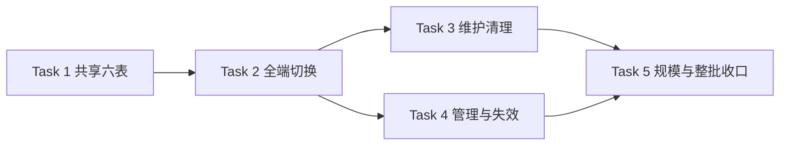

# 外部来源缓存按来源拆表 Implementation Plan

> **For agentic workers:** REQUIRED SUB-SKILL: Use superpowers:subagent-driven-development (recommended) or superpowers:executing-plans to implement this plan task-by-task. Steps use checkbox (`- [ ]`) syntax for tracking.

**Goal:** 将外部来源缓存集中到 cache.db，按来源拆成六表，通过共享缓存实现维持原业务语义，并验证大表定向读取与有界清理。

**Architecture:** media crate 提供固定 CacheSource、六表 schema 与共享 SQL，Store 与六来源客户端复用；运行时只读写 cache.db。用户明确旧开发数据可全部舍弃，因此采用停服后重建的干净切换，不写旧缓存导入或兼容层。原浏览失效与维护控制接入新表，不另造调度系统。

**Tech Stack:** Rust 2024、rusqlite 0.37（bundled SQLite）、serde/serde_json、现有 Axum 与 pnpm 前端；复用现有依赖方向，不新增依赖。

**Spec:** [按来源拆表设计](../specs/2026-10-18-source-separated-cache.md)。执行者同时阅读设计与计划；不扩大到整个数据库重设计或 DB-07。

## Global Constraints

- 用户已明确：**项目未上线，现有数据库数据可以全部舍弃，不要求兼容或迁移旧数据。** 本计划不执行删除；实施收尾时停服务、确认数据路径后一次性重建。
- 唯一运行时缓存文件 `{data_dir}/cache.db`；六表固定为 tmdb_cache / douban_cache / tvdb_cache / bangumi_cache / anilist_cache / fanart_cache，共用实现。
- 不创建导入器、cache_imports、迁移完成标记、兼容视图、新旧双读双写或旧裸 rowid 游标转换；不把清空数据库放进正常启动逻辑。
- 默认 TTL **604800 秒（7 天）**；expires_at=NULL 不过期，expires_at<=now 已过期；保留端点校验后替换、stale-if-error 与语言/参数缓存键。
- cache.db 使用 schema **1**，高版本拒绝打开；其他 DB 版本不因缓存改名而重置，其他业务历史迁移的清理另立任务。
- 连接继续 WAL、5000ms busy_timeout、foreign_keys=ON；同文件仍有写锁竞争，不宣称分表可并行提交。
- cache.db 中 revision/journal 各一份，逐行事件阈值 **1024**，逻辑 entity_kind=`catalog_cache`，entity_key=`<source>:<cache_key>`。
- 清理全局每批 examined<=**500**，单次维护最多 **20 批或 2 秒**（批间检查）；默认关闭/dry_run=true/90 天，详情与未知 key 保护不变。
- `.rs` 文件硬上限 800 行，生产函数 120 行；只按此次职责拆出新模块，不顺手重构其他功能。
- fake HTTP/临时 DB 测试，不碰真实来源；NAS/生产设备验收按用户决定延后、写 Not run。
- Cargo 统一 `CARGO_TARGET_DIR=/tmp/crawler-media-transfer-flake-target`，保留 debug=0 与共享缓存；迭代只跑目标，整批由集成者跑 workspace 一次。

## Review Focus

1. **来源与键边界**：六来源同键、未知 source、语言参数、`%`/`_`/非 ASCII key 不串表、不扩大删除范围；Task 1、2。
2. **过期与错误响应**：过期详情在断网时仍可读，畸形新响应不覆盖可用旧值，cache SQL 失败不是 miss；Task 2。
3. **启动/重启与缓存丢失**：新库不创建旧文件，单独丢失 cache.db 后旧游标不跳过新事件，正常重启不重复清游标；Task 2、4。
4. **清理停止边界**：六表共享批次预算、同时间游标不漏行、详情保护、preview 零写、首批停用阻止第二批；Task 3。
5. **规模证明**：不能以分表或返回行数冒充不扫描；定向查询要测实际 VM/Fullscan，写成本/空间如实报告；Task 5。

---

## File Structure 与职责

| 创建/修改 | 文件 | 责任 |
|---|---|---|
| Create | `crates/media/src/response_cache/{mod.rs,source.rs,schema.rs,queries.rs}` | 固定来源、错误/行模型、schema/触发器、共享读写 SQL |
| Modify | `crates/media/src/{lib.rs,cache.rs,client.rs,douban.rs,tvdb.rs,bangumi.rs,anilist.rs,fanart.rs}` | 六客户端选表，保持 TTL/解析/回退 |
| Modify | `crates/store/src/{open.rs,lib.rs,schema.rs,catalog.rs,browse_changes.rs,browse_projection.rs}` | cache 连接、schema 预检、Store 缓存 API、定向详情与逻辑 journal 读取 |
| Modify | `crates/store/src/schema/{browse_changes.rs,data_retention.rs}` | 移除旧共享缓存表专属 DDL/触发器职责，改复用共享初始化 |
| Modify | `crates/api/src/{main.rs,scrape_metadata.rs,catalog_cache.rs}` | main/fanart 同一路径、参数与响应 |
| Create | `crates/store/src/data_retention/cache.rs` | 分表 keyset 窗口与游标编码，从既有 data_retention.rs 提取 |
| Modify | `crates/store/src/data_retention.rs`、`crates/api/src/maintenance/{database.rs,data_retention.rs}`、`web/components/maintenance-job-settings.tsx` | 清理接线、维护目标、缓存说明 |
| Test/Create | `crates/media/tests/{source_cache.rs,source_cache_scale.rs}` | 共享存储、键/有效期、真实 SQL 工作量 |
| Test/Create | `crates/store/tests/{source_cache.rs,source_cache_retention.rs}` | Store/失效与清理合同 |
| Test/Create | `crates/api/tests/cache_database_cutover.rs` | 临时启动、六客户端、HTTP、重启烟测 |
| Modify | 现有 media 来源测试、store catalog_prefix_scale/open/connection_policy、api persistence/maintenance_runtime/data_retention_control/management catalog cache | 更新真实物理结构 fixture，不重新钉住旧文件行为 |
| Modify/Create | `docs/database/cache.md`、数据库导航、ADR-0008、deploy、`docs/benchmarks/2026-10-18-source-cache.md` | 新结构、开发库重建、实测与恢复说明 |

执行前用搜索列出生产 `catalog.db`、`fanart.db`、`catalog_cache` SQL、`Store.catalog` 的引用，全部按上述职责迁移；历史文档可保留旧名但必须标历史。不修改媒体字节、其他 DB 模型或公开图片鉴权合同。

## Task 1: 共享六表存储与固定来源映射

**Files:** Create `response_cache/{mod,source,schema,queries}.rs`；Modify `crates/media/src/lib.rs`；Test Create `crates/media/tests/source_cache.rs`。

**Interfaces:** 公开 `media::response_cache`：

```rust
pub enum CacheSource { Tmdb, Douban, Tvdb, Bangumi, Anilist, Fanart }
// derive Copy/Clone/Debug/Eq/PartialEq；FromStr<Err=CacheDbError>。
pub const CACHE_SOURCES: [CacheSource; 6];
impl CacheSource {
    pub const fn as_str(self) -> &'static str;
    pub const fn table_name(self) -> &'static str;
}
pub struct CacheRow {
    pub source: CacheSource, pub entry_id: i64, pub cache_key: String,
    pub body: String, pub fetched_at: i64, pub expires_at: Option<i64>,
}
pub enum CacheDbError {
    Sqlite(rusqlite::Error), Io(std::io::Error), UnknownSource(String),
    UnsupportedVersion { found: i64, supported: i64 },
}
pub fn initialize(conn: &rusqlite::Connection) -> Result<(), CacheDbError>;
pub fn open(path: &std::path::Path) -> Result<rusqlite::Connection, CacheDbError>;
pub fn get(conn: &rusqlite::Connection, source: CacheSource, key: &str)
    -> Result<Option<CacheRow>, CacheDbError>;
pub fn put(conn: &rusqlite::Connection, source: CacheSource, key: &str,
    body: &str, fetched_at: i64, expires_at: Option<i64>) -> Result<(), CacheDbError>;
pub fn delete(conn: &rusqlite::Connection, source: CacheSource, key: &str)
    -> Result<bool, CacheDbError>;
pub fn list(conn: &rusqlite::Connection, source: Option<CacheSource>)
    -> Result<Vec<CacheRow>, CacheDbError>;
pub fn details_for_prefixes(conn: &rusqlite::Connection, source: CacheSource,
    prefixes: &[String]) -> Result<Vec<CacheRow>, CacheDbError>;
```

CacheDbError 用 thiserror，SQLite/IO 实现 From；只记录 source/key 和错误，不记录 body、完整 token。CacheSource 不能与现有 `media::Source`（不含 fanart 的身份别名枚举）混用。

- [ ] **Step 1: 写失败测试。** `same_key_in_six_sources_is_isolated`、`updates_keep_entry_id_and_exact_prefix_boundaries`、`unknown_source_cannot_become_sql_identifier`、`newer_schema_rejected_and_reopen_is_idempotent`：

```rust
for (i, source) in CACHE_SOURCES.into_iter().enumerate() {
    put(&conn, source, "same-key", &format!("body-{i}"), 100, None)?;
}
assert_eq!(list(&conn, None)?.len(), 6);
assert_eq!(get(&conn, CacheSource::Tmdb, "same-key")?.unwrap().body, "body-0");
assert!("tmdb_cache; DROP TABLE tmdb_cache".parse::<CacheSource>().is_err());
// 同一键 put 两次：entry_id 不变；只删 TMDB 同键，其他五来源仍在。
// prefixes=/movie/42、/movie/100%、/movie/a_b、/电影/一：
// 精确断言 exact/?language 的 key 列表，排除 420、/images、通配符误匹配。
```

使用真实内存 SQLite；版本用例先创建 sentinel 表并设 user_version=2，initialize 返回 UnsupportedVersion，schema/版本/sentinel 均不变。正常重复初始化/重开不改数据，六表 recent/retention 索引均可用。

- [ ] **Step 2: 跑 RED。** `cargo test -p media --test source_cache`；补齐新 API 的编译红后记录来源隔离、更新稳定 ID、前缀与版本保护的行为失败。
- [ ] **Step 3: 实现 Interfaces。** 使用设计第 2 节固定 DDL、六表固定映射，UPSERT 保留 entry_id；值全部绑定。schema/版本一事务初始化，创建一份 revision/journal，六表固定 source 的触发器。将缓存专属触发器构造从 Store 的旧 catalog 路径提取为共用实现，不复制两份。
- [ ] **Step 4: 跑 GREEN。** `cargo test -p media --test source_cache`，并运行既有 `tmdb`、`fanart`、`connection_policy` targets。本任务引入新公共模块；Task 2 必须删除旧客户端共用表运行路径，不能永久保留两套。
- [ ] **Step 5: Commit。** `git add crates/media/src/response_cache crates/media/src/lib.rs crates/media/tests/source_cache.rs && git commit -m "feat(cache): add shared source-separated cache tables"`。

## Task 2: Store 与所有客户端干净切换

**Files:** Modify 上述 media 六客户端与 cache.rs；Store open/lib/schema/catalog/browse_changes/browse_projection 与 schema 下旧 catalog 触发器/索引；API main/scrape_metadata/catalog_cache；Test `crates/store/tests/source_cache.rs`、`crates/api/tests/cache_database_cutover.rs` 与现有来源 fixture。

**Consumes:** Task 1 的 CacheSource / CacheDbError / 共享 SQL。

**Produces:**

```rust
// media::cache，仍为六客户端共用的私有实现
impl CatalogCache {
    pub fn open_source(path: impl AsRef<std::path::Path>, now: i64,
        source: media::response_cache::CacheSource) -> Result<Self, TmdbError>;
}
// Store
pub fn cache_db_path(&self) -> std::path::PathBuf;
// 现有 put/get/list/delete_catalog_cache、catalog_details_batch、
// catalog_details_for_prefixes 的签名保留，source:&str 在边界解析成 CacheSource。
```

Store 连接改为 `cache: Connection`，StoreError/TmdbError 以 `#[from] CacheDbError` 保留错误。ReadRevisions.catalog/BrowseChangeSource::Catalog 保留逻辑名，但实际读 cache.db；物理 schema_versions 标签与 db_paths 改 cache。新建缓存文件时，在后台启动前清 library 的逻辑 catalog cursor 并标脏投影；正常重启不清游标。不创建任何旧数据导入/完成标记。

- [ ] **Step 1: 写失败测试。** `fresh_install_creates_cache_not_catalog_or_fanart`、`six_clients_and_store_share_the_same_cache`、`cache_recreation_resets_projection_cursor`、`expiry_and_invalid_response_preserve_stale_contract`：

```rust
let store = Store::open(dir)?;
assert!(dir.join("cache.db").is_file());
assert!(!dir.join("catalog.db").exists());
assert!(!dir.join("fanart.db").exists());
assert!(store.get_catalog_cache("unknown-source", "/movie/42").is_err());
// 真 Tmdb<FakeHttp> 与 FanartClient<FakeHttp> 写 cache.db，Store 读取/删除同一行。
// 六来源分别断言：miss->fetch->put，重开客户端 hit 不 fetch。
// 关闭连接后只移除临时 cache.db，保留 library 的旧 cursor>0；重开 Store：
assert_eq!(store.browse_change_cursor(BrowseChangeSource::Catalog)?, 0);
// 后续新缓存 seq=1 的事件可消费；正常第二次重启保留已确认 cursor。
```

TTL 测试用 now=100、expires_at=100 精确到期边界、NULL expiry、now=0 实时时钟；过期有效 body 在 fake HTTP 失败时返回，畸形新响应不能覆盖旧值。来源表 SELECT 失败需返回错误，不得降为 cache miss。

- [ ] **Step 2: 跑 RED。** `cargo test -p store --test source_cache`、`cargo test -p api --test cache_database_cutover` 以及 media 既有 stale regressions；应观察旧文件创建、来源串扰或失效游标错误。
- [ ] **Step 3: 切换全部读写。** 客户端与 Store 调同一共享 SQL；删除旧共用表 catalog_cache 的生产建表/CRUD 与 catalog/fanart 物理连接。main 五来源与两处 fanart 接线用 cache_db_path。Store 启动高版本预检不因改缓存顺序破坏其他 DB 的拒绝降级规则；必要修改处先走同库 schema 校验。不要把 schema1 声称为其他 DB 的首发重设计。
- [ ] **Step 4: 跑 GREEN 与实际烟测。** `cargo test -p media`；`cargo test -p store --test source_cache --test catalog_prefix_scale --test open --test connection_policy`；`cargo test -p api --test cache_database_cutover --test persistence`。烟测启动临时 Store→fake 六客户端→重启→缓存命中，确认未生成旧文件；不连接生产数据。
- [ ] **Step 5: Commit。** 只提交本任务调用点/必要 fixtures，`git commit -m "refactor(cache): use cache.db across all source clients and store reads"`。

## Task 3: 来源分表的维护与清理

**Files:** Create `crates/store/src/data_retention/cache.rs`；Modify data_retention.rs、API maintenance/database.rs / data_retention.rs、web maintenance-job-settings.tsx；Test `crates/store/tests/source_cache_retention.rs`、API maintenance_runtime / data_retention_control / maintenance_acceptance / maintenance_config / maintenance_sqlite。

**Interfaces:** 保留 DataRetentionCursor/DataRetentionBatch；实现私有：

```rust
pub(super) fn prune(store: &Store, cutoff_ms: i64,
    cursor: Option<&DataRetentionCursor>, limit: usize, dry_run: bool)
    -> Result<DataRetentionBatch, StoreError>;
// cursor.at_ms 继续毫秒；cursor.id = "<source>:<entry_id>"。
```

DatabaseName 删除 Catalog/Fanart，增加 Cache；目标固定 app/cache/library/subscribe/jobs。已有 vacuum/禁用/停止检查不变，不新增默认清理；开发数据整体重建，不转换旧维护游标。

- [ ] **Step 1: 写失败测试。** `six_sources_share_one_retention_budget`、`detail_unknown_and_fanart_are_protected`、`preview_is_read_only_and_equal_timestamps_resume`、`disable_after_first_batch_stops_second`、`database_targets_include_cache_once`：

```rust
let batch = store.prune_data_history(RetentionClass::TransientCatalog, cutoff_ms, None, 500, false)?;
assert!(batch.examined <= 500);
assert_eq!(batch.deleted + batch.protected, batch.examined);
assert!(batch.incomplete);
assert_eq!(deleted_after_disable_boundary, 500);
assert_eq!(target_names, ["app", "cache", "library", "subscribe", "jobs"]);
// dry-run 前后六表、journal/revision、settings 游标完全相同。
// 六表同 fetched_at、同 entry_id：反复回传 source:entry_id 游标不漏不重。
```

100k 合成行覆盖 search/discover/trending、详情/未知 key、cutoff 边界、各来源交错。每表最多取 limit+1，再合并全局前 500；另记录预取上界 6×501，不声称 SQL 只扫描 500 行。

- [ ] **Step 2: 跑 RED。** `cargo test -p store --test source_cache_retention`、`cargo test -p api --test data_retention_control --test maintenance_runtime`；观察旧单表选择/裸 rowid 游标/旧维护目标的错误。
- [ ] **Step 3: 实现 prune 和维护目标。** 按 `(fetched_at,source固定顺序,entry_id)` 归并，删除只作用于选中的具体来源表键；URL 白名单、详情保护、preview 零写、批间取消/停用不变。fanart 通常无 transient key，受保护而非一概清掉。
- [ ] **Step 4: 跑 GREEN。** 上述 targets 加 maintenance_acceptance/config/sqlite；如改前端文案跑 `pnpm -C web test` / `pnpm -C web typecheck`。报告预取/检查/删除/保护/剩余，首批后停用必须阻止第二批。
- [ ] **Step 5: Commit。** `git commit -m "refactor(maintenance): maintain source cache tables with bounded shared budgets"`，只暂存本任务文件。

## Task 4: 缓存管理与投影失效合同收口

**Files:** Modify `crates/api/src/catalog_cache.rs`、`crates/api/src/browse_projection/changes.rs`（仅必要解析）、`crates/api/src/http/library/selection/{snapshot.rs,metadata.rs}`（仅读接口接线）；Test 扩展 `cache_database_cutover.rs`、management catalog_cache/CLI、store browse_change_recovery/journal_bound。

**Consumes:** 保留签名的 Store cache API，六表 list 排序和统一 logical Catalog journal。

- [ ] **Step 1: 写失败测试。** `source_delete_keeps_other_sources`、`direct_client_write_invalidates_projected_detail`、`source_read_failure_cannot_be_partial_success`：

```rust
// 六来源同键；HTTP 删除 source=tmdb 后 Douban/fanart 同键不动。
assert_eq!(delete_response["data"]["deleted"], true);
// Tmdb<FakeHttp> 直接更新缓存表，消费来源 journal 后受影响投影 dirty token 递增。
assert!(after.dirty_token > before.dirty_token);
// 将某来源表临时改名后管理列表必须报错，不是省略该来源返回200。
assert_ne!(listing_status, 200);
```

补 source 注入返回 `catalog.invalid` 400、聚合视图不把 fanart 原始响应伪造成 Media、普通重启不重置游标、重建 cache 后旧高位 cursor 不跳过新事件。保持当前路由/CLI/前端 DTO、图片公开鉴权不变。

- [ ] **Step 2: 跑 RED。** `cargo test -p api --test cache_database_cutover --test management`，先按名字过滤新用例取得行为失败，不拿已有用例本来绿当新 RED。
- [ ] **Step 3: 接线与清 dead path。** 缓存参数仍是来源名，不是表名；所有来源错误向上抛。只在不能改变 membership/count 的可选 enrichment 上保留原 fallback。搜索生产旧文件/旧表 SQL，逐个迁完；删除临时兼容代码，不留别名入口。
- [ ] **Step 4: 跑 GREEN。** `cargo test -p api --test management --test cache_database_cutover --test browse_projection_hot_path --test browse_semantic_parity --test data_retention_control`；`cargo test -p store --test browse_change_recovery --test browse_change_journal_bound`。
- [ ] **Step 5: Commit。** `git commit -m "fix(cache): preserve cache management and projection invalidation after table split"`，只提交本任务接线与回归。

## Task 5: 规模证明、文档、开发库重建与整批审查

**Files:** Create `crates/media/tests/source_cache_scale.rs`、`docs/benchmarks/2026-10-18-source-cache.md`；Modify `crates/store/tests/catalog_prefix_scale.rs`、`crates/api/tests/cache_database_cutover.rs`、`docs/database/{README.md,catalog.md,fanart.md}`（合为新 cache.md 后删除旧字典）、ADR-0008、deploy。

**Interfaces:** 测试内部 `QueryWork { vm_steps:i64, fullscan_steps:i64, rows:usize }`，在实际 SQL statement 采集 `StatementStatus::{VmStep,FullscanStep}`；不用响应条数猜扫描工作。

- [ ] **Step 1: 写规模回归。** `source_lookup_and_prefix_work_ignore_unrelated_growth`、`retention_query_uses_source_time_index`；固定目标 key/输出，加入同来源 1k→50k 无关行，另加其他来源50k：

```rust
assert_eq!(large_rows, small_rows);
assert!(small.vm_steps > 0);
assert!(large.vm_steps <= small.vm_steps * 2);
assert_eq!(large.fullscan_steps, 0);
assert_eq!(after_other_sources.vm_steps, before_other_sources.vm_steps);
```

100k 清理回归使用 Task 3 的预算断言；压力测试用多连接真实写六表再读回，断言完整数据/来源隔离/无死锁和错误不被吞。记录写入耗时、DB/WAL 字节、point/prefix/清理 SQL 工作，不只展示理想单条 seek。

- [ ] **Step 2: 验证测试能失败。** 将定向 SQL 变异成全表读后内存过滤，记录 VM/Fullscan 断言失败后恢复。这里叫变异验证，不伪称实施前 RED。
- [ ] **Step 3: 更新文档。** cache.db 字典列全六表+revision/journal（共8张代码表），移除旧 catalog/fanart 独立字典并改导航；ADR 更新为五文件布局。deploy 明示现有开发数据可丢、此次不迁移；API-01 等逻辑目录名不等同旧物理文件名。新缓存格式从1开始，其他DB版本不顺便清零。
- [ ] **Step 4: 实施时一次性重建开发数据。** 先停止 API、所有后台/外部写入进程；解析实际 data_dir 和可能自定义的 app_path，列出将删除的明确 DB 文件及 WAL/SHM。按用户授权只删除这些 SQLite 文件（app/catalog/library/subscribe/jobs/fanart/cache），不递归删除数据目录，不删除媒体/sidecar/下载/YAML/编译缓存。此步骤不做成普通启动自动清理；记录实际清单和执行结果。删除失败不继续宣称切换成功。
- [ ] **Step 5: 运行新实例烟测与整批 GREEN。** 临时实例 fake 六来源客户端→缓存管理 API→维护 preview→停服重启，确认新五文件布局、六来源命中、不生成旧文件。运行触及的 `cargo test -p media` / `-p store` / `-p api`，最后稳定树 `cargo test --workspace` 一次；改了 web 文案则 test/typecheck/build。真实来源网络、NAS大数据均标 Not run。
- [ ] **Step 6: 整批 review 与提交。** 新 reviewer 按 Spec/Review Focus 五项检查来源全部读写/游标/失效/维护调用链，发现退回所属任务，不能以局部 target 绿关闭整批。`git commit -m "test(cache): verify work bounds and document clean pre-release cutover"`，只暂存本任务文件。

## 依赖、并行与自审



Task 3/4 可以不同 agent 并行，各自只写本任务文件；共享初始化/API 接口变化先在 Task 2 完整交付。统一构建缓存，每个 agent 迭代只跑目标，最后集成者一次 workspace。按用户既定方法执行：文件不重叠的子代理并行，末尾统一 review；同一时刻最多一个 grok-4.7，所有 grok 只走 grok-self，额度/网络问题断点重试后轮换。

自审映射：六表/共享实现→Task1；无迁移重建/所有客户端/TTL与旧缓存回退→Task2/5；清理预算和保护→Task3；API/失效/错误传播→Task4；性能、写成本、文档、重建和完整烟测→Task5。Review Focus 1→Task1/2；2→Task2；3→Task2/4；4→Task3；5→Task5，无遗漏项。

本计划只产出设计与步骤；用户审阅确认前不实施。旧数据可舍弃不等于需要马上执行删除。
