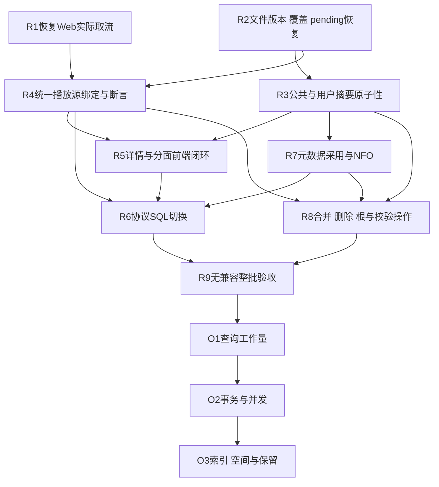

# 存储干净切换修复与第二步优化 Implementation Plan

> **For agentic workers:** REQUIRED SUB-SKILL: Use superpowers:subagent-driven-development (recommended) or superpowers:executing-plans to implement this plan task-by-task. Steps use checkbox (`- [ ]`) syntax for tracking.

**Goal:** 先关闭已证实的数据损失、运行阻断和生产迁移缺口，再量化优化查询/事务成本；不增加旧库兼容。

**Architecture:** 保留 app/library/subscribe/cache/jobs 五文件。library 内以文件/覆盖、元数据、Playback 原始事实为权威，由用例事务维护公共/用户摘要；Web/Jellyfin/CLI 迁完后删除旧数据适配，禁止再用 LedgerRow 回写完整文件事实。修复期不引入新数据库、消息系统或第二份全文件投影。

**Tech Stack:** Rust 2024、rusqlite 0.37 bundled SQLite、Axum、serde/thiserror/tracing；现有 Vite/React 19/TypeScript；不预先增加连接池或依赖。

**Spec:** [存储设计](../specs/2026-10-18-library-storage-redesign.md)、[原实施计划与开发合同](2026-10-18-library-storage-redesign.md)、[接口合同](2026-10-18-library-storage-contracts.md)。现状见 [数据库字典](../../database/README.md)，历史运行证据见 [检查与基准](../../benchmarks/2026-10-18-library-storage.md)。本计划补齐既有要求，不缩小原 T1–T12/F1–F5/R1–R3。

状态：**方案已编写，业务修复尚未执行**。基线 `a3dab1b`；上次审查基线 `0a046e0`。本次文档提交不把任何下列任务标为已完成。

## Global Constraints

- 无旧数据导入、兼容视图、双读双写、旧版本回退；一次干净切换，全部调用方直接使用新模型。
- TV S00E00 合法；movie/video whole 固定 `(-1,-1)`；禁止旧 movie `(0,0)` 回读/复制。正常 Jellyfin 协议和来源回退不属于旧库兼容。
- 保留身份、权限、过滤、精确 count、字幕/音轨/章节、STRM、pending 恢复及媒体字节；不能删功能或放宽鉴权换取通过。静态图片仍公开，视频按协议认证。
- 文件内容变化必须产生可校验的新物理源版本；pending/missing/unknown 不得成为可播放源。清缓存不改变本地采用事实。
- 同库事实/覆盖/terms/items/受影响用户摘要原子发布。事务外完成网络、stat、目录枚举、NFO/大 JSON 解析；扫描输入窗口最多100文件。
- 跨库操作使用持久阶段和幂等恢复，不宣称共享进程锁或多个连接带来跨文件事务。
- 每个修复先在公开 Store/HTTP 行为 seam 取得失败，再实现；已有失败证据不反复确认。测试不依赖真实 TMDB/qBittorrent/Chromium。
- 每个触及 crate 单独 `cargo test -p <crate>`；稳定树最后一次 `cargo test --workspace`。前端执行 typecheck/test/build，实际页面浏览与取流不能仅由类型测试替代。
- Rust 文件≤800行、生产函数≤120行、测试函数≤120行。改动已有超限文件时按职责拆分；不做无关重排。
- 每任务 GREEN 后更新对应状态/字典并仅提交本任务文件；内部绿色不等于全切换完成，不操作用户实例或删除实际 DB/媒体。

## Review Focus

1. 一文件覆盖两集、多版本、TV S00E00：覆盖和观看独立，迟到事件不得污染另一个逻辑目标（R2/R4）。
2. 断电停在 pending、sidecar 已替换未登记、跨库合并阶段：重启可继续，不重复发布/计数，不丢来源（R2/R7/R8）。
3. 文件替换/STRM URL变化/音轨重排：旧 worker、旧会话、旧恢复包不得写到新源（R2/R4）。
4. 无用户摘要行、最后文件删除再导入、同作品多库：原始状态可恢复，当前用户写入不扫描其他用户（R3/R4）。
5. 根不可达、嵌套根、私有 Collection/隐藏 Library：不误判 missing、不跨权限选源或泄漏分面（R5/R6/R8）。

## 1. 已知问题台账与任务归属

证据 `运行` 指上轮 `0a046e0` 的 Store/真实 API 烟测；`源码` 指具体调用链。不是本轮重新运行结果，也不表示 `a3dab1b` 对所有问题重新复现。

| ID | 问题 | 证据 / 当前状态 | 任务 |
|---|---|---|---|
| B01 | Web会话200但返回的物理UUID取流404 | 运行；session.rs:60/141与typed ItemId解析不一致 | R1 |
| B02 | Probe摘要与持久常量v1不匹配；替换不推进FileVersion/摘要 | 源码；probe.rs:748、scan_probe_obligations.rs:94、scan_seen.rs | R2 |
| B03 | Transfer收尾把多集覆盖缩成单集 | 运行；ledger.rs:304；run.rs:72–83 | R2 |
| B04 | pending重试生成新file_id，撞唯一path | 源码；collect.rs:644、recorder.rs:45–59 | R2 |
| B05 | 文件增删不重建用户摘要；whole增量被计入分集 | 运行/源码；reduce.rs:78–106、reduce_incremental/units.rs:66 | R3 |
| B06 | 实际心跳保留旧源绑定；自动恢复不优先仍可用原源 | 源码；units.rs:226、mutate.rs:89 | R4 |
| B07 | Jellyfin原始位置、played断言时钟、多集会话混用 | 源码；items.rs:447、user_marks.rs:33、playback_events.rs:91 | R4 |
| B08 | 电影旧0,0回读/复制仍存在 | 源码；units.rs:323–405、http/playback.rs:65–72 | R4 |
| B09 | 详情首50文件cursor丢失；观看分面恒0；content_rating适配遗漏 | 运行/源码；details.rs:192、facets.rs:146、web/lib/api/libraries.ts | R5 |
| B10 | 协议查询未生产接线，Rust全量筛选及物理多版本重复逻辑ID | 源码；selection/scope.rs、selection/mod.rs、light.rs | R6 |
| B11 | 完整采用未接通；最后来源获胜；无效NFO丢有效字段；自产反馈缺失 | 运行/源码；metadata/adopt.rs、nfo_input.rs、scrape_metadata.rs:638 | R7 |
| B12 | self-merge先删事实后失败；人工锁/来源冲突/NFO迁移/摘要顺序错误 | 运行/源码；playback/mutate.rs:384、merge*.rs | R8 |
| B13 | 多覆盖/Unidentified删除阻断，嵌套根持久归属漂移 | 运行/源码；library_deletion.rs、libraries.rs、roots.rs | R8 |
| B14 | 根/locale/integrity有表无完整操作运行链 | 源码；library_operations/integrity_state仅结构不等于行为 | R8 |
| B15 | 深cursor OR退化；cursor无上下文绑定、units cursor被忽略 | 运行/源码；items.rs:452–499、details.rs:135–138；正确性先修，工作量后测 | R5/O1 |
| B16 | cache两个初始化器索引不同；现行字典/验收状态失真 | 源码；Store/cache.sql与media/response_cache/mod.rs；本轮先纠正文档 | O3/R9 |
| B17 | 扫描TOCTOU提前确认版本的三项workspace失败 | 历史失败；`a3dab1b`已改checkpoint清stat，本轮未重跑；不能称当前仍失败或全部已修 | R2/R9 |
| B18 | TV只有season无可靠episode时写(s,-1)非法物理覆盖 | 源码；scan_probe_obligations.rs:121–125 | R2 |

## 2. 实施顺序与所有权



self-merge的拒绝保护属于R8，但数据损失防护应与R1优先落地；保护不允许代替R8剩余合同。R1/R2可独立实施；R5依赖R4有效played合同与R3摘要，R7依赖R3，接口明确后可并行。HTTP router/ApiState、公共schema、domain类型由一个集成者持有，避免同文件并发编辑。下文 `store/src`、`api/src`、`domain/src`、`library/src`、`media/src`、`subscribe/src`、`media-server/src` 均相对 `crates/`；同一Files行的兄弟短路径沿前一个crate模块解析。代码块是验收不变量/公共协议示例，不是伪造已存在的 fixture helper。

## R1：修复真实 Web 会话到物理源取流

**Files:** `crates/api/src/http/playback/session.rs`、`http/mod.rs`、`media_server_provider.rs`、`crates/media-server/src/provider/mod.rs`、`routes/media/playback.rs`；`web/lib/api/playback.ts`、`web/components/player/video-player.tsx`。测试扩展 `crates/api/tests/playback_read_regression.rs` 和 `crates/media-server/tests/playback_stream.rs`。

**Interfaces:** 保留 POST `/api/v1/playback/sessions` 的 `stream_url/file_id/play_session_id`。取流必须使用会话签发的 `(user,device,logical unit,file_id,file_revision,source_version,library config_revision)`，从 session binding 定位源，而不是重新选择默认文件。实际视频路由核验认证、Library可见性/生命周期与源版本；不能接受旧裸file UUID作为逻辑项目兼容入口。

Web选定wire合同为 `/api/v1/playback/sessions/{play_session_id}/stream?device_id={device}&api_key={token}`，handler按签发会话读取逻辑目标与物理版本，Web只用完整返回URL。该视频路由按既有视频认证取User，绑定user/device/session并检查当前授权；不放public图片router。Jellyfin `/Videos/{typed_logical_item_id}/stream` 保留协议表面，在R4迁其MediaSourceId与可选PlaySessionId消费者；不能强迫所有协议取流先走Web会话接口。协议携源/会话时严格验证绑定；无会话的合法取流仍按协议校验逻辑目标与授权可用源，不接受旧裸file UUID作为逻辑ItemId。

- [ ] RED：真实Router创建临时MP4文件、签发会话，再GET返回的URL和Range；另选两个可播放版本时断言返回选定版本的字节，不只检查URL字符串。

```text
POST /api/v1/playback/sessions {media_item_id:<Media UUID>, file_id:<selected file UUID>, device_id:"review"}
=> 200, stream_url 非空
GET <stream_url> Range: bytes=0-3 => 206，body等于选定文件前4字节
撤销权限/替换file_revision后GET同URL => 拒绝，不能切到另一版本
```

- [ ] 执行 `cargo test -p api --test playback_read_regression`，记录实际失败；实施上述同一会话源绑定读，不给旧取流UUID加fallback。
- [ ] GREEN：同目标及 `cargo test -p media-server --test playback_stream`；独立运行api/media-server全套；临时真实HTTP服务取流并在Web播放器打开、seek，截图/网络观察后关闭浏览器。
- [ ] 更新API调用映射和状态，提交 `fix(playback): stream the session-bound physical source`。

## R2：统一文件观察、源版本、覆盖与 Transfer 恢复

**Files:** `domain/src/library_storage.rs`；`api/src/fingerprint_job/cache_key.rs`、`probe_manager/probe.rs`、`watch_ledger.rs`、`http/library_scan/runner/{walk,checkpoint}.rs`、`worker/transfer/{recorder,run}.rs`；`store/src/{scan_probe_obligations,scan_seen,ledger}.rs`、`library_write/{publish,probe}.rs`；`subscribe/src/{collect,types}.rs`。

**Interfaces:** 保留 `FileVersion { revision, source_version }`、`FileCoverage { file, units }`、`TransferRecorder` 与 `publish_files` 的完整事实合同。将现有 `media_source_version(path: &Path) -> String` 的纯观察规则收敛到library/domain允许的正确边界（IO不放domain）；扫描、Transfer、Probe共用同一结果。观察输入在事务外产生，提交时CAS；不以字符串v1、当前时间或晚到worker的重新读取冒充捕获版本。

- [ ] RED：扩展 `store/tests/probe_publication.rs`、`file_publication.rs`；API `storage_write_runtime.rs`、`probe_retry_support.rs`；subscribe `partial_collection.rs`。公开行为覆盖：正常扫描后Probe冷详情可读；同文件E01–E02 Transfer完成覆盖均存在；pending前后退出重启复用同file_id；冲突来源不覆盖；season已知episode未知登记但units为空；TV S00E00正常。

```text
发布E01-E02 => units={(1,1),(1,2)}；Transfer finalize后仍为同集合；size只计一次
观察源A -> 替换B -> worker(A)发布 => false，B事实不变
新源B确认 => revision递增，旧resume/worker无权写B，旧质量/轨道不沿用
pending prepare -> reopen -> retry => 同一file_id，字节只成功发布一次
```

- [ ] 用真实ApiState+fake MediaProbe/Downloader先取得行为RED；运行 `cargo test -p store --test probe_publication --test file_publication`、`cargo test -p subscribe --test partial_collection`。
- [ ] 实施：Transfer finalize消费 `RunOutcome.files`/完整FileCoverage，删除LedgerRow收尾写；pending预留事务按路径核对media/source/mode后返回已有身份；替换事务统一推进版本、失效热/冷派生事实、重挂义务并归约；持久“观察stat”与“已确认处理版本”分清，不靠清空展示stat模拟新物理版本。更改schema须同步生产DDL、布局版本及所有新库消费者，不加旧库导入器。
- [ ] GREEN：上述目标和 `cargo test -p api --lib http::library_scan::runner::tests`。`a3dab1b`的三项故障恢复已改代码，此处验证当前行为且保留重启/失败注入，不能因旧失败日志去撤销用户修复。每触及crate独立全套。
- [ ] 真实临时目录扫描/Transfer/Probe→替换STRM→重启烟测，更新字典，提交 `fix(storage): publish versioned file coverage without lossy adapters`。

## R3：事实变化同事务维护公共及用户摘要

**Files:** `store/src/library_write/{reduce,reduce_incremental/mod,reduce_incremental/units,delete,publish}.rs`、`playback/user_summary.rs`；测试 `storage_invariants.rs`、`file_publication.rs`、`playback_storage_v1.rs`。

**Interfaces:** 复用 `refresh_user_library_summary` 的统一played归约；文件变化从 `playback_units` 按media索引枚举相关用户，写当前受影响Library摘要；普通心跳仍只更新当前用户，不调用全用户文件归约。内部连接/事务辅助不暴露给API。

- [ ] RED：收藏电影→删最后文件→重开→导入同Media；验证原始favorite=true且favorite过滤返回该项。只有E01且已看→加E02，完成数1/拥有数2、NextUp为E02。其他库/用户不受无关变化影响。

```text
last-file delete: media/playback_units/collection membership保留，item/user summary消失
reimport: item与有非默认事实用户摘要同提交恢复，favorite count=1
whole=(-1,-1)增删不改变distinct_episode_count；完整重算与增量结果相同
```

- [ ] 执行 `cargo test -p store --test storage_invariants --test file_publication --test playback_storage_v1`，先行为失败。
- [ ] 实施同一事务归约、完整/增量同口径、覆盖/质量变化的首选源重选；语义未变不无条件推进revision。事务失败从另一连接看不到部分摘要。
- [ ] GREEN及 `cargo test -p store`，实际Store重启重导入烟测，更新状态，提交 `fix(store): rebuild scoped user summaries with file facts`。

## R4：两个协议统一恢复包、会话授权与 played 断言

**Files:** `store/src/playback/{mutate,source,units,session_ids,sessions,user_summary}.rs`；`api/src/http/playback{.rs,/heartbeat.rs,/selection.rs,/session.rs}`、`playback_events.rs`、`media_server_provider/{playback,items,user_marks,selection/light}.rs`；`web/lib/api/playback.ts`、player消费者。

**Interfaces:** 生产心跳使用 `commit_playback_event(&BoundPlaybackEvent, now_ms) -> Result<EventOutcome,StoreError>` 的绑定语义，但必须补齐session存在/generation/EventSequence/终态幂等与单元、会话、历史同事务，不能把当前不完整实现直接接线。`resolve_playback` 先读原恢复包；未显式选源时优先仍授权/可用的精确原源。统一读取显式 `has_played_assertion/played_changed_at_ms`，favorite/轨道/watch活动不构成played断言。

- [ ] RED：扩展 `store/tests/playback_resume_v1.rs`、`playback_session_ids.rs`，API `playback_event_identity.rs`、`review_remediation_playback.rs` 和 `jellyfin.rs` 的对应模块。

```text
90min合并E02暂停60min -> 明确选45min独立E02 => start=0,duration=45min
原源仍可用 -> 自动继续原源60min；新源有效进度5min -> 重开恢复5min
E02活动session + E01 ItemId(同file)迟到Progress => 拒绝，E02不终止且E01不写
重复Stop => 历史一条、播放次数不加；旧generation不改新会话
S01 mark true -> later favorite-only/普通未完成进度 => 不覆盖played断言
```

- [ ] 真实Web/Jellyfin HTTP取得RED；补电影省略坐标写whole、TV S00E00独立测试。
- [ ] 实施统一绑定写入/解析、源/轨道revision检查、逻辑不匹配先拒绝；详情/NextUp/Resume统一有效played与源感知位置。删除movie legacy copy/read/reducer及相应兼容测试，删除不再被生产使用的旧writer入口并迁完所有调用。
- [ ] GREEN：`cargo test -p store --test playback_resume_v1 --test playback_session_ids`、`cargo test -p api --test playback_event_identity --test review_remediation_playback --test jellyfin`，触及crate独立全套；前端typecheck/test/build与浏览器换源/继续观看。
- [ ] 更新契约/字典，提交 `fix(playback): commit source-bound events and remove legacy movie state`。

## R5：详情分页、分面、分集状态与前端适配闭环

**Files:** `store/src/library_query/{details,files,facets,items,types}.rs`；`api/src/http/library.rs`、`http/mod.rs`；`web/lib/api/libraries.ts`、`components/{library-item-detail-view,library-filter-bar,filter-menu}.tsx`。

**Interfaces:** 新增 GET `/api/v1/libraries/{library_id}/items/{media_id}/files?after=<cursor>&limit=<1..100>`，响应 `{ok:true,data:{files,next_cursor}}`；每页鉴权。详情明确返回 `next_file_cursor`，前端按需请求对应季集/文件页，季导航基于完整 `library_units`，不可由首50文件推断。观看分面复用整数tier谓词，保留公开字符串；分集played使用R4统一断言归约。`content_rating` 从HTTP到适配对象完整传递。

- [ ] 同批修复cursor正确性：items游标绑定Library/User/过滤/排序/方向，units页真正消费after并返回next_cursor；错误上下文400。测试连续两页逻辑集合无重无漏，改变库/用户/过滤/排序重用游标被拒绝。O1只做其性能优化，不允许把错误分页合同延期。

- [ ] RED：`api/tests/library_browse_rows.rs`、`facets_regression.rs`、`management/gallery_contracts.rs`。60集分两季，首50不含某季时仍能导航并播放其分集；同集多版本可全部选；未看1项且无用户行时facet unwatched=1；已看季无分集行也显示played。

```text
详情和每个files页只返回授权Library文件
拼接续页file_id集合 == 原60文件集合，无重复无漏；游标耗尽结束
facet选择前count与实际过滤count一致；content_rating='PG-13'在组件可见
```

- [ ] 运行API对应目标取得RED；前端用现有行为测试约定覆盖API适配与页面交互，不新增只验证字段拷贝的永久测试。
- [ ] 实施上述HTTP/DTO/前端一起变更，文件presence/publication明确展示；missing/unknown/pending管理行不能被组件误当可播。
- [ ] GREEN及api/store独立全套；`cd web && pnpm typecheck && pnpm test && pnpm build`，浏览器60集详情翻页、分面、PG-13、选版本真实检查。
- [ ] 更新API合同，提交 `fix(library): consume bounded file pages and correct watch facets`。

## R6：完成协议生产 SQL 读取切换

**Files:** `store/src/library_query/protocol.rs`及按查询职责拆分的兄弟模块；`api/src/media_server_provider{.rs,/selection/mod.rs,/selection/scope.rs,/selection/light.rs,/items.rs,/item_metadata.rs,/enrichment.rs}`；`media-server/src/provider/{mod,query}.rs`。

**Interfaces:** 生产provider调用完整的 `protocol_item_page(&ProtocolItemQuery) -> Result<ProtocolItemPage,StoreError>`；该方法需先补全parent/type/recursive/folder/person/studio/genre/marks/sort/授权及跨库去重，不接受当前方法忽略字段的行为。逻辑项分页前唯一；物理版本在MediaSources中表达。page/count同短读事务，页内本地冷数据批读。

- [ ] RED：`api/tests/jellyfin.rs`、`jellyfin_paged_metadata.rs`、`jellyfin_read_scale.rs`；`media-server/tests/jellyfin_scope.rs`、`next_up_paging.rs`。两个库同Media、两个物理版本，跨页逻辑ID唯一、count正确；收藏/未看/type/genre/person/folder交叉筛选无漏；私有Collection/隐藏库不泄漏。仅采用元数据无NFO也能筛选展示。
- [ ] 运行上述API目标；实际请求库页和根页，在测试注入Fetcher/文件观察边界禁止本地浏览访问cache/network/NFO/stat；断言不是用mock回声模拟结果。
- [ ] 实施完整SQL谓词/去重/分页及页内水合，删除旧全候选Rust筛选/排序和本地页catalog enrichment。外部发现/选图联网保留；不得把全体/media接口一律断网。
- [ ] GREEN、触及crate独立全套；真实Jellyfin `/Items`、Resume、NextUp、PlaybackInfo与用户隔离烟测。
- [ ] 更新读路径说明，提交 `refactor(protocol): query canonical local items before paging`。

## R7：完整采用、NFO输入生命周期与自产反馈

**Files:** `media/src/normalized.rs`、`store/src/metadata/{adopt,nfo_input,types}.rs`、`library_query/details.rs`、`library_write/reduce.rs`；`library/src/nfo{.rs,/fields.rs}`；`api/src/{scrape_metadata,auto_resolve,catalog_refresh}.rs`、`http/library_scan.rs`。将adopt.rs超长方法按保存来源/合成字段/发布拆职责。

**Interfaces:** 真实validated来源响应→`normalize_metadata`→`MetadataAdoption`→`Store::adopt_metadata`，不依赖mirror_nfo开关。人工锁>NFO同Library/实体/locale>固定来源>基础字段；Missing/Empty/Value、实际locale/provenance、expected_revision校验贯通。NFO先在锁外观察和解析，再以owned输入和源CAS同事务提交；无效/未知保最后有效，确认删除解除。

- [ ] RED：`store/tests/metadata_adoption.rs`、`library/tests/nfo_fields.rs`、`media/tests/normalized_metadata.rs`，并在 `api/tests/storage_write_runtime.rs` 覆盖真实写链。

```text
mirror_nfo=false仍持久化work简介/演职员、season/episode采用详情
TMDB与Douban交换采用顺序 => 相同有效值/来源；Empty不被补成Value
有效NFO X -> invalid/unknown IO => X；确认删除 => 下层来源
work+E01+E02、两个locale/Library => 不串标题/简介/身份
来源V1 -> Scrape -> unchanged rescan -> 来源V2 => 显示V2
用户只改plot=X -> 来源V2 => plot X，其余未改字段V2
```

- [ ] 先运行定向目标取得RED；再实现来源合成和生产接线。Scrape先登记持久意图，原子替换文件，提交export_id/digest/字段来源；替换后登记前退出重启能认出自产，不写任意新历史表。
- [ ] GREEN：上述目标与media/library/store/api独立全套；空目录真实HTTP导入→导出→改NFO→重启→清cache，仍读正确采用事实。
- [ ] 更新字典与错误行为，提交 `fix(metadata): adopt scoped fields independently of sidecar output`。

## R8：合并安全、删除范围、根/语言/完整性操作

**Files:** `store/src/playback/{mutate,merge,merge_facts}.rs`、`libraries.rs`、`roots.rs`、`library_deletion.rs`、`library_write/delete.rs`；`api/src/library_lifecycle.rs`、`http/{library_config,reidentify,library_housekeeping}.rs`。按原计划新增 `store/src/media_operations/` 用例模块、`api/src/http/media_operations.rs` 与 `api/src/library_integrity.rs`，不能只建空路由/处理器。测试先将922行 `store/tests/media_merge_v1.rs` 按冲突/恢复/断言职责拆分。

**Interfaces:** 保留 `begin_media_merge(&MediaMergeRequest,now_ms)` / `advance_media_merge(operation_id,now_ms)`，preflight固定版本和逐键决议；Media冻结后入口拒绝新增引用，排空已在途工作，library合并后收敛Subscribe及Job显式引用再retire。文件改挂不是全局合并。Library operation使用现有持久表状态/游标，不建浏览journal。

- [ ] RED（首先落self-merge保护）：同一ID被拒绝且metadata/playback/Collection/文件完全不变；不同kind、revision变化、人工锁冲突、refresh target缺选择均先拒绝。扩展已有合并fixture而不是把旧“冲突静默成功”预期重钉。

在拆分后的self-merge专用测试保留以下公开Store断言（`create_media`沿用现有测试模块fixture，不新建第二套构造器）：

```rust
#[test]
fn self_merge_is_rejected_before_operation_or_fact_mutation() {
    let temp = tempfile::tempdir().unwrap();
    let store = Store::open(temp.path()).unwrap();
    let id = "00000000-0000-0000-0000-000000000001";
    let media = create_media(&store, id, "Keep identity", MediaKind::Movie);
    let request = MediaMergeRequest {
        request_id: "reject-self".into(),
        survivor: media.id,
        loser: media.id,
        survivor_revision: 0,
        loser_revision: 0,
        refresh_targets: BTreeMap::new(),
    };
    assert!(matches!(store.begin_media_merge(&request, 1), Err(StoreError::Invalid(_))));
    assert_eq!(store.get_media(media.id).unwrap().unwrap().title, "Keep identity");
}
```

同一测试组另以既有metadata/playback/Collection fixture验证拒绝前后事实完全相同；只检错误码不能捕捉“先删再失败”的原缺陷。

```text
A/B来源相同实体：较新fetched_at整包胜；同时间固定survivor
不同外部实体：无选择拒绝；选p2 => 快照/后续刷新目标均p2
无目标快照 => 固定survivor优先字段fallback，Empty不补，成功刷新后退出pending
各持久阶段退出重开 => 可继续，计数不增加，冻结/retired ID不能新增写入
所有事实先移动，再公共terms/items与用户摘要；Library NFO/provenance不遗留loser
```

- [ ] RED（删除/根）：一文件两覆盖、Unidentified、父子嵌套库删除可结束且保留媒体字节；其他库文件/原始观看/Media/Collection不变。新增更深根后持久归属与所有读/删除一致；重启恢复过程中不呈现混合归属/locale。
- [ ] RED（校验）：人工删一个item和一个有非默认事实的用户摘要，checker均发现；登记integrity错误后HTTP明确报错；每批≤100Media、长Media内分页，版本变化重检；修复只用本地事实并重验再清状态。
- [ ] 运行现有 `cargo test -p store --test media_merge_v1 --test library_removal_recovery --test library_removal_topology --test library_removal_cleanup`（拆分后改为真实target），API management删除/认领/可见性目标取得RED。
- [ ] 实施：删除快照按持久file_id每文件一次并比较完整覆盖集合；清理根之前清Library所属NFO/Unidentified及依赖，禁止路径推断覆盖持久ownership。根/locale操作freeze→drain→分批apply→check→ready；配置revision与worker租约共同屏障。合并按原R2/F-01/F-02冲突合同，不写survivor任意覆盖策略。
- [ ] GREEN、所有触及crate全套；真实操作在每阶段重启、同Media另一库继续可读、冻结期间旧worker拒绝烟测。
- [ ] 更新状态与字典，提交按独立用例拆为self保护/merge/Library operation三个可回归提交，不混无关代码。

## R9：无兼容整批验收与文档关项

**Files:** 所有受影响生产入口/既有回归；`docs/database/*`、ADR-0008、API合同与本计划/基准。不新建重复测试基础设施。

- [ ] 逐入口对账Web/CLI/Jellyfin、扫描/Transfer/Scrape/Probe、首页/收藏/继续观看、删除/根/认领、维护/备份：每项列生产调用与公开回归，不用搜索零匹配替代行为证明。
- [ ] 删除旧movie copy/read/旧单集写适配/obsolete API aliases和其兼容测试；迁完类型调用者，保留合法TV S00E00、Jellyfin协议、明确正常fallback。不得为了让测试绿重新创建旧表/视图。
- [ ] 所有触及crate独立测试；稳定树一次workspace；web typecheck/test/build。记录失败版本、目标、原因，不拿缩小目标冒充整批通过。
- [ ] 临时实例真实启动→配置→fake来源识别→本地小视频扫描/注入Probe→Web浏览/图片/Range播放→进度/收藏/Subscribe→Transfer/Scrape→重启→受控清cache→仍浏览/播放→移除重导入；CLI/Jellyfin真实请求及浏览器交互均观察结果，结束关服务/页签。
- [ ] 每个B编号对应测试/烟测/移除入口后才能关闭；R1–R8全部完成才能进入第二步。未经授权不切用户实例。提交 `test(storage): verify complete clean-cutover lifecycle`。

## 3. 第二步优化（不是第一步缺失功能的延期）

先完成R1–R9。正确性基线保持相同数据、权限、筛选/count语义，优化前后必须一致；不靠减少功能/准确度达标。

### O1：查询有界化、深游标和页内水合

**Files:** `store/src/library_query/{items,details,files,protocol,facets}.rs`；API Library/协议读接口；web Library分页消费者。items.rs现899行，先按predicate/order/cursor/page hydration拆职责。

- [ ] 在R5已正确绑定的cursor上保留排序NULL/同值tie/升降序、上下文拒绝、units连续页回归；本阶段不重新定义分页语义，仅测量并优化工作量。
- [ ] 同向排序使用 `(sort_key,media_id) > (?,?)` / `<`复合seek，混合方向观看tier显式分支/有界索引方案；保留R5已正确的units续页。Web本地API明确有界默认页并迁完全部当前调用者，不保留无限列表兼容；Jellyfin StartIndex按协议保留并声明深offset成本。
- [ ] 在bundled SQLite测100kMedia/1M文件/1MPlayback，记录首页/深cursor/深offset/稀疏terms/未看/last_played/跨库去重的SQL次数、VmStep/FullscanStep/Sort、解码行/字节与端到端p50/p95；旧OR对照300371与tuple486是历史单形态，不是通用阈值。
- [ ] 固定目标库，其他库文件10k→1M，可seek路径FullscanStep=0且VmStep≤基线2倍；复杂count/facets如实报告扫描。page/count同短读事务，文件/冷详情只批读返回页。实际Web/Jellyfin深页烟测，提交 `perf(query): bound canonical item reads and compound cursor seeks`。

### O2：缩短写事务、控制单Media写放大

**Files:** R2/R3/R7统一写路径、API Store锁边界、Playback事件与扫描batch；不先加连接池或拆Playback到另一库。

- [ ] profile先定位长事务：100文件发布、10k集单Media、同Media多库/多用户、扫描+连续心跳。记录busy次数、锁等待、最长事务、写入吞吐、p50/p95/WAL增量；注明debug/release与硬件、冷热缓存。
- [ ] 输入观察/解析移出Store锁与事务；按受影响Media合批、重算范围去重；值/来源均未变不写revision，热点SQL复用prepared statement。禁止为省写跳过需要原子可见的played继承/摘要。
- [ ] 固定当前user/Media覆盖，增长无关用户时心跳读写集合不增长；新增不含该单元的Library不被更新。全量/增量归约同事实同结果，失败回滚后重启一致。
- [ ] 用相同release workload与R9行为回归验证；结果不足再决定是否读连接隔离，不能把连接池当减少SQLite单写锁的证明。提交 `perf(storage): shorten scoped publication transactions`。

### O3：缓存DDL统一、索引/空间与保留策略

**Files:** `media/src/response_cache/{mod,queries}.rs`、`store/src/schema/v1/cache.sql`和cache初始化消费者；Library/Jobs保留与维护入口；相关字典。

- [ ] 先列Store先开、media先开、重开后三种cache实际索引集合/查询计划与写成本。统一一份来源缓存DDL/布局所有者，移除重复声明和冗余索引；不是把两个初始化器不同形状写成文档事实后永久接受。
- [ ] 根据O1/O2记录逐项评估八类items排序索引、terms正反向、来源retention索引；保留确有消费者的索引，不为所有过滤组合建笛卡尔索引。`WITHOUT ROWID`、UUID编码仅作测量候选，未证明收益前不实施格式变更。
- [ ] 测DB/索引/WAL字节、page利用率、写吞吐、cache hit及维护锁时长；history/operation/Probe清理保护活动引用与最新必要状态，cache清理不触发本地摘要重建。受控备份不能复制活跃DB冒充跨库一致快照。
- [ ] 同数据/同release环境比较前后，完整保留精确count/权限/恢复合同，更新字典版本与可复现报告，提交 `perf(database): consolidate measured indexes and retention work`。

## 4. 交付与关闭条件

本次文档交付只关闭“过时文档已更正、计划已给出”，不关闭任何B/R/O业务项。后续执行每项携带：代码版本→失败行为→修复入口→迁完调用者→定向及独立crate结果→真实烟测→文档更新。最终整批审查不得把schema计数、类型通过、方法只在测试使用或有限SQL实验当作产品端到端完成。
