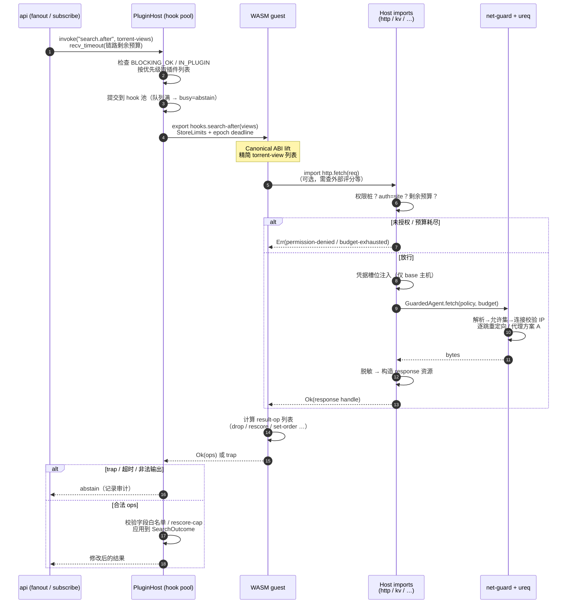

# crawler-media 插件系统设计（草案）

> 状态：草案 r6（在 r5 基础上按第六轮审核 `plugin-design-review-r6.md` @ `702c790` 修订，见 §17.4）｜基线：`d6ae414`，ureq 锁定 `3.4.1`｜基线：`main`｜参考：MoviePilot 插件体系
> 目标：在不破坏 ADR-0002 "Hook 是工作流扩展点" 原则的前提下，引入可由第三方编写、分发的**隔离插件运行时**。

## 0. 现状（基于实际代码）

| 位置 | 现状 | 对插件化的意义 |
|---|---|---|
| `crates/hooks/src/bus.rs` | `Step` 枚举仅 7 项（ChooseTorrent/AddDownload/Transfer/Rename/Scrape/Login/CheckIn）；`HookEvent { step }` **不携带任何载荷**；`Hook.run: Fn(&HookEvent)->Result<(),PluginError>`；`Bus::emit` 顺序执行、**第一个错误即中止并向上返回**；无优先级、无超时 | 只能"否决"，不能修改数据；一个钩子失败会拖垮整个流水线——必须重做 |
| `crates/hooks/src/plugins.rs` | `LoginPlugin` / `CheckInPlugin` 第一方插件，经 `SiteCredentials`、`HttpPost`、`indexer::Browser` 交互；`PluginError { NotFound, Veto, Fetch }` | 已是"通过契约访问宿主能力"的雏形，可直接映射为 WIT 导入接口 |
| `crates/hooks/src/site_policy.rs` | `trait SiteResponsePolicy`、`NexusPhpPolicy`、`CheckInOutcome` | 站点适配器的登录/签到判定点 |
| `crates/indexer/src/profile.rs` | `Profile`（`framework`、`search`、`rss`、`fields`、`categories`、`login_success_css`…）；`ProfileSet::load(overlay)` = 内置 `BUILTIN` YAML + overlay 目录 YAML | **声明式站点**已有扩展通道；插件站点分两级：纯 YAML（零代码）和 WASM 适配器（复杂站点） |
| `crates/indexer/src/engine.rs` | `Indexer::{search, search_page, search_page_categories, rss, resolve_torrent_download}` → `SearchOutcome { torrents, failures: Vec<SiteFailure> }`；`Fetcher` trait（`fetch.rs`） | 插件站点的接入点：按 `Site` 分派到 YAML 引擎或插件适配器；失败天然以 `SiteFailure` 隔离 |
| 执行模型 | `Indexer::search*/rss`、`Fetcher::fetch`（`ureq` 阻塞，`api/src/http_fetcher.rs`）、`Downloader` trait（`downloader/src/lib.rs:34-146`）、`Bus::emit`、`admit_and_add` **全部同步**；手动搜索经 `state.search_work` 线程池（`http/search/fanout.rs:115-117`）；`http/downloaders/submission.rs:246` 是 `async fn submit` | 插件运行时必须是同步模型（§7.1） |
| 搜索调用方 | `api/src/http/search/fanout.rs:117`、`api/src/admit.rs:97`、`api/src/management/subscribes/run.rs:386/398`、`api/src/worker.rs:49` | 搜索前/后 hook 应放在 Indexer 门面层，而不是每个调用方各插一次 |
| `crates/filter/src/admission.rs` | `admit/admit_scored -> AdmitOutcome { admitted, rejected, skipped_low_confidence }`，`ScoredTorrent { torrent, release, score }` | 重打分/重排 hook 在 admission 之后、`choose` 之前 |
| `crates/subscribe/src/add.rs` | `admit_and_add`：admit → `choose` → `emit(ChooseTorrent)` → 每个种子 `emit(AddDownload)` + `downloader.add` | 选种、提交下载 hook 的位置；需改为携带 `chosen` 载荷且允许修改 |
| `crates/subscribe/src/collect.rs:376-383` | `emit(Rename) / emit(Transfer) / emit(Scrape)`；`:282/:503` 调 `slot_replacement::is_replacement_approved`（洗版） | 完成/入库、洗版 hook 位置 |
| `crates/subscribe/src/types.rs` | `RunInput { hooks: Option<&Bus>, … }`、`RunOutcome`、`SubscribeError::Hook(PluginError)`（`PluginError` 仅 `NotFound/Veto/Fetch`，`hooks/src/plugins.rs:8`） | 插件错误目前会成为订阅错误——改为"降级+记录"；新增 `SubscribeError::Denied { plugin, reason }` 仅承载显式 deny |
| `crates/store/src/{subscribes,subscribe_wanted,search_history,ledger}.rs` | `PendingDownload`、`WantedHistory`、搜索历史、Ledger | 只读查询接口的数据源 |
| `crates/jobs/src/kinds.rs` | `JobKind`（SubscribeSearch/Rss/CheckIn/…）、`Schedule` | 插件定时任务新增 `JobKind::PluginTask` |
| `api/src/check_in.rs:19`、`api/src/http/sites.rs:481/525` | 每次临时 `Bus::new()` | 需改为应用级共享 `PluginHost`（在 `AppState` 中） |

结论：现有 Hook 总线是"无载荷的否决点"，不足以支撑需求 2/4；站点 YAML overlay 已能覆盖需求 1 的大部分声明式站点。

## 1. 目标与非目标

**目标**：需求 1–5 全覆盖；第三方插件不可信也安全；单插件失败不影响流水线；API 版本化。
**非目标（v1）**：插件自带任意前端 JS（Web UI 仅按 JSON Schema 渲染）；插件直接访问文件系统/数据库；插件**绕过宿主服务层**访问下载器/订阅（下载器与订阅的写操作只通过受权限控制、带审计和护栏的宿主 API 提供，见 §13A/§13D）；`dlopen` 原生插件；插件之间互相调用；`wasi:http`、`wasi:filesystem`、`wasi:sockets` 一律不链接（只用自定义 `http` 导入）；多用户级插件（v1 插件仅 Admin 安装/配置，以"系统主体"运行，见 §7.4）。

## 2. 运行时选型

| 方案 | 隔离 | 性能 | 生态/作者门槛 | 分发 | 结论 |
|---|---|---|---|---|---|
| **WASM 组件（wasmtime + WIT）** | 强：默认无能力，仅可调用导入；内存/fuel/epoch 可限 | 好（AOT/缓存编译） | Rust/Go(TinyGo)/JS(jco/ComponentizeJS)/Python(componentize-py) 均可 | 单 `.wasm` 跨平台 | **主选** |
| 内嵌 Lua（mlua）/ JS（QuickJS/boa） | 中：需自己裁剪标准库，逃逸面大；资源限制粗糙 | 中 | 门槛最低 | 脚本文件 | 不选：安全性靠"删 API"，长期维护难；ADR-0002 已否决内嵌脚本 |
| 外部进程（HTTP/gRPC） | 依赖 OS（容器/用户）隔离，宿主无法限制其网络/文件 | 进程间开销；需进程管理 | 任意语言、任意库 | 镜像/二进制，跨平台差 | 作为**补充的"外部服务插件"**，见 §2.3 |
| `dlopen` 原生 | 无 | 最好 | ABI 脆弱 | 每平台编译 | 否决 |

### 2.1 WASM 的已知限制与对策

**线程**
- `wasi-threads`/shared-memory 在组件模型下仍不成熟（wasmtime 中属实验特性，组件模型尚未正式支持线程；WASI 0.3 的原生 async 仍在推进），**v1 不启用**。
- 对策：并发放在宿主侧。
  1. 每次 hook 调用使用独立 `Store`（`InstancePre` + 实例池 `PoolingAllocationConfig`），实例创建为微秒级，不同调用可在多个宿主线程并行；
  2. 插件 API 设计为"短小同步函数"，I/O 全部由宿主中介：v1 使用**同步 wasmtime（不开 `async_support`）**，`http.fetch` 直接复用阻塞 `ureq`，插件调用在 `PluginHost` 自有的有界线程池执行（详见 §7.1）；
  3. 需要并发 I/O 的场景提供批量导入，如 `http.fetch-many(list<request>) -> list<result<response>>`，由宿主并行；
  4. 站点适配器的多站点搜索由 `Indexer` 现有的多站点 fan-out 并行驱动，每站一次调用。
- 每插件并发上限（manifest 可申请，宿主封顶，默认 4）。

**内存**
- wasm32 线性内存上限 4 GiB；`memory64` 已标准化（Wasm 3.0）且 wasmtime 支持，但工具链/组件模型支持参差、指针更大、边界检查开销更高——**v1 只支持 wasm32**，对本场景（解析 HTML/JSON、处理几百条种子）绰绰有余。
- 每插件内存上限：`StoreLimits`/`ResourceLimiter`，**按运行时类型设默认**：Rust/Go/TinyGo 64 MiB，JS（ComponentizeJS）128 MiB，Python（componentize-py）192 MiB；manifest 可申请，最高 256 MiB，管理员可调；同时限制 `memories=1`、`table_elements`、`instances`；pooling 分配器 `memory_pages` 按申请值配置；超限 → trap → 该次调用失败。Python/JS 插件推荐仅用于任务与低频 hook，文档推荐 Rust/Go。
- 时间：**epoch interruption**（宿主计时线程每 10ms `increment_epoch`）实现墙钟超时，CPU 预算默认 200ms，I/O 预算与链路总预算分开计（§7.1）；可选 **fuel** 做确定性 CPU 预算（用于防死循环，开销约 10–30%，默认仅开 epoch）。
- **序列化/拷贝开销**：组件模型的 canonical ABI 每次调用都会把 `list<torrent>` 等跨边界复制（lift/lower）。对策：
  1. 传递精简视图：hook 收到 `torrent-view`（id、title、size、seeders、site、release 摘要），不传 HTML/描述原文；
  2. 结果以**补丁/操作**返回而非整表回传：`list<result-op>`（`drop(id)`、`rescore(id, delta)`、`set-order(list<id>)`、`patch(id, fields)`、`add(torrent)`）；
  3. 大对象用 `resource` 句柄：`http.fetch` 直接返回宿主侧 `response` 资源，guest 按需调用 `body-text()`（才拷贝）或 `document()`（宿主用 `scraper` 解析，`select(css)` 结果条数/总字节封顶），整页 HTML 不进 guest；`scraper::Html` 非 `Send`，资源表按调用线程持有、不跨线程；实例**无状态**（每调用独立 `Store`），跨调用状态只能放 KV（SDK 文档写明）；
  4. 批大小上限（如 500 条/次），超出分片调用；
  5. 预编译缓存（`Module::serialize` 到 `data/plugins/cache/`），启动时不重复 JIT。

### 2.2 为何不是 v1 就"万物 WASM"
声明式 YAML 站点（`Profile`）继续存在且优先：90% 的 NexusPHP 站点只需 YAML，零运行时成本。WASM 站点适配器只用于签名算法、特殊 API（如 M-Team 类 JSON API）、复杂登录等。

### 2.3 什么时候外部进程（gRPC）插件更合适
- 需要大型原生依赖（OCR 验证码识别、机器学习模型、ffmpeg、Python 生态库）；
- 长驻服务/长连接（Telegram/企业微信机器人双向交互、WebSocket 推送）；
- 需要大内存（>256 MiB）或真正多线程计算；
- 已有其它语言实现、移植成本高。
设计：同一份 WIT 世界生成 gRPC/protobuf 定义（或 JSON-RPC over HTTP），宿主作为客户端调用外部服务；manifest `runtime = "external"`，管理员**手动配置端点并显式信任**（UI 标红"不受沙箱保护"）。超时、熔断、失败隔离与 WASM 插件共用 §7 的调度层。v1 不做，列为 M5。

## 3. 总体架构

```
crates/plugin-api      WIT 定义 + 宿主侧生成绑定 + 版本常量（新）
crates/plugin-host     wasmtime 引擎、实例池、能力实现、调度/超时/熔断、注册表（新）
crates/plugin-store    （或并入 store）插件元数据、配置、KV、审计表（新表）
crates/hooks           Bus 升级为带载荷/优先级/策略的 HookPipeline；第一方 Login/CheckIn 迁移为内置 "native plugin"
crates/indexer         新增 IndexerProvider trait；Indexer 按 profile_id `plugin:` 前缀分派 YAML 引擎或插件 provider
crates/subscribe       各节点调用 HookPipeline 并应用返回的决策
api                    插件管理 HTTP API、配置表单 Schema、AppState 持有 Arc<PluginHost>
```

数据流（订阅搜索为例）：
`JobKind::SubscribeSearch` → `search.before`（改关键词）→ `Indexer::search_*`（内置 YAML 站点 + 插件站点并行）→ `search.after`（增删改/重排）→ `filter::admit` → `subscribe.score`（重打分）→ `choose` → `subscribe.select`（改/否决选择）→ `download.before`（每种子，否决/改参数）→ `downloader.add` → `download.after`（通知类）→ … → `transfer.intercept/rename/completed/failed` → 洗版 `upgrade.decide`。

## 4. Hook 点清单

类型说明：**Filter**（可修改载荷，链式）、**Gate**（allow/deny/abstain）、**Notify**（只读事件，异步 fire-and-forget，后置动作）。

| Hook ID | 类型 | 触发位置（代码） | 载荷 | 允许的返回 |
|---|---|---|---|---|
| `search.before` | Filter | Indexer 门面（包装 `engine.rs::search_page_categories/rss`，覆盖 `fanout.rs`、`admit.rs`、`subscribes/run.rs`、`worker.rs` 调用方） | keyword、page、categories、sites、上下文（手动/订阅 id） | 改 keyword、增删站点、取消搜索 |
| `search.after` | Filter | 同上，`SearchOutcome` 返回前 | `torrent-view` 列表 + failures | `result-op` 列表（drop/patch/add/rescore/set-order） |
| `subscribe.created` | Gate+Notify | `api/src/management/subscribes` 创建处理器、`store/src/subscribes.rs` 写入前/后 | 订阅草案 | deny(原因)、patch(过滤规则组/站点集) |
| `subscribe.search` | Gate | `management/subscribes/run.rs` 每次订阅搜索开始 | 订阅、facts | skip 本轮 |
| `subscribe.score` | Filter | `subscribe/src/add.rs::admit_and_add` 中 `filter::admit` 之后、`choose` 之前 | `ScoredTorrent` 视图 | rescore/drop |
| `subscribe.select` | Filter+Gate | `add.rs` 现 `emit(Step::ChooseTorrent)` 处（`choose` 之后） | chosen 列表 | 替换/删除选择、deny |
| `download.before` | Gate+Filter | **仅** `DownloadService::submit_blocking`（`api` crate，实现 `downloader::DownloadSubmitter`）；订阅 `add.rs`、手动 `submission.rs`、`admit.rs` 三条路径都经它，Gate 只触发一次（P5-H1） | 单个种子、目标下载器、标签/目录 | deny、patch(标签/分类/保存路径子目录/暂停) |
| `download.after` | Notify | `downloader.add` 成功/失败后 | 种子、结果 | — |
| `transfer.intercept` / `transfer.rename`（原名 `import.before`，已废弃） | Gate / Filter | `collect.rs:376` `Rename/Transfer` 前 | 文件列表、目标路径 | deny、patch(命名模板变量)；详见 §13A M-4 |
| `transfer.completed`（原名 `import.after`，已废弃） | Notify | `collect.rs:383` Scrape 后 / `RunOutcome.completed` | ledger 行、`transferred_enclosures` | — |
| `upgrade.decide` | Gate | **仅挂在 `collect.rs:282`** 的首次替换判定；`collect.rs:495-510` 的 `replacement = approved && safe_quality && is_replacement_approved(...)` 是二次安全确认，插件不介入（只可能更严，无需重复） | 现有 Release、候选 Release | allow/deny/abstain（只能**收紧**，见下） |
| `subscribe.completed` | Notify | `is_complete` 为真 | 订阅、facts | — |
| `site.login` / `site.checkin` | 适配器方法 | `hooks/src/plugins.rs` `LoginPlugin/CheckInPlugin` | — | 见 §5 |

现有 `Step` 映射：ChooseTorrent→`subscribe.select`，AddDownload→`download.before`，Rename/Transfer→`transfer.intercept/rename`，Scrape→`transfer.completed`/`metadata.scraped`，Login/CheckIn→站点适配器。旧 `Bus` API 保留为适配层一个版本。

**Gate 合并规则**：任一 deny → deny（记录插件与原因）；全部 abstain → 宿主默认行为。为防恶意插件“放行”危险操作，`upgrade.decide` 与 `transfer.intercept` 的 allow **不能覆盖**宿主 deny（插件只能收紧，不能放宽内置安全判定）。
**Filter 合并**：按优先级链式，每一插件看到前一插件的结果；宿主校验输出（例如 `add` 的种子必须来自已注册站点、`patch` 字段白名单）。

## 5. 自定义站点（需求 1）

两级：
1. **声明式**：插件包内携带 `sites/*.yaml`，格式即 `indexer::Profile`；安装时校验并注入 `ProfileSet`（新增 `ProfileSet::extend(source = plugin_id, profiles)`，**记录来源**以便卸载时移除；id 冲突**默认拒绝**，覆盖内置 id 需 ★`indexer:override:<id>`）。
2. **适配器**：WIT `indexer-provider` 导出（完整定义见 §13C；下列为能力概要）：
   - `search(req: search-request) -> result<list<torrent-raw>, site-error>`
   - `rss(site) -> result<list<torrent-raw>, site-error>`
   - `resolve-download(site, torrent-id) -> result<download-request, site-error>`（对应 `Indexer::resolve_torrent_download`）
   - `verify-login(site) -> result<session-update, site-error>`、`check-in(site) -> result<checkin-outcome, site-error>`（对应 `SiteResponsePolicy`/`CheckInOutcome`）
   宿主侧新增 `trait IndexerProvider`（§13C），`Indexer` 按 `Site.profile_id` 的 `plugin:` 前缀分派（**不改** YAML `Framework` 枚举）；结果仍汇入 `SearchOutcome.torrents`，异常转 `SiteFailure`。站点凭据（Cookie/API key，ADR-0003 明文存储）策略以 §13A M-2 为准：**默认路径**是 `auth = site(site-id)` 由宿主按 §13C 规则注入、响应脱敏，插件看不到明文；**例外**是 ★`site:credentials:<id>`（单站授权、Admin 确认、限频、审计）可读明文。代理复用 `FetchRequest.proxy/render/cdp_url`，插件**不能自选代理**。需要浏览器渲染时走宿主 `Browser`（ADR-0007 CDP opt-in）。

## 6. 宿主能力（WIT imports）与权限模型

**单一事实来源**：完整 WIT 放在仓库 `crates/plugin-api/wit/`（M1a 前产出，CI 以 `wasm-tools component wit` 校验并生成绑定），本文只给与正文一致的骨架：

```wit
package crawler:plugin@1.0.0;

interface types   { /* torrent-view, release-view, result-op, media-view, download-plan, site-ctx, … */ }
interface log     { log: func(level: level, msg: string); }
interface kv      { get: func(key: string) -> option<list<u8>>; set: func(key: string, v: list<u8>) -> result<_, kv-error>;
                    delete: func(key: string); list: func(prefix: string) -> list<string>; }
interface blob    { /* put/get/delete，配额见 §11 */ }
interface config  { get: func() -> string; /* JSON，已按 schema 校验 */ }
interface clocks  { now-ms: func() -> s64; }                 // 自定义；随机数用 wasi:random
interface http {                                            // 响应资源；fetch 在同一接口内，无需跨接口 use
  resource document { select: func(css: string, max: u32) -> list<element>; }
  resource response {
    status: func() -> u16;
    headers: func() -> list<tuple<string, string>>;          // 已脱敏副本（§13C 规则 4）
    body-text: func(max-bytes: u32) -> result<string, http-error>;   // max-bytes ≤ 宿主响应上限 5 MiB；超出截断并返回 truncated 标志于 http-error
    document: func() -> result<document, http-error>;        // 基于同一脱敏副本解析
  }
  fetch: func(req: request) -> result<response, http-error>;
  fetch-many: func(reqs: list<request>) -> list<result<response, http-error>>;
}
interface library-read   { /* subscriptions / subscription-history / download-records / search-history，分页 */ }
interface site           { /* list / get-credentials(★) / update-session(★) */ }
interface downloader     { /* §13A M-1 */ }
interface indexer-read   { /* search / rss：仅 YAML 站点，见 §7.1 重入规则 */ }
interface subscribe-write{ /* §13A M-3 */ }
interface notify         { send: func(msg: message) -> result<_, string>; }
interface schedule       { register: func(task-id: string, cron: string) -> result<_, string>; }

world hook-plugin     { import log; import kv; import blob; import config; import clocks; import http; import notify; import schedule; import wasi:random/random@0.2.0; export lifecycle; export hooks; export ui; export tasks; }
world indexer-plugin { include hook-plugin; import site; import indexer-read; export indexer-provider; }
world list-plugin    { include hook-plugin; import library-read; import subscribe-write; export list-provider; }
world channel-plugin { include hook-plugin; export notify-channel; }

// 能力型插件按 world 组合识别：一个组件可同时满足多个 world（如 indexer + list）。
// 所有 world 的 import 仍固定存在，未授权者链接拒绝桩（§6 权限机制不变）。

**world 按插件类型拆分（R3-M5）**：上面的单一 `world plugin` 不再使用。组件模型里"新增导出"对旧组件不向后兼容（缺导出即无法满足新 world），因此 MINOR 新增能力一律发布新 world 名，宿主同时支持当前与上一个 MAJOR 的全部 world；JS/Python 插件只实现自己的 world，避免为无关导出生成胶水代码。SDK 按插件 manifest 的 `type` 选择 world。

**只读数据（需求 3）**：`library-read` 由 `store` 中的 `subscribes.rs`（`PendingDownload`）、`subscribe_wanted.rs`（`WantedHistory`）、`search_history.rs`、`ledger.rs` 投影为视图结构；分页（≤200/页）；**不包含**站点凭据、用户密码哈希、下载器地址/密码；路径字段可按权限脱敏。本节只读接口不暴露写操作；写操作仅限 §13A 列出的、带独立权限、审计与护栏的宿主 API（`downloader`、`subscribe-write`、`site.update-session`），其余修改只能通过 hook 返回值进行。多用户：视图默认剥离用户标识（§7.4）。

**权限**：唯一权威列表见 §6.1（本节旧列表已删除）；出站网络规则见 §6.2。

**固定 world + 拒绝桩**：组件模型要求所有 import 被满足，"不链接"会导致实例化失败，因此：① WIT 为**固定的 world 集合**（`crawler:plugin@1.0.0` 下的 `hook-plugin`/`indexer-plugin`/`list-plugin`/`channel-plugin`，见 §6 骨架），宿主按组件实际导出识别其类型；② **安装时静态检查**组件实际 imports（`Component::component_type().imports()`）⊆ 已授权导入集合 ∪ 标准允许集（`wasi:random`、`wasi:cli/environment` 空环境等），出现 `wasi:http`/`wasi:filesystem`/`wasi:sockets` 直接拒绝安装；③ **运行时**对 world 中已声明但未授权的导入链接"拒绝桩"，统一返回 `permission-denied` 错误（并计数，不 trap）。HTTP allowlist 与 §6.2 网络策略在宿主 `fetch` 实现中逐请求、逐跳检查。权限扩大的升级需重新确认。

### 6.1 统一权限表（单一来源；★ = 敏感，需管理员单独确认，可单独撤销）

| 权限 | 含义 | 里程碑 |
|---|---|---|
| `hooks:<id>` | 订阅某个 hook | M1a |
| `kv`、`blob` | 插件存储（默认授予，配额见 §11） | M1a |
| `schedule` | 注册定时任务 | M1a |
| `http:<host[:port][/path-prefix]>` | 出站 HTTP 白名单（不允许运行时动态申请；只能是公网，私网见 §6.2） | M1a（第三方插件在 §6.2 实现前全局关闭） |
| `indexer:provide` | 提供索引器（取代旧 `sites=["register"]`/`site:register`） | M1b |
| `indexer:yaml`、`indexer:override:<id>` | 携带 YAML profile；覆盖内置 id（★） | M1b |
| `http:site-auth` | 请求可附 `auth=site(id)`，由宿主注入凭据（取代旧 `http_site_auth`） | M1b |
| `indexer:read` | 调用宿主 `indexer.search/rss`（刷流等） | M1c |
| `downloader:read` | 列客户端/任务 | M1c |
| `downloader:control` | 暂停/恢复/限速/标签/分类 | M1c |
| `downloader:add` | 添加任务（受配额） | M1c |
| `downloader:delete` | 删除本系统添加的任务（默认进回收站） | M1c |
| ★`downloader:delete-files` | 删除时连文件（仍先进回收站） | M1c |
| ★`downloader:foreign` | 操作非本系统添加的任务（默认关闭） | M1c |
| `site:read` | 站点列表（无凭据） | M2 |
| ★`site:credentials:<ids>` | 读明文凭据（单站授权、限频、审计）。**约束（N5）**：授予时插件的整个 `http` allowlist 必须是这些站点主机（`effective_base_url` 主机 + Admin 确认的附加主机）的子集，安装时校验；不满足则两项权限不能同时授予（无"额外确认"绕过）。即：能读明文的插件只能把请求发往对应站点本身 | M2 |
| ★`site:write-session` | 回写 Cookie | M2 |
| `read:subscriptions` / `read:history` / `read:downloads` | 只读数据（去用户标识） | M2 |
| ★`read:user-scoped` | 带用户维度的只读数据 / 播放事件 | M4 |
| `list:provide` | 提供榜单/探索源 | M2 |
| `subscribe:write`、★`subscribe:delete` | 订阅写 | M2 |
| `events:<domain>` | 订阅 Notify 事件（site/subscribe/transfer/download/history/library/playback） | 按域 |
| `notify:send`、`notify:channel` | 发送通知 / 提供通知渠道 | M1a / M3 |
| `endpoints` | 插件 HTTP 端点（user/admin/apikey；**不支持 public**） | M3 |
| `library:read`、`library:refresh` | 库只读/刷新 | M4 |
| `discover` | 探索源分区 | M3 |
| `commands` | Bot 命令 | M5 |

### 6.2 出站网络与 SSRF 防护（r3 完整设计，取代原 §16.1 延后项）

**适用范围**：插件 `http.fetch/fetch-many`、插件 provider 的所有请求、插件提供后由宿主或第三方组件抓取的 URL，**以及 `crates/downloader` 自身的出站抓取**（`qbit.rs::download_torrent_bytes`、`downloader/src/http.rs::agent_for_url`，R3-H1），以及现有 `crates/api/src/http/image_proxy.rs`（统一迁移）。宿主自身对已配置站点/下载器的请求走同一模块，但使用"站点/下载器实例"策略。

**1. 新模块 `crates/net-guard`（宿主共享）**
- `NetPolicy { allow_hosts: HostPatterns, allow_private: PrivateGrants, ports: PortRule, max_redirects: u8 (默认 5), via_proxy: Option<ProxyRef> }` 与 `GuardedAgent::fetch(req, policy, budget)`。
- 基于 ureq 3：`max_redirects(0)` 关闭自动跟随；**自定义 `Resolver`**（ureq 3 `unversioned::resolver::Resolver` trait）在连接前解析 → 过滤 → 只把校验通过的 `SocketAddr` 交给连接器，**连接使用的即被校验的 IP**，不存在二次解析（防 TOCTOU / DNS rebinding）。**决议（R3 开放问题 24）**：不依赖 resolver 的行为作为唯一屏障——自行实现 `Connector`（`TcpConnector` 包一层，`connect` 前对传入的 `SocketAddr` 再按拒绝表校验一次），resolver 只负责解析与过滤；双保险且不受 ureq `unversioned` API 变化影响。版本锁在 `Cargo.lock`（当前 ureq `3.4.1`），升级须跑 §6.2 测试套件。
- TLS SNI/Host 头保持原主机名，证书校验不变。

**2. 地址判定：仅允许全局单播（R3-M1）**
- 实现语义为"允许集"：IPv4 用等价 `Ipv4Addr::is_global` 的判定（RFC 6890/IANA special-purpose registry），IPv6 用 `Ipv6Addr::is_global`（Rust 1.8x 稳定 API）并补 `ip_network` 规则；拒绝表作为**测试清单**而非实现依据。
- 嵌入 IPv4 的形式（IPv4-mapped `::ffff:0:0/96`、IPv4-compatible `::/96`、NAT64 `64:ff9b::/96`、6to4 `2002::/16`、**Teredo `2001::/32`**）统一先抽取内嵌 IPv4 再判。
- 测试清单至少包含：IPv4 `0/8`、`10/8`、`100.64/10`、`127/8`、`169.254/16`（含 `169.254.169.254`）、`172.16/12`、`192.0.0/24`、`192.0.2/24`、`192.88.99/24`（6to4 中继）、`192.168/16`、`198.18/15`、`198.51.100/24`、`203.0.113/24`、`224/4`、`240/4`、`255.255.255.255`；IPv6 `::/128`、`::1`、`fe80::/10`、`fc00::/7`、`fec0::/10`（已废弃站点本地）、`ff00::/8`、`2001:db8::/32`、`2001:10::/28`、`2001:20::/28`、`100::/64`、`fd00:ec2::254`。
- 主机名解析前规范化：用 `url` crate 解析（自动处理十进制/八进制/十六进制 IPv4 写法如 `2130706433`、`0177.0.0.1`、`0x7f.1`），IP 字面量同样判定；`localhost`、`*.localhost`、`*.local`、`*.internal`、`metadata.google.internal` 直接拒绝。
- DNS 解析结论不缓存（防 rebinding），但保留系统 DNS 缓存，不自建"已校验"缓存。
**3. 端口与协议（R3-L1）**：仅 `http/https`；默认端口 80/443，其他端口须在 allowlist 显式写成 `host:port`。常见内部服务端口（22/25/3306/5432/6379/11211/2375/2379 等）对**公网**一律拒绝；私网访问由第 7 点按 `host:port` 精确授权，不再额外区分端口类别。

**4. 逐跳重定向**：每一跳重新执行 allowlist（主机+端口+path 前缀）+ 解析 + 拒绝表 + 凭据规则（`auth=site` 禁止跨主机，§13C 规则 3）；最多 5 跳；`https→http` 降级拒绝；每跳计入同一 I/O 预算。

**5. DNS rebinding**：由第 1 点"校验即连接"保证；另外不缓存跨请求的"已校验"结论，每次连接重新解析校验；解析 TTL 不影响判定。

**6. 代理（R3-H2，v1 方案 A）**：插件**不能**自选代理。经核实 ureq 3.4.1（`ureq::Proxy::new` + `.proxy(Some(proxy))`，`api/src/http_fetcher.rs:8-13`，api crate 开 `socks-proxy` feature）在启用代理时 resolver 解析的是**代理主机**，CONNECT 目标取自请求 URI 的主机名；把 URI 主机改成 IP 会使 TLS SNI 与证书校验变成 IP，HTTPS 失败。因此"本地校验后 `CONNECT <validated-ip>`、SNI 仍为原主机名"**在 ureq 内置代理上不可实现**，v1 不做。
- v1：插件请求**经代理时一律视为"代理侧解析"**，只允许**Admin 已确认的站点主机**（`effective_base_url` 主机 + 站点实例上 Admin 确认的附加主机），不允许插件自报主机与 manifest allowlist 主机经代理出站；UI 明示"该站点经代理，IP 校验在代理侧，仅限已确认主机"。
- 代理地址本身（常在私网）是宿主配置，不受地址判定约束，插件不可见、不可改。
- v2（不在 M1a）：自实现 `Connector` 链——本地解析校验 → 与代理建 TCP → `CONNECT ip:port` → 隧道上用 rustls 以原主机名做 SNI/证书校验。

**7. 私网授权（解决 Jackett/Prowlarr/下载器冲突）**
- 新增 `private_grants(scope, target_cidr_or_host, port, path_patterns, granted_by, granted_at)`：只能由 **Admin 在具体"站点实例"或"下载器实例"配置页**显式勾选"允许访问内网地址"并填写主机:端口（如 `192.168.1.10:9117`、`localhost:9696`）；插件 manifest **不能**申请私网。
- 授权只在该实例的 `site-ctx` 下生效（即 torznab-bridge 访问 Jackett 实例 A 时，只能访问 A 的 `host:port` + §13C 规则 5 的路径模式），其他调用上下文仍套用完整拒绝表。
- **解析固定（R3-M2）**：按主机名授权（`localhost`、Docker 服务名 `jackett`）时，保存授权时解析并记录结果（默认 /32 或 /128），运行时解析结果必须落在记录内，变化需 Admin 重新确认；授权上下文内的重定向只允许回到同一 `host:port`。
- 云元数据地址（`169.254.169.254`、`fd00:ec2::254`）与 `0.0.0.0` **不可授权**。
- 下载器实例（qB/Tr 常在私网）由宿主直接连接，属于宿主配置，不经插件策略；插件永远拿不到下载器地址。

**8. 二级 SSRF（插件提供的 URL 交给其他组件抓取）**
- **下载器（R3-H1，经代码核实）**：现有代码有两条旁路——`crates/downloader/src/qbit.rs:133-160` 对 http(s) URL 自行调用 `download_torrent_bytes`（`:370`，`http_agent().get(enclosure)`，无 SSRF 校验），失败时 `fallback_url = true` 把 URL 原样交给 qBittorrent（`:155-160`，`form.text("urls", …)`）；`crates/downloader/src/transmission.rs:237` 以 `{"filename": download_url}` 提交，由 Transmission 自己抓 URL。因此：
  1. **插件来源的 .torrent 一律由宿主 `DownloadService` 用 `GuardedAgent` 抓取**（按该站点实例的 `NetPolicy`，大小上限 10 MiB、校验 bencode），再以 `AddSource::File` 提交——这是插件来源的唯一路径（P5-M5）。downloader crate 内的 `download_torrent_bytes` 只服务内置 YAML 站点，同样改走 `GuardedAgent`（由宿主注入一个 `TorrentFetcher` trait 对象，downloader 自身拿不到站点上下文）；
  1b. `downloader/src/http.rs::agent_for_url` 访问的是**下载器自身 API**（常在私网），走"下载器实例"策略：只允许该实例配置的 `host:port`，保留现有 `is_local_endpoint` 代理绕过逻辑，不套插件地址判定；
  1c. `AddOptions` 增加 `origin: Origin { Builtin, Plugin(id) }`；`origin = Plugin` 时 downloader 拒绝 `AddSource::{Url, ResolvedUrl}`（返回错误，不 fallback），只接受 `File`/`Magnet`；
  1d. **种子内地址（r4 R4-M5）**：宿主对插件来源的 .torrent / magnet 解析 `announce`/`announce-list`/`url-list`(webseed)/magnet `tr=`/`ws=`，按地址判定（§6.2 第 2 点）拒绝内网地址（下载器会去连这些地址）；违规即拒绝提交。
  2. `AddSource::file(bytes)`：qB 用 multipart 内存 part（现 `Part::file` 写临时文件，改为 `Part` 内存体），Transmission 用 `metainfo`（base64）字段而非 `filename`；
  3. 来源为插件的提交（`origin ∈ {plugin}` 或 provider 为 `plugin:`）**禁止 URL fallback**：下载失败即失败，`magnet:` 例外（无 HTTP 抓取，直接提交）；内置 YAML 站点的现有 fallback 行为保持不变（但抓取本身已走 net-guard）；
  4. 文件提交前从 bencode 计算 info-hash，写入 `downloader_added`（§13D）。
- **通知渠道**：`notify.send` 的 `image-url`/`link`：`image-url` 由宿主经 `GuardedAgent` 拉取（公网 + 图片 MIME + 5 MiB），以附件/内联形式交给渠道；`link` 只允许 `https` 公网主机，渠道不抓取（仅文本）；插件 `notify-channel` 自身出站同样受其 allowlist + 拒绝表约束。
- **图片代理/前端**：插件返回的 `poster-url`（榜单/探索）、`ui.widgets` 中的图片一律改写为现有图片代理路由 `/api/v1/images/proxy?url=…`（`http/mod.rs:137`，public 路由），经统一后的 image_proxy（见第 9 点）抓取。
- **插件 HTTP 端点**返回的重定向 `Location` 仅允许站内相对路径。

**9. 统一现有 `image_proxy::allowed_url`**
- 现状（`crates/api/src/http/image_proxy.rs:127-150`）：`ALLOWED_HOSTS` 后缀匹配 + 拒绝 IP 字面量/`localhost`，**不校验解析后 IP**；`no_redirect_agent`（`:152`，`max_redirects(0)`）+ 调用方逐跳（`:209`）。
- 迁移：`fetch_image` 改用 `GuardedAgent`（保留 douban bypass 头逻辑），获得连接时 IP 校验；`crates/api/src/media_posters/http.rs:20` 的 `max_redirects(2)` 同样迁移。M1a 完成，作为 net-guard 的第一个使用者（无需等待插件）。
- **插件图片主机不并入全局 `ALLOWED_HOSTS`（R3-M3）**：插件返回的图片 URL 改写为 `/api/v1/images/proxy?url=…&src=plugin:<id>&exp=…&sig=HMAC`（签名参数**仅对插件来源强制**；内置来源保持现有参数）（HMAC 密钥仅宿主持有，签名覆盖 url+src+过期时间），`image_proxy` 按 `src` 插件的 allowlist 校验后抓取；一个插件的声明不影响其他调用者。

**10. 测试套件（`crates/net-guard/tests`，M1a 验收）**
- 解析层：自定义测试 resolver 模拟 rebinding（首次公网、第二次 `127.0.0.1`）→ 连接使用首次校验 IP 或拒绝；AAAA 返回 `::ffff:127.0.0.1`、`::ffff:169.254.169.254`、`64:ff9b::a9fe:a9fe`、6to4 嵌入私网 → 拒绝。
- 主机写法：`http://2130706433/`、`http://0177.0.0.1/`、`http://0x7f.1/`、`http://[::1]/`、`http://127.1/`、`http://localhost./`、`http://foo.localhost/` → 拒绝。
- 重定向：公网 302 → `http://10.0.0.1/`、→ 非 allowlist 主机、→ https→http、超过 5 跳 → 拒绝；同主机重定向保留凭据、跨主机丢弃。
- 端口：未声明端口、内部服务端口 → 拒绝。
- 私网授权：Jackett 实例上下文内允许 `192.168.1.10:9117/api/v2.0/indexers/x/results/torznab`；同插件在其他上下文访问同地址 → 拒绝；授权 path 外 → 拒绝；元数据地址授权尝试 → 配置保存失败。
- 代理：经代理时宿主本地校验目标 IP；代理侧解析模式下非 Admin 确认主机 → 拒绝。
- 二级（R3-H1）：mock qB 断言收到 multipart 文件而非 `urls` 字段，且 .torrent 下载失败时**不** fallback 到 URL；mock Transmission 断言收到 `metainfo` 而非 `filename`；`notify` 图片经宿主抓取。
- 代理（R3-H2）：经代理的插件请求发往非 Admin 确认主机 → 拒绝；确认主机 → 放行（不要求 IP 校验）。
- 私网授权（R3-M2）：授权时解析结果变化（Docker 名从 172.17.0.2 变到 172.17.0.3）→ 拒绝并提示重新确认。
- 回归：现有 `image_proxy` 测试（`allows_whitelisted_image_hosts`、`rejects_ssrf_targets_and_host_spoofing`）全部保留并通过。

**11. 全局开关**：`plugins.third_party_network = off|on`，在 net-guard 与上述测试未完成/未通过时强制 `off`（第三方插件的 `http` 导入返回 `permission-denied`）；M1a 验收包含该开关测试。

## 7. 调度、超时、失败隔离、优先级

### 7.1 执行模型（同步）
- **同步 wasmtime**，不开 `async_support`；宿主导入全部阻塞实现：`http.fetch` 复用 `ureq`（与 `api/src/http_fetcher.rs` 一致），`downloader.*` 直接调用同步 `Downloader` trait，KV 为同步 SQLite。
- **分类线程池（N1）**：`PluginHost` 按调用类别拥有独立的有界池，互不借用：
  | 池 | 用途 | 默认线程 | 队列上限 |
  |---|---|---|---|
  | `provider` | indexer/list provider 调用（搜索 fan-out、RSS、ListSync） | `min(8, cpus)` | 32 |
  | `hook` | Filter/Gate 同步链 | `min(4, cpus)` | 64 |
  | `task` | 定时任务、端点请求 | 2 | 16 |
  | `notify` | Notify 事件（§7.2） | 2 | 1024（满即丢弃计数） |
  每插件另有并发信号量（默认 4，跨池合计）。调用方同步提交并 `recv_timeout` 等待——仍适配现有同步的 `Indexer`/`Fetcher`/`Downloader`/`admit_and_add`。
- **有界提交、不阻塞调用方**：队列满或插件信号量耗尽时**立即**返回 `busy`：hook 视为 abstain，provider 视为该站 `SiteFailure{busy}`（不计入插件熔断），task 推迟到下次调度。调用方永不在"等待池空位"上阻塞。
- **禁止重入（N1）**：池线程入口设置 thread-local `IN_PLUGIN = Some(plugin_id)`。宿主导入若会再次进入插件（如 `indexer-read.search/rss` 指向插件站点、`subscribe-write` 触发同步 Gate），规则为：`indexer-read` **只允许 YAML 站点**（`plugin:` 前缀站点返回 `unsupported`）；`subscribe-write` 等写操作在插件线程中执行时，其触发的 Gate 链**内联在当前线程执行**（R3-M4）：不包括发起插件本身、深度上限 1；被内联插件的每插件信号量用 **`try_acquire`**（拿不到即 abstain，不阻塞，避免两插件互相写订阅时互等）；内联调用使用独立 `Store` 与独立 epoch deadline，并计入发起方的剩余预算；`PluginHost::invoke` 检测到 `IN_PLUGIN` 时拒绝向任何池提交（返回 `reentrancy-denied`）——从结构上消除"池内线程等待同池空位"的死锁。
- **超时后线程占用（N1）**：epoch 只能中断 guest 代码，无法中断阻塞在宿主导入中的 `ureq`。因此每个宿主导入的阻塞超时取 `min(导入自身超时, 调用剩余总预算)`（ureq 每请求 `timeout_global` 动态设置；SQLite 用 `busy_timeout` 同理），保证 `recv_timeout` 返回后池线程最多再被占用"剩余预算"量级即释放。宿主维护每池"卡住线程"计数（调用方已超时但线程未返回）；卡住数计入池容量（不额外扩容），超过池大小的 50% 时该池对新提交返回 `busy` 并告警，同时对相应插件计一次插件错误（参与熔断）。
- **`crates/exec-ctx`（P5-H2，M0a 落地，不依赖 wasmtime）**：提供 `BlockingGuard`、`InPluginGuard`（RAII）、`is_blocking_ok()`、`in_plugin()`、`spawn_blocking_marked(f)`（包装 `tokio::task::spawn_blocking`）。`api`/`jobs`/`hooks` 只依赖这个小 crate；`plugin-host`（M1a）复用而不重新定义。`hooks` 定义 `trait PluginInvoker`，由 `plugin-host` 实现并在运行时注入，`hooks` 不依赖 wasmtime。
- **`WrongContext` 作用范围（R6-M2）**：只在 `PluginInvoker` 发起**同步插件调用**（Filter/Gate 链中的 WASM 调用）时检查 `BLOCKING_OK`。`emit_notify`（只入有界队列，不阻塞）与内置原生钩子（Login/CheckIn 等 Rust 闭包）可在任何线程调用，包括 async handler 中事务提交后发出的领域事件。
- **阻塞上下文判定（N2）**：不使用 `Handle::try_current()`（在 `spawn_blocking`/`blocking_budget::run` 线程中同样返回 Ok，会误报）。改为**正向 thread-local 标记** `BLOCKING_OK`：在 `PluginHost` 池线程、`state.search_work`（`crates/api/src/blocking_budget.rs`）worker 入口、job worker 线程入口、以及宿主封装的 `plugin_host::spawn_blocking(…)`（包装 `tokio::task::spawn_blocking`，在闭包内先设标记）中设置。tokio blocking 线程会被复用，标记必须用 **RAII guard** 在闭包结束（含 panic）时复位，避免同线程上的后续任务继承标记（R3-L2）。`PluginHost::invoke` 在 **release 构建同样检查**：未设标记 → 不 panic，返回 `PluginError::WrongContext` 并计数告警（hook 视为 abstain）。ADR-0013 写明该约束。
- **三重预算**：
  1. **CPU 预算**（epoch deadline，计时线程 10ms 粒度）：hook 默认 200ms，任务 5s；
  2. **I/O 预算**：每个宿主导入自带超时（ureq `timeout_global`），单次 hook 内 I/O 累计默认 2s、可申请至 10s（宿主封顶），站点 provider 调用 15s，任务 60s；
  3. **调用/链路总预算**：单次调用墙钟上限 = CPU + I/O 预算；同步链路上全部 Filter/Gate 共享一个**链路总预算**（如订阅单次运行 30s、手动搜索 `search.*` 合计 5s）。**provider 调用不计入 hook 链路预算**（N10）：provider 由 `fanout.rs` 现有 `budget`（`blocking_budget::run`）与单站 15s 上限管理；hook 链路预算只覆盖 Filter/Gate，且 `search.after` 在汇总后执行一次，因此无需按站点数缩放。宿主导入内部检查剩余预算，不足直接返回 `budget-exhausted` 错误，guest 在下一次 epoch 检查时 trap；链路预算耗尽后剩余插件直接 abstain。
- WASI 0.3 async 稳定后作为 v2 MAJOR 迁移（双 MAJOR 适配层过渡）。

### 7.2 排序与合并

- **调度器** `PluginHost::invoke(hook, payload)`：遍历订阅该 hook 的已启用插件，按 `(priority asc, plugin_id)` 稳定排序；manifest 给默认 priority（0–1000，默认 500），用户可在 UI 拖拽覆盖。
- **超时**：见 §7.1 三重预算。
- **失败语义**：插件 trap/超时/返回非法数据 → 视为 **abstain**（Filter 视为未修改），记录 `plugin_invocations` 审计/指标；**绝不**转成 `SubscribeError`。现 `bus.rs::emit` 的"首个错误即返回"改为仅对显式 `Gate::Deny` 生效。`SubscribeError::Hook` 更名为 `SubscribeError::Denied { plugin, reason }`，只承载显式 deny。
- **Filter 输出约束**：`search.after` 的 `add` 仅允许来自该插件**自己注册的 indexer** 的 `torrent-raw`（宿主赋 `site-id` 并走 §13C 校验），不能伪造内置站点种子；`patch` 字段白名单仅限排序/打分/标签/展示类，禁止改 `enclosure`/`download-ref`/`site`/`info-hash`；`rescore` 每插件增量封顶为当前 filter 分值区间（max−min）的 10%，由宿主计算后随载荷下发（`rescore-cap`），超出部分截断；区间为 0 时封顶取最小值 10（R3 对 N12 的补充）。
- **熔断**：只统计**插件错误**（trap、超时、非法输出、拒绝桩调用激增）；**上游错误**（`indexer-error::network/rate-limited/challenge`、HTTP 5xx）计入站点 `SiteFailure`，不计入插件熔断。触发条件：最近窗口样本 ≥ 20 且失败率 > 50%，或连续 10 次失败 → 进入**半开**：暂停路由，按指数退避（1m→2m→…→1h）放行 1 次探测调用，成功即恢复，连续 5 次探测失败才转为"已禁用"并通知。
- **`fail_mode`**：默认 `open`（失败=abstain）。`closed` **仅 Admin 可手动设置，仅限 `download.before` 与 `transfer.intercept` 两个 Gate**，且 closed 下插件失败转为 **`defer`**（下次轮询重试）而非 deny，并发通知；这样"必须审核"类插件故障只会延后、不会让订阅流程失败，与"插件失败不得使流水线失败"一致。**注意（N13）**：closed 插件持续故障时，`defer` 累计至上限（72h/10 次）后转 reject，最终效果等同 deny；因此**第一次**因 closed 故障产生 defer 时即通知 Admin，UI 显示"受 closed 插件阻挡的待下载数"。
- **资源**：内存 `StoreLimits`、epoch、分类池与每插件信号量（§7.1）、KV 配额、HTTP 速率、响应体大小上限（默认 5 MiB）。
- **节流**：插件 HTTP 按 `(plugin, host)` 双键限速；`auth=site(id)` 的请求（含 `fetch-many`）复用 `Indexer.next_request` 的按站点节流（`engine.rs:31,210-213`），不可绕过。
- **Notify** 类 hook：`PluginHost` 内建有界 MPSC + 固定 worker（不沿用 `api/src/worker.rs:40-42` 的 `std::thread::spawn` 模式），满则丢弃并计数，不反压主流程；同一实体（同一订阅/站点/任务）事件按序投递。
- **事件发出时机**：所有领域事件在**应用服务层、数据库事务提交之后**发出（如 `api/src/subscribe_create.rs`、`http/sites.rs` 的服务函数），`store` crate 不依赖 hooks；事务回滚则不发事件。

### 7.3 指标与日志
- 每插件暴露调用次数、p50/p99 耗时、CPU/I/O 预算消耗、错误分类、熔断状态（管理 UI + `/metrics`）。
- `log` 导入：限速（每插件 100 行/分钟）、单行长度上限，写入前对已知凭据值（cookie/passkey/apikey）做脱敏替换。

### 7.4 多用户（v1）
- 插件安装/启用/配置/权限授予**仅 Admin**（`UserRole::Admin`，`crates/store/src/users.rs`、`api/src/http/users.rs`）；插件以"系统主体"运行，配置全局。
- `library-read`、事件载荷默认剥离用户标识；用户维度数据需 ★`read:user-scoped`。播放事件属观看隐私，需该用户授权，Member 默认不共享。
- 插件端点 `auth=user` 时宿主传入 `user-id`，宿主侧数据查询按该用户过滤。

## 8. 生命周期

状态机：`downloaded → installed(disabled) → enabled ⇄ disabled → uninstalled`；以及 `failed`（加载失败/熔断）。
- **安装**：拉取包 → 校验签名与 sha256 → 解析 manifest → 检查 `api` 版本兼容 → 展示权限 → 用户确认 → 解包到 `data/plugins/<id>/<version>/` → 预编译缓存。
- **启用**：实例化、调用 `lifecycle.init(config)`，注册 hook/站点/任务。
- **停用**：从注册表摘除（新调用不再路由），等待在途调用结束，`shutdown()`；站点 profile 移除时，引用该站点的订阅提示"站点不可用"而不删除。
- **升级**：新版本并排安装、权限 diff 确认 → 原子切换注册表指针（`ArcSwap`）→ 旧实例 drain；KV 数据保留，可提供 `lifecycle.migrate(from-version)`。失败自动回滚到旧版本。
- **卸载**：可选择保留/删除 KV 与配置。
- 热加载无需重启服务。

## 9. Manifest 示例

```toml
# plugin.toml
id = "dev.example.mysite"            # 反向域名，全局唯一
name = "MySite 适配器"
version = "1.2.0"                    # semver
api = "^1.0"                         # 兼容的 crawler:plugin WIT 版本
runtime = "wasm"                     # wasm | external(M5)
entry = "plugin.wasm"
authors = ["..."]
license = "MIT"
homepage = "https://..."
min_host = "0.9.0"

[permissions]
hooks = ["search.after", "download.before"]
indexer = ["provide"]        # 统一命名，见 §6.1
http = ["*.mysite.example"]  # 与上面 http 合并为单一列表
site_auth = true             # = 权限 http:site-auth
read = ["subscriptions", "downloads"]
notify = []
schedule = true

[limits]          # 申请值，宿主封顶
memory_mib = 64
hook_timeout_ms = 300
concurrency = 4

[[tasks]]
id = "refresh-token"
cron = "0 */6 * * *"
timeout_s = 60

[hooks."search.after"]
priority = 400

[config]
schema = "config.schema.json"        # JSON Schema (draft 2020-12) + ui 扩展
```

## 10. 配置 Schema 与 Web UI

- JSON Schema 子集（string/number/boolean/enum/array/object，`format: password|url|cron`），加 `x-ui` 扩展（分组、顺序、帮助文本、`x-ui:widget: select-site|select-subscription|select-downloader`）。
- 前端用通用表单渲染器（如 react-jsonschema-form / 自研轻量渲染），**不执行插件 JS**。
- 宿主保存前校验；`format: password` 字段加密/脱敏显示；变更后调用 `on-config-changed`。
- 插件可选导出 `ui.status() -> list<status-item>`（只读卡片：键值、表格、进度），由前端按固定组件渲染，替代 MoviePilot 的自定义页面。

## 11. KV 存储与定时任务

- 表 `plugin_kv(plugin_id, key, value BLOB, updated_at)`，SQLite（ADR-0008 一致），按插件命名空间隔离，配额与键长限制，单次写原子；配额用 SQLite 事务内计数（`plugin_quota(plugin_id, kv_bytes, blob_bytes)` 与写入同一事务更新），防并发绕过；`plugin_kv`/`blob`/配置**纳入系统备份**，恢复时随插件一起还原。
- 定时任务：`jobs/src/kinds.rs` 新增 `JobKind::PluginTask`，参数 `(plugin_id, task_id)`；`Schedule` 由 manifest cron 生成（用户可改/关闭）；在现有 job 队列（ADR-0009）中运行，享受重试与历史记录；与 `CheckIn` 任务同级别并发控制。

## 12. 版本化 API/ABI

- WIT 包 `crawler:plugin@MAJOR.MINOR.0`；宿主同时链接**当前与上一个 MAJOR** 的世界（适配层转换），MINOR 只增不删（新 hook、新可选字段用 `option<>`）。
- 插件声明 `api = "^1.2"`；宿主不支持即拒绝安装并提示。
- 枚举/variant 扩展：宿主只向插件发送其声明 API 版本中存在的 hook 与字段。
- 弃用周期：至少一个 MAJOR 并在 UI 标记。

- **world 版本化（R3-M5）**：导出的增加对旧组件不兼容，因此 MINOR 新增能力以新 world 名发布（如 `indexer-plugin-v1-2`），宿主同时支持当前与上一个 MAJOR 的全部 world，按组件实际导出识别类型。

## 13. 分发与签名

- **仓库索引**：`index.json`（插件 id、版本、api、sha256、下载 URL、签名、权限摘要、发布者公钥 id），可托管于 GitHub Pages/Release；UI 支持添加多个仓库源（类似 MoviePilot 插件仓库）。
- **包格式**：`.cmplugin`（zip）：`plugin.toml`、`plugin.wasm`、`config.schema.json`、`sites/*.yaml`、`README.md`、`icon.png`。
- **签名**：minisign/ed25519（或 Sigstore cosign 无密钥签名作为可选）。信任模型：内置官方仓库公钥；第三方仓库首次添加时 TOFU 固定公钥；未签名包仅允许"开发者模式"本地侧载并显式警告。
- **安装安全**：`.cmplugin` 解包防 zip-slip（拒绝绝对路径/`..`/符号链接）与 zip bomb（条目数 ≤ 256、解压总大小 ≤ 100 MiB、单文件 ≤ 64 MiB、压缩比上限）。支持离线安装（上传包文件，签名校验同样适用）。
- **签名前置到 M1a**：包 sha256 + minisign 校验与本地信任库（官方公钥内置，用户可导入）在 M1a 落地；未签名包每次启用都需 Admin 确认并在 UI 常驻警告。**开发者模式（N14）**：全局开关 `plugins.developer_mode`，默认关闭，仅 Admin 可开启（需重新输入密码），开启期间 UI 顶部常驻横幅；只有开发者模式下才允许侧载未签名包与 `.wasm` 文件热重载；关闭开发者模式时，所有未签名插件自动停用。M4 只做远程仓库、升级、吊销同步。
- 吊销：索引中 `revoked` 列表，宿主定期同步并自动禁用。
- 本地开发：`crawler-media plugin dev ./target/wasm32-wasip2/release/x.wasm` 热重载；提供 Rust SDK crate（`wit-bindgen` 封装宏）与模板仓库。

## 13A. 能力补全（依据 MoviePilot 差距分析 `/workspace/moviepilot-plugin-research.md`）

约定：**事件 = Notify**（异步、只读）；**链 = Filter/Gate**（同步、可改/可拦截）；**宿主 API = WIT import**（需权限）。"敏感"权限 = 安装时单独高亮 + 管理员二次确认（需输入密码/勾选"我了解风险"），且在插件详情页长期可见、可单独撤销。

### MUST

| # | 能力 | 设计 | 代码落点 | 权限 | 里程碑 |
|---|---|---|---|---|---|
| M-1 | **下载器操作 API** | `interface downloader { list-clients; list-tasks(client, filter) -> list<task-snapshot>; pause(client, hash); resume; delete(client, hash, delete-files: bool); set-tags/ set-category(client, hash, …); get-speed-limits / set-speed-limits(client, up, down); add(client, download-request, options) }`。宿主直接复用 `downloader::Downloader` trait（`crates/downloader/src/lib.rs`：`task_snapshots`、`pause_task`、`resume_task`、`delete_task`、`get/set_speed_limits`、`add_with_options`），客户端经 `api/src/dynamic_downloader.rs` / `http/downloaders/{instances,tasks,task_listing}.rs` 的实例注册表取得。插件**看不到**下载器地址/账号。标签写入需扩展 trait（新增 `set_tags`，qB/Tr 实现）。`delete-files=true` 额外需要 ★`downloader:delete-files`，且默认进回收站（见 §13D）。所有写操作写审计表 `plugin_audit`。 | downloader、api/http/downloaders | `downloader:read`、`downloader:control`（暂停/限速/标签）、`downloader:delete`、★`downloader:delete-files`、★`downloader:foreign`、`downloader:add` | M1c（见 §13D） |
| M-2 | **站点凭据读取 API + 站点事件** | **决定（取代原开放问题 1）**：提供 `site.get-credentials(site-id) -> site-credentials { cookie, user-agent, proxy, api-key? }`，但仅对 manifest 声明 `site:credentials` 且管理员确认的插件可用，可限定站点列表（`site:credentials:hdsky,ttg`，或 `*` 需再确认）；默认路径仍是 `http.fetch(auth = site(id))` 由宿主注入，**推荐插件不取明文**。凭据读取记审计；凭据仍受 ADR-0003 明文存储约束。另提供 `site.list() -> list<site-view>`（不含凭据，`site:read`）与 `site.update-session(site-id, cookie)`（Cookie 同步类插件，`site:write-session`，敏感）。凭据读取限频（每站每小时 ≤ 10 次），首次读取即时通知 Admin，之后汇总日报。事件：`site.added/updated/deleted/enabled-changed/session-refreshed`，在应用服务层（`api/src/http/sites.rs` 中调用 `store/src/sites.rs::{insert_site, save_site, delete_site, set_site_enabled}` 的服务函数）**事务提交后**发出；`session-refreshed` 在 `LoginPlugin::login_inner` 保存合并后 Cookie 之后发出（`merge_cookie_string` 现为 `hooks/src/plugins.rs:182` 私有 fn，下沉到宿主并改 `pub(crate)`）。 | store/sites.rs、api/http/sites.rs、hooks/plugins.rs | `site:read`、`site:credentials[:ids]`(敏感)、`site:write-session`(敏感)、`events:site` | M2 |
| M-3 | **订阅写操作 + 订阅事件** | `interface subscribe-write { add(draft) -> subscribe-id; update(id, patch); delete(id); mark-complete(id) }`，内部走与 Web UI 相同的应用服务（`api/src/http/subscriptions*`、`management/subscribes`），复用校验与 `subscribe.created` Gate（插件建的订阅也会经过其他插件的 Gate，防循环：同一插件不接收自己触发的事件）。事件：`subscribe.added/updated/deleted/completed`，在应用服务层（`api/src/subscribe_create.rs`、`http/subscriptions*`、`management/subscribes`，即调用 `store/src/subscribes.rs::{insert_subscribe, update_subscribe, delete_subscribe}` 处）**事务提交后**发出；`completed` 在 `subscribe/src/choose.rs::is_complete` 为真后。新增链 `subscribe.episodes-refresh`（改总集数）与 `subscribe.completion-check`（Gate，决定是否完成），对齐 MoviePilot `SubscribeEpisodesRefresh/CompletionCheck`。插件写入的订阅带 `source = plugin:<id>`。 | store/subscribes.rs、subscribe/choose.rs、api/management/subscribes | `subscribe:write`、`subscribe:delete`(敏感)、`events:subscribe` | M2（见 §13E） |
| M-4 | **整理/入库钩子** | 拆分原 `import.before/after`：`transfer.intercept`（Gate，取消本次整理）、`transfer.rename`（Filter，修改 `library::naming::render_path` 结果或模板上下文变量）、`transfer.completed`（Notify，含 ledger 行、源/目标路径、Media）、`transfer.failed`（Notify，含错误）。落点：`subscribe/src/collect.rs` 第 376–383 行附近（原 `Rename/Transfer/Scrape` emit）、`library/src/file_transfer.rs::transfer_file_controlled` 结果、`api/src/fs_watcher.rs` 手动/监视入库路径（保证非订阅入库也触发）。`transfer.rename` 输出必须仍在库根内（宿主校验，防路径穿越）。 | subscribe/collect.rs、library、api/fs_watcher.rs | `hooks:transfer.*`、`events:transfer` | Gate/Notify M1c，rename M2 |
| M-5 | **通知发送 + 插件通知渠道** | 发送：`notify.send(message{title, body, image-url?, link?, level, buttons?})`，宿主经现有 `api/src/http/notify.rs::send` → `NotifyTransport`（`notify_transport.rs`）发往已配置渠道。渠道扩展：插件导出 `notify-channel { deliver(message) -> result }`，宿主把 `NotifyTransport` 改为多渠道路由（内置 HTTP 渠道 + 插件渠道），用户在通知设置里选择渠道与事件类型。插件渠道调用其自身 allowlist 内的 HTTP。可选链 `notify.before`（Filter：改图/改文案/屏蔽，对应 MoviePilot NoticeMessage 接管）。 | api/http/notify*.rs | `notify:send`、`notify:channel`、`hooks:notify.before` | send M1，channel M3 |
| M-6 | **插件自定义 HTTP 端点**（v1 不支持 `public`，见下） | manifest `[[endpoints]] path="/status" method="GET" auth="user|admin|apikey"`；宿主路由挂在 `/api/plugins/<id>/<path>`（api crate `http/mod.rs` 新增 `plugins` 子路由），请求以 `http-request{method, path, query, headers(过滤 Cookie/Authorization), body≤1MiB}` 交给插件导出 `endpoints.handle`，返回 `http-response`（限制 header，禁止 Set-Cookie）。鉴权由宿主完成：`user/admin` 复用现有会话（`http/auth.rs`），`apikey` 用每插件独立生成、可轮换的 token（可放 header 或 query，兼容 Emby/IYUU 类 webhook）；**不支持 `public`**。超时、并发、速率与 hook 相同调度层。 | api/http/mod.rs、http/auth.rs | `endpoints` | M3 |
| M-7 | **定时任务 / KV（核实已覆盖）** | 已在 §11：`JobKind::PluginTask` 接入 `crates/jobs`（`kinds.rs`、`schedule.rs`、ADR-0009 队列），`plugin_kv` 表。补充：① 插件可动态注册/注销任务（`schedule.register(task-id, cron)`，仍受 manifest 中 `max_tasks` 限制），满足"按配置决定签到时间"；② 手动"立即运行"按钮；③ 插件数据目录：不给文件系统，改为 `kv` + `blob`（≤50 MiB 配额）；④ 生命周期补 `state()`（对应 MoviePilot `get_state`）。 | jobs、store | `schedule`、`kv`、`blob` | M1 |

### SHOULD

| # | 能力 | 设计与落点 | 权限 | 里程碑 |
|---|---|---|---|---|
| S-1 | 媒体识别钩子 | 链 `media.name-recognize`（原生解析失败/低置信时由插件给出标题/年份/季集，落点 `crates/release` 标题解析 + `filter::admit_scored` 的 `skipped_low_confidence`）、`media.recognize`（补 TMDB/豆瓣/Bangumi 身份，落点 `crates/media`（`contracts.rs`、`client.rs`）及 `api/src/auto_resolve.rs`）、`media.id-convert`（IMDb→TMDB）。只能在宿主结果为空/低置信时生效，或作为"建议"返回置信度，由宿主择优，防劫持身份（ADR-0001 媒体身份）。 | `hooks:media.*` | M4 |
| S-2 | 媒体服务器事件与 API | 我们自身是 Jellyfin 兼容服务器（`crates/media-server`、ADR-0005）：事件 `playback.started/paused/stopped/progress`（落点 `media-server/src/routes/sessions.rs`、`api/src/http/playback*`，载荷用 `provider.rs::PlaybackEventIdentity`/`MediaItemSnapshot`）、`library.item-added/removed`（`api/src/library_lifecycle.rs`、`http/library_delete.rs`）、`metadata.scraped`（`library/src/scrape.rs::scrape_beside/scrape_directory` 之后）。API：`library.refresh(scope)`（触发 `http/library_scan` 的扫描任务）、`library.read`（条目只读查询）。播放事件可能高频 → 仅 Notify、合并节流（progress 最多 1 次/30s/会话）。 | `events:playback`、`events:library`、`library:read`、`library:refresh` | M4 |
| S-3 | Bot 命令/交互 | manifest `[[commands]] name="/signin" desc category`；宿主维护命令表，Bot 渠道（插件或内置通知渠道实现 `notify-channel.receive`）把 `user-message` 分发到 `commands.invoke(name, args, ctx)`；消息按钮回调 `message.action(action-id)`。链 `command.register`（COULD）。 | `commands`、`events:user-message` | M5 |
| S-4 | 仪表盘 widget / 详情页 | §10 `ui.status` 扩为 `ui.widgets() -> list<widget>`（stat/table/chart/list/progress 固定组件，JSON 声明），前端仪表盘可添加；**不**做 iframe（v1），若后续做 iframe 必须独立 origin + CSP sandbox。 | `ui` | M3 |
| S-5 | 探索/推荐数据源 | 插件导出 `discover-source { sections() ; items(section, page) -> list<media-card> }`，接入 `api/src/http/discover.rs`/`discover/sections.rs` 作为额外分区；条目点击走宿主媒体识别。 | `discover` | M4 |
| S-6 | 热重载 | §8 已有原子切换；补充：开发者模式监听 `.wasm` 变更自动重载；配置变更不重建实例（调用 `on-config-changed`）；`plugin.reloaded` 事件。 | — | M1（侧载），M4（仓库升级） |
| S-7 | 删除/历史联动事件 | `history.deleted`（`store/src/search_history.rs` `HistoryDeletePlan/Outcome` 执行后、订阅历史 `subscribe_wanted.rs`）、`download.deleted`/`download.files-deleted`（`http/downloaders/tasks.rs` 删除任务、`http/file_delete.rs`）、`library.item-removed`（`store/src/library_deletion.rs`、ADR-0012）。用于辅种/删种联动。 | `events:history`、`events:download` | M3 |

### COULD（简列，不排期）
工作流动作（`get_actions`）、存储后端扩展（网盘/strm，`StorageOperSelection`）、认证提供者（OIDC / `AuthIntercept`）、插件独立数据库/迁移与多实例克隆、Agent/LLM 工具注册、`command.register` 链、`transfer.overwrite-check`、`config.changed`/`system.error` 事件、外部 Webhook 插件通道（与 M5 外部进程合并）。

> 权限以 §6.1 为唯一来源（旧"新增权限一览"已删除）。

## 13B. 与 MoviePilot 插件模型对照

| MoviePilot | crawler-media | 说明 |
|---|---|---|
| `EventType`（广播，异步，`@eventmanager.register`） | **Notify** hook（`events:*` 权限，有界队列异步投递） | 语义一致；我们按领域加权限，并对高频事件节流 |
| `ChainEventType`（同步链式，改 `ChainEventData` 回传） | **Filter**（改载荷）+ **Gate**（allow/deny/abstain） | MoviePilot 的链事件同时承担修改与拦截（如 ResourceDownload 设 cancel）；我们拆成两类以明确合并规则，并且失败=abstain、带超时 |
| `ResourceSelection` | `search.after` + `subscribe.score` + `subscribe.select` | 我们额外提供 `search.before`（MoviePilot 无搜索前链事件，需靠 get_module 劫持） |
| `ResourceDownload` | `download.before`（Gate+Filter） | |
| `TransferIntercept/Rename/RenameBuild`、`TransferComplete/Failed` | `transfer.intercept/rename/completed/failed` | |
| `SubscribeEpisodesRefresh/CompletionCheck`、`Subscribe*` 事件 | `subscribe.episodes-refresh/completion-check`、`subscribe.added/updated/deleted/completed` | |
| `NameRecognize/MediaRecognize/MediaRecognizeConvert` | `media.name-recognize/recognize/id-convert` | 我们只允许"补充/建议"，不允许覆盖高置信原生结果 |
| `DiscoverSource/RecommendSource` | `discover-source` 导出 | |
| **`get_module()`**（任意劫持系统模块方法：`search_torrents`、`post_message`、`recognize_media`…） | **类型化 Provider 导出**：`indexer-provider`（索引器）、`list-provider`（榜单）、`notify-channel`（通知）、`discover-source`（数据源）、M5 起可考虑 `downloader-client`（新下载器类型） | 我们**不提供**任意方法劫持：它与沙箱、版本化 ABI 和失败隔离不兼容（劫持者崩溃即主功能崩溃）。每类 Provider 是窄接口，宿主在其外层做超时、熔断和结果校验；内置实现与插件实现并列注册，用户选择/排序 |
| `get_service()` | `[[tasks]]` + `schedule.register` → `JobKind::PluginTask` | |
| `get_api()`（apikey 鉴权） | `[[endpoints]]` + 宿主鉴权（user/admin/apikey；不支持 public） | |
| `get_form()/get_page()`（Vuetify JSON / 联邦模块前端） | JSON Schema 表单 + 声明式 `ui.widgets` | 不执行插件前端代码 |
| `get_command()` | `[[commands]]` | |
| `save_data/get_data/get_data_path` | `kv` + `blob` | 无文件系统访问 |
| `init_plugin/get_state/stop_service` | `lifecycle.init/state/shutdown` + `on-config-changed` | |
| 插件可直接 import 任意系统模块/数据库（Python 进程内，无隔离） | 只能经声明的 WIT import | 根本差异：MoviePilot 信任插件，我们不信任 |
| 市场：`package.json`（version/history/level） | `index.json` + 签名 + 吊销 + 权限摘要 | |


## 13C. 一等能力一：自定义索引器（Indexer Provider）

§5 的"站点适配器"泛化为 **Indexer Provider**，覆盖 PT 站、Torznab（Jackett/Prowlarr）、公开 BT、纯 RSS 源。内置 YAML 引擎（`indexer/src/engine.rs` + `profile.rs`）本身也视为一个内置 Provider。

### WIT

```wit
interface indexer-provider {
  flags capability { search, rss, detail, download-url, login, checkin, user-stats, categories, imdb-search, tmdb-search }
  enum indexer-kind { private-pt, public-bt, torznab, rss-only, other }

  record indexer-descriptor {
    id: string, name: string, kind: indexer-kind, capabilities: capability,
    config-schema: option<string>,       // 每个站点实例的配置（URL、passkey 字段名等），JSON Schema
    default-base-url: option<string>, rate-limit-ms: u32,
    categories: list<category-def>,      // 映射到 domain 分类，对应 Profile.categories
  }
  record site-ctx { site-id: string, base-url: string, instance-config: string /* JSON，不含凭据 */ }
  record search-query { keyword: option<string>, imdb: option<string>, tmdb: option<u64>,
                        season: option<u32>, episode: option<u32>, categories: list<string>, page: u32 }
  record torrent-raw { id: string, title: string, subtitle: option<string>, size: u64, seeders: option<u32>,
                       leechers: option<u32>, grabs: option<u32>, published: option<s64>, category: option<string>,
                       detail-url: option<string>, download-ref: string, info-hash: option<string>,
                       free: option<promo>, hr: option<bool>, imdb: option<string>, tmdb: option<u64>, labels: list<string> }
  record user-stats { username: option<string>, uploaded: u64, downloaded: u64, ratio: option<f64>,
                      bonus: option<f64>, seeding: option<u32>, level: option<string>, unread-messages: option<u32> }

  describe: func() -> list<indexer-descriptor>;          // 一个插件可提供多个索引器
  search: func(ctx: site-ctx, q: search-query) -> result<list<torrent-raw>, indexer-error>;
  rss: func(ctx: site-ctx) -> result<list<torrent-raw>, indexer-error>;
  detail: func(ctx: site-ctx, id: string) -> result<torrent-detail, indexer-error>;
  download-url: func(ctx: site-ctx, download-ref: string) -> result<download-request, indexer-error>;
  verify-login: func(ctx: site-ctx) -> result<session-update, indexer-error>;
  check-in: func(ctx: site-ctx) -> result<checkin-outcome, indexer-error>;
  user-stats: func(ctx: site-ctx) -> result<user-stats, indexer-error>;
}
```

`indexer-error = variant { auth-expired, rate-limited(u32), challenge, unsupported, network(string), parse(string) }`：宿主据此分别触发重新登录提示、退避、CDP 回退（ADR-0007）、熔断。

### 宿主分派（`profile_id` 前缀，不改 YAML schema）
- **运行时可变（N8）**：现 `Indexer { profiles: ProfileSet, fetcher, next_request }`（`crates/indexer/src/engine.rs:28-31`）构造后不可变。M0b 改为 `profiles: ArcSwap<ProfileSet>` + 新增 `providers: ArcSwap<ProviderRegistry>`，安装/卸载/升级时整体替换（读路径无锁）。
- **`profile()` 签名（R3-H3）**：现 `Indexer::profile(&self, id) -> Option<&Profile>`（`engine.rs:53-55`）返回借用，`ArcSwap` 后无法返回跨 guard 的引用。改为 `ProfileSet` 内部存 `Arc<Profile>`，`profile(&self, id) -> Option<Arc<Profile>>`；并提供 `snapshot() -> Arc<ProfileSet>`。单次请求（fan-out、签到、站点校验）取一次快照贯穿全程，避免同一请求前后用到不同版本。
- **6 处调用方同步改签名**（已核实 `api/src`、`hooks/src`、`subscribe/src` 内无其他 `.profile(`/`Framework::` 调用）：
  1. `crates/api/src/check_in.rs:25-26`（`framework == Api` 分支）；2. `check_in.rs:129-134`（`framework != Nexusphp` 即拒绝）；3–5. `http/sites.rs:143/150/236`（`profile(...).is_none()` 校验）；6. `http/settings.rs:267`。另 `catalog.rs` 读 profile 列表，随快照改。统一改为 `Indexer::capabilities(&site) -> Option<Capabilities>`（YAML profile 由 `framework` 推导：Nexusphp→login/checkin，Api→search/rss/download-url；插件站点由 `describe()` 给出）；签到改为"有 `checkin` 能力 → 调用 provider，否则跳过"，站点校验改为"profile 或 provider 存在"。
- **不**往 `indexer/src/profile.rs:10` 的 `enum Framework { Nexusphp, Api }` 加插件变体（`Profile` 是 YAML schema）。插件站点的 `domain::Site.profile_id` 写作 `plugin:<plugin-id>/<indexer-id>`；`Indexer` 在分派时先看前缀：`plugin:` → `IndexerProvider` 注册表中的 `WasmProvider`，否则 → `ProfileSet` + `YamlProvider`（现有 `parse.rs` + `fetch.rs` 路径包装）。站点添加 UI（`api/src/http/sites.rs`、`catalog.rs`）从 `describe()` 列出可添加的插件索引器并按 `config-schema` 渲染实例表单。
- 插件携带的 YAML profile 走 `ProfileSet::extend(source, …)`（记录来源，卸载移除，冲突默认拒绝），`profile_id` 仍是普通 id。
- `search_page_categories` / `rss` / `resolve_torrent_download` 按上述规则分派；多站点 fan-out、`next_request` 节流（按 descriptor `rate-limit-ms` 与站点配置取较大值）、`SiteFailure` 汇总不变 → 插件站点"像内置站点一样"参与 `api/src/http/search/fanout.rs` 手动搜索和 `management/subscribes/run.rs`、`worker.rs` 的订阅搜索/RSS。`WasmProvider` 内部把调用提交到 `PluginHost` 线程池并同步等待（§7.1），对 `Indexer` 而言与 `Fetcher` 一样是阻塞调用。
- `torrent-raw` → `domain::Torrent` 由宿主转换并校验（尺寸、URL 协议、标题长度），`download-ref` 不透明，只回传给同一 provider 的 `download-url`。
- 能力缺失（如 RSS-only 无 search）时宿主跳过该站，不计失败；`imdb-search/tmdb-search` 能力存在时订阅搜索优先用 ID 查询（Torznab `imdbid`/`tmdbid`）。
- `user-stats` 由新 `JobKind::SiteStats` 定时调用，写入站点统计表，供仪表盘与 H&R/刷流插件读取（`site:read`）。
- `login/checkin` 能力替代 `hooks/src/plugins.rs` 中对该站的 `LoginPlugin/CheckInPlugin` + `NexusPhpPolicy` 路径；`JobKind::CheckIn` 对插件站点调用 `check-in`。

### 凭据注入（防外泄规则）
1. **只绑定站点 base 主机**：凭据只会注入到发往 `effective_base_url(site, profile)`（`indexer/src/fetch.rs`）主机的请求。附加主机（API 子域、CDN）**不由插件 `describe()` 自报**，而是在**站点实例层由 Admin 确认**后才可接收凭据。
2. **只在宿主指定位置**：descriptor 声明"凭据槽位"（`cookie`、`authorization` 头、`x-api-key` 头、或 query 中某个**参数名**），宿主在发送时写入值；插件提供的 URL path、body、其它 header、其它 query 参数中出现 `{{` 占位符或凭据明文 → 直接拒绝请求。不存在"插件自由放置的 `{{passkey}}`"。
3. **重定向与协议（R3-L4）**：`auth=site(id)` 请求**强制 https**（站点仅支持 http 时由 Admin 在站点实例上显式勾选"允许 http 凭据"，UI 警示凭据明文过网）；禁止跟随跨主机重定向（同主机重定向重新应用规则 1/2）。
4. **响应脱敏（N4）**：在宿主拿到原始字节后、构造 `response` 资源**之前**统一做一次，`body-text`/`document().select()`（元素文本与属性）/`headers()`/`fetch-many` 各结果都基于同一份脱敏副本。变体至少覆盖：原文、URL 编码（大小写十六进制）、HTML 实体（`&amp;` 前后文、`&#x..;` 数字实体）、JSON 转义（`\/`、`\uXXXX`）、大小写不敏感匹配；base64 形式对长度 ≥ 16 的凭据额外生成 3 种对齐的 base64 片段。实现用 Aho-Corasick 多模式单遍扫描（5 MiB 响应约毫秒级），只对带 `auth=site` 或站点主机的响应启用。**脱敏是纵深防御，主屏障仍是规则 1/2（主机绑定 + 宿主槽位）**。`download-url` 需要 passkey 时，插件返回带槽位的 `download-request`，由宿主在提交下载器前填值，插件始终看不到。
5. **Torznab 实例（N3）**：实例 URL 主机:端口由 Admin 在添加站点时确认（私网需勾选 §6.2 私网授权），仅在 `site-ctx` 为该实例时可用；路径与凭据槽位按**实例类型**配置（实例 URL 可带 base path，模式相对于它匹配）：

   | 类型 | 允许路径模式 | 凭据槽位（query 参数名） |
   |---|---|---|
   | Jackett | `/api/v2.0/indexers/*/results/torznab`、`/api/v2.0/indexers/*/results/torznab/api`、`/dl/*`（下载） | `apikey`（搜索）、`jackett_apikey`（`/dl/` 下载） |
   | Prowlarr | `/{n}/api`、`/{n}/download`（`{n}` 为数字 indexer id）、`/api/v1/indexer/{n}/newznab` | `apikey` |
   | 通用 Torznab/Newznab | Admin 配置的 path 前缀 | `apikey`（可改名） |

   插件返回的下载 enclosure 若指向本实例（如 Jackett `/dl/<indexer>/?jackett_apikey=…&path=…`），宿主剥离其中的凭据参数并按槽位重新填值后由宿主下载 .torrent（§6.2 第 8 点）。M1b 验收包含：Prowlarr `/{n}/api` 搜索、Jackett `/dl/` 下载、路径外请求被拒、插件把 `jackett_apikey` 放进其他参数被拒。
6. 明文读取只能走 ★`site:credentials:<id>`（§13A M-2）。
7. `verify-login` 返回的 `session-update`（新 Cookie）由宿主合并保存（复用 `merge_cookie_string`）。

### 示例插件
1. **torznab-bridge**：一个插件提供 `torznab` 索引器，用户可添加多个实例（Jackett 每个 indexer 一个，或 Prowlarr 聚合）；`search` 拼 `t=search|tvsearch|movie&q=&imdbid=&season=&ep=&cat=`，解析 Torznab XML（`torznab:attr` seeders/peers/infohash/downloadvolumefactor→free），`download-url` 直接返回 enclosure（可能是 magnet）。权限：`indexer:provide`、`http:site-auth`。
2. **public-bt**：如 Nyaa/动漫花园，`kind=public-bt`，能力 search+rss，无凭据；manifest `http = ["nyaa.si"]`。
3. **rss-only**：通用 RSS/Atom 源（字幕组 RSS），实例配置 URL + 标题正则，能力仅 `rss`。
4. **mteam-api / 特殊 PT**：JSON API + 签名 header，能力 search/rss/download-url/login/user-stats。

权限：`indexer:provide`（新增，M1），`http:site-auth`。

## 13D. 一等能力二：下载干预

### download.before（Filter + Gate）
**端口定义（P5-H1）**：`subscribe` 只依赖 `downloader`/`hooks`，不能依赖 `api`。因此在 `downloader` crate 新增
```rust
pub trait DownloadSubmitter: Send + Sync {
    fn submit(&self, plan: DownloadPlan, origin: Origin) -> Result<SubmitOutcome, SubmitError>;
}
```
（`DownloadPlan`/`SubmitOutcome`/`Origin` 同在 `downloader`）。

**结果语义（R6-M1）**：
```rust
pub enum SubmitOutcome {
    Submitted { ownership_tag: String, info_hash: Option<String> },
    Rejected  { plugin: String, reason: String },        // download.before reject
    Deferred  { plugin: String, until: SystemTime },      // download.before defer
}
pub enum SubmitError { Downloader(DownloaderError), Network(String), Fetch(String) } // 仅下载器/网络/抓取失败
```
`admit_and_add` 的处理：`Submitted` → 进入 `submitted`；`Rejected` → 写入 wanted 的拒绝原因（与现有被规则组拒绝的候选同处展示），**不**让订阅失败、不计入 `submission_errors`；`Deferred` → 由 M0b-6 写 `deferred_until/defer_count`，不算已提交；`Err(SubmitError)` → 沿用现有 `add_errors`（`add.rs:70-79`）。`SubscribeError::Denied` **只**用于会否决整次运行的 Gate（如 `subscribe.select`、`subscribe.created`），不用于单种子的下载 Gate。

**链路预算传递（R6-L4）**：`DownloadPlan` 携带 `chain_budget: Option<ChainBudget>`（`ChainBudget` 定义在 `exec-ctx`，可 `Copy`）；订阅路径把本次运行剩余的 30s 链路预算传入，`download.before` 与同一次运行的其他 Filter/Gate 共用；手动提交传 `None`，使用手动默认（5s）。`admit_and_add` 由 `D: Downloader` 改为依赖 `&dyn DownloadSubmitter`；`api::DownloadService` 实现它，并且**只在 `submit_blocking` 内**触发 `download.before/after`。订阅 crate 不再 emit `download.*`。

落点与统一（M0b）：现状三条路径各自提交——`subscribe/src/add.rs::admit_and_add` 对每个 `chosen` 同步调用 `input.downloader.add(&scored.torrent)`（**未用** `add_with_options`；需 `resolve_torrent_download` 的站点走 `add_resolved` 的短时 URL）、手动下载 `api/src/http/downloaders/submission.rs:246` 的 `async fn submit`、`api/src/admit.rs`。M0b 新建 `DownloadService`：**同步核心** `submit_blocking(plan, origin) -> Result<SubmitOutcome, SubmitError>`（订阅路径直接调用）+ **async 外壳**（`spawn_blocking` 包装，供 `submission.rs` 使用）；`Downloader::add` 与 `add_resolved` 都改为经它提交，保证 `download.before/after` 必然触发。

`Downloader` trait 扩展：新增 `AddOptions { save_path, category, tags, paused, upload_limit, download_limit, sequential, first_last_piece }` 结构体与 `add_with(torrent, source: AddSource /* url|resolved-url|file */, opts: &AddOptions)`，旧 `add`/`add_with_options(save_path)`/`add_resolved` 保留为默认实现转调；qB/Tr 各自实现 tags/category/paused/limits；新增 `set_tags`/`set_category`。

```wit
record download-plan {
  torrent: torrent-view, media: option<media-view>, subscribe-id: option<string>, origin: origin, // subscribe|manual|plugin|rss
  downloader-id: string, save-path: option<string>, category: option<string>, tags: list<string>,
  paused: bool, upload-limit: option<u64>, download-limit: option<u64>, sequential: bool, first-last-piece: bool,
}
variant download-decision { abstain, modify(download-plan-patch), reject(string), defer(u32 /*秒*/) }
download-before: func(plan: download-plan) -> download-decision;
```
- 链式：按优先级依次看到上一个插件修改后的 plan；任一 `reject` 即终止，返回 `SubmitOutcome::Rejected`（wanted 记录拒绝原因，不计入 `submission_errors`、不让订阅失败）；`defer` 让订阅在下次轮询再试（如等待免费时段）。
- 宿主校验：`downloader-id` 必须是已配置实例（`http/downloaders/instances.rs`）；`save-path` 必须位于该下载器配置的允许根目录之下（防任意路径）；标签/分类长度与字符集限制。
- 修改后经 `DownloadService` → `Downloader::add_with(…, &AddOptions)` 提交。
- `defer` 需持久化：wanted 记录（`store/src/subscribe_wanted.rs`）加 `deferred_until`、`defer_count`；单种 ≤ 72h 且 ≤ 10 次，超限转 reject 并记录原因。

### download.after（Notify）
`{ plan, result: ok(info-hash) | err(string) }`；用于通知、写外部统计、辅种登记。另有 `download.completed`（下载器任务完成，由现有 `collect_completed*` 轮询发现时发出）、`download.deleted`（§13A S-7）。

### 下载器操作 API
即 §13A M-1：`list-clients / list-tasks / pause / resume / delete / set-tags / set-category / set-speed-limits / add`，基于 `Downloader::task_snapshots` 等；`task-snapshot` 扩充 ratio、seeding_time、uploaded、tracker、site-id（通过 tracker 主机匹配站点）、added_at、state、tags、category、save-path、是否由本系统添加（`system_added`，见下）。

### 周期性做种管理（定时任务）
插件用 `[[tasks]]` 或 `schedule.register` 注册 `JobKind::PluginTask`，任务内：`list-tasks` → 规则判断 → `pause/delete/set-limits`。宿主护栏：
- **"本系统添加"判定**：`Downloader::owned_identity(&Torrent)` 以 `Torrent` 为入参、`delete_task(&str, bool)` 无归属检查，二者语义不同，不足以判定。宿主新增 `downloader_added(downloader_id, ownership_tag, info_hash NULL, source, plugin_id?, state, added_at)` 表（R3-H4，经代码核实：`domain::Torrent` 无 info-hash 字段，只有 `enclosure`；qB `torrents/add` 不返回 hash；URL 提交前根本不知道 hash，故 info-hash **不能**做主键）。主键为 `(downloader_id, ownership_tag)`，复用现有 `downloader::ownership_tag(&torrent.enclosure)`（`owned.rs`，qB 写入 tags `qbit.rs:118-122`、Transmission 写入 labels `transmission.rs:240-243`，`remove_owned` 已基于它）。
- 两阶段（N9：下载器添加是外部副作用，无法与 SQLite 事务原子化）：先写 `state=submitting` → 调用下载器 → 成功标记 `added`，失败删除该行。
- 对账（启动时及每小时）：按 tag/label 在下载器任务中查得后**回填 `info_hash`**；文件提交路径（R3-H1）在提交前从 bencode 计算 info-hash 一并写入。`submitting` 超过 10 分钟且下载器中查不到该 tag → 删除；对账前 `submitting` 行在护栏中视为"非本系统"（偏安全）。
- Transmission `labels_supported=false` 的旧版本无法打标签：**不**按名称+大小匹配（与 `downloader/src/lib.rs` 中"破坏性清理必须证明精确身份"的约束一致）。改用 `torrent-add` 返回的 `hashString`（`transmission.rs:250-258` 已写入 `identities`）在提交成功时写入 `info_hash`，按 hash 对账；没有 hash 的记录视为 foreign（P5-M4）。
- 历史任务（插件系统上线前添加的）默认视为 foreign，Admin 可在 UI 一次性"认领"（按 pending/ledger 匹配给出建议列表）。插件删除请求先查此表，命中走 `remove_owned` 路径。
- **删除护栏**：默认只允许操作 `downloader_added` 中的任务，操作外部任务需 ★`downloader:foreign`（默认关闭）；`delete-files` 需 ★权限，且**默认进回收站**（与 ADR-0012 库删除一致：先移入回收目录，保留期后清理）；批量上限 20 个/次、200 个/日（可配），超出转 UI 待办由用户确认；删除前若对应 ledger/库文件为硬链接以外的源文件则拒绝删文件（与 `library` 移除语义、ADR-0012 一致）。
- **H&R 保护**：宿主暴露站点 H&R 元数据（`torrent-raw.hr`、`user-stats`）与 `task-snapshot.seeding_time/ratio`；内置一个"受保护"标记：插件可 `protect(hash, until)`，其他插件的删除请求在保护期内被宿主拒绝。
- **刷流**：需 `downloader:add` + 索引器 RSS 读取（`indexer.rss(site)` 宿主 API，`indexer:read`），按免费/做种人数/体积选种添加，配合定时删除；宿主默认配额每小时 ≤ 10 个、总占用 ≤ 200 GiB；强烈建议独立下载器，无独立下载器时强制使用专用 category，且该插件只能删除该 category 下的任务。
- 所有操作写 `plugin_audit`，UI 可按插件查看/撤销（暂停/标签可撤销，删除不可）。

### 示例插件
1. **hr-guard**：`download.before` 对 `hr=true` 的种子加标签 `HR` 并设下载器/路径到长期做种盘；定时任务 `protect` 未满足站点要求做种时长的任务。
2. **auto-clean**：每 30 分钟按规则（ratio≥2 或做种>14 天且非 HR 保护）删除本系统添加的已入库任务，入库副本为硬链接时允许删源文件。
3. **free-only**：`download.before` 对非免费种子 `defer`，免费结束前 1 小时的种子 `reject`。
4. **brush（刷流）**：读取指定站点 RSS，免费 + 做种人数低 + 体积区间 → `add` 到专用下载器/分类，`set-speed-limits`，超时/低效删除。
5. **downloader-router**：按媒体类型/站点/体积选择下载器与保存路径、分类、标签。

权限：`hooks:download.before/after`、`downloader:read/control/add/delete`、★`downloader:delete-files`、★`downloader:foreign`、`indexer:read`。

## 13E. 一等能力三：榜单订阅（List / Discover Provider）

### WIT
```wit
interface list-provider {
  record list-descriptor { id: string, name: string, media-kinds: list<media-kind>,
                           params-schema: option<string>,   // 如豆瓣用户 ID、榜单类型、年份
                           personal: bool }                  // 个人"想看"类需要凭据
  record list-item { title: string, original-title: option<string>, year: option<u32>, kind: media-kind,
                     ids: external-ids /* tmdb/imdb/tvdb/douban/bangumi/trakt */, season: option<u32>,
                     rank: option<u32>, rating: option<f32>, poster-url: option<string>, added-at: option<s64> }
  describe: func() -> list<list-descriptor>;
  fetch: func(list-id: string, params: string, cursor: option<string>) -> result<list-page, list-error>;
  // list-page { items: list<list-item>, next-cursor: option<string> }
}
```
同一 Provider 也可作为 §13A S-5 的探索源（`discover-source` 复用 `list-item`，在 `api/src/http/discover.rs` 显示为分区），从而"浏览榜单"和"订阅榜单"共用一套实现。宿主已有 `api/src/douban_http.rs`、`bangumi_http.rs`、`anilist_http.rs`、`crates/media` 客户端，可作为内置 Provider 迁移到同一接口。

### 榜单订阅（宿主功能，而非插件自造）
新表 `list_subscriptions(id, plugin_id, list_id, params, schedule, filter_id, rules{min_rating, year_range, kinds, top_n, only_new}, auto_subscribe|suggest, enabled)`，UI"榜单订阅"页。由宿主新 `JobKind::ListSync` 定时：
1. 调 `fetch` 分页（上限页数/条数）；
2. **识别**：`external-ids` → 宿主媒体身份（ADR-0001；优先 tmdb/imdb，豆瓣/Bangumi 通过 `crates/media` 映射，必要时 `media.id-convert` 链）；识别失败进入"待确认"；
3. **去重**：按媒体身份查已有订阅（`store/src/subscribes.rs`）、库中已有（`library` ownership/ledger）、本榜单历史表 `list_sync_items(list_sub_id, media_key, state, first_seen, last_action)`、用户"忽略"列表；已处理过的条目不重复处理（即使用户删除了订阅，也不会被重新添加，除非手动"重新允许"）；
4. **规则**：评分/年份/类型/Top-N/只要新上榜；
5. **动作**：`auto_subscribe` → 经 §13A M-3 订阅写 API 创建，`source = list:<list_sub_id>`，套用指定规则组；`suggest` → 进入待确认列表并通知。

插件也可不经宿主榜单订阅、直接用 `subscribe-write`（如自定义复杂逻辑），同样受下述防循环约束。

### 去重与防循环
- 写入幂等键：`(source, media_key, season)` 唯一；重复 `add` 返回已有 id。
- 事件回声抑制：插件不接收由自己写操作引发的 `subscribe.*` 事件；事件携带 `cause-chain`（插件 id 列表），深度 > 3 或出现环即丢弃并告警。
- 速率与配额：每插件每次同步新增订阅 ≤ N（默认 20），每日 ≤ M（默认 100），超出转 suggest。
- 删除尊重：用户手动删除由榜单创建的订阅 → 写入 `list_sync_items.state = user_removed`，后续同步跳过。
- 插件卸载/榜单订阅删除：其创建的订阅保留并转为普通订阅（回答开放问题 14 的默认值）。

### 示例流程：豆瓣"想看" + TMDB 趋势
1. 安装 `douban-lists` 插件（`list:provide`、`http = ["frodo.douban.com","m.douban.com"]`），提供 `douban.wish`（个人，params: 用户 ID）、`douban.movie_hot`、`douban.top250`。
2. 用户在"榜单订阅"添加 `douban.wish(uid=xxx)`，每 2 小时，auto_subscribe，规则组"1080p 中字"。
3. `ListSync` 拉取 → 豆瓣 ID 经 `crates/media`/`media.id-convert` 映射 TMDB → 去重（已在库的跳过）→ 创建订阅 → `subscribe.added`（cause = list）→ 订阅调度器正常走搜索/下载。
4. 同理 `tmdb-trending`（IMDb/TMDB/trakt/Bangumi 季度新番插件），配置 `top_n=10, min_rating=7, suggest`，每日推送待确认清单（通知按钮"订阅"→ `message.action`，M5 前在 Web UI 确认）。

权限：`list:provide`、`subscribe:write`（插件直接写时）、`discover`。

## 14. ADR 草案

```markdown
# ADR-0013 WASM 组件插件运行时（扩展 ADR-0002）

状态：提议｜扩展并部分取代 ADR-0002 中"第三方加载器以后再说"一句

工作流 Hook 仍是唯一的扩展模型（ADR-0002 原则保留），但 Hook 升级为
带类型化载荷的三类：Filter（链式修改）、Gate（allow/deny/abstain）、Notify（异步）。
第三方插件以 WASM 组件（wasmtime + WIT，`crawler:plugin@1`）运行，默认无能力，
仅能调用 manifest 声明并经用户确认的宿主导入（HTTP allowlist、KV、只读查询、通知）。
插件失败（trap/超时/非法输出）一律视为 abstain，并触发熔断，不得使订阅流水线失败；
只有显式 deny 能阻断。宿主 API 覆盖下载器操作、站点凭据（敏感权限+管理员确认）、订阅写操作、通知渠道与插件 HTTP 端点；不提供 MoviePilot `get_module` 式任意方法劫持，改为类型化 Provider（indexer-provider / list-provider / notify-channel / discover-source）。
执行模型为同步 wasmtime + PluginHost 专用线程池，不得在 tokio worker 线程上同步调用插件；
CPU（epoch）/I/O/链路总预算分离。凭据只注入站点 base 主机的宿主指定槽位，响应脱敏。
固定 world，未授权导入链接拒绝桩并在安装时静态比对 imports；禁用 wasi:http/filesystem/sockets。
包签名校验随运行时（M1a）一起落地。v1 插件仅 Admin 管理。领域事件在事务提交后发出。第一方 Login/CheckIn 继续编译内置，但改为实现同一宿主侧
`IndexerProvider`/Hook 契约。声明式站点 YAML（indexer Profile）是首选站点扩展方式，
WASM 站点适配器仅用于 YAML 无法表达的站点。

理由：ADR-0002 担心过早冻结 ABI；现 Login/CheckIn 契约已稳定（hooks/src/plugins.rs），
且需求已扩展到第三方分发，必须有强隔离。WIT 版本化 + 双 MAJOR 适配层控制冻结风险。

备选：内嵌 Lua/JS（隔离靠裁剪，否决）；dlopen（否决）；外部 gRPC 进程（作为非沙箱
"外部服务插件"补充，M5，需管理员显式信任）。

后果：新增 plugin-api / plugin-host crate 与 wasmtime 依赖（编译体积/时间增加）；
Bus::emit 失败语义变更；v1 不支持 wasm 线程与 memory64。
r3 补充：同步调用约束以正向 thread-local 标记判定（不使用 Handle::try_current），release 构建同样检查；
PluginHost 按 provider/hook/task/notify 分池、有界队列满即 busy，禁止插件经宿主导入重入插件。
出站网络统一经 net-guard：解析即校验即连接（防 DNS rebinding）、拒绝私网/回环/链路本地/元数据
（含 IPv4-mapped/NAT64/6to4）、逐跳重定向校验；私网仅能由 Admin 在具体站点/下载器实例上授权；
插件提供的 .torrent URL 由宿主下载后以文件提交下载器，通知图片由宿主拉取（防二级 SSRF）。
现有 image_proxy 迁移到 net-guard。
r4 补充：net-guard 覆盖 downloader crate（.torrent 抓取经校验，插件来源禁止 URL fallback，Transmission 用 metainfo）；
地址判定为"仅允许全局单播"；经代理的插件请求 v1 仅限 Admin 确认的站点主机（ureq 内置代理无法 CONNECT 已校验 IP）；
私网授权固定解析结果；WIT 按插件类型拆分 world。
r5 补充：exec-ctx 小 crate 提供阻塞上下文标记（M0a，无 wasmtime）；download.before/after 仅在实现 downloader::DownloadSubmitter 的 DownloadService 中触发一次；外部进程插件无网络沙箱，需 Admin 显式信任。
r6 补充：DownloadSubmitter 结果分 Submitted/Rejected/Deferred，单种子 Gate 不让订阅失败；WrongContext 仅约束同步插件调用。
```

## 15. 分阶段实施（r2：按审核拆分 M0/M1；三大一等能力仍在 M1–M2 落地）

| 阶段 | 内容 | 验收 |
|---|---|---|
| **M0a 总线** | `HookPipeline`（载荷、Filter/Gate/Notify、优先级、链路预算、失败=abstain、熔断半开）；§4 中除 `download.*` 以外的埋点（`download.before/after` 随 `DownloadService` 在 M0b 落地）；`exec-ctx`；应用服务层事件（提交后发出）；共享 `PluginHost` 替换 `api/src/check_in.rs:19`、`http/sites.rs:481/525` 的临时 `Bus::new()`；`SubscribeError::Denied`；`plugin_audit` | 现有 hooks/订阅测试全绿；panic/超时 hook 不影响订阅；事件仅在提交后发出的测试 |
| **M0b 宿主抽象** | `trait IndexerProvider` + `YamlProvider`，`profile_id` `plugin:` 前缀分派骨架，`ProfileSet::extend`；`ArcSwap<ProfileSet>` + `ArcSwap<ProviderRegistry>`，`profile()` 改返回 `Option<Arc<Profile>>` + `snapshot()`，6 处调用方与 fan-out 快照（R3-H3）；`Indexer::capabilities` 替换 `check_in.rs`/`http/sites.rs`/`settings.rs`/`catalog.rs` 的 `Framework` 直接分支；`DownloadService`（同步核心 + async 外壳），`AddOptions`/`add_with`，`add.rs`/`add_resolved`/`submission.rs`/`admit.rs` 统一，`AddSource::file`；`downloader_added`（主键 `(downloader_id, ownership_tag)`，submitting→added，对账回填 info-hash，R3-H4）| YAML 站点经 Provider 分派行为不变；三条下载路径均经 `DownloadService` |
| **M1a 运行时与安全网** | 同步 wasmtime、**分类有界线程池 + 禁重入 + `BLOCKING_OK` 标记**、可校验的 `.wit`（`crates/plugin-api/wit`）、**`crates/net-guard`（§6.2 全部 1–11 点，含 R3-H1 下载器抓取与禁 URL fallback、R3-H2 代理方案 A、允许集判定、私网授权解析固定、image proxy 签名来源）+ image_proxy/media_posters 迁移**、开发者模式开关、epoch + I/O + 链路预算、StoreLimits（按运行时）；固定 world + 拒绝桩 + 安装时 imports 比对；log(脱敏)/kv/blob/config/clocks/notify.send/http（allowlist、响应资源）；**包签名校验 + 本地信任库**、zip 防护；第三方网络全局开关；`JobKind::PluginTask`；侧载 + 热重载；管理 UI（仅 Admin）；Rust SDK | 死循环插件 200ms 被终止；I/O 超预算返回错误；未授权导入返回 permission-denied；未签名包需确认；zip-slip 包被拒；**§6.2 第 10 点测试全过（含 qB 不 fallback、Transmission `metainfo`、代理仅确认主机）**；池饱和返回 busy 不阻塞调用方；重入被拒；超时后卡住线程计数与释放；非阻塞上下文调用返回 WrongContext（release 构建）；net-guard 未通过时第三方 `http` 被禁用 |
| **M1b 自定义索引器**（进入条件：M1a 的 net-guard 验收通过） | `WasmProvider`、凭据槽位注入、Aho-Corasick 响应脱敏、私网授权 UI、跨主机重定向禁用、Torznab 实例类型模式表；search.*/subscribe.* hook；`add` 输出约束；示例 torznab-bridge、public-bt、rss-only | Jackett/Prowlarr 站点参与订阅搜索全流程；**凭据回显用例**（占位符放 path/body、echo 端点、响应含 passkey 的 URL 编码/HTML 实体/JSON 转义形式）全部被拦截/脱敏；Prowlarr `/{n}/api`、Jackett `/dl/` 用例通过；内网 Jackett 经私网授权可用 |
| **M1c 下载干预** | download.before/after、`defer` 持久化；downloader:read/control/add（插件 http URL 一律宿主下载后以文件提交）；随后 delete + 回收站 + 批量/每日上限 + foreign 权限 + `protect`；transfer Gate/Notify；示例 downloader-router、free-only，随后 auto-clean、hr-guard | auto-clean 在护栏内删种；超配额转待办；foreign 任务默认不可删 |
| **M2 榜单 + 站点 + 写操作** | List Provider（内置豆瓣/Bangumi/AniList 迁移于此）+ 榜单订阅（`ListSync`、去重/防循环/配额）；subscribe-write + subscribe.* 事件、episodes-refresh/completion-check；site.read/★credentials（限频）/write-session、site.* 事件；login/checkin/user-stats（`SiteStats`）；library-read（去用户标识）；transfer.rename；示例 douban-lists、tmdb-trending、brush | 豆瓣想看→自动订阅→下载入库；用户删除后不被重新添加 |
| **M3 集成** | notify-channel + notify.before；插件 HTTP 端点（user/admin/apikey）；删除/历史联动事件；仪表盘 widget；探索源 UI | 第三方通知渠道、Webhook 端点可用 |
| **M4 分发与媒体** | 远程仓库索引、升级/回滚/吊销同步、权限 diff；媒体识别链；媒体服务器事件（★read:user-scoped）+ library.refresh | 远端安装/升级/回滚 |
| **M5 外部服务与交互** | gRPC/HTTP 外部插件；Bot 命令；COULD 项 | OCR 验证码、Telegram 命令插件 |

**解锁情况（r5）**：M0a 可立即开工（含 `exec-ctx`）；M0b 可开工（`DownloadSubmitter` 端口与 Transmission hash 对账已定稿）；M1a 开工前 §18 片段以附录式最小样例为准，并作为 M1a-3 的验收样例；M1a 可开工（第三方网络在 net-guard 验收前全局关闭，仅开发者模式侧载；验收含 R3-H1/H2）；M1b 与 M1c 在 M1a net-guard 验收（含下载器禁 URL fallback 与代理方案 A）通过后解锁；对外发布 SDK / 第三方分发的进入条件 = M1a 全部验收 + M1b 凭据用例通过。

基准（M1a 起持续跟踪）：100 条 `torrent-view` 经 5 个插件 Filter 链的 p99；单站点插件 provider 搜索额外开销；**池饱和下的手动搜索 p99**；插件 provider 重入用例。

## 16. 开放问题与决议（r2：采纳审核建议答案）

| # | 问题 | 决议 |
|---|---|---|
| 1 | 插件读取明文凭据 | 允许：★`site:credentials:<id>` 单站授权 + Admin 确认 + 限频（每站每小时 ≤ 10 次）+ 审计；首次读取即时通知，后续日报 |
| 2 | `search.after add` 来源 | 仅允许来自插件自身注册 indexer 的种子（§7.2） |
| 3 | `fail_mode=closed` | 仅 Admin 手动切换，限 `download.before`/`transfer.intercept`，失败→defer（§7.2） |
| 4 | 多用户 | v1 全局、仅 Admin；只读数据默认去用户标识（§7.4） |
| 5 | 插件间依赖/共享 KV | 否；v2 再考虑显式导出接口依赖 |
| 6 | HTTP allowlist 粒度 | 支持 `host[:port][/path-prefix]`；不允许运行时动态申请，新主机=权限扩大需重新确认 |
| 7 | fuel | 默认关闭，以 epoch 为主；仅任务型/开发者模式可选 |
| 8 | JS/Python 组件体积 | 可接受；AOT 缓存（`Module::serialize`）+ 按运行时内存默认；文档推荐 Rust/Go |
| 9 | MoviePilot Python 插件兼容 | 否，只提供迁移指南 |
| 10 | 洗版能否放宽 | 仅收紧，不放宽 |
| 11 | WASI 0.3 async | 是，作为 v2 MAJOR，双 MAJOR 适配层过渡 |
| 12 | 删文件回收站 | 是，与 ADR-0012 一致（§13D） |
| 13 | 插件端点 public | 禁止，只允许 apikey（可在 query 携带以兼容 webhook） |
| 14 | 插件卸载后其订阅 | 默认保留并转为普通订阅；卸载对话框提供"一并删除"（逐条列出） |
| 15 | 播放事件隐私 | 需用户级授权，Member 默认不共享（★`read:user-scoped`） |
| 16 | Torznab 实例主机例外 | 可接受：Admin 在站点实例上确认 + 按实例类型的路径模式表（§13C 规则 5）+ 仅该实例上下文；私网经 §6.2 第 7 点 Admin 授权 |
| 17 | `defer` 上限 | 单种 ≤ 72h、≤ 10 次，超限转 reject 并记录 |
| 18 | 刷流配额 | 每小时 ≤ 10 个、总占用 ≤ 200 GiB；建议但不强制独立下载器，否则强制专用 category 且只能删该 category |
| 19 | 豆瓣个人凭据存放 | 插件配置 `x-secret` 字段（加密/脱敏存储），不混入站点表 |

仍开放：
- ~~20~~ 已决：rescore 封顶 = filter 分值区间 10%（§7.2）。
- ~~21~~ 已决：不缩放；provider 不计入 hook 链路预算（§7.1）。
- ~~22~~ 已决：历史任务默认 foreign，Admin 一次性认领（§13D）。
- ~~23~~ 已决（R3-H2）：不必完全禁止；v1 经代理的插件请求仅限 Admin 确认的站点主机（§6.2 第 6 点）。
- ~~24~~ 已决：是，自行实现 `Connector` 在 connect 前再校验一次，resolver 只负责解析（§6.2 第 1 点）。

### 16.1 SSRF

r3 已完成设计，见 §6.2（原"延后"状态撤销）。

## 17. 变更记录（r2，对照 `plugin-design-review.md`）

| 审核项 | 处理 | 位置 |
|---|---|---|
| B1 异步执行模型不匹配 | 改为同步 wasmtime + `PluginHost` 专用线程池 + `recv_timeout`；CPU(epoch)/I/O/链路总预算分离；WASI 0.3 作 v2。**（`debug_assert` 说法已被 §17.1 N2 取代：改为 `BLOCKING_OK` 标记）** | §0、§2.1、§7.1、ADR |
| B2 SSRF | r2 按用户要求延后；**r3 已完整设计**（见 §17.1） | §6.2 |
| B3 凭据回显外泄 | 只绑定 base 主机；附加主机由 Admin 在站点实例确认；宿主定义槽位，path/body 出现 `{{` 拒绝；禁跨主机重定向；响应脱敏；download-url passkey 由宿主填。**（"Torznab path 前缀 `/api`"已被 §17.1 N3 取代：按实例类型的路径模式表）** | §5、§13C、ADR、M1b 验收 |
| 里程碑过载 / 签名延后 | 拆为 M0a/M0b/M1a/M1b/M1c；签名校验前置 M1a；ListProvider 迁移挪到 M2；删除护栏在 M1c 后段 | §13、§15 |
| H1 签名在 M4 | M1a 落地 sha256 + minisign + 本地信任库；未签名每次确认 + 常驻警告；M4 仅远程仓库/吊销 | §13、§15 |
| H2 不链接会实例化失败 | 固定 world + 拒绝桩（permission-denied）+ 安装时 imports 静态比对；禁 wasi:http/filesystem/sockets | §1、§6、ADR |
| H3 多用户 | v1 仅 Admin、系统主体；默认去用户标识；★`read:user-scoped`；端点 `auth=user` 传 user-id | §7.4、§6.1 |
| H4 owned_identity 语义不足 | 新增 `downloader_added` 表，删除走 `remove_owned`；foreign ★默认关；回收站；20/次 + 200/日。**（"同事务写入"已被 §17.1 N9 及 §17.2 R3-H4 取代：两阶段 submitting + 主键 ownership_tag）** | §13D |
| H5 下载统一入口与代码不符 | 明确 `add.rs` 用 `add` 非 `add_with_options`、`add_resolved`、`submission.rs:246` async；`DownloadService` 同步核心 + async 外壳；`AddOptions`/`add_with`，旧签名默认实现 | §13D、M0b |
| H6 Filter 输出约束 | `add` 仅自身 indexer；`patch` 字段白名单。**（"rescore ±50"已被 §17.1 N12 及 §17.2 取代：区间 10%、下限 10）** | §7.2 |
| H7 超时数值 | CPU 200ms / I/O 2s（可至 10s）/ 链路 30s 分离；验收增加 I/O 超预算用例 | §7.1、§15 |
| M1 `Framework::Plugin` | 改为 `profile_id` 前缀 `plugin:` 分派；`ProfileSet::extend(source)` 记来源、冲突默认拒绝 | §5、§13C |
| M2 节流与熔断粒度 | `(plugin,host)` + 站点双键节流，site-auth 复用 `next_request`；熔断最小样本 20、区分插件/上游错误、半开指数退避 | §7.2 |
| M3 fail_mode / defer | closed 仅 Admin、限两个 Gate、失败→defer；defer 持久化 `deferred_until/defer_count`，72h/10 次 | §7.2、§13D |
| M4 html(body) 自相矛盾 / 无状态 | `fetch` 返回 response 资源（`body-text`/`document`），删除 `constructor(body)`；`scraper::Html` 非 Send；实例无状态 | §2.1、§6 |
| M5 fuel/内存默认 | fuel 默认关；按运行时设内存默认；限制 memories/table/instances | §2.1 |
| M6 Notify 线程模型 | 有界 MPSC + 固定 worker，按实体保序 | §7.2 |
| M7 事件位置 | 应用服务层、事务提交后发出；store 不依赖 hooks | §7.2、§13A M-2/M-3 |
| M8 里程碑 | 见上 | §15 |
| L1 SubscribeError::Hook | 改为 `SubscribeError::Denied { plugin, reason }` | §0、§7.2 |
| L2 collect.rs:503 | `upgrade.decide` 仅挂 `collect.rs:282`，495–510 二次确认不介入 | §4 |
| L3 merge_cookie_string 私有 | 下沉宿主并改 `pub(crate)` | §13A M-2 |
| L4/L5 权限命名分散 | 新增 §6.1 统一权限表；`sites=["register"]`→`indexer:provide`，`http_site_auth`→`http:site-auth` | §6.1、§9 |
| L6 zip-slip/zip bomb | 解包限制（路径、条目数、总大小、压缩比） | §13 |
| L7 配额并发 | SQLite 事务内计数 `plugin_quota` | §11 |
| L8 import.* 与 transfer.* 并存 | `import.*` 标为废弃别名，统一 `transfer.*` | §3、§4 |
| 矛盾 1（§1 vs 下载器写） | §1 非目标改为"不绕过宿主服务层" | §1 |
| 矛盾 2（§6 无写接口 vs 写 API） | §6 改为仅限 §13A 受控写 API | §6 |
| 矛盾 3（资源句柄 vs body:string） | 见 M4 | §6 |
| 矛盾 4（§5 vs M-2 明文） | §5 以 M-2 为准 | §5 |
| 矛盾 5（ADR 缺 Provider） | ADR 补 indexer-provider/list-provider 及 r2 决策 | §14 |
| 遗漏：日志脱敏、指标、备份、离线安装、clocks/random、wasi:http | §7.3 日志脱敏 + 指标；§11 纳入备份；§13 离线安装；§6 `clocks` 自定义、`wasi:random` 链接；禁 `wasi:http` | §6、§7.3、§11、§13 |
| 开放问题 1–19 建议答案 | 全部采纳（16 的私网部分在 r3 由 §6.2 第 7 点解决） | §16 |

### 17.1 r3 变更（对照 `plugin-design-review-r2.md`）

| 复审项 | 处理 | 位置 |
|---|---|---|
| B2 SSRF（原延后） | 完整设计：`crates/net-guard`，自定义 resolver 校验即连接（防 rebinding/TOCTOU）、IPv4/IPv6/映射/NAT64/6to4/元数据拒绝表、主机名规范化、端口规则、逐跳重定向、代理处理、私网仅 Admin 按实例授权（解决 Jackett/Prowlarr 冲突）、二级 SSRF（.torrent 宿主下载后以文件提交、通知图片宿主拉取、图片走统一代理）、`image_proxy::allowed_url` 与 `media_posters` 迁移、测试套件、第三方网络全局开关 | §6.2、§16.1、§15 |
| N1 嵌套池死锁 / 超时后线程占用 | provider/hook/task/notify 分池；有界队列满即 busy；thread-local `IN_PLUGIN` 禁止重入，`indexer-read` 仅 YAML 站点，写操作触发的 Gate 内联执行；导入超时取 min(自身, 剩余预算)；卡住线程计数计入容量并告警 | §7.1、§6 WIT |
| N2 `debug_assert(Handle::try_current)` 失效 | 改为正向 thread-local `BLOCKING_OK` 标记（PluginHost 池、`search_work`/`blocking_budget`、job worker、宿主 `spawn_blocking` 包装）；release 构建检查，违规返回 `WrongContext` | §7.1、ADR |
| N3 Torznab 路径/参数矛盾 | 按实例类型的路径模式表与槽位参数名（Jackett `apikey`/`jackett_apikey`、`/dl/*`；Prowlarr `/{n}/api`、`/{n}/download`）；enclosure 凭据剥离重填；M1b 用例 | §13C 规则 5、§15 |
| N4 脱敏覆盖与成本 | 构造 response 前统一一次脱敏，所有读取接口基于副本；原文/URL 编码/HTML 实体/JSON 转义/大小写/base64；Aho-Corasick；声明为纵深防御 | §13C 规则 4、§6 WIT |
| N5 明文凭据 + allowlist 外泄 | `site:credentials` 授予要求 http allowlist ⊆ 对应站点主机，否则不可同时授予 | §6.1 |
| N6 WIT 片段过期 | 重写骨架（`http` 内含 response/document/fetch，补 clocks/blob/site/downloader/indexer-read/subscribe-write/schedule，exports 补 indexer-provider/list-provider/notify-channel/endpoints/ui）；`body-text` 与 5 MiB 关系；完整 `.wit` 放 `crates/plugin-api/wit` 由 CI 校验 | §6、§15 M1a |
| N7 旧权限文本 | 删除 §6 旧列表与 §13A 旧一览；§13B 修正 public 与 Provider 名；§5 改为 indexer-provider | §5、§6、§13A、§13B |
| N8 Indexer 不可变 / Framework 直接分支 | `ArcSwap<ProfileSet>` + `ArcSwap<ProviderRegistry>`；`Indexer::capabilities` 替换 `check_in.rs:25-26/129-134`、`http/sites.rs:143/150/236`、`settings.rs:267`、`catalog.rs` | §13C、§15 M0b |
| N9 同事务写入不可实现 | `submitting`→`added` 两阶段 + 启动/每小时对账；历史任务默认 foreign + Admin 认领 | §13D、§16 |
| N10 链路预算与 fan-out | provider 不计入 hook 链路预算，由 fanout `budget` 管理；无需按站点数缩放 | §7.1、§16 |
| N11 §7.4 混入资源条 | 移回 §7.2 | §7.2、§7.4 |
| N12 rescore 固定封顶 | 改为 filter 分值区间 10%，宿主下发 `rescore-cap` | §7.2 |
| N13 closed 最终等同 deny | 写明，并在首次 defer 即通知 Admin，UI 显示受阻数量 | §7.2 |
| N14 开发者模式开关 | 全局开关默认关、仅 Admin（需密码）、横幅、关闭时停用未签名插件 | §13 |
| 复审"§16.1 无解除时间点" | §15 写明解锁条件与进入条件 | §15 |

### 17.2 r4 变更（对照 `plugin-design-review-r3.md`）

| 复审项 | 处理 | 位置 |
|---|---|---|
| R3-H1 下载器二级 SSRF | 核实 `qbit.rs:133-160`（`download_torrent_bytes` + `fallback_url`）与 `transmission.rs:237`（`filename` URL）。net-guard 覆盖 `crates/downloader`；qB 用内存 multipart、Transmission 用 `metainfo`；插件来源禁 URL fallback；测试补 qB 不 fallback、Tr 收 `metainfo` | §6.2 适用范围/第 8/10 点、§15 |
| R3-H2 代理 CONNECT-IP 不可实现 | 核实 ureq 3.4.1 代理行为；v1 改为方案 A：经代理仅限 Admin 确认的站点主机，删除"CONNECT IP、SNI 保持"表述；v2 才自实现 Connector 链。开放问题 23/24 给出决议 | §6.2 第 1/6 点、§16 |
| R3-H3 `profile()` 借用 | 改为 `Option<Arc<Profile>>` + `snapshot()`，列出并要求改 6 处调用方（`check_in.rs:25-26/:129-134`、`sites.rs:143/150/236`、`settings.rs:267`），fan-out 取一次快照 | §13C、§15 M0b |
| R3-H4 对账键不可用 | 主键改 `(downloader_id, ownership_tag)`（复用 `owned.rs::ownership_tag`，qB tags / Tr labels）；info-hash 对账时回填，文件提交前从 bencode 计算；`labels_supported=false` 降级为名称+大小匹配 | §13D、§15 M0b |
| R3-M1 拒绝表缺口 | 改为"仅允许全局单播"允许集语义（`is_global` + IANA），拒绝表降为测试清单；补 Teredo `2001::/32`、`2001:10::/28`、`2001:20::/28`、`100::/64`、`fec0::/10`、`192.88.99/24`；嵌入 IPv4 统一抽取再判 | §6.2 第 2 点 |
| R3-M2 私网授权解析固定 | 保存时记录解析结果（/32、/128），运行时必须落在记录内；重定向只回同一 host:port | §6.2 第 7 点 |
| R3-M3 image proxy 扩大攻击面 | 不并入全局 `ALLOWED_HOSTS`；URL 带 `src=plugin:<id>` + HMAC，按来源插件 allowlist 校验 | §6.2 第 8/9 点 |
| R3-M4 内联 Gate 信号量互等 | 内联调用 `try_acquire`，拿不到即 abstain；独立 Store/epoch deadline，计入发起方预算 | §7.1 |
| R3-M5 world 全部强制 | 拆为 `hook-plugin`/`indexer-plugin`/`list-plugin`/`channel-plugin`（`include` 组合），MINOR 新能力用新 world 名，宿主同时支持多 world | §6、§12 |
| R3-L1 端口规则表述 | 公网一律拒内部服务端口；私网按 host:port 精确授权 | §6.2 第 3 点 |
| R3-L2 标记泄漏 | `BLOCKING_OK` 用 RAII guard 复位（tokio blocking 线程复用） | §7.1 |
| R3-L3 §17 旧表过期 | B1/B3/H4/H6 行标注"已被 §17.1/§17.2 取代" | §17 |
| R3-L4 凭据走 http | `auth=site` 强制 https，仅 http 站点需 Admin 显式允许 | §13C 规则 3 |
| N12 补充 | 分值区间为 0 时 rescore 封顶取最小值 10 | §7.2 |
| Torznab `/bh/*` | 从允许列表删除（不再以"禁用"形式出现） | §13C 规则 5 |
| 里程碑 | M0b 标注 H3/H4 已定稿；M1a 验收含 H1/H2；解锁情况更新为 r4 | §15 |


### 17.3 r5 变更（对照 `plugin-design-review-r5.md`）

| 复审项 | 处理 | 位置 |
|---|---|---|
| P5-H1 download.* 挂载矛盾 | `downloader::DownloadSubmitter` 端口；`admit_and_add` 依赖它；Gate 只在 `DownloadService::submit_blocking` 触发一次；订阅 crate 不 emit `download.*`；M0a-5 删去 download 埋点，移至 M0b-4 | §4、§13D、计划 M0a-5/M0b-4 |
| P5-H2 BLOCKING_OK 依赖倒置 | 新增 `crates/exec-ctx`（M0a-0，无 wasmtime）；`hooks::PluginInvoker` 反向注入；M0a 接入 `blocking_budget`、job worker、`submission.rs` | §7.1、计划 M0a-0 |
| P5-M1 WIT 校验失败 | §18.3 改为最小完整包（补 torrent-patch/torrent-raw/search-context/hook-error/http-error 与 lifecycle/log/kv/config/clocks），注明为 §6 摘录；`wit/deps` vendor WASI；CI 从 md 抽取校验 | §18.3、计划 M1a-3 |
| P5-M2 宿主代码不可编译 | 按 wasmtime 31 生成 API 重写：`HookPluginPre::instantiate` + `call_search_after`、嵌套 Result、`Arc`/`String` 捕获、`impl http::Host/HostResponse for State`、`with:` 映射、`ResourceTableError` 转换、epoch/StoreLimits、按耗时扣 I/O；写明每调用新建实例 | §18.4 |
| P5-M3 插件代码不可编译 | `exports::…::hooks::Guest` + `lifecycle::Guest` + `export!`；SDK `hook_plugin!` 宏内置 WIT；delta 使用 `rescore_cap` | §18.5 |
| P5-M4 Transmission 名称+大小降级 | 删除；改用 `hashString` 写 info_hash 对账，无 hash 即 foreign | §13D、计划 M0b-5 |
| P5-M5 origin / agent_for_url | 插件来源唯一路径 = 宿主 GuardedAgent 抓取 + `AddSource::File`；`AddOptions.origin`；`agent_for_url` 走下载器实例策略并保留 `is_local_endpoint`；种子内 announce/webseed/magnet tr 校验 | §6.2 第 8 点、计划 M1a-2 |
| P5-M6 前端路由 | `settings/plugins?tab=` + `settings/plugins/:id`；榜单用 `/subscriptions?tab=lists` + `/list-subscriptions/:id`；保留字禁止；放「系统」组与 logs 并列；删除顶层入口 | §19.1 |
| P5-M7 榜单/widget 权限 | 全部 admin 路由；`accessiblePathFor` 限定（r6 修正：仅 pathname，tab 在组件内门闸，见 §17.4）；widget 仅 Admin | §19.4 |
| P5-M8 M5 回环代理 | 写明外部插件无网络沙箱、需 Admin 信任；代理仅便利（token/Unix socket）；首选 JSON-RPC over HTTP，gRPC 需 `block_on` | §18.6 |
| P5-L1 world 名冲突 | 改为"世界集合 + 按导出识别" | §6 |
| P5-L2 图片代理路径 | 统一 `/api/v1/images/proxy`，签名仅插件来源强制 | §6.2 |
| P5-L3 插件端点前缀 | `/api/v1/plugins/:id/endpoints/…`，不走信封 | §19.4、计划 M3-2 |
| P5-L4 信封形状 | 新客户端按 `{ok,data}` 定义 | §19.3 |
| P5-L5 敏感权限清单 | 由后端 `sensitive` 标记生成 | §19.4 |
| P5-L6 裸 wasm 侧载 | 仅 `.cmplugin` | §19.2、计划 FE1a |
| P5-L7 端点缺口 | 计划补齐 tasks/run、upgrade、rollback、plugin-repos、widgets；`PATCH /plugins/:id` | 计划 M1a-7/M3-4/M4-1 |
| P5-L8 golden 测试与版本锁 | M0b-1 补 `indexer/tests/goldens.rs:279`、`settings.rs:262-267` 用一次 snapshot；M1a-3 锁 `wasmtime`/`wit-bindgen` 精确版本 + `rust-toolchain.toml` | 计划 M0b-1/M1a-3 |

### 17.4 r6 变更（对照 `plugin-design-review-r6.md`）

| 复审项 | 处理 | 位置 |
|---|---|---|
| R6-M1 SubmitOutcome 语义 | `Submitted/Rejected/Deferred`；`SubmitError` 仅下载器/网络/抓取失败；`admit_and_add` 分别处理；`SubscribeError::Denied` 仅限运行级 Gate；修正 `submit_blocking(plan, origin)` 签名；§15 M0a 去掉"§4 全部埋点"说法；§18.1 错误口径同步 | §13D、§15、§18.1、计划 M0b-4 |
| R6-M2 WrongContext 范围 | 只作用于同步 Filter/Gate 插件调用；Notify 与内置钩子任何线程可用；计划新增盘点所有 `spawn_blocking` 入口任务 | §7.1、计划 M0a-0/M0a-0b |
| R6-M3 `?tab=lists` 门闸 | `accessiblePathFor` 只拦 `/list-subscriptions/*`；tab 在组件内按 `isAdmin` 门闸并回退；FE2 为订阅页新增 tab 机制 | §19.4、计划 FE0/FE2 |
| R6-L1 片段前提 / panic | 注明 `Budget: Copy`、`Busy` 作用域；`Disconnected` → `Panicked`（计插件错误） | §18.4 |
| R6-L2 其余 import 实现 | 宏为 world 中每个 import 生成实现（授权转发 / 拒绝桩） | §18.4、计划 M1a-5 |
| R6-L3 版本写法 / 双 wit-bindgen | 精确版本 `wasmtime = "=31.0.0"`、`wit-bindgen = "=0.46.0"`；guest SDK 放独立 workspace，不并入宿主工作区（宿主 lock 中间接 `wit-bindgen 0.57.1` 不受影响） | 计划 M1a-3/M1a-9 |
| R6-L4 链路预算传递 | `DownloadPlan.chain_budget`（`ChainBudget` 在 exec-ctx，`Copy`）；订阅路径共用 30s，手动用 5s | §13D、计划 M0b-4 |

## 18. 插件与主程序通信

本章说明宿主（Rust 主进程）与 guest（WASM 组件）之间如何调用、传数据、做权限与超时控制，以及 M5 外部进程插件如何映射到同一契约。实现细节以 §6–§7、§13C–E 为准；此处给出可对照的序列图与端到端代码片段。

### 18.1 总览

| 方向 | 机制 | 线程 | 权限 / 预算 |
|---|---|---|---|
| 宿主 → guest | 调用组件 **export**（hook / provider / lifecycle / endpoints） | `PluginHost` 分类池（provider/hook/task/notify） | 调用前查 manifest 是否声明该 export；三重预算（§7.1） |
| guest → 宿主 | 调用组件 **import**（`http.fetch`、`kv`、`downloader`…） | 仍在当前池线程内同步执行（阻塞 `ureq`/SQLite） | 拒绝桩（未授权）→ `permission-denied`；`auth=site` 走凭据槽位；出站经 net-guard（§6.2） |
| 数据 | Canonical ABI lift/lower；大对象用 **resource** 句柄（`response`/`document`） | — | 序列化开销对策见 §2.1；脱敏在构造 `response` 前完成 |
| 错误 | guest trap / 超时 / 池线程 panic / 非法输出 → abstain；运行级 Gate（`subscribe.select`/`subscribe.created`）deny → `SubscribeError::Denied`；单种子 `download.before` reject/defer → `SubmitOutcome::Rejected/Deferred`（不失败整次运行） | 导入超时取 `min(自身, 剩余预算)` | 卡住线程计数计入池容量（§7.1） |

M5 外部进程插件：同一 WIT 世界生成 gRPC/protobuf（或 JSON-RPC over HTTP），宿主作为客户端调用；调度 / 熔断 / 权限 / net-guard 与 WASM 共用，仅传输层替换。

### 18.2 序列图（`search.after` + `http.fetch`）



超时路径：epoch 中断 guest CPU；导入内 `ureq` 超时取剩余预算；调用方 `recv_timeout` 返回后池线程最多再占用「剩余预算」量级即释放，卡住计数告警。

### 18.3 WIT 片段（最小完整包，可独立校验）

以下为**摘录**，world 定义与 §6 骨架一致（完整版含 blob/notify/schedule/`wasi:random` 与 ui/tasks 导出，见 `crates/plugin-api/wit/`，`wasi:*` 依赖随仓库 vendor 到 `wit/deps/`）。此片段本身可用 `wasm-tools component wit` 独立校验（review r5 附录 A 已在 wasm-tools 1.258.3 下验证同构样例），M1a-3 的 CI 从本文抽取该代码块校验。

```wit
package crawler:plugin@1.0.0;

interface types {
  record torrent-view { id: string, site-id: string, title: string, size: u64, seeders: option<u32>, score: option<s32> }
  record torrent-patch { title: option<string>, tags: option<list<string>> }
  record torrent-raw { title: string, size: u64, download-ref: string }
  variant search-context { manual, subscribe(string) }
  variant result-op {
    drop(string),
    rescore(tuple<string, s32>),
    set-order(list<string>),
    patch(tuple<string, torrent-patch>),
    add(torrent-raw),
  }
  record search-after-input { query: string, views: list<torrent-view>, rescore-cap: u32, context: search-context }
  variant hook-error { unsupported, failed(string) }
}

interface http {
  variant http-error { permission-denied, budget-exhausted, blocked-address, network(string) }
  resource response {
    status: func() -> u16;
    body-text: func(max-bytes: u32) -> result<string, http-error>;
  }
  variant auth { none, site(string) }
  record request { method: string, url: string, headers: list<tuple<string, string>>, body: option<list<u8>>, auth: option<auth> }
  fetch: func(req: request) -> result<response, http-error>;
}

interface log       { enum level { debug, info, warn, error } log: func(level: level, msg: string); }
interface kv        { get: func(key: string) -> option<list<u8>>; set: func(key: string, v: list<u8>) -> result<_, string>; }
interface config    { get: func() -> string; }
interface clocks    { now-ms: func() -> s64; }
interface lifecycle { init: func() -> result<_, string>; }

interface hooks {
  use types.{search-after-input, result-op, hook-error};
  search-after: func(input: search-after-input) -> result<list<result-op>, hook-error>;
}

world hook-plugin {
  import http; import log; import kv; import config; import clocks;
  export lifecycle;
  export hooks;
}
```

### 18.4 宿主侧片段（wasmtime 31 `bindgen!`，示意但按生成 API 书写）

实例策略：**每次调用从 `InstancePre` 新建实例**（pooling allocator，微秒级），guest 内存不跨调用保留，状态只能放 KV；每次调用新建 `Store`，设置 `StoreLimits` 与 epoch deadline。

```rust
// crates/plugin-host/src/bindings.rs
wasmtime::component::bindgen!({
    path: "../plugin-api/wit",
    world: "hook-plugin",
    with: { "crawler:plugin/http/response": crate::imports::http::HostResp },
});
use crawler::plugin::types::{SearchAfterInput, ResultOp, HookError};

// crates/plugin-host/src/invoke.rs
pub fn invoke_search_after(
    host: Arc<PluginHost>,
    plugin_id: String,
    input: SearchAfterInput,
    budget: Budget,
) -> InvokeOutcome<Vec<ResultOp>> {
    if !exec_ctx::is_blocking_ok() { return InvokeOutcome::WrongContext; }
    if exec_ctx::in_plugin() { return InvokeOutcome::ReentrancyDenied; }
    // 前提（R6-L1）：`Budget: Copy`（闭包 move 后仍读 budget.wall）；`Busy` 是作用域内的单元结构体
    let cap = input.rescore_cap;                         // 先取出，避免 move 后再读
    let h = host.clone();
    let pid = plugin_id.clone();
    let rx = match host.pools.hook.try_submit(&plugin_id, move || {
        let _g = exec_ctx::InPluginGuard::enter(&pid);
        let mut store = h.new_store(&pid, budget);       // StoreLimits + set_epoch_deadline
        let pre: &HookPluginPre<State> = h.pre(&pid)?;
        let bindings = pre.instantiate(&mut store)?;     // wasmtime::Result
        // 外层 Result = trap；内层 = guest 业务错误
        let r: Result<Vec<ResultOp>, HookError> =
            bindings.crawler_plugin_hooks().call_search_after(&mut store, &input)?;
        Ok(r)
    }) {
        Ok(rx) => rx,
        Err(Busy) => return InvokeOutcome::Busy,          // 视为 abstain
    };
    match rx.recv_timeout(budget.wall) {
        Ok(Ok(Ok(ops))) => match validate_ops(&plugin_id, ops, cap) {
            Ok(ops) => InvokeOutcome::Ok(ops),
            Err(e) => InvokeOutcome::Invalid(e),          // abstain + 计插件错误
        },
        Ok(Ok(Err(hook_err))) => InvokeOutcome::GuestError(hook_err), // abstain
        Ok(Err(trap)) => InvokeOutcome::Trap(trap),       // abstain + 计插件错误
        Err(RecvTimeoutError::Timeout) => InvokeOutcome::Timeout,       // abstain；池线程由预算释放
        Err(RecvTimeoutError::Disconnected) => InvokeOutcome::Panicked, // 池线程 panic：abstain + 计插件错误
    }
}

// crates/plugin-host/src/imports/http.rs
pub struct HostResp { status: u16, body: Arc<[u8]> }     // 已脱敏副本

impl crawler::plugin::http::Host for State {
    fn fetch(&mut self, mut req: Request) -> Result<Resource<HostResp>, HttpError> {
        if !self.caps.http_allowed(&req.url) { return Err(HttpError::PermissionDenied); }
        let left = self.budget.io_remaining();
        if left.is_zero() { return Err(HttpError::BudgetExhausted); }
        let site = match &req.auth { Some(Auth::Site(id)) => Some(id.clone()), _ => None };
        if let Some(id) = &site {
            inject_credential_slots(&self.sites, id, &mut req.url, &mut req.headers)
                .map_err(|_| HttpError::PermissionDenied)?;          // §13C 规则 1–3
        }
        let policy = NetPolicy::for_plugin(&self.caps, site.as_deref());
        let started = Instant::now();
        let res = GuardedAgent::fetch(&req.method, &req.url, &req.headers, req.body.as_deref(),
                                      &policy, left.min(self.caps.io_timeout));
        self.budget.charge_io(started.elapsed());                     // 按实际耗时扣减
        let (status, bytes) = res.map_err(HttpError::from)?;
        let body = match &site { Some(id) => redact_credentials(&self.sites, id, &bytes), None => bytes };
        self.table.push(HostResp { status, body: body.into() })
            .map_err(|e| HttpError::Network(e.to_string()))
    }
}

impl crawler::plugin::http::HostResponse for State {
    fn status(&mut self, r: Resource<HostResp>) -> u16 { self.table.get(&r).map(|x| x.status).unwrap_or(0) }
    fn body_text(&mut self, r: Resource<HostResp>, max: u32) -> Result<String, HttpError> { /* 截断到 min(max, 5 MiB) */ todo!() }
    fn drop(&mut self, r: Resource<HostResp>) -> wasmtime::Result<()> { self.table.delete(r)?; Ok(()) }
}
impl crawler::plugin::types::Host for State {}
// world 中其余 import（log/kv/config/clocks…）的 Host 实现由宏统一生成：已授权者转发到真实实现，
// 未授权者生成返回 permission-denied 的拒绝桩（R6-L2），见计划 M1a-5。
```

### 18.5 插件侧片段（Rust SDK）

SDK `crawler-plugin-sdk` 内置 WIT 与 `hook_plugin!` 宏（封装 `wit_bindgen::generate!`、`export!` 与未实现导出的默认 `unsupported`），插件作者不需要自己持有 WIT 文件。宏展开后等价于（wit-bindgen 0.46，review r5 附录 A 已验证同构写法）：

```rust
wit_bindgen::generate!({ world: "hook-plugin", path: "wit" });   // SDK 内部
use crawler::plugin::types::{SearchAfterInput, ResultOp, HookError};

struct Plugin;

impl exports::crawler::plugin::hooks::Guest for Plugin {
    fn search_after(input: SearchAfterInput) -> Result<Vec<ResultOp>, HookError> {
        let delta = 5i32.min(input.rescore_cap as i32);           // 尊重宿主下发的封顶
        let ops = input.views.iter().map(|v| {
            if v.seeders.unwrap_or(0) == 0 { ResultOp::Drop(v.id.clone()) }
            else { ResultOp::Rescore((v.id.clone(), delta)) }
        }).collect();
        Ok(ops)
    }
}

impl exports::crawler::plugin::lifecycle::Guest for Plugin {
    fn init() -> Result<(), String> { Ok(()) }
}

export!(Plugin);
// 使用 SDK 时只需：crawler_plugin_sdk::hook_plugin!(Plugin);
```

### 18.6 M5 外部进程变体映射

| WASM | 外部进程 |
|---|---|
| `export hooks.search-after` | JSON-RPC over HTTP `POST /rpc {method:"hooks.search_after"}`（**首选**，复用同步 ureq）；或 gRPC `Hooks.SearchAfter`（tonic 为异步，需在池线程上 `Handle::block_on`） |
| `import http.fetch` | 外部进程拥有完整网络栈，**宿主无法强制其经代理出站**。**外部插件 = 无网络沙箱，需 Admin 显式信任**（UI 标红）。宿主可提供每插件独立 token（`Proxy-Authorization`）或 Unix socket 的出站代理作为便利功能，**不作为安全边界**；真正隔离需 Admin 自行放入独立 network namespace / 容器 |
| Canonical ABI | JSON / protobuf；resource 句柄改为宿主发放的 opaque id |
| 超时 / 熔断 / 权限 | 同一 `PluginHost` 调度层；传输替换，`recv_timeout` 不变 |

## 19. 前端设计（`web/`）

> 基线：Vite 7 + React 19 + react-router 7（`web/src/main.tsx` 路由表、`web/app/(app)/…` 页面、`web/components/*`、`web/lib/api/*` + `lib/http.ts` 的 `/api/v1` 信封）。无独立 i18n 库，文案以中文硬编码为主（与现有设置页一致）；后续若引入 i18n，插件 UI 字符串走同一套。插件管理**仅 Admin**（对照 `lib/session` / `lib/permissions`）。

### 19.1 信息架构与路由

沿用现有约定：设置页只有 `settings` 与 `settings/:section` 两条路由（`web/src/main.tsx`），`app/(app)/settings/[section]/page.tsx` 以 `settingsSections` 校验 id，子页面用 `?tab=`（`use-tab-param`）。因此：

| 路由 | 页面 | 说明 |
|---|---|---|
| `/settings/plugins?tab=installed` | 已安装列表（默认 tab） | 启停、版本、熔断徽章、敏感权限角标 |
| `/settings/plugins?tab=repos` | 仓库与市场 | 添加仓库、TOFU 钉扎公钥、浏览/安装/升级 |
| `/settings/plugins?tab=developer` | 开发者模式 | 全局开关（需重新输入密码）、侧载上传 |
| `/settings/plugins/:id` | 插件详情 | `main.tsx` 显式新增 `settings/plugins/:id`（比 `settings/:section` 更具体）；Tab：概览 / 配置 / 权限 / 任务 / 日志与审计 / 指标 |
| `/settings/sites`（扩展） | 资源站点 | 目录增加「插件索引器」分组；添加站点可选 `plugin:<id>/<indexer>`；私网授权勾选 |
| `/subscriptions`（扩展） | 订阅列表 | 来源列显示 `plugin:` / `list:`；筛选 |
| `/subscriptions?tab=lists` | 榜单订阅（Admin） | CRUD、规则、待确认队列；用 tab 而非 `/subscriptions/lists`，避免与 `/subscriptions/:id` 混淆 |
| `/list-subscriptions/:id` | 榜单详情（Admin） | 同步历史、`list_sync_items`、忽略/重新允许 |
| `/activity`（扩展） | 活动 / 下载 | 拒绝/延后原因、H&R `protect` 标记 |
| `/` 首页行（扩展，仅 Admin 渲染） | 仪表盘 widget | 声明式组件，无插件 JS |

- 不设独立顶层入口（删除旧表述）。
- 插件 id 命名规则禁止保留字（`repos`、`developer`、`installed`、`new`），manifest 校验时拒绝。
- `settingsSectionGroups` 在「系统」组中与 `logs` 并列新增 `{ id: "plugins", label: "插件", … }`（`members` 在单独的「成员」组，不变）。

### 19.2 页面与组件

| 组件（建议路径） | 职责 | 复用 |
|---|---|---|
| `components/plugins/plugins-section.tsx` | 已安装列表、批量启停 | `GlassPanel`、列表密度同 `site-config-section` |
| `components/plugins/plugin-detail-view.tsx` | 详情 Tab 壳 | `use-tab-param` |
| `components/plugins/plugin-config-form.tsx` | JSON Schema + `x-ui` 渲染 | 自研轻量渲染（string/number/boolean/enum/array + `format: password\|url\|cron` + `x-ui:widget: select-site\|select-subscription\|select-downloader`）；**不**引入插件 JS / iframe |
| `components/plugins/permission-consent-dialog.tsx` | 安装/升级权限确认 | 敏感权限（★）红标 + 二次勾选；对照 `useConfirm` |
| `components/plugins/plugin-audit-log.tsx` | 调用/审计/熔断 | 风格对齐 `system-logs-section` |
| `components/plugins/plugin-metrics-panel.tsx` | p50/p99、预算、错误分类 | |
| `components/plugins/repos-section.tsx` | 仓库列表、钉扎、浏览 | |
| `components/plugins/sideload-dialog.tsx` | 仅 `.cmplugin` 上传（含 manifest，裸 `.wasm` 无法声明权限，不支持） | 仅开发者模式 |
| `components/plugins/list-subscriptions-view.tsx` | 榜单订阅 CRUD | |
| `components/plugins/list-pending-queue.tsx` | 待确认条目 → 一键订阅/忽略 | |
| `components/plugins/plugin-widget-host.tsx` | 渲染 `ui.widgets`（stat/table/chart/list/progress） | 固定组件映射表 |
| `components/site-config-section.tsx`（改） | 目录分组、私网授权、插件站点徽章 | 现有站点表单 |
| `components/download-tasks.tsx` / activity（改） | 展示 `reject`/`defer` 原因、`protect` 徽章 | `lib/download-attention.ts` |
| `components/subscriptions-view.tsx`（改） | `source` 列 | |

### 19.3 API 客户端（`web/lib/api/plugins.ts` 等）

统一走 `lib/http.ts` → `/api/v1`。新 `lib/api/plugins.ts` 按后端实际信封 `{ ok: true, data } | { ok: false, error }`（`http/mod.rs`）定义类型，**不复制** `lib/api/sites.ts` 中旧的 `{success,code,message,data}` 声明。全部端点挂在 `require_admin` 路由组（`http/mod.rs:112-160`）。建议端点（后端任务对应见计划 M1a-7 / M3-4 / M4-1）：

| 方法 | 路径 | 用途 |
|---|---|---|
| GET | `/plugins` | 已安装列表（状态、版本、熔断、权限摘要） |
| GET/PATCH | `/plugins/:id` | 详情；启停、配置更新（校验后） |
| GET | `/plugins/:id/config-schema` | JSON Schema + x-ui |
| GET | `/plugins/:id/audit` | 审计分页 |
| GET | `/plugins/:id/metrics` | 指标快照 |
| POST | `/plugins/:id/tasks/:taskId/run` | 立即运行 |
| POST | `/plugins/install` | 从仓库或上传安装（multipart） |
| POST | `/plugins/:id/upgrade` | 升级（返回权限 diff） |
| POST | `/plugins/:id/rollback` | 回滚 |
| DELETE | `/plugins/:id` | 卸载（可选删除 KV；订阅保留对话框） |
| GET/POST | `/plugin-repos` | 仓库 CRUD；钉扎公钥 |
| GET | `/plugin-repos/:id/index` | 浏览远程索引 |
| GET/PATCH | `/settings/plugins` | 开发者模式、第三方网络开关 |
| POST | `/settings/plugins/developer/enable` | 重新鉴权后开启 |
| GET/POST/PATCH/DELETE | `/list-subscriptions` | 榜单订阅 |
| GET | `/list-subscriptions/:id/pending` | 待确认 |
| POST | `/list-subscriptions/:id/pending/:item/accept\|ignore` | 确认/忽略 |
| GET | `/plugins/:id/widgets` | 仪表盘卡片 |

站点相关扩展现有 `lib/api/sites.ts`：`CatalogItem` 增加 `source: "builtin" \| "plugin"`、`plugin_id?`；创建 payload 支持 `profile_id: "plugin:…"`、`allow_private?: { host, port }`。

下载/订阅扩展：任务 DTO 增加 `reject_reason?`、`deferred_until?`、`protected_until?`、`source?`。

### 19.4 状态、权限、文案

- 数据获取：沿用现有 `request` + 组件内 `useState`/`useEffect`（无 Redux）；列表页用 `use-visible-polling` 拉熔断/任务状态。
- 权限（P5-M7）：v1 插件管理、`/list-subscriptions*`、`/plugins/*/widgets` **全部为 Admin 路由**；非 Admin 隐藏「插件」分区（`settingsSectionGroupsFor` 模式）；`web/lib/permissions.ts::accessiblePathFor` 只拦截 pathname `/list-subscriptions/*`（`web/components/auth-gate.tsx:68/100` 传入的只是 `pathname`，不含 query，**无法**拦截 `?tab=lists`，R6-M3）；`/subscriptions?tab=lists` 在组件内按 `isAdmin` 门闸：非 Admin 不渲染该 tab，访问时回退到默认 tab；现有订阅页（`subscriptions-page.tsx`/`subscriptions-view.tsx`）未使用 `use-tab-param`，FE2 需新增 tab 机制；首页 widget 只对 Admin 渲染。日后开放成员需新增 `allow_list_subscribe` 能力。
- 敏感权限 UI：安装确认对话框的 `★` 项**由后端按 §6.1 权限表返回的 `sensitive: true` 标记生成**（不在前端手写清单，避免遗漏如 `indexer:override:<id>`），默认折叠详情，需逐项勾选才可继续。
- 开发者模式：关闭时侧载入口隐藏，未签名插件显示「已停用」；开启需密码（复用登录接口或 `POST …/developer/enable`）。
- **不执行插件前端代码**：无 iframe、无远程脚本；自定义页仅 `ui.widgets` / `ui.status` 声明式数据。插件 HTTP 端点为 `/api/v1/plugins/:id/endpoints/…`（对外 webhook，返回插件自定义响应，**不走** `{ok,data}` 信封），不在 Web UI 内嵌。
- 通知渠道：`/settings` 通知配置（现有 `notify` API）增加「渠道」多选，列表含插件渠道（`notify-channel`），标「插件」徽章。
- 文案：中文硬编码，关键术语与设计文档一致（插件 / 熔断 / 榜单订阅 / 开发者模式 / 私网授权）。

### 19.5 前端里程碑（并入计划文档）

| 阶段 | 前端交付 | 依赖后端 |
|---|---|---|
| FE0 | 路由壳、设置分区、空状态、Admin 门闸 | 无 |
| FE1a | 已安装列表 / 详情壳 / 开发者模式开关 / 侧载上传 / 启停 | M1a 插件管理 API |
| FE1b | Schema 配置表单、权限确认对话框、审计/指标只读、熔断徽章 | M1a |
| FE1c | 站点目录插件分组、私网授权勾选、下载活动拒绝/延后/protect 展示 | M1b/M1c |
| FE2 | 仓库市场、升级权限 diff、榜单订阅 + 待确认队列、订阅 `source` 列 | M2 / M4（市场） |
| FE3 | 通知渠道多选、仪表盘 widget、插件任务「立即运行」 | M3 |
| FE4 | 远程仓库钉扎/吊销同步提示、播放事件开关（用户级） | M4 |

