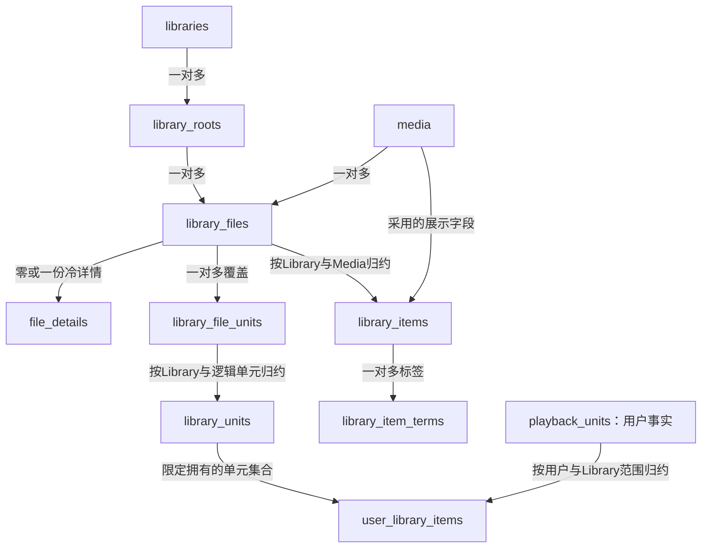

# Media / Library 存储重设计：单表浏览与独立响应缓存

状态：**Sol 第二轮复审修订版，供用户审阅，未实施**。本设计取代旧缓存计划中“保留浏览投影失效链”的决定。允许舍弃旧数据库数据，但不得删减现有业务功能。第一轮F1–F5已修订；第二轮确认F3/F4/F5在设计层面闭合，F1/F2仍有延伸缺口并发现季级范围遗漏。本轮补充R1跨源恢复、R2同来源合并与刷新目标、R3季级状态作用域；这些新增规则尚未经过独立复审，不代表运行时代码已实现。

## 1. 决策摘要

1. `cache.db` 只缓存外部响应，不是本地 Media 元数据的事实来源；清缓存不改变 Library 列表、身份、观看状态和已采用的图片地址。
2. 将 Media 身份/采用的元数据、Library 配置/根、文件台账、单元覆盖、浏览摘要及Playback状态/会话/历史放在 **同一个 library.db**。Media 可以无本地文件，文件台账只是它的使用者。
3. 文件行显式保存 `library_id/root_id`。常规浏览单表读 `library_items`，详情单表读文件台账后按主键批量补充少量冷数据。禁止请求时全库路径归属判断、文件 stat、NFO 解析和外部网络访问。
4. 浏览摘要仍是冗余读模型，但按受影响的 `(library_id, media_id)` 在写事实的**同一事务**内更新。不再维护另一份完整文件投影，不再依赖跨库 journal、周期整库重建或请求触发重建。
5. 删除旧浏览专用 `_read_revisions`、`_browse_changes`、`browse_change_cursors`、`browse_generations`、`browse_media`、`browse_files` 及消费者/构建服务。不能把这些机制改名搬到另一张通用队列表。
6. **大表尽量不关联**；允许确有必要的索引半连接/反连接、分页后主键批量水合、单个 Media 范围内的事务聚合。禁用“大表先全量取出，在 Rust 里做 JOIN/过滤/排序”这种伪优化。
7. 无旧数据导入、兼容视图、双读双写、旧版本回退。一次停服重建后所有调用方直接使用新模型；实际媒体和 sidecar 文件保留。

## 2. 当前证据与问题定位

| 当前代码 | 已观察到的行为 | 本设计对应变化 |
|---|---|---|
| `crates/store/src/schema/tables.rs` | Media/Library 配置在 app.db，ledger/file_meta 在 library.db，Playback 单元在 subscribe.db | 同一业务原子更新所需记录合到 library.db；凭证仍隔离 |
| `crates/api/src/http/library/selection/page.rs` | 高级过滤/观看排序读取全库轻候选再在内存筛选排序 | 查询端完整 SQL 过滤/排序/分页，禁止筛后补页 |
| `crates/api/src/browse_projection/builder.rs` | 合并台账、Media、TMDB 缓存，观察文件与 sidecar，再发布整库投影 | 文件观察在扫描/探测/Scrape 写路径；元数据成为本地采用记录 |
| `crates/store/src/browse_reads.rs`、builder 的 collect_owned | 部分 Library 查询仍以路径推断归属，默认 Library 有补集扫描 | 显式归属列与以 library_id 开头的索引 |
| `crates/store/src/schema/browse_changes.rs` | 每个源最多1024条逐行通知+1条 browse_all，不是无限日志 | 新结构不需要这份浏览通知；不能据此声称当前日志无限增长 |
| `crates/store/src/browse_projection.rs` | 发布校验对 app/library/catalog 的数据库级修订比较 | 同库事务读取/更新局部事实，不再用全库修订判断整库构建 |

结论不是“已有 JOIN 证明慢”：当前还存在全量内存筛选、JSON 解码、文件 IO、全库派生计算和跨库一致性成本。真实收益须由新旧查询工作量及端到端测量证明。

## 3. 数据库文件与生命周期

| 文件 | 新职责 | 正常运行时能否随意清空 |
|---|---|---|
| `app.db` | User/凭证、Site、Downloader、Filter、Naming template、实例设置；其他控制面设置 | 否 |
| `library.db` | Media身份与已采用元数据、Library/根/权限配置、文件与单元覆盖、Collection、浏览摘要、Playback状态/会话/历史/指标，以及文件相关持久操作与探测状态 | 否 |
| `subscribe.db` | Subscribe策略/覆盖/搜索轮次事实；不在本次顺便重设计其政策模型 | 否 |
| `jobs.db` | Job 定义、执行、重试事实 | 否 |
| `cache.db` | 六来源外部响应缓存及缓存自身索引；无浏览修订/事件表 | 是（按停用连接或受控清理流程，不直接 unlink 活跃 WAL 文件） |

“旧数据可丢”只适用于这次未上线切换，**不是以后可以删除 library/subscribe/jobs 的产品语义**。Media 从 app.db 移入 library.db 不意味着依附于文件：删除 Library 必须保留 Media 和观看状态。

同库FK用于明确的从属关系；禁止library/file删除通过FK级联删除Media或User观看事实。跨文件ID无外键，不宣称有跨文件原子事务。User删除、Subscribe创建/调度仍需可恢复的业务操作，不能误把整个实例当作一个事务；Playback进度/会话/历史则放同库并用同一事务提交。

## 4. 核心表与键（目标模型）

以下列出业务字段和关键约束；复用现有操作/探测/播放字段时不得因清单省略而删除功能。实现前需生成完整新 DDL/字典及逐调用方迁移矩阵，不以本文为已经完成的 schema。

### 4.1 Media 与元数据

| 表 / 主键 | 主要字段 | 规则 |
|---|---|---|
| `media` / `media_id TEXT` | kind、title、original_title、year、identity_state、aliases_display_json、metadata_revision | 内部 UUID，kind=movie/tv/video；无文件的 Subscribe 也可先创建 Media；不以路径或 TMDB ID 当身份 |
| `media_aliases` / `(source,kind,external_id)` | media_id、is_refresh_target | 别名唯一归属；同一Media/source/kind仅一条刷新目标（部分唯一索引），新识别首条别名为目标、后续添别名不暗中切换；不同外部实体合并须明确选择 |
| `media_metadata_sources` / `(media_id,entity_scope,season,episode,source,locale)` | provider_entity_id、normalized_json、present_fields_json、fetched_at、source_revision | 当前来源快照；实体坐标同人工覆盖，后续刷新使用固定目标并校验季集归属，合并按R2确定决胜 |
| `media_metadata` / `(media_id,locale)` | title/year、overview、release_date、rating、runtime_minutes、language、genres/countries JSON、poster_url/backdrop_url、cast/details JSON、field_origins_json、revision | 来源政策合成后的本地元数据；长简介/演职员等冷字段不复制进每个文件或卡片 |
| `media_metadata_overrides` / `(media_id,entity_scope,season,episode,locale)` | 显式字段值/清空标志、revision | 全局人工字段锁；work坐标(-1,-1)、season坐标(s,-1)、episode坐标(s,e)，CHECK约束合法组合；来源刷新不覆盖 |

TV 的季/分集详情单独保存 `media_seasons(media_id,season,locale)` 与 `media_episodes(media_id,season,episode,locale)`，含采用的名称、简介、播出日期、封面/剧照URL及来源版本；它们不是新的Media身份，也不代表已拥有该集。按Media/季定向分页，不能把整部TV详情复制到每个文件。Library详情将本Library的NFO覆盖与本地采用元数据按已知主键合成，允许单Media范围冷读，不访问响应缓存。

字段采用顺序：**同实体/语言的人工锁 > 对应Library同实体/语言的外部NFO字段 > 固定优先来源 > 基础名称/文件名**；自产未修改NFO不升级为外部覆盖，见下文。初始来源顺序TMDB、Douban、TVDB、Bangumi、AniList；fanart只提供图片候选，不生成Media身份。缺失/显式空/人工清空须区分，失败刷新保留最后有效值；语言不得按任意最新响应选择。

`library_metadata_inputs`保存候选事实，唯一键 `(library_id,media_id,entity_scope,season,episode,locale,input_key)`，另存root_id、规范路径、解析结果、版本、provenance与已导出字段摘要。work/season/episode坐标与人工覆盖一致，不使用NULL坐标规避唯一约束。TV的tvshow.nfo只提供work字段，season.nfo只提供对应season字段，episodedetails只提供对应episode字段；movie.nfo提供movie work字段。分集title/plot/runtime绝不能升级为work字段；本地身份别名须按NFO实体类型解析，集ID不当作品ID。

候选限定同Library、同实体坐标和同locale；同实体多个有效NFO按现有首选文件次序 `(season或0,episode或0,path,file_id)`及input_key稳定消歧，保留冲突信息。work卡片只取work输入，episode详情先取episode输入；仅可继承work的类型/国家等明确共享字段，title/plot/runtime/air_date不从work冒充分集值。没有季NFO则使用已采用season元数据；work字段仅作明确共享字段回退。

NFO提供明确语言时采用该语言，否则**导入时绑定Library当时的显示locale并持久化**，不随以后语言切换重新解释。详情顺序为请求locale→Library默认locale→实例默认locale，每一步都按对应实体采用；返回实际locale/来源。人工override只作用于同实体locale；Library语言切换按持久operation重算，不把旧NFO当成新语言翻译。

**自产NFO反馈（F4）：** Scrape成功写文件时，在同库摄取记录中保存export_id、实体/locale、导出文件digest及各字段的导出值/原始来源。再次扫描内容相同的输出仅确认sidecar存在，不生成高权威覆盖；外部实际改变字段后，只把改变/显式删除的字段作为该NFO的本地覆盖，未变字段保留原来源。无法解析的新NFO不覆盖最后有效输入；外部删除文件解除其覆盖。文件已替换但导出登记前崩溃，通过Scrape持久意图中的digest/export_id恢复识别，不能误当人工修改。

NFO读取入口必须返回可区分的状态：确认不存在、权限/根不可达等unknown IO、无效XML、有效输入；字段级再区分缺失/显式空/有值。只有确认删除或显式解除才移除本地覆盖，unknown IO保留最后有效输入，不能继续用Option<字段>把上述情况全压成None。该入口改造及两协议消费者列入实施计划，不能只改存储表。

新库离线导入没有任何导出登记的NFO视为外部本地输入，优先于来源，这与“原实例自产文件有记录”不同；明确刷新来源默认不覆盖外部修改/人工锁，只有显式解除本地字段覆盖或重写动作才替换。清cache不改变以上来源判断。不增加另一套逐文件完整有效元数据投影，候选最多保留当前输入/最后有效值与必要导出来源，不保存每次扫描历史。

验收（F3/F4）：work+E01+E02 NFO、两个locale的Library离线导入，work卡片不取集标题、两集简介独立、修改E01不影响E02；V1→Scrape→重扫→仅刷新来源V2后未修改字段显示V2；人工把简介改成X则刷新保留X；语言切换、清cache、导出登记前崩溃重启均按上述唯一规则得到结果。

展示 locale 的实际决策保存在 Library 配置中；一 Library 默认只有一套卡片语言，不做所有语言×所有文件的复制。单条详情按 locale 读取本地元数据，缺失可以降到实例默认；改变 Library 显示语言是显式可恢复重算操作，完成前不混用两种语言卡片。

### 4.2 Library、归属和文件台账

- `libraries(library_id PK, kind, name, lifecycle_state, config_revision, ...现有显示/访问/扫描/探测设置)`。
- `library_roots(root_id PK, library_id FK, path_key UNIQUE, display_path, enabled, ...)`。路径使用目录组件边界和平台既有大小写/规范化规则，不能简单小写所有路径。跨 Library 重叠根仍按最长唯一根处理，歧义拒绝，嵌套独立 Library 不互删。
- `library_files(file_id PK, library_id, root_id, media_id, path_key UNIQUE, display_path, kind, presence_state, publication_state, file_revision, size_bytes, mtime_ns, created_ns, source_digest, source_path, transfer_mode, ...质量/置信度/Transfer字段)`。
- 时间、路径、归属、基本质量、duration、has_poster/backdrop/still、选定本地 artwork 路径等高频标量直接在文件行；音轨/字幕/章节/指纹大体积数据放独立冷表 `file_details(file_id PK, source_revision, video/audio/subtitle/chapters JSON, ...)`。不把巨型 JSON 塞进热行。
- `library_file_units` 主键 `(file_id,season,episode)`，另存 library_id/media_id 和必要的可播放/版本标量。保留同单元多文件、多版本；同文件覆盖多集通过多行表示，文件大小仅计算一次。
- `library_units` 主键 `(library_id,media_id,season,episode)`：每个去重单元的文件计数、可用版本数、首选 file_id 和质量摘要。movie/video 用规范 whole `(-1,-1)`；TV 的 S00/E00 是合法分集，不能兼作 whole。
- 没有可靠分集编号的文件仍可登记/展示，不凭空生成覆盖单元，不据此宣称 Subscribe 已完成。`unidentified` 按 library/root/path 定向保存，保持人工认领流程。

文件归属列需用同库复合约束保证root属于声明的Library，kind与Media/Library一致；不是只存三个互相不一致的ID。presence使用present/missing/unknown，unknown（权限/IO错误/根不可达）不当missing，也不触发prune。STRM的source版本包含内容摘要，不能只比size/mtime；发布pending文件不出现在可播放列表。统计可区分missing和unknown，保留已有错误提示。

归属在写入时确定并持久化，不在每次列表读取时解析全库路径。根编辑、增加更深层根、跨根移动用显式 operation 对受影响范围重归属；不能留下读路径默默回退默认 Library 的规则。Transfer 的默认 Library 是**目标选择规则**，不是任意未归属文件的读时兜底。

### 4.3 单表浏览摘要

`library_items` 主键 **`(library_id,media_id)`**，每个实际有台账文件的 Media 每 Library 一行：

- 冗余身份展示：kind、title、title_sort、year、identity_state、常用外部 ID、metadata_revision。
- 冗余过滤排序：release_date_sort、rating_sort、runtime_sort、language、added_at_sort、size_bytes、resolution_rank、hdr、scraped、missing、stable_shuffle_key。
- 汇总：file_count、available_file_count、distinct_episode_count、distinct_season_count、缺失文件计数；计数列保持不变量并可核对。
- 卡片图片：preferred_file_id、poster_ref/backdrop_ref、has_still；引用可为已知本地文件路由或已采用远端 URL，不存图片字节。
- 版本：item_revision，随该行真实语义变化更新，不存在数据库级浏览版本计数。

不保存完整文件列表、全季分集数组、演职员或原始响应 body。`scraped` 保留既有筛选语义（可用元数据已采用），另用明确字段记录“已写 NFO/图片”，避免把缓存命中当作实际 Scrape 完成。

当前归约口径保留：`missing = missing_file_count > 0`；size按每个已发布文件行一次累计（同文件多集不重复；不同路径的hardlink仍按两份馆藏文件计），仅确认普通文件的值参与，全部未知时NULL；added_at取created优先/mtime兜底后的最早值，无值时NULL。图片按 `(season或0,episode或0,path,file_id)` 最大文件选择，NFO先按第4.1节限定实体/locale再选择，不能用最新集NFO覆盖work。浏览选图与播放按质量选版本不同；删除最后已发布文件删除卡片/覆盖但保留Media和观看事实，HTTP不回退stat。

多值字段不靠 `LIKE '%...%'` 或热页 `json_each` 全库扫描：`library_item_terms(library_id,term_kind,term_value,media_id)` 为去重倒排表，主键同列顺序，反向索引 `(library_id,media_id,term_kind,term_value)`；genres/countries/resolutions/collection 等通过此表做必要的索引 EXISTS。一个类别内部 OR，不同类别 AND，跟现有筛选合同一致。

Collection 定义/成员随Media迁入library.db，绑定canonical media_id，不依赖旧的路径式media_item_id；API旧格式由边界解析为同一身份，不能产生两套持久键。公共系列collection可进入公共terms；用户自建collection必须存有owner_user_id的独立成员索引，并在查询关联中显式校验owner，**不得把私有成员混入公共terms或全局facets**。成员变化与必要倒排索引同事务更新，移除Library不删除用户成员关系；卡片消失后只是不再出现在该Library可见结果。

### 4.4 User Playback 单元与摘要

- 将 `playback_units` 移入library.db，主键 `(user_id,media_id,season,episode)`；逻辑事实played/favorite/play_count与物理恢复包分离。恢复包同列保存position_ms、duration_ms、resume_file_id、resume_file_revision、resume_source_version、timeline_mode、tracks_version及轨道引用；一次有效上报成套提交，不拼接不同源的位置/时长。file_id仅作来源证据，不声明删除文件会级联删除观看事实的FK；文件移除后保留最后恢复包供解释，是否可用在选源时判断。无需增加每用户每版本进度表。
- `user_library_items` 主键 `(user_id,library_id,media_id)`，保存 seen/played/favorite/last_played_at 与继续观看所需当前单元摘要；只为有相关状态的用户/Media 创建，不预建全用户×全 Library×全 Media 笛卡尔积。
- 一行缺失的默认状态是未看/未收藏。**未看查询必须包含缺失行**；不能只查摘要存在的行，也不能分页后排除已看条目。
- 用户写入只处理**当前user_id、当前media_id**。影响范围有三种：episode按Media+season+episode精确定位；season `(s,-1)`按Media+season去重Library；whole `(-1,-1)`按Media定位所有现有items。从本地覆盖事实枚举影响范围，不能从已有用户摘要枚举（它可能尚不存在）；仅有其他季的Library不受season操作影响。不得读写其他用户、重算公共items/terms或检查磁盘。覆盖/身份变化才处理受影响的其他用户归约。
- 区分 Library 浏览既有 whole/episode favorite 与 seen 规则、播放页分集完成规则。不能把“某集看过”改成“整部看完”。取消 movie 旧 `(0,0)` 兼容分支，全新数据一律写规范 whole；TV S00E00 仍保留。
- `playback_sessions`、`playback_session_ids`、`playback_logs`、`playback_metrics`及非认证设备状态随单元一起移入library.db，保留现有字段/索引/保留窗口。会话generation/EventSequence校验、进度更新、摘要更新与终态历史提交使用同一事务；终态按稳定session标识幂等，旧Progress/Stop不能影响新会话，重复Stop不能增加播放次数。设备token/认证凭证仍在app.db，不因日志搬库而改变授权协议。

**季级已看/撤销（R3）：** playback_units允许TV `(s,-1)`保存季级逻辑标记，但library_units只保存真实拥有的分集，不制造季级物理覆盖。分集完成状态继承episode/season/whole中的最近有效played断言，同时间按episode优先于season优先于whole；显式false也是断言，favorite-only/单纯轨道编辑不是played断言。played断言使用独立played_changed_at_ms/has_played_assertion，收藏时间不得推进它；消费层沿用既有“浏览seen/played”与“分集有效完成”各自口径，不能拿一个OR结果取代全部协议归约。季级写入同事务更新当前用户受影响Library的完成数、NextUp及需要的浏览摘要，无已有分集用户行也必须生效；撤销重新计算继承结果，不删除更晚的分集断言。没有真实观看不推进watch_activity_at、不伪造position/duration。

### 4.5 逻辑播放项目、物理源与多集文件（F1）

- **逻辑目标**为 `(media_id,season,episode)`，movie/video 用whole；分集公共ItemId使用版本化类型前缀与内部MediaId/规范坐标编码，Series/Season使用各自类型，不使用file_id充当分集身份。它不是外部来源ID，也不包含路径。Library作用域另由请求授权确定。
- **物理源**为 `(file_id,file_revision)`；MediaSourceId明确引用它。每次开始会话持久绑定 user/device、逻辑目标、物理源、Library/生命周期版本、generation和时间轴模式。Progress/Stop按会话绑定处理，不从当前文件反推分集；迟到的旧会话或逻辑目标不匹配事件拒绝。无PlaySessionId的客户端只有活动逻辑ItemId与物理源均匹配才可更新，不能只比较文件ID。
- `library_file_units`记录覆盖关系，不推断时间分段。首版直连多集文件使用 **full_file时间轴**：E01/E02可分别指向同一完整文件，进度按选中的逻辑目标独立保存，position/duration都是完整文件坐标。UI/协议明确这是合并文件，不伪报分集时长或自动跳到E02起点；停止/完成只作用于选中的分集，不自动标记其他覆盖分集已看。
- 未知分集起止时间不从文件时长均分，也不把普通chapter当作集边界。不增加裁剪/转码服务；有可靠集段映射的未来分段播放需独立设计时间转换和协议合同，本次不宣称支持。覆盖可使Subscribe判为已拥有，但不等于观看完成。
- 播放选版本：先按逻辑单元和授权Library读取覆盖索引，再选可发布且可访问的源，最后按file_id点查当前源版本。两个Library共用Media的观看事实可以共享，但被隐藏Library的文件不能成为播放源。文件被替换后旧会话不得写入新源；历史保留其原绑定信息，不依赖文件行仍存在。

**跨源恢复兼容政策（R1）：** Web恢复、Jellyfin PlaybackInfo/PositionTicks、NextUp预览和自动起播共用一个源感知解析器。逻辑身份相同不意味着时间轴相同；默认仅当resume_file_id、file_revision、source_version及timeline_mode全部与当前物理源匹配时复用position/duration。轨道编号还必须匹配tracks_version并在当前探测列表有效；否则清除本次物理轨道选择，按语言/默认偏好重新选择，不复用旧编号。仅时长相同、路径相同、外部ID相同或分辨率不同均不构成兼容证据；首版不自动按百分比、时间偏移或内容相似度转换。

自动继续观看优先选仍授权/可用的精确原源，即使它不是默认最高质量版本；用户显式选其他版本则尊重选择。原源不存在/无权/已换版本时选择正常可用源，但本次start_position=0，duration只取当前源有效探测值（未知则NULL），轨道按当前源重选。Web明确返回resume_status=source_changed与原因；Jellyfin在该源的播放信息/项目位置中返回0及当前源信息，不暗中塞入旧位置。无可用源返回不可播放，不以隐藏Library原源兜底；不能因played/favorite逻辑状态保留而强行判新源已播到片尾。

源不兼容的解析本身是只读，不抹去旧恢复包或观看事实；新源开始并收到有效进度时，才用新源绑定成套替换该逻辑单元恢复包。用户明确start_ms属于对本次选源的显式定位，按当前源校验，可覆盖默认0，但不是自动恢复转换；自动完成阈值仅用当前会话有效duration/position。逻辑played/favorite不因源变化自动清空；已看单元默认重新播放从0开始。

验收（R1）：90分钟合并文件E02在60分钟暂停→改选45分钟独立E02时起点0且不沿用90分钟duration；原源仍可访问时自动继续使用原源60分钟；不同剪辑/同路径替换不可自动迁移位置；轨道顺序变化不复用编号；未启动只做解析不丢旧进度，两个协议均保留收藏/已看，NextUp不返回对选定源无效的恢复位置。
- 验收：同文件覆盖E01/E02，两个ItemId分别解析到同一源且进度独立；E02开始后E01迟到事件不改变E02；重复Stop不重复计数；完成E01不标E02已看；物理字节仅累计一次；TV S00E00与whole无冲突。

### 4.6 文件重新识别与 canonical Media 合并（F2）

**文件改挂**只对请求列明且版本/归属匹配的file_id集合执行：将A改挂至B、重建这些文件的覆盖，以及A/B受影响Library的卡片/用户摘要。A的原始进度、收藏、历史、Collection和Subscribe不迁往B；B的摘要从B原有用户事实生成。其他文件不改；相关文件活动会话先终止/排空，旧worker不能发布。B的新别名如与现有身份冲突则拒绝，不顺便触发全局合并。

**身份合并**仅用于经明确确认A/B为同一作品且kind一致的动作，选定唯一survivor ID；它不是修正一个文件的默认行为。规则如下：

1. 同用户同单元：favorite/played/seen按既有事实OR归并；position、duration与轨道选择采用最近有效观看活动的成套状态（不得拿favorite时间覆盖观看进度），同时间以survivor优先；没有有效源身份/时长依据的不猜测转换。play_count取两者max而非相加，避免未知重复来源双计；历史保留独立事件，只按稳定session/event标识去重，界面不再由历史条数反推这一计数。
2. 别名唯一性保留；不同来源别名可汇入，任一外部别名已属于第三个身份则中止待人工处理。人工锁冲突在预检返回明确冲突；同来源快照碰撞及后续刷新按下述R2规则，不依赖SQL处理顺序。Collection同owner重复成员合为一项，保留最早排序位置；Subscribe只改media_id引用，不擅自合并两条策略。
3. 持久operation以唯一operation_id保存survivor/loser及预检版本。顺序：冻结两个身份的新引用/写入→排空相关工作和会话→library.db事务合并事实及摘要→分批收敛Subscribe/Job中显式Media引用→校验无可写loser引用→完成/解除survivor冻结。每一步有持久阶段和幂等键；失败/重启保持冻结并可重试，不伪称跨库事务。
4. 创建Subscribe、Job调度、文件发布、Playback写入等入口必须校验身份状态，冻结后不能新增旧引用；已运行跨库发布者由租约/版本屏障排空。loser保留最小retired墓碑用于拒绝旧ID（明确错误和survivor信息），不是可继续写入的兼容实体或自动HTTP跳转。用户重新选择survivor；历史审计中的原ID可保留。
5. 验收：不同作品A/B只改挂一个文件时，A另一库文件、原始进度/收藏/Collection/Subscribe不变；确认同作品合并后冲突规则确定、重试不增加计数；在每个阶段退出重启均可继续，冻结/退役ID不能再产生新引用。

**同来源候选合并与刷新目标（R2）：** 每条来源快照还记录provider_entity_id（对应source/scope的外部实体）、规范化payload与字段存在性摘要，不能只记录source名。合并预检先解析“同一个外部实体”再比较版本：

- 同source/scope/locale且provider_entity_id相同，选择整份已校验快照：fetched_at较新者胜；相同时间固定survivor原行优先，不依赖遍历顺序，不比较不同身份的本地source_revision大小。胜出快照的缺失字段保持缺失、显式空保持显式空，不从落选快照拼补后伪称一次来源响应；按原字段采用政策再合成有效元数据。失败响应从来不是可选快照。
- 同source却provider_entity_id不同，时间新旧不能证明是同一外部条目。预检必须由合并请求为每个冲突source明确选择refresh_target_external_id；缺失选择返回冲突且不进入冻结/写入阶段。选择必须属于已确认合并的别名并匹配kind；所有非冲突别名可保留用于身份识别，但每个Media/source/kind仅一条别名标记is_refresh_target（部分唯一约束），来源刷新只能使用该目标，不随机选第一条别名。
- 当前单快照表不扩展为无限候选历史：不同外部实体只保留选定目标对应的当前快照，若只有另一目标的快照则不冒用，标为该来源待刷新；既有本地有效值按既有fallback规则保留并标明原来源，直到明确采用选定目标成功返回。work目标确定后季/集只采用其验证归属的provider实体，不因季集数字相同拼接不同作品；无法验证或坐标冲突则预检拒绝待处理。
- 预检把冲突选择、每个键的胜出来源/版本与有效候选清单固定在持久合并operation中。冻结后事务再次校验预检版本；已变化则回到预检，不沿用旧决议。一次成功事务对冲突键UPSERT一次，重启不按新读取顺序重新决胜；后续刷新只更新固定目标。人工锁仍高于该选择，不因合并自动解除。
- 验收：同实体同locale新旧/同时间/缺失与显式空快照交换输入顺序，胜出整份内容一致；不同外部实体无明确选择时拒绝，有选择时后续请求固定目标；合并阶段重启/重试不产生唯一键错误或改变胜出结果，季集不能串作品。

### 4.7 Library 表关系与成本地图

**表之间有关系，不等于每次请求都JOIN这些表。** 事实负责正确性，三个摘要（items、units、用户items）负责把重复归约从请求时移到相关写入时，terms是多值倒排索引。`file_details`是冷数据，不是第二份完整文件事实；探测/删除/scan operations是恢复状态，均不参与普通海报墙查询。



关系约束：file_id全实例唯一；一个已发布文件只属于一个root/Library、一个Media；相同Media可在多Library拥有不同文件。file_details按file_id可缺失（尚未探测）。coverage行的Library/Media必须与file一致，以同库FK/复合约束约束冗余归属；units的首选file必须来自该单元有效覆盖。items/terms随最后一个已发布文件消失而移除；NFO候选按对应sidecar生命周期清理，源快照只随明确元数据操作变化；Media、原始用户进度、Collection成员不随最后文件删除。用户摘要可随Library/item消失删除、重导入后由原始用户事实恢复。

| 请求/动作 | 主要访问表及范围 | 有意避开的成本 |
|---|---|---|
| 普通列表50项，不请求总数 | 授权配置小表后，items一次索引分页；如返回用户状态，最多50个Media主键批读用户摘要 | 不读files、覆盖、冷JSON、cache，不stat |
| 需要精确总数/分面 | items/terms与必要用户索引，在相同授权/谓词下聚合 | 可扫描本Library窄行，不拉所有文件/JSON到Rust；精确count不是免费 |
| 类型/国家筛选 | term倒排索引与items必要索引关联，在LIMIT前完成 | 不用LIKE/JSON逐行解码；不承诺极稀疏筛选只检查50行 |
| 未看/收藏/观看排序 | 当前User+Library的稀疏用户摘要与items必要关联 | 没状态也算未看；不预建全用户全卡片；复杂排序成本公开 |
| 作品详情/分集列表 | 本地已采用元数据和本Library输入的定向主键读；units按Media/季分页 | 不为详情加载整个Library或全TV的文件详情 |
| 某一集选播放版本 | 按Library/Media/季/集的coverage索引取候选；files按选中file_id点读，details可再点读 | 不扫描所有文件；最终校验权限、可用性和源版本 |
| 普通播放心跳 | 当前session+unit+受影响用户摘要，按当前用户/Media/单元索引 | 不碰公共items/terms、不读其他用户、不执行整库重建 |
| 新文件或覆盖删除 | 文件/coverage、受影响units、对应item/terms及相关用户摘要，同事务 | 增加局部写成本换取读速度；不重写整个Library |

索引职责补充：items反向 `(media_id,library_id)` 用于whole扇出；units索引 `(media_id,season,episode,library_id)` 用于episode精确定位，**season用该索引的Media+season前缀去重Library**，不能查不存在的 `(s,-1)` 覆盖；只拥有其他季的库不入选。coverage `(library_id,media_id,season,episode,file_id)`只选物理版本，心跳不遍历同集所有版本。用户摘要主键 `(user_id,library_id,media_id)`、反向 `(library_id,media_id,user_id)`用于覆盖变化，活动排序 `(user_id,library_id,last_played_at DESC,media_id)`；用户单元 `(user_id,media_id,watch_activity_at DESC,season,episode)`用于观看活动回退，played断言/favorite时间单独保存不冒充观看。scope枚举和这些查询分别验收，不能从现有稀疏用户行推断应受影响Library。

**成本用数据范围判断：** 列表seek约为索引定位+返回页，详情按一个Media/一季范围，单元选源按该集版本数；exact facets、稀疏条件或跨库去重可能按本库items/terms增长。文件变更按受影响Media文件/覆盖/用户数增长。表数量本身既不是成本指标，也不是无限拆表的理由：冷数据独立避免热页读大对象，coverage独立是多对多事实，三个摘要须以热查询消费者和写成本证明价值，不能再叠加泛化全文件投影。

例：一个Media有12集、每集2个版本且都属于同一Library，则24个文件、24条覆盖、12个去重units、**1张items卡片**；点开卡片不读24份冷详情，播放E03才读取E03版本候选。新增另一个版本主要增加文件/覆盖，更新E03和该Media摘要；没有覆盖/质量/图片变化的心跳不走这个更新链。文件数与覆盖数不同：一文件多集可增加多条覆盖但大小只按文件计一次。

## 5. 原子写入与并发：冗余字段如何不漂移

Store 提供按用例的事务入口，而不是允许任何模块任意写事实后“记得刷新摘要”。所有索引事实、覆盖、terms、卡片和用户摘要在同一 library.db `BEGIN IMMEDIATE` 事务内发布；冷 IO/网络/JSON 解析必须在事务外完成。

| 写入事件 | 同事务内必须完成 |
|---|---|
| 扫描/Transfer 发布一个文件 | 校验 Library 生命周期与 config_revision；写 file/units；合并对应 library_units；更新该 item、terms、受影响用户摘要；登记 probe 义务 |
| 文件质量/本地图片变化 | 校验 file_revision/source version；更新文件事实与受影响 item/单元；冷数据以同源版本写入 |
| 元数据采用/用户编辑 | 写候选/覆盖/已采用元数据；按 media_id 索引更新此 Media 的相关 items/terms；不同 Library 的 NFO 不串用 |
| Playback 上报/收藏 | 更新单元事实及受影响 user_library_items；不更新公共卡片、不触发全库工作 |
| 缺失标记/显式 prune | missing 只标记，不自动删数据；显式 prune 删文件依赖与覆盖、刷新对应摘要，不删 Media/观看/字节 |
| 文件改挂 / canonical Media 合并 | 两种不同操作，严格按第4.6节范围执行；文件改挂不迁移旧作品的全局用户事实。合并需明确授权、稳定幂等操作与跨库引用收敛，不允许通用UPDATE冒充合并 |

索引：文件 `(library_id,media_id,file_id)`、`(media_id,library_id,file_id)`、`(root_id,path_key)`；单元按 `(library_id,media_id,season,episode,file_id)` 与 `(media_id,season,episode,library_id)`；用户单元反向 `(media_id,user_id,season,episode)`。质量/版本变化后首选文件重新选择时，SQL/Rust 可读取**该 Media 范围**，不是全 Library。

文件/覆盖/元数据变更可在受影响Media范围重算公共汇总，扫描以**最多100个文件**为提交窗口、合并重复Media更新；该上限只限输入，不保证归约耗时。Playback不复用全用户重算入口：普通心跳只写当前会话/单元及当前用户受影响摘要；有效played/seen/favorite或领先者变化才按episode/season/whole的明确scope更新归约。season标记/撤销可能遍历该季真实分集，whole可能遍历本作品已有覆盖，不能缩成精确集或预先分页再归约；不读写其他用户。10000集作品的标记/撤销应测锁时长，不能为提速打破原子可见。网络/大blob解析在事务外，冷数据写入仍计成本。

元数据全局刷新按单Media事务发布；根编辑/显示语言等确实涉及整库的大操作必须有持久operation与生命周期屏障：标记reindexing、阻止旧scope工作发布，分批更新期间普通读返回明确operation状态而非混合新旧归属/语言，完成并校验后恢复ready。重启恢复该operation，不用通用浏览journal；不能长持一个覆盖百万文件的写事务。

同一路径被替换时增加 file_revision，probe/artwork worker 发布必须匹配 file_id、source version 和生命周期租约；旧 worker 不能覆盖新内容。不能用一个全局版本号代替这个检查。磁盘变更与 SQLite 无原子事务，Transfer/Scrape/删除仍需保留先登记意图、原子文件替换/确认、崩溃恢复和身份校验，不能删掉 pending_file_deletions、probe obligation 等必要持久工作。

摘要一致性保证边界（F5）：正常写路径由同事务维持；已解析到的坏行/已登记不一致状态在HTTP返回明确存储错误，但**仅查摘要不能自动发现任意漏行**，不承诺普通请求检测所有外部破坏。显式/周期低优先级校验任务以事实为依据按Library和Media有界keyset遍历：对file覆盖→items/units/terms及反向孤儿、playback_units→应有用户摘要及反向错误进行核对；包含没有用户摘要行的非默认事实。每批最多100个Media，超长单Media内部再分页，记录版本；事实变化则重检，不发布旧结果。发现问题先标记该Library的integrity状态再报管理员；修复对每个Media加写事务重读事实并重建，清除状态前再校验。进度/错误保存为明确校验operation，不是浏览事件流。修复只读本地事实/已采用元数据，不访问cache、网络或磁盘。验收：人工删公共item和非默认用户摘要后，校验必须发现并修复；HTTP在发现前可能返回较少项，发现后明确报错，这一边界必须如实说明。

## 6. 查询、索引和 JOIN 例外

### 6.1 常规列表：单表 SQL

```sql
SELECT media_id, title, year, poster_ref, file_count
FROM library_items
WHERE library_id = :library_id
  AND (title_sort, media_id) > (:title_sort, :media_id)
ORDER BY title_sort ASC, media_id ASC
LIMIT :limit;
```

示例对应索引 `(library_id,title_sort,media_id)`，采用非NULL排序键进行复合seek。首屏省去cursor条件；降序排序为避免混合方向的OR条件退化，使用与排序方向一致的复合seek（例如DESC/DESC），cursor模式同值按ID同向排序；旧offset协议保留现有tie-break。标题/上映时间/评分/时长/大小/分辨率/固定随机键按真实查询建复合索引，NULL映射必须保留既有排序语义。标题排序须与现有大小写/Unicode规则一致，不用SQLite NOCASE假装解决全语言排序。

cursor 包含排序类型、方向、过滤指纹和末项排序键/ID，服务端绑定 Library/User；翻页中有数据变化允许下一页反映新状态，不承诺跨请求冻结快照。现有 offset/StartIndex API 保留可用并如实报告深页成本；前端可切 cursor，不能悄悄破坏 Jellyfin 或 CLI 协议。

### 6.2 必要关联：有边界、有索引、分页前完成

| 场景 | 允许形态 | 禁止替代 |
|---|---|---|
| 详情的冷数据/当前页观看状态 | 本页 ID 列表批量主键点查；一 Media 的文件按 library/media 索引查询并分页 | N+1 每卡片读取；为一页读全库文件 |
| 类型/国家/分辨率/collection 多值筛选 | 对倒排表的索引 EXISTS/IN 子查询，或选择性高的 term 索引驱动关联 | 在大 JSON 数组上 LIKE；先分页后过滤 |
| 未看/收藏/观看排序 | 与当前 User+Library 的稀疏摘要做索引 LEFT JOIN/EXISTS/NOT EXISTS，缺失为默认 | 复制所有公共卡片给每个用户；只查有状态行导致漏未看项 |
| 精确 facets/count | 相同权限和谓词下 SQL COUNT/GROUP；可扫描该 Library 的窄摘要/倒排行 | 认为单表精确 COUNT 也是恒定时间；把全部候选送到 Rust |
| 多 Library 首页/跨库去重 | 先确定可见 Library，在 SQL 内定义按 Media 去重与首选归属再分页；必要索引聚合/关联 | 分别每库取一页后合并，造成重复、漏项和错 count |
| Probe/任务派发/删除操作 | 有界工作窗口与索引关联 | 为追求零 JOIN 删除必要的工作项/状态表 |

初始热索引以现有排序键为准，不为所有任意过滤组合建笛卡尔数量索引。复杂多条件/观看排序可能仍需临时排序或扫描本库候选；必须在基准中暴露，不谎称“所有分页都 seek”。全量精确 facets 是按库规模增长的管理/交互成本，后续是否缓存需测量再决定。

名称搜索保留现有精确/前缀/包含及Unicode语义；精确和可索引前缀用本地列索引，任意包含搜索允许扫描本库窄摘要并报告成本，不用引入分词后悄悄改变匹配语义。page与精确count在同一读事务内查询，避免一个响应的页与数量来自不同提交；多语句事务保持短，不在其中执行文件IO或等待外部请求。混合条件参数全部绑定，排序/term类别来自固定枚举。

ACL 先从配置得出授权 Library 集，再将授权条件带入列表/count/facets/搜索/选文件查询，拒绝参数中的越权 library_id；数据层无权访问的文件不参与派生选择。最终播放文件打开前再校验当前权限/生命周期。静态图片仍公开，Jellyfin 视频按协议鉴权，不能把两者混淆。

## 7. 全链路保留合同

| 链路 | 新读写路径及不可退化点 |
|---|---|
| 空库启动/首次配置 | 新 schema 原子初始化、五文件布局；可创建默认 Library/根、User、Site/Downloader，不能要求旧数据存在 |
| 搜索/发现/创建 Subscribe | 外部候选可仅活于 cache；只有识别/选择/Subscribe/扫描采用时建本地 Media；无需先有文件；Search/RSS 并发/Filter 政策不变 |
| 扫描/Watch directory/NFO 重导入 | IO→识别/版本验证→局部事务发布；full/incremental/movie/tv/video、断点、根不可用保护、人工认领均保留；Video 不强制 Metadata source |
| Transfer/Wash-cut | 默认目标/显式绑定、hardlink/copy/move、质量优先、pending 发布和崩溃恢复不变；旧文件在新文件可用且身份确认后删除，不能提前改卡片宣称已成功 |
| Scrape/刷新/本地图片 | 采用元数据与写 sidecar 分离；NFO/图片成功原子替换后摄取事实；失败不覆盖有效候选、不破坏用户锁；图片候选请求可直接走 cache |
| Browse/详情/gallery/facets/搜索/collection | 持久化摘要/单元/冷表，全部过滤和去重发生在分页前，保留现有排序/筛选/计数与图片剔除语义 |
| Playback/Jellyfin/收藏/继续观看 | 单元进度独立于文件版本/路径；同 Media 多库/多版本按权限和质量选文件；会话/历史/字幕/音轨/markers/章节/STRM不丢 |
| Probe/指纹/章节帧 | 阶段退避、partial、单文件版本 CAS、probe obligation/重启重试保留；不将 NFO 当探测成功 |
| Library 冻结/移除/根编辑/重导入 | 保留 ADR-0012 freeze→drain→scoped cleanup；按明确 ownership 清文件索引、不删字节/Media/观看；重建同别名 MediaId 可重连进度；嵌套库/相同Media的另一库不受损 |
| 维护/备份/清缓存 | 缓存清空只影响后续网络命中；Job定义/在途状态不能按缓存清理；备份按停写或受控一致性流程，不复制活跃DB文件冒充一致快照 |

## 8. 规模预算、增长与验收

**测量目标，不是本次已取得的性能结果。** 规模至少 Media=100k、文件=1M、Playback 单元=1M；覆盖一个超长 TV、同 Media 多版本/多库、多用户。普通请求 page_size=50，API 最大分页保持协议既有上限；所有解码/补充只限实际返回页或明确有界窗口。

1. 单条/普通第一页：EXPLAIN QUERY PLAN + VmStep/FullscanStep/Sort；固定目标库数据，在无关库文件从10k→1M时，热点 SQL FullscanStep=0，VmStep≤基线2倍，不把 B-tree深度增长误判为必须完全相等。
2. 相同目标库增大时分别测第一页、深 cursor、深 offset、稀疏多值、未看、last_played排序、跨库去重。只对可索引 seek 路径断言上述工作量；精确 facets、任意多条件与 offset 报告实际扫描/排序成本，不拿它们冒充恒定。
3. 记录 SQL次数、引擎步数/返回行数、Rust解码行数与字节、分配/峰值内存、锁等待/事务时长、WAL/DB/索引字节、写入吞吐和 p50/p95。禁止只量 SQL耗时或只看结果行数。
4. 100文件批量发布后摘要可立即读；一处更新仅触及对应 Media 的索引范围。进度心跳不改公共卡片/响应缓存；缓存 100k次更新/清空不写本地 items 或重算任务。
5. 对每一写入口断言文件事实、覆盖、terms、items、用户摘要的事务不变量；进程在提交前/后退出，重启不能出现事实成功但摘要永久旧。删除/根修改/重新识别与并发worker的发布竞态覆盖。
6. 保留/更新现有可见行为回归：筛选边界/排序NULL/同值tie、TV S00、whole与分集观看、无状态未看、同Media多Library、用户可见性、缺失prune、删除重导入、恶意/冲突NFO、坏响应/断网、STRM换URL、Probe旧版本晚到。
7. 空目录真实启动→配置→fake来源识别→扫描本地小视频/注入probe→浏览/图片→播放进度→收藏/Subscribe→Transfer/Scrape→重启→清cache→仍浏览/播放→移除并重导入。API/CLI/Jellyfin真实请求，web涉及页面需浏览器实际验证；不只跑Store测试。
8. 每个触及crate独立 `cargo test -p <crate>`，稳定树workspace一次；前端typecheck/test/build。现有无关失败报告实际证据；NAS设备/真实来源未运行必须写Not run。

本轮新增可观察验收：F1多集独立ItemId/会话/迟到事件及full_file时间轴；F2文件改挂隔离与canonical合并每阶段重启/冲突计数；F3实体/locale隔离；F4自产NFO反馈及人工修改；F5事实驱动查漏与修复。性能专项在10k分集、多Library、多用户同Media下，固定当前用户与覆盖，增长其他用户状态时，心跳的读取/写入集合不能增长；增加不包含该单元的Library不得更新其用户摘要。并发扫描+心跳至少记录p95、写锁等待、最大事务时长、busy失败和扫描吞吐；未实现测量前不写毫秒承诺。

第二轮复审新增验收（R1–R3）：跨源解析覆盖合并→独立分集/剪辑变化/同路径替换/音轨重排，两个协议的源感知位置、duration和轨道输出一致；同来源快照交换读取顺序/相同时间/重启仍确定，外部实体冲突无选择拒绝、选择后刷新只打选中目标；S01E01在A、S01E02在B、S02在C且无初始用户行时，当前用户标记S01已看/撤销须同事务更新A/B的NextUp与分集完成，C及其他用户保持不变，收藏不得改变played断言优先级。

R1–R3本轮设计烟测：临时Python SQLite 3.51.0验证episode/season/whole三个作用域、无初始用户摘要的季标记/撤销仅更新A/B；season查询走Media+season覆盖索引，DISTINCT使用临时B-tree，故不宣称按Library去重是常数工作。同来源整行候选在交换输入顺序后仍按fetched_at/固定survivor决胜，缺失与显式空不混合；部分唯一索引拒绝两个刷新目标。独立策略原型验证原源恢复/新源归零/轨道重排/未知时长/显式seek且不修改旧恢复包。以上仅验证SQL形态和设计决策表，非完整DDL、真实Web/Jellyfin实现、并发性能或独立Sol复审；本轮不运行Cargo测试，因为未修改运行时代码。

设计阶段已做独立SQL烟测：Python SQLite 3.51.0内存库100k卡片，复合title cursor返回第50001起精确50条，EXPLAIN显示覆盖索引复合SEARCH；未看NOT EXISTS用User/Library/Media主键SEARCH，缺失用户状态行正确入选、过滤在LIMIT前。仅证明该SQL形态可执行及这组语义，不是Rust bundled SQLite、真实应用或NAS性能验收，后者均未运行。

本轮独立SQL烟测（同为Python SQLite 3.51.0）验证24文件/24覆盖/12逻辑单元/1卡片、100k卡片深游标精确返回50项、事实与摘要事务回滚；按Media/季/集查询受影响Library走units覆盖索引，预热后加入100k无关用户摘要，指令回调计数保持18。首次未预热比较为24与18，不能当工作量增长证据；后续采用预热前后对照。该实验不是实际心跳实现、并发写性能、完整新DDL或Sol复审，均未验证。

增长说明：`library_items` 随实际 Library×Media归属增长，不随访问次数增长；terms随这些记录的标签/collection成员增长；用户摘要随有状态用户及相关归属增长，不预铺满；file/unit表随实际文件与覆盖增长。操作/会话历史有既有保留策略，持久队列成功ACK后可裁剪；响应缓存仍按独立维护政策清理。没有通用浏览事件日志不等于所有业务表可以无保留策略地积累。

## 9. 切换、实施边界与交付门槛

- 这是需要更新 ADR-0008 的新决策：同一事务需求优先于原先把 Media/Library配置/Playback单元分散在不同文件；不修改已接受的 Media 内部身份和文件删除安全合同。
- 用户批准设计后再编写新的完整实施计划，不执行旧缓存计划。先定新DDL和领域/Store事务接口，再改写链路、全部调用方和测试；不能只改表后让旧服务勉强启动。
- 实施分为可验收批次：①新schema/事务基础；②来源缓存与元数据摄取；③扫描/Transfer/Scrape/探测写路径；④Library浏览/详情/统计；⑤Playback/Subscribe/collection/删除与根变更；⑥空库全流程、性能与旧路径清理。**这些是依赖分解，不是允许交付半套功能。** 全部通过后才切换用户实例。
- 删除旧投影/通知表与代码之前，枚举所有修订计数/全量fallback/投影依赖者，迁完播放页、首页、CLI、Jellyfin与测试；不能仅删cache触发器。若审计发现独立用途，迁成该用途的明确局部版本/状态，不保留误导兼容别名。
- 公共API既有筛选/排序/权限能力保留；有意变化（locale采用规则、显式归属、多集逻辑ItemId与物理MediaSource分离、watch_activity与favorite时间分离）必须在实施计划逐入口映射并同步全部Web/CLI/Jellyfin生产者消费者。旧数据库ID可舍弃，不保留file_id冒充逻辑分集的兼容分支；协议认证、字段单位和既有可用功能不能因换ID缩水。
- 真正切换先停所有写进程，列出实例真实路径与SQLite/WAL/SHM后按授权删除旧DB；只删明确SQLite文件，不删视频、字幕、NFO、图片、Indexer YAML、下载目录、编译缓存。启动自动建新库，不在每次启动清库。
- 新结构使用自身schema版本和固定布局标识；未知/较新布局拒绝打开，不尝试把旧表就地猜成新表。未来变更正常做前向schema版本升级，本次不写旧数据迁移器。
- 本次文档交付不改现行 `CONTEXT.md`/ADR为已生效状态；批准并实现时同步术语/数据库字典/部署说明/变更记录。现有缓存旧实施计划标为已取代，避免执行者继续安装journal。

## 10. 尚需实测而非臆断的取舍

- 同库保证局部原子性，代价是Playback心跳、扫描、元数据写共享SQLite写锁；必须测高并发心跳+扫描。先短事务/窄热行/合批，不先引入分布式消息。
- 冗余items/terms/用户摘要降低读成本，增加受影响Media写成本；很多文件/用户的单Media更新是重点，不声称“无JOIN且零写放大”。
- 必要的多值/用户状态索引关联比冗余整个用户卡片集更易维护；接受此明确例外，依据计划/实测优化，而不是按JOIN关键字数量判性能。
- 基准若不达标，调整索引、摘要范围或按用例拆查询；不得通过取消精确计数、去掉过滤/权限、删掉Playback功能来达标。任何进一步产品语义变化需要另行批准。
