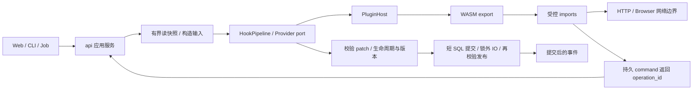

# 插件系统设计：基于 storage-redesign

状态：待实现的完整设计；本轮交付文档与 review，不代表运行时、API、SDK 或性能已经通过验证。

代码基线：`feat/storage-redesign` @ `52522549fbefece002d0354cb4434686939b4f4c`。
取代旧方案：`docs/plugin-design` @ `6836a4eb7f9ecd9aa50cc7c9a3449e6817082647`。

配套：[作者与协议](../../plugins/authoring.md)、[界面与 API](../../plugins/ui-and-api.md)、[实施计划](../plans/2026-11-03-plugin-system-plan.md)、[review](../../audits/2026-11-03-plugin-design-review.md)、[ADR-0013](../../adr/0013-wasm-plugin-runtime.md)。这些文档共同定义合同；正文中的新类型、表、接口均为提议。

## 1. 结论、目标与范围

旧方案的 WASM Component + WIT、宿主能力授权、声明式界面和类型化 Provider 方向保留。不能直接按旧计划实施：它引用旧路径、旧数据库归属、兼容适配层和不成立的事务/删除/超时保证。新设计以 SQLite 五文件、每库单 writer、统一 reader pool、持久操作和版本发布校验为基础。

必须交付四条完整链路：

1. 自定义 Site：YAML 包或 WASM Indexer Provider，参与手动搜索、Subscribe 搜索/RSS、详情、下载解析、认证检查、Check-in 与统计。
2. 全流程干预：搜索前、单站结果、汇总结果、Filter 前后、评分、选择、下载前、Transfer、Scrape、完成判定；各步骤提供明确且受校验的输入/输出。
3. 第一方 Check-in 插件和刷流插件：不是保留一个 UI 开关；有实际调度、执行、持久状态、恢复和可观察结果。
4. 插件编写、安装、启停、配置、授权、任务、诊断、升级、卸载，以及 Admin 管理界面。

用户明确要求 CDP 可用于插件搜索和签到。本提议扩展 ADR-0007 的能力范围：`browser:search` 允许获授权的插件 Indexer 使用受控 Browser；`browser:maintenance` 用于认证检查/签到。全局关闭、Site 未 opt-in 或隔离条件不足时均不可调用；不自动下载或启动浏览器。本轮不改写 CONTEXT/ADR-0007 对当前实现的描述。

榜单订阅、通知渠道、声明式 widget、受鉴权 endpoint、媒体识别建议、Playback 事件列入同一完整方案，但按实施阶段逐项开放。Bot/外部服务运行时属于后续独立扩展；不把外部进程称为 WASM 沙箱，也不承诺自动从 WIT 生成可用 gRPC 协议。

不提供任意 SQL、文件路径读写、原始 CDP socket、宿主 Rust 对象、任意前端 JS、原生动态库或插件之间直接调用。插件不能绕过 ACL、实例维护 WriteGate、Library lifecycle、FileVersion、删除证据或远程 probe 限流。

## 2. 当前代码证据与改动地图

| 当前事实 | 证据 | 新方案处理 |
|---|---|---|
| Hook 只有 Step，无业务 payload，首次错误终止 | `crates/hooks/src/bus.rs` | 类型化 pipeline，一批更新所有调用者，删除旧 Bus API；不保留一版本兼容层 |
| 第一方 Login/Check-in 支持已有 Cookie，不提供用户名密码自动登录 | `crates/hooks/src/plugins.rs`、`crates/api/src/site_maintenance.rs` | 保留业务能力，转成第一方 Maintenance Provider；不把已有 Cookie 校验描述成自动登录 |
| Check-in 是全局 Interval Job，刷流仅配置/统计 | `crates/api/src/check_in.rs`、`http/sites/boost.rs`、`jobs_api.rs` | 拆成两个独立插件任务；去掉 Check-in 中 boost_check，删除旧假执行入口 |
| Schedule 只有 Interval | `crates/jobs/src/kinds.rs` | 本版 `interval_secs`；没有 cron 解析和时区支持的承诺 |
| Store 四库 + Jobs 独立库；无进程级 Store Mutex | `store/src/writers.rs`、`open.rs`、`read_scope.rs` | 插件持久数据并入正确归属库；无 plugin.db / plugin-store 第二写者 |
| Writer 等待预算 1s；实际 writer 后复查准入 | `api/src/http/store_wait.rs` | 每次宿主写能力复用同一准入合同；不改 busy_timeout 掩盖等待 |
| Indexer profile 借用且配置不可变 | `indexer/src/engine.rs`、`profile.rs` | 一个不可变 RegistrySnapshot 同时持有 profiles、providers、版本，整次调用固定快照 |
| 下载接口已经拆到 client.rs，多条准入/提交路径 | `downloader/src/client.rs`、`api/src/delivery.rs`、`admit/delivery.rs` | 统一 DownloadSubmitter，同步业务核心、HTTP 异步外壳；保留现有精确归属与 pending 语义 |
| Subscribe 创建/删除有跨库持久意图 | `api/src/subscribe_create.rs`、`subscribe_job_sync.rs`、`store/src/subscribe_retention.rs` | 插件写走同一应用服务；不直接 Store CRUD |
| Transfer 有 reserve、源证据、WriteScope 和 FileVersion | `api/src/worker/transfer/`、`subscribe/src/collect/transfer.rs` | 可改路径的 Hook 在 reserve 前；发布后才发成功事件 |
| Watch/claim 不是 collect 同一调用栈 | `api/src/watch_intake.rs`、`claim/publication.rs` | 通过共用决策端口覆盖各入口；不能只在旧 emit 位置加插件 |
| Library 删除保留磁盘字节，先隐藏取消，再清理 | `api/src/library_lifecycle/removal.rs`、ADR-0012 | 插件迟到结果拒绝发布；无虚构回收站 |
| Browser 现有 render/PageSession 不是任意插件 CDP 工具箱 | `indexer/src/browser.rs`、`browser_host.rs` | 新增窄 BrowserSession port、动作与网络隔离；保留独立 context 和取消回收 |

参考方案选择：继续纯原生 Hook 无法交付第三方分发；内嵌脚本需要额外沙箱模型；选择 WASM 并把所有真实副作用留在宿主应用服务。现有 YAML 仍适合声明式 Site。

## 3. 模块与依赖

| 模块 | 拥有的职责 | 不拥有的职责 |
|---|---|---|
| `domain` | PluginId 等纯身份/DTO（确有共享需要时加入） | IO、运行时、SQL |
| `hooks` | HookId、类型化 payload/patch、Gate 合并、PluginInvoker port | Wasmtime、Store、HTTP handler |
| `plugin-api`（新） | 唯一 `.wit`、world/ABI 常量、生成绑定 | 业务写入、SQL |
| `plugin-host`（新） | 组件加载、调用预算、注册表、权限检查、资源表、导入适配 port | 直接打开 SQLite、调用 api crate |
| `net-guard`（新） | HTTP/Browser 出站策略、解析与连接一致性 | 业务状态、Site 凭据持久化 |
| `indexer` | IndexerProvider、ProviderSnapshot、YAML 适配、Site 节流 | WASM 实现细节 |
| `downloader` | DownloadSubmitter port、提交 DTO、Downloader 适配、能力描述 | api 依赖、插件授权判定 |
| `store` | 当前 DDL、typed plugin/operation/KV 查询写入、业务原子约束 | 执行 Hook、发网络请求、调用 Jobs |
| `jobs` | JobKind、调度/执行事实、重试、终态保留 | 插件配置/权限的第二权威副本 |
| `api` | 组装端口实现、DownloadService、PluginCommandService、管理路由、生命周期协调 | 被其他 crate 反向依赖 |
| `web` | 宿主控制的配置/任务/诊断 UI | 执行第三方代码 |

`plugin-host` 接受 `Arc<dyn HostServices>`，由 api 内部适配器实现；`indexer/hooks/subscribe` 只见其所属业务 port。Store 当前依赖 domain/downloader/library/media 的图保持真实，不简化成只有 domain 的错误图。第一方和 WASM Provider 在相同 registry 注册；第一方代码仍是受信任宿主实现，不声称能被 epoch 强行中止。

## 4. 调用上下文与能力

宿主构造不可伪造的 `InvocationContext`：`invocation_id/cause_id/plugin_id/generation/config_revision/subject/site_id?/subscribe_id?/library_id?/deadline/cancellation`。guest 只能读脱敏视图，不能传一个不同的 subject、generation 或 deadline 来提权。

`subject`明确为Admin发起者、Member发起者、系统插件任务或EndpointKey委托主体。系统任务只可操作安装时授予的对象集合；为用户创建Subscribe必须指定并验证owner，默认只能当前安装管理员，不能冒名为任意Member。Member发起endpoint按该用户ACL与插件grants交集。EndpointKey持久绑定key_id、issuer_user_id、plugin_id、endpoint_ids、允许read/command能力和object_scope；subject派生自key_id+issuer，不能混成插件全局system身份。执行权限取key委托∩当前issuer权限∩插件grants∩endpoint声明；issuer删除/停用或降权立即收紧，key轮换不继承旧key的operation读取权。每次import、命令接受和执行都重验，快照授权不是永久通行证。

权限与方法目录见作者文档。统一词形为 `hooks:<id>`、`events:<domain>`、`read:<domain>`、`command:<kind>`、`indexer:provide`、`maintenance:provide`、`list:provide`、`http:site-auth`、`browser:search`、`browser:maintenance`。grants 携带精确 Site/Downloader/Library/Subscribe 范围，默认空集；声明不等于授权。`*` 必须 Admin 单独批准并在新增对象时重新确认范围。

凭据始终在宿主注入；不交付旧设计的明文 `site.get-credentials`。凭据绑定包的调用另外绑定宿主签发的 `security_scope=(site_id,credential_epoch)`；切换Site或人工替换凭据/URL生成不同域，正常同Site会话刷新不改变域。其KV/blob、secret配置、operation结果、response/Browser句柄与任意guest输出都标记此域；不同Site、global任务或低权限endpoint不能读取/转存/导出该域内容。带凭据的调用不能改scope或读取别的Site；多站维护由宿主分发多个独立调用。一个包内组件只能在同一域共享状态，不能先在A调用存token，再在B调用取出送往B。

包在该域内的全部出站只能到Site的Admin授权目的地，包括其他component、不带auth的HTTP与Browser子资源。日志/UI仅供获该域权限的Admin诊断；外部通知采用宿主固定模板和已注册事件字段。Provider返回候选经宿主规范化后，仅标准Torrent/Media公开字段允许进入共享业务结果；原始HTML、任意扩展JSON与opaque资源不解密域。**这不是通用信息流证明**：恶意Provider仍可能把秘密编码进获准公开字段，Admin授权Provider等于信任它处理该Site认证内容；WASM/域隔离限制直接能力与跨Site状态，不承诺检测隐写。需要强保密的Site不得授权不可信Provider。

## 5. Hook 执行与结果合同

### 5.1 三类扩展点

- Filter：返回类型化 patch。按 `(priority asc, plugin_id, component_id)` 稳定执行，每个后继看到宿主已校验并应用的结果。
- Gate：`allow / abstain / reject(reason) / defer(until, reason)`；任意 reject 终止当前动作，defer 产生可持久恢复的待办。allow 不覆盖宿主拒绝。
- Notify：观察已发生事实，不得把它解释为可回滚事务。业务写 import 在 Notify 上返回 `wrong-context`；通知投递允许但不得递归调用自身渠道。

Filter/Gate 允许有界只读、受控 HTTP GET、自身 KV；不允许下载、修改 Site/Subscribe、创建 Job、删除文件或 Browser 交互这类副作用。需要 CDP 的搜索放在 Indexer Provider；需要签到的交互放在 Maintenance Provider。其他流程的中间干预通过决策返回值完成。

所有 payload 带 `schema_version`、opaque 对象 handle 和观察 revision。候选 handle 由宿主分配并绑定 Site/provider/generation；插件不能伪造另一 Site 的下载引用。Filter 后重新解析 Release、校验 Media/覆盖并运行宿主硬性规则；不得把原本不符合安全/权限约束的 Torrent 通过 rescore 变成已准入。

### 5.2 全流程干预目录

下表是必须实现并公开在 hook catalog 的范围；路径为当前接入位置，实施时可按职责拆文件。`F/G/N` 分别表示 Filter/Gate/Notify。前置 Hook 不在 writer、reader lease 或 Library publication lease 内运行。

| Hook ID | 时机/位置 | 类型 | 输入与允许修改 |
|---|---|---|---|
| `site.create.before` | Site 应用服务保存前 | F/G | URL、provider、非秘密配置建议；重验网络授权，不能授予自身权限 |
| `site.update.before` | Site revision 更新前 | F/G | 启用、节流、非秘密配置；不能取 Cookie/代理原文 |
| `site.delete.before` | 用户删除 Site 意图接受前 | G | 引用概要；可解释性拒绝，管理员可显式停用阻挡插件再操作 |
| `site.created/updated/deleted` | app 提交后 | N | 脱敏 Site 事实与 revision |
| `site.auth.before` | Provider verify-session 前 | G | Site、方式、原因；defer/reject |
| `site.auth.after` | 认证结果已验证、会话 CAS 后 | N | authenticated/expired/challenge/unknown |
| `site.checkin.before` | 每 Site Check-in action 前 | G | 日期窗口、上次结果、可用 transport |
| `site.checkin.after` | Check-in 回执持久化后 | N | succeeded/already-done/unsupported/failed/unknown |
| `site.session.before-save` | 宿主接收 Cookie 更新前 | G | 变化来源与目标 revision，绝不包含 Cookie 内容 |
| `site.session-refreshed` | app CAS 成功后 | N | Site 与新 revision；失败不能发成功 |
| `site.request.before` | HTTP/Browser 导航策略校验前 | F/G | 方法、脱敏 URL、非秘密 headers/query；路径修改重跑 net-guard |
| `site.response.after` | 受控响应解析前 | F | 有界脱敏 response；可提供规范化解析建议，不修改 auth 判定事实 |
| `search.before` | 手动/Subscribe/RSS 统一门面 | F/G | keyword、page、categories、当前授权 Site 集；只能在授权集选择 |
| `search.site.before` | 单 Site Provider 前 | F/G | query、Site、原因；不能自选代理/CDP endpoint |
| `search.site.after` | 单 Site Provider 返回后 | F | drop、字段白名单 patch、补充本 Provider 候选，限制数量 |
| `search.after` | 汇总全部 Site、Filter 前 | F | drop、补充自身 Provider 候选、重排；错误站点独立保留 |
| `filter.before` | 宿主 Filter 输入前 | F/G | 候选子集、Release 建议；对修改项重新解析/验证身份 |
| `filter.after` | admit_scored 完成后，手动/Subscribe/刷流共用 | F | drop/有界rescore/set-order已准入项；拒绝项不可复活 |
| `subscribe.create.before` | creation generation 分配前 | F/G | Media/range/Filter/Site/目标 Library 草案，受 owner ACL |
| `subscribe.update.before` | 政策 revision 保存前 | F/G | 政策 patch；不能写既有覆盖事实/生命周期 generation |
| `subscribe.delete.before` | durable delete fence 前 | G | 删除选项概要；不是取消已接受删除的闸门 |
| `subscribe.created/updated/deleted` | 服务持久阶段达到定义结果后 | N | owner 按权限脱敏、源与 operation_id |
| `subscribe.run.before` | 每轮快照取得后 | G | 本轮政策/缺口；skip/defer 本轮 |
| `subscribe.score` | Filter 后、choose 前 | F | rescore/drop；单项 delta 不超过宿主给定 cap（默认 max(10,分值区间10%)） |
| `subscribe.select` | choose 后、下载前 | F/G | 从已准入且覆盖合法的 handle 集重选/删减；不得注入新种 |
| `subscribe.episodes-refresh` | 总集数/范围建议接收前 | F | 候选元数据建议；不能清掉已有逐槽事实 |
| `subscribe.completion-check` | completion 候选提交前 | G | 宿主完整性事实；只能延迟完成，不能把未完整项标完成 |
| `subscribe.completed` | accept_completion 写入转换后 | N | active→completed 的真实 revision |
| `subscribe.run.after` | 本轮结果持久化后 | N | submitted/rejected/deferred/unknown 与失败分类 |
| `download.before` | 唯一 DownloadService，远程副作用前 | F/G | 已冻结身份的候选、Downloader 选择、允许根内子目录、tags/category/paused/limits |
| `download.after` | 提交回执后 | N | submitted/rejected/deferred/unknown/failed；unknown 不伪装失败 |
| `download.completed` | 轮询确认完成后 | N | task handle、可靠归属、文件概要 |
| `download.control.before` | 暂停/恢复/标签/限速命令执行前 | G | 自身任务与当前版本；不能扩大目标集 |
| `download.delete.before` | 精确归属与保护校验后、命令接受前 | G | delete-task/delete-files 明确区分，默认仅删任务 |
| `download.deleted` | Downloader 确认/对账后 | N | 确认删除任务；磁盘删除另有事件 |
| `transfer.plan` | Subscribe/Watch/claim 候选形成、reserve 前 | F | 相对 Naming template 变量与候选路径；不能改 root/file/version |
| `transfer.intercept` | 最终目标验证、reserve 前 | G | plan、源证据摘要、覆盖变化 |
| `transfer.rename` | Naming template 渲染后、reserve 前 | F | 合法相对路径；改完重新验证最深根/冲突 |
| `upgrade.decide` | Wash-cut 首次候选判定 | G | 旧/新 Release 与质量；只收紧，发布前宿主仍再验 |
| `transfer.completed/failed` | 实际发布/失败结论后 | N | operation、已接受 file/version；迟到结果不是成功 |
| `scrape.before` | Scrape 计划生成后、写 sidecar 前 | F/G | Metadata source 建议、可写字段白名单、允许的 sidecar 类型 |
| `metadata.scraped` | sidecar 结果与持久状态确认后 | N | 已成功字段/文件概要；Transfer 不隐含 Scrape |
| `media.name-recognize` | 低置信 Release 解析后 | F | 名称/年份/季集建议与置信度 |
| `media.recognize/id-convert` | 宿主身份未确定或需别名映射 | F | kind + aliases 建议；冲突必须失败，不覆盖已采用身份 |
| `library.item-added/removed` | library 事实提交后 | N | Media/File 公共事实；不把磁盘操作等同事实提交 |
| `library.refresh.before` | 显式扫描命令接受前 | G | Library/scope；仍走现有 Job 与取消体系 |
| `history.deleted/download.files-deleted` | 各自真正完成后 | N | operation 和脱敏目标；不是 SQL 意图写入即发完成 |
| `notify.before` | 宿主通知路由前 | F/G | 固定模板允许字段、渠道选择/抑制；不能读 credential |
| `playback.started/paused/stopped/progress` | 协议事件已接受后 | N | 用户 opt-in 的最小字段；progress ≤每会话30秒一次 |

Provider 导出与 Hook 区分：Indexer 决定如何 search/rss/detail/resolve-download；Maintenance 决定 verify/check-in/stats 的实现；Hook 在这些步骤前后干预。Provider 不以 Hook 注册替换任意核心函数。

### 5.3 干预失败、持久 defer 与调试

guest trap、非法 patch、超时、busy 默认保持宿主原行为，记明确原因；Provider 失败只影响该 Site/榜单。不能把一切错误吞成空列表。Admin 可对 `download.before/transfer.intercept` 设置 closed：故障转 defer，首次即通知并显示阻挡项；单候选最多10次或72小时，超限转 rejected，需要人工解除，不无限排队。

用户显式 reject 与运行故障分开。单 Torrent 的 reject/defer 不失败整轮 Subscribe；运行级 Gate 拒绝记录 skipped/denied 结果。defer 保存候选稳定身份、Subscribe generation/policy_revision、原因、截止时间和次数；策略/生命周期变化使旧 defer 失效，不能在新代上复用旧授权。

每次调用记录 `input_count/output_count/patch_summary/duration/outcome`，搜索结果可解释“被哪个插件过滤/加分/延后”。诊断不存原始 Cookie、带 passkey 的 URL、完整 HTML 或观看历史。调试预览使用无业务写权限的上下文，不会真的下载/签到。

最终排序规则：filter.after的policy_score与有效set-order用于手动结果和后续choose；Subscribe可再经过subscribe.score/select。宿主给每个插件/候选一个贯穿评分阶段的累计delta cap，不能注册两个Hook重复加分。最后一个有效set-order指定当前存活项完整排列；未显式排序时按最终policy_score降序、宿主稳定候选键打破平局。手动页面切换用户排序只改变展示，不悄悄改变已确认的下载plan。

## 6. 执行模型、资源与取消

同步 Wasmtime 仅运行在 PluginHost 专用 blocking workers。宿主 async handler 只提交/await；业务现有同步调用用明确的 `BlockingGuard`，不能凭 `Handle::try_current()` 判定。`exec-ctx` 若需要共享则只含 RAII 标记、绝对 deadline、取消、cause，不依赖 Wasmtime；不为所有业务入口强制新增公共框架。

| 类别 | 默认 worker/队列 | 单次墙钟预算 | 默认内存 |
|---|---|---|---|
| Filter/Gate | 2 / 32 | 2s，整个请求 Hook 链最多5s | 64MiB |
| Indexer/List/Maintenance Provider | 2 / 16 | HTTP 15s；Browser 取宿主 Browser 剩余预算且不超30s | 64MiB |
| task/endpoint | 2 / 16 | 60s/10s | 64MiB |
| Notify/channel | 1 / 128 | 5s | 64MiB |

全局最多4个活动 guest，单插件默认1个、最多2个；队列满立即 busy，不在池内等槽位。class worker 数不是额外放大活跃 guest 数；后台任务不能占完交互调用保留名额。Browser 另受现有 BrowserSlots 和每 Site 域维护串行预算限制，不能提高远程 probe 并发（仍1、500ms）。申请内存最大256MiB，活动 guest 的线性内存总预算默认256MiB；编译缓存、HTML/HTTP bytes、宿主 heap 单独度量，不能假称线性内存就是进程 RSS 上界。

每调用独立 Wasmtime Store/实例，resource handle 仅在本次有效。epoch 用于墙钟抢占，**不是 CPU 时间**；fuel 限 guest 指令量，限额从基准校准并锁在配置，不把 fuel 等同毫秒。HTTP/DNS/Browser/SQL 都用 `min(本能力预算, invocation 剩余绝对 deadline)`，排队时间计入 deadline。

超时/取消只撤销结果发布权，不能保证同步 OS IO 立即退出。真实 worker 退出前不归还 permit、reader lease 或实例占用；不扩容补线程。记录 late-worker，按实际容量拒绝新任务。guest 返回后宿主还要检查取消与目标 lifecycle/version。

业务写 import 返回持久 operation_id，命令由独立宿主 worker 执行，不在 guest 线程等待另一个插件；任务轮询操作结果需让出本次调用，在下一轮恢复。Filter/Gate/Notify 的业务写直接拒绝。command cause 保留访问过的 `(plugin_id, command_kind, target_id)`，重复或深度>4拒绝并审计；遇到循环不能简单跳过安全 Gate。`http.fetch` 还须禁止回调本实例管理 API，避免经 loopback/API token 间接重入。

网络Hook有唯一受限的嵌套通道：`site.request.before/site.response.after`由宿主transport在明确HTTP请求/顶级Browser导航前后执行，不对Browser自动子资源逐个执行guest。Provider的import到此暂停父guest，释放所有数据库lease/网络响应借用后，在当前blocking线程**内联**运行独立子Store，深度固定1；不提交线程池、不等待第二个全局执行permit。父guest此刻不执行，计入同一活动调用，父子线性内存同时计入全局额度；子内存和其他插件permit仅try-acquire，busy按该Hook的显式错误策略处理。同插件子调用借用父plugin permit，不再次等待自己。

此子上下文只允许runtime/clock、固定config、当前脱敏请求/响应和有界日志；HTTP、Browser、KV/blob、数据库读取、command、notify导入全部wrong-context。调用链depth及绝对deadline由宿主封闭，子调用不得再次触发网络Hook。子Hook失败仍应用宿主net-guard；closed Gate忙则defer当前请求，不静默跳过。普通Hook/Provider之间仍禁止同步嵌套。Browser自动子资源只走静态网络策略，不能因缺可编程Hook绕过scope/地址检查。

注册表只在获取不可变快照时短持锁；数据库连接、reader lease、writer、Jobs reservation、Browser registry guard 均不跨 guest、网络、文件 IO 或 `.await`。实际 SQL 事务内部允许本库约束读取；不为调用插件保持 read snapshot。

## 7. 存储设计与恢复

### 7.1 五文件归属

下表为未来 DDL 的逻辑实体与键，不是第二套可执行 SQL。实施只修改 `crates/store/src/schema/v1/{app,subscribe,library}.sql` 和 `crates/jobs/src/schema.sql` 的唯一生产定义，更新布局验证/字典/空库测试；旧布局明确拒绝，不添加 ALTER 迁移、兼容视图或双读。

| 数据库 | 新增/扩展事实 | 主键、关键索引与生命周期 |
|---|---|---|
| app.db | plugins、plugin_versions、plugin_grants、plugin_configs、plugin_trust_keys、plugin_repos | plugin_id；版本以包 digest 标识；插件 revision/generation 单调；授权绑定包版本与范围 |
| app.db | plugin_operations、plugin_commands、plugin_task_bindings | operation_id；唯一 `(subject,plugin_id,idempotency_key)` 与请求 hash；索引 `(state,next_run_at,id)`；绑定任务含 desired revision 与 Jobs 同步状态 |
| app.db | plugin_kv、plugin_blobs、plugin_quota | `(plugin_id,security_scope,key)`，非凭据包为global域；KV/blob bytes按域计数并以插件总额封顶，同事务更新；blob 本版≤1MiB/对象、≤50MiB/插件，先用 BLOB，不引入磁盘/DB 双写 |
| app.db | plugin_audit、site_maintenance_receipts、plugin_event_outbox | `(at,id)` keyset；Check-in 唯一 `(site_id,action,window_key)`，plugin/凭据代仅来源；可靠事件与本库事实同事务 |
| subscribe.db | download_operations、download_ownership、boost_reservations、boost_task_facts | operation_id；唯一逻辑请求键；归属 `(downloader_id,ownership_tag)` +可选 info_hash；按 plugin/site/client/state keyset |
| subscribe.db | 候选 defer、list_subscriptions、list_sync_items、list_ignored、plugin_event_outbox | defer 绑定 Subscribe generation；榜单去重键含 owner/media kind/identity/coverage；忽略记录独立于活动订阅 |
| library.db | 复用持久 Transfer/删除/Library operations；plugin_event_outbox | 不复制 Media/Playback/文件事实到 plugin_kv；operation cause/source 可扩展 typed 字段 |
| jobs.db | PluginTask、ListSync、PluginReconcile JobKind 与 defs/runs | Queue 唯一 writer；job payload 引用业务 operation/generation；不得另建调度真相 |
| cache.db | 继续仅承载可重建 Metadata source 响应 | 不存 grants、KV、任务回执、刷流占用、安装状态 |

下载事实放 subscribe.db，因为它与现有 pending/候选状态同生命周期；通用手动和刷流操作允许 subscribe_id 为空。宿主层不得只在 app 写一份“已经下载”，再把 subscribe.pending 当另一个权威。

默认配额：KV 5MiB、blob 50MiB、单KV值64KiB、key256字节、列表页100项（最大200）、审计保留30天/每插件10000条。quota 满则明确 `quota-exceeded`，不能静默丢 state。审计终态以有界窗口清理；operation/下载归属/忽略 tombstone 只在对应业务可安全忘记后清理，不能套日志 TTL。文件包是受宿主管理的不可变磁盘 artifact，app.db 存 digest/path，安装状态仍以数据库为准。

### 7.2 读写接入

HTTP 读使用 `store_read/store_read_handle`，blocking import 使用 `with_read_snapshot` + QueryBudget，声明所读库；准入顺序 library→app→subscribe→cache。app/subscribe/library/cache 池4/2/8/2不因插件增加第二套 pool。Jobs 查询使用 `jobs_readers` 的容量2 pool + QueueRead。跨库读取只是各库快照，不能声称原子快照。

写使用 `store_write/with_foreground_store` 或具有等价准入/取消检查的后台服务；实际目标 writer 获得后重验 WriteGate。仅本库 SQL 在 writer 内，嵌套 writer 禁止（release 同样检查）。跨库业务通过持久 operation/恢复意图逐步推进，失败可以查询阶段，不能多次 commit 后对外称全局事务成功。

### 7.3 持久 command 与幂等

1. 管理/插件请求校验 subject、grants、schema、If-Match 和 idempotency key；app 提交 accepted operation 与 command，同一 key+body 返回原 operation，异 body 返回 conflict。
2. 调度协调器锁外取得输入并准备 Jobs 定义；分别提交 Jobs，再更新 app 同步回执。崩溃后按 `(operation_id,generation,revision)` 对账，重复投影不重复业务操作。
3. worker claim command，重新验证插件仍可执行、授权未撤销、目标仍有效；构造独立 invocation/cause，调用同一业务服务。下载等目标库用稳定 operation_id 幂等接受，不能只依赖 app 状态。
4. Operation状态统一为 `queued/running/waiting/blocked/succeeded/rejected/deferred/failed/cancelled/unknown`，终态仅`succeeded/rejected/failed/cancelled`。deferred有next_run_at，unknown需要查询/对账后确定，不盲目重发；不能在副作用未知时直接标cancelled。
5. app/Jobs 的最终状态分别回写；查询管理 operation 时展示真实业务阶段，恢复器重放同步意图而不重复 Hook 或远程副作用。

权限撤销/停用通过内存 authority 关闭新 dispatch，并持久推进 generation。已在关闭前线性化接受的外部调用可能完成；状态显示 draining/unknown，完成对账前不宣称“已停用且无在途”。进程重启先读持久禁用意图再恢复调度；仅恢复已有操作的收据/清理，不能重新授权旧插件。跨库状态通过 operation fence 收敛，不用“在 app 检查一次然后 library 写入”冒充跨库 CAS。

### 7.4 事件投递

业务 Notify 分两档：诊断/Playback progress 是有界 best-effort，满队列丢弃并计数；影响自动化的创建/删除/下载/Transfer/Check-in 完成事件使用所属事实库 outbox，和该事实同事务写。Store 只存普通 event record，不依赖 hooks；应用层 dispatcher 执行插件。

持久事件至少一次投递，event_id 稳定，重试可重复，插件必须按 event_id 去重；不承诺 exactly-once 外部通知。每个订阅插件的投递回执与 outbox 在同一库保存，按实体 sequence 保序，不承诺跨库全局顺序。超限连续失败入 dead-letter 并显示 Admin 告警。恢复 Subscribe 创建等流程的最后服务阶段产生完成事件，不能在中间表写入时提前广播。

## 8. 搜索、自定义 Site 与 CDP

### 8.1 Indexer Provider

`RegistrySnapshot` 同时固定 profiles、providers、plugin generation 和描述，避免两个 ArcSwap 先后更新出现混合版本。`profile()` 返回 `Arc<Profile>`，不返回跨 snapshot guard 的借用；所有 profile/settings/catalog/check-in 调用者和 golden 测试一批更新，不锁死“恰好6处”。

自定义 Site 的 profile_id 使用 `plugin:<plugin-id>/<provider-id>`；插件 YAML profile 使用命名空间标识，冲突拒绝，不允许悄悄覆盖内置配置。descriptor 声明 search/rss/detail/resolve-download/verify-session/check-in/user-stats/categories，以及 transport HTTP/Browser；能力缺失返回 unsupported。describe 结果安装时校验并存为版本化描述，不能每次请求动态扩权限。

搜索调用：读取 Site/政策快照→search.before→每站 search.site.before→Provider→search.site.after→汇总→search.after→filter.before→宿主 Filter→filter.after→subscribe.score/select（有 Subscribe 时）。任何增加或改写的 Torrent 都经长度/数量/来源/Release/URL 校验。一次总汇总 Hook，不对每个 fan-out 结果重复执行全局 Hook。每次搜索固定 snapshot；插件停用后旧结果必须重验 generation 才能进入下载。

download-ref 是不透明 provider 引用，保存 provider/version/site/input 摘要；短期下载 URL 由 resolve-download 在真正提交前取得，不把过期带密钥 URL作为持久候选身份。HTTP 与 Browser 共用按 Site 的限速和挑战状态；不能通过换 transport 绕过节流。

### 8.2 HTTP 与二级取址

net-guard 统一校验 scheme、规范化主机/端口/path、Admin scopes、解析结果与实际连接地址；重定向逐跳重验，禁 https 降级，最多5跳。仅允许公网全局单播；IPv4/IPv6 及映射/转换地址保守拒绝非全局目标。私网只可对 Admin 确认的 Site/Downloader 精确实例授权，固定解析范围；元数据地址不可授权。

插件不能自选代理；经过代理时必须有可证明的目标策略执行。仅拿 Admin 主机确认不能宣称防 DNS rebinding。代理若无法把已验证目的 IP 与原 Host/SNI 绑定，本版该请求返回 unsupported-route；不把未验证的旧 ureq 代理能力写成既成保证。实施用实际锁定版本验证 transport，测试 fake resolver/connector，不依赖外网。

插件 HTTP 默认5MiB响应、1MiB请求、5个重定向、每Site节流；下载种子10MiB并验证 bencode。插件来源 .torrent 宿主获取后以 bytes 交 qB multipart/Transmission metainfo；无 URL fallback。来源由宿主标记，YAML bundle 同样按第三方来源处理，插件不能改成 builtin。

种子 announce/webseed 与 magnet 参数需校验；但 Downloader 自行联网仍可能再次解析或发现 peer，宿主一次 URL 检查**不是** Downloader 网络沙箱。刷流启用需要 Admin 信任 Downloader 的出站边界；有明确限制需求的部署必须给 Downloader 网络层 egress 限制。未知/私网嵌入地址拒绝，不承诺阻止所有 BT peer 通信。

插件图片经来源签名 URL 返回既有 image proxy，签名覆盖 plugin/generation/url/expiry，撤权后拒绝；不扩大全局图片 allowlist。静态图片仍位于 public router，不要求 `` 的 Authorization。网络来源校验不能变成把全站静态端点挪到 admin router。

### 8.3 Browser 能力与网络边界

开放 `open(site,purpose)→session`、`navigate`、`query/text/attribute`、`click`、`fill`、`wait-for`、`read-response`、`close`；接口细节见作者文档。resource 仅本次调用有效，不能跨 invocation 放 KV。不给 `Runtime.evaluate` 任意脚本、`Browser.*` 任意命令、原始 websocket、下载路径、cookie-get-all、宿主文件上传。必要的 DOM 动作用宿主固定脚本实现。

三重准入：实例 CDP 开关 + Site 对该用途 opt-in + plugin grant。仅认证/签到用途可更新 Site 会话；搜索 browser 的会话变化默认丢弃。Cookie 由宿主按原 Site origin 注入/回收；保存时 CAS Site revision，人工更新优先，不能旧会话覆盖新配置。上下文隔离、每 Site 可注册域维护串行、导航前/后失败分类沿 ADR-0007。

Browser 发出的所有导航、iframe、XHR/fetch、图片、WebSocket、worker 请求都受同一 Site 网络策略；禁 file/data 顶级导航、弹窗任意 origin、service worker 持久化、WebRTC/其他直连绕过及下载。**CDP 的 URL request interception 本身不足以证明连接 IP**：插件会话只能运行在经过能力探测的受管 Browser egress，所有 TCP/DNS 出站经宿主校验代理，并阻断直连；或提供等价且已验证的隔离部署。普通远端 CDP 若不满足此条件仍可供受信任现有维护逻辑使用，但不能开放给第三方插件。失败返回 `browser-isolation-unavailable`，UI 显示原因，不静默降级为无防护执行。

隔离 egress 为宿主基础设施，不是 guest 可写代理 URL。第三方代理链只有能保持目的地址检查时才启用。新 browser 搜索 opt-in 的保存、能力探测、真实网络回归和关闭行为均列入前期验收，不能把接口定义当能力已经实现。

取消时立即撤销本次句柄/发布权并发起 target/context close；browser session 槽位在真实 dispose 完成或确认失联后回收。失联进程不被认为已结束，受管 daemon 对账清理。搜索超时只失败该 Site；签到已点击后超时为 unknown，不能再 HTTP 重做同一动作。截图若开放仅 Admin 诊断、限额并按临时 artifact 清理，不给插件任意磁盘路径。

## 9. 下载、刷流与删除

### 9.1 DownloadService 的统一提交

`DownloadSubmitter` 定义在 downloader；api 实现 DownloadService。接入范围包括定时 `worker/finish_search`、手动 Subscribe `management/subscribes/run/admission`、普通 `http/downloaders/submission`、`admit/delivery`、CLI 与插件 command。不能绕过现有 AdmittedDownloader/RoutedDownloader 的覆盖和路由语义。

过程：

1. 读政策/候选/目标快照，建立稳定 operation/cause；准备 plan，运行 download.before。
2. 对 patched plan 重验 Site/Downloader/路径/覆盖/Filter、宿主固定标签和保护。选择具体 Downloader 并冻结，之后不能因默认配置变化漂移；最终设置签名包含 plugin决策摘要。
3. subscribe.db 短事务预写提交意图/pending，若使用候选size只作为临时reservation，**不得凭此调用add**。锁外resolve-download/抓取种子，宿主解析metainfo全部文件长度并checked-sum得到verified_total_bytes、hash、内容摘要；插件声明size仅作展示。
4. 使用verified_total_bytes在subscribe.db同事务完成最终容量reservation/CAS（替换临时额度），不足则拒绝且不add；未知大小magnet在可信metadata解析完成前不准入自动刷流。再次重验取消/删除fence、配置与证据，锁外远程add，输入bytes摘要必须匹配reservation。任何Subscribe/Store/registry mutex不得跨Hook或网络；已发出未确认的操作记Unknown。
5. 按 operation/具体 Downloader 的 ownership tag/hash 对账，CAS confirm pending 与归属；再发 download.after。结果为 Submitted/Rejected/Deferred/Unknown，明确错误限于没有副作用的失败。

归属不能用名称+大小猜。qB tag、Transmission label 或返回 hash 是证据；同 hash 已存在的 foreign 任务不能因一次 add 返回 existing 就自动归自己。`ExistingTaskBroken` 继续明确暴露；没有精确证据时禁止破坏性操作。所有旧 Downloader add API 和调用者一批收敛，不保留兼容默认转调。

### 9.2 刷流插件：完整闭环

第一方 `builtin.boost` 通过同一 task/import/command 合同运行，核心不写一套特殊绕过路径。每个配置绑定 `site_ids/downloader_id/category/budget_bytes/hold_days/min_seeders/min_free_remaining/ratio_target/max_add_per_hour`。预算是磁盘占用，上传 bytes 是独立计数，不混用。

每轮：

1. 读自己拥有的任务、持久 reservation、真实 Downloader 状态和 Site free/HR 元数据。上游不可达标记 unavailable，不把上传量或占用默认为0释放配额。
2. 对账 unknown/submitting；冻结具体 Downloader。按任务可靠 size 计 `reserved + downloading + seeding + retained_files`；同一归属任务只计一次。磁盘剩余量无法可信获得则暂停新投递并告警。
3. 到期/低效任务先检查 hold_days、HR保护、保护到期时间、是否正在 Transfer、文件引用和数据版本。默认先 pause；delete-task 保留文件，残留文件仍计磁盘占用，不能因任务消失就释放预算。
4. 搜索/RSS 经与 Subscribe 相同的 search/filter/score/selection端口，带 purpose=boost。只选已授权 Site、明确满足 free/HR政策的候选；不是另造绕过 Hook 的刷流搜索。
5. 并发最终容量预留在 subscribe.db 同事务判断 `used+reserved+verified_total_bytes≤budget_bytes`，其中verified_total_bytes来自宿主解析而非Provider字段；Unknown继续占额，失败确认后才释放。每小时默认最多10个、单轮最多20个；Admin可降低/调整，所有并发任务共享同一配额键。
6. submit command 走 DownloadService，专用 category + 宿主不可移除的 ownership tag；根据 receipt 保存下轮游标，不阻塞 guest 等待。
7. 若磁盘清理已授权，先由宿主证明文件路径/精确归属/Library引用安全再执行持久文件操作；真实完成才释放占用。无安全删除能力的 Downloader 返回 unsupported，并显示需人工清理，不调用裸 `delete-files=true` 代替。

刷流必须可 dry-run：返回会选哪些候选/会保护或暂停哪些任务及原因，不创建 reservation、不签到、不改下载器。启用状态与实际 Job 状态分开；完成验收至少包含两 Site、两个 Downloader、同 hash foreign、重启、超时与磁盘满。

guest读取`boost.snapshot(scope)`取得权威reservation/retained_files/任务归属和带observed_at的磁盘证据（未知用option）；`downloader.prepare-cleanup` command在宿主观察文件和引用后生成绑定operation/目标版本/有效期的host_file_plan_handle。`downloader.delete-files`只消费该计划并在执行时重新验证，不能从Admin REST借一个未定义的内部入口。REST brush-state/cleanup-preview与这两个能力复用同一服务。

### 9.3 Library 与 Transfer 生命周期

transfer.plan/rename/intercept 放在 `recorder.prepare` 之前；完成后用当前根/路径/政策重新 reserve。真实文件 IO 后必须沿当前 `ReadFingerprint/WriteScope.config_revision/FileVersion/source_version/lease` 验证发布，plugin.allow 无权扩大通过范围。WatchIntake 与 claim 也走此合同，不能直接把 fs_watcher 的 Job enqueue 当 Transfer 成功。

Library 删除先隐藏/freeze、取消全部关联 Job 和插件 invocation/command、关闭发布权，再清理和 detach Subscribe；不等不可控插件结束才隐藏。旧结果返回只能被拒绝或记清理回执，不能复活文件/Media。孤儿清理复用当前文件/Collection/Subscribe retention规则；最后引用消失时 favorites/progress 同时清除。

真实删文件只能引用宿主 file handle/operation，重验完整身份、路径归属、磁盘 source token、FileVersion；先写 pending_file_deletions，再锁外 IO，再按 deletion_id 完成。旧意图不能删新文件。Library removal 不删媒体/sidecar磁盘内容，与 Downloader delete-task、delete-files 是三种不同操作。

## 10. Check-in 与 Site 会话

第一方 `builtin.checkin` 提供 task 计划，按 Site capability 调对应 Maintenance Provider；第一方 NexusPHP provider 复用现有成功/已签到/挑战/凭据失效判定，其他 Site 可提供 WASM 版本。不因 framework=Api 就一概跳过有 check-in capability 的自定义站点。

每 Site 流程：read Site快照→before Gate→建立唯一 maintenance receipt→verify-session（可选）→HTTP 或 Browser签到→校验业务结果→session.before-save→Cookie宿主合并+revision CAS→结果持久化→after Notify。已有 Cookie 失效返回 auth-expired/challenge，提示人工修复；不自动向站点提交未知账号密码。

maintenance window 默认为 Site 配置时区的本地日期，receipt同时存UTC起止边界；Interval调度与签到日窗口是两个字段。重试之前先读receipt，already-done不重复POST。发出签到动作后网络断开是 unknown，先调用只读状态查询确认；无查询能力则待人工确认，不在相同窗口自动再发。

幂等归属是Site业务动作，不是插件：唯一键为`(site_id,action,window_key)`，并装/切换/升级维护Provider或更换凭据不清除成功/unknown回执；这些字段仅记provenance。所有Provider先原子认领同一receipt再发动作；unknown未决时新Provider也不能重发。时区/日窗口变更在下一已确认边界生效，避免修改时区生成第二个重叠窗口。

Cookie仅由宿主从已授权响应/browser session收集，不能 guest 返回任意站点cookie map写入别的Site。Session保存失败与签到成功分别展示：网站可能已签到，但本地Cookie冲突未写；不得因为CAS失败重做签到。

旧 boost.* 设置和误导UI不自动导入。实施删除旧端点/Check-in内boost_check与旧配置读取，一次切换到插件schema；数据保留/重建遵守明确部署授权，不在启动阶段自动删库。

## 11. Subscribe、榜单与其他扩展

Subscribe 写命令调用现有创建/更新/删除服务。创建 Gate在generation分配前；之后依次 ensure Media、creation generation、library retention、subscribe commit/Jobs intent、Jobs publish/ack、finalize；阶段恢复不重复 Gate。任何 patch改变owner/Media/range/Library后必须重验权限与保留关系，不能只patch SQL。

完成 Hook 在候选完成判定与 `accept_completion` 之间；最终 revision/current facts变化时拒绝旧决定。删除在明确意图接受前可干预，接受后不得由 plugin反对取消/阻止恢复。

ListProvider 分页输出 kind/aliases/title/year/coverage/rank/rating/poster。宿主 ListSync 限页/限条（每轮最多10页×100项）、识别、去重、suggest/auto_subscribe；新 Subscribe 用相同服务，unique key含owner+Media+coverage。未知身份进待确认。list_ignored记录用户取消/忽略，删除活动Subscribe也写抑制意图，恢复该意图前禁止重新自动创建；插件卸载不删除已有Subscribe。

通知渠道输出经宿主注册，channel自身不能调用notify.send造成递归。自定义endpoint均鉴权、限体积/时间，只JSON/plain text响应；user身份不能读取Admin配置；apikey仅header、可轮换撤销，不接受query token。Widget/表单由宿主固定组件渲染。Playback事件需要用户opt-in与插件grant双重满足，默认不包含观看历史。

## 12. 安装、配置、升级与 ABI

包结构/manifest/作者步骤见作者文档。安装预检包digest/签名/trust key、zip路径/符号链接/炸弹、manifest/schema/world/imports/限额；编译与文件IO均在writer外。只接受`.cmplugin`，签名包可离线安装；未签名仅Admin开发者模式，关闭后停止全部未签名插件。

状态：staged→installed-disabled→enabling→enabled→draining→disabled；failure单独保存原因，不拿一个failed掩盖部分完成。installed版本不可变，运行代generation独立于包version。

配置更新：仅在disabled且drain完成时接受PUT，宿主按JSON Schema验证后CAS提交新revision；enabled/draining时返回409，要求先停用。下次enable才调用无网络/无业务副作用的lifecycle.validate，通过后生成新代并发布registry；失败仍停用并显示配置错误。secret字段使用write-only操作keep/replace/clear，GET只回configured。遵守ADR-0003本地受保护文件/数据库风险，不无依据承诺已有加密密钥管理。

升级：旁路安装新包→比较grants/schema/state-version→Admin确认绑定digest+revision→停新调用并drain→验证新代→app提交active version/generation→重建registry/Jobs投影。崩溃后以app active pointer和operation阶段恢复。**不运行guest KV migration**；state-version一致才允许保留KV升级，不同必须管理员导出后明确清空重置，或取消升级。回滚同样检查state-version，不许把新schema数据交旧插件解释。

管理API提供独立trust-key导入/指纹确认/撤销，不依赖在线repo。state导出/重置仅在disabled且drain完成时接受，按security_scope列明范围，需Admin重新鉴权；导出通过受鉴权短期附件流下载，不进普通operation JSON/日志。升级prepare必须包含完整target_config与preserve/reset，consent绑定配置摘要、包digest、当前revision及重置范围；reset与新active指针由同一app持久operation推进，清除KV/blob不清业务receipt/归属。具体路径见UI/API合同，不能让管理员只能手工改数据库才升级。

停用等待在途真实退出/unknown对账，UI可立即显示“停止接受新任务”；强制取消撤销发布但不谎称撤回已发网络请求。卸载先停用，清理任务定义与投影；可选保留/清空配置KV。用户Subscribe保留；Site引用显示provider unavailable；包清理确认无人引用后执行。审计/业务receipt不随卸载立即消失。

ABI精确匹配`crawler:plugin@1.0.0`与world集合，未知imports/exports/ABI拒绝；无双MAJOR、旧Bus别名、旧Downloader默认转调或旧字段兜底。wasmtime/wit-bindgen/工具链在P0验证后精确锁版本，本文不沿用旧wasmtime31样例的“已编译”声明；WIT源为未来唯一代码来源，文档摘录由测试核对。

## 13. 验收与观测

每个新能力先写public seam失败测试，再实现；不测SQL字符串、私有helper或mock调用次数。测试使用fake Fetcher/Downloader/BrowserSession/clock与临时SQLite，cargo不联网不启动Chromium。Browser真实隔离另用受控E2E，不与单测混合。

必须覆盖：所有Hook时序/patch重验；Filter不能复活拒绝项；CDP搜索/签到三重准入与跨origin拒绝；权限撤销与升级drain；writer/reader不跨guest；池饱和/late-worker；跨库每个阶段崩溃恢复；Unknown下载不重复；两个刷流任务争抢最后容量；foreign同hash不可认领；保留文件不释放磁盘预算；Subscribe完成revision冲突；Library删除期间迟到Transfer/Probe/Browser结果；Cookie CAS；事件回滚不发/重放去重；Admin/Member越权；精确ABI与缺失imports；卸载保留用户Subscribe。

指标分等待/执行/IO/SQL/guest，不混成一个“CPU耗时”：queue depth、busy、active guest、线性内存与宿主RSS、epoch/fuel截止、reader占用、writer hold、unknown operations、pending bytes、draining、outbox lag/dead-letter。错误日志带plugin/version/generation/invocation/operation/target且脱敏；拒绝业务日志不是error，上游可恢复为warn，意外失败error。

性能目标在现有[性能SLO](../../testing/performance-slo.md)下验证：禁用插件时无guest开销，纯过滤5插件×100候选的额外p99目标≤50ms（目标非既有测量）；池饱和不拖垮内置Site/Playback；大表只keyset/有界批次。若目标不达标先定位拷贝、SQL、guest或queue等待，不提高远程probe并发或超时掩盖。
